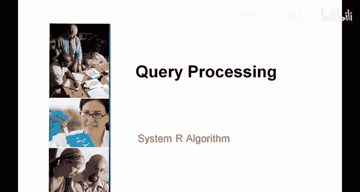
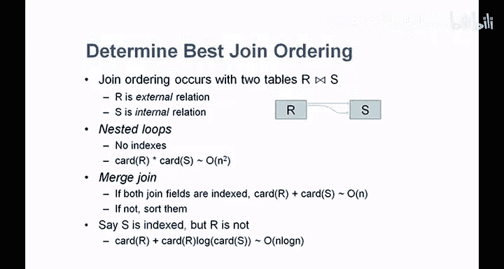
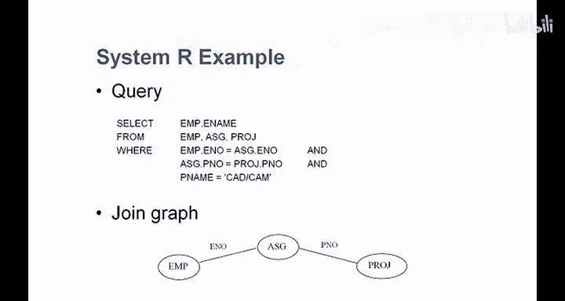
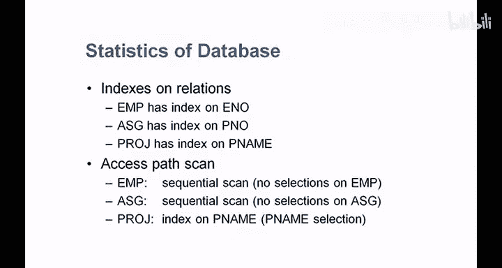
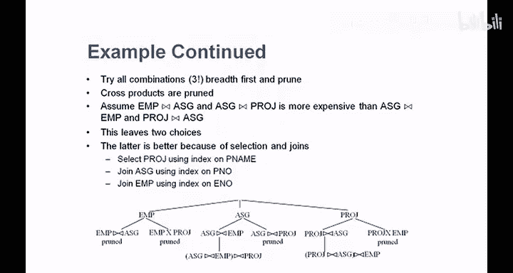

# 约翰霍普金斯大学《大规模数据库系统｜Large-Scale Database Systems》中英字幕 - P27：9_System R算法.zh_en - GPT中英字幕课程资源 - BV1N2urzvEjK

Welcome to Queery Procesing and this unit will discuss the systemR algorithm。

When determining the best join order ordering， we realize that there are a number of different options and depending on the nature of the tables。

 we have these options available to us in calculating or estimating the cost of the join。

 so assume that we have a join with tables R and S。

And because of the placement of R before the bow tie and S after the bow tie。

 we consider that R is the external table and S is the internal relation。 So as we are joining。

 If you look at the diagram， we notice that for every row of R being the external table。

 we start to search for the corresponding rows of S。

Now there are a number of different ways we can approach this if this is a nested loop and we don't have indexes to take advantage of。

 so we would for each row of R， we would read all the rows of S to find the corresponding matches and then for the next row of R we would read all the rows of S。

 this is cross product， very inefficient， the amount of reads would be the cardinality of R times the cardinality of S。

 which is a big O of n squared operation very inefficient。

 we stay away from those if at all possible。In the best case， R and S are both ordered。

 as we discussed before in a previous unit， so we can have pointers to the beginnings of both of the tables。

 and as we start working our way through the table since they're ordered。

 we can just move the pointers down the table sequentially。

 and therefore we only have to read all the rows of R once in all the rows of S once。

 so if we're merge join， which is the best possible join opportunity。

 if we have such such a case where both R and us are merged on the fields that we are sorted on the fields that we'd like to join on so we perform a merge join and that order of magnitude of operation。

 is the cardinality of S， plus the cardinality of R。Which is in order of an operation。If not。

 you may want to sort them， which is an order of and longgan operation。

So the case that we're going to be considering the most often is the case where S has an index on the join column and R does not。

In this case， we read each row of R once， and then for each row of R， we'll look at S's index。

And if you recall， to look at S's index， as has a length， a depth of log n。

 so requires log n reads to move down the index and then another read to find the corresponding row of S。

So the order of magnitude of this operation is Carar for reading the Rovear plus Car R times the log of cards。

Which is basically an O of N log n operation， a very reasonable join operation。

So imagine a query， our favorite query where we are selecting the employee name from three different tables。

 we're joining the three tables and in this case our constraint is on the project name。

 a project name is CADCm， a depiction of the join graph shows that the employee is a joined to the assignment table along the he number。

Attribute and the assignment table is joined to the project table along the P number attribute。

So if we examine the statistics of the database， we'll notice that in our case for making this up or contriving it。

 but in our case， let's say the employee table has an index on the employee number。

And let's say the assignment table has an index on the。On the project number。

 And also project has an index on P name。 And that's one of our join constraints。 I mean。

 that's one of the constraints of the query。 So we noticed that when we access the rows of employee。

 we would normally have to do a sequential stand， unless， of course。

 we're reading along the index values。 and when we read the rows of assignment。

 we basically have to form a sequential scan unless we're looking at the index so in the P number index。

 and there is an index on P name。 So having this in mind。

The system our approach is the following。We， if you look at the example at the bottom。

 you notice that we start building a tree。 Remember， we， we start building the query execution plans。

 The first level of plan， just。Identifies that we have three tables and we start with each one of those tables。

 There's a plan that starts with the employee table。

 there's a plan that starts with the assignment table and there's a plan that starts with the project table。

 we don't have enough information at this point to prune any of those plans So the next step in the query evaluation process is to now expand flesh out each one of those these query plans to the next level。

 Now if we tried all levels and worked our way all the way down。

 there will be three factorial number of plans， but three factorial it may not be so large right now。

 but when the number of tables gets much larger， the number of fragments gets larger becomes n factorial if there are end fragments so we'd like to be able to prune least sets a query plans to find the most the most efficient very quickly so note that we're going to be pruning all cross products。

And that if you look at the third bullet， we're going to assume that the join between employee and assignment and also the join between assignment a project is more expensive than the join between assignment and employee and the join between project and assignment。

 Why is this true， Because the table to the left of the bow tie is the external table and the table to the right of the bow tie is the internal table。

 And remember that we we find efficient joins when the index is on the join column on the internal table。

 So the join between the assignment and the employee table is best done when the employee table as the internal table because there is an index on the employee number。

Similarly， the join between the project and the assignment table is done when the project table is the external table and the assignment table is the internal table because the join is on the project number。

 and there is an index on the project number on the assignment table。

 So as we start moving through our tree at the bottom。

 note that this itself is not a relational join tree。

 It's a representation of the space of relational join trees。

 Each branch represents a different possible relational join tree that we're building out。

So if you look at the leftmost branch。At Me Leho's brand starts with the employee table。

And if we start expanding that one step， we notice that we can join the employee table to the assignment table or we can adjoin the employee table to the project table。

 now note that when we join the employee table to the assignment table， it is natural join。

 but the employee table becomes the external relation and the assignment table becomes the internal relation and the join is on the employee number。

That， given that there is no index on the internal。Table。

 the assignment table where there's no index on the employee number。

 that is prune because it's going to be an n squared operation since there's no index to do the search。

 it's going to be a regular read one row from employee for every row that we read from employee read all the rows from the assignment table。

 not a very efficient operation so we prune that branch early on we're not even going to examine what happens when we start to join that to the project table At this point it looks like it's going to be an expensive operation The next branch from the employee table branch is the employee cross product with project。

There is no direct join between the two。 and part of our heuristics are to eliminate or prune cross products immediately。

 So from the employee branch， we don't have any promising query plans。 So we'll start。

 We'll move over to the next branch， the assignment branch。

And there we're going to expand that branch， one layer down。

And we're going to propose joining the assignment table to the employee table where the employee table is the interrelation。

And we're going to propose joining the assignment table to the project table where the project table is the interrelation。

Looking at the left branch， joining the assignment table to the employee table looks to be a reasonable operation。

 and the reason is because we're joining on the employee number column and the employee table is the inner table and it has an index on the employee number column。

That has the potential of being at En log at operation， a reasonable joint operation。

 So we're going to keep that plan and expand that in the next round of looking of expanding the query execution plan space。

 Let's look at the second option。 The second branch leading from the assignment table。

 That's a join between the assignment table and the project table。

 Now the project table is the inner table。And it does not have an index on project number。

 which is the join column。 It only has an index on the project name。

 It's not very useful in joining the assignment table to the project table So we are going to so there is no easy end log n query plan here。

 It's going to be an endqueered query plan。 So therefore we prune this option as well。

 moving all the way that right， we look at the options for the project table。

 the potential query plans for the project table one query plan is to join the project table with the assignment table where the assignment table is the inner table and the innertable has an index on the join column。

 which is project number that looks like it's going to be a reasonable plan and it'll be an end log n operation。

 so we'll keep that option around。 and then the final option。

 the final branch leading from the project table is cross product as a cross product between the project table and the employee table。

Again， our heuristic says remove cross products， they're going to be at a log as they're going to be an end squared operation。

 So we prune them。 So after the second round， expanding our join our search space。

4 of the six potential query plans。 were left with joining the assignment table to the employee table and joining the project table to the assignment table。

We're going to expand each one of these and each one of these two plans in the next round。

 we're going to flesh that those query plans out， and we're going to take the product。

 the product of the join between the assignment and the employee table and join that to the project table。

Has one plan， and we're going to flesh out the join of the project to the assignment table and take that result and join it to the employee table。

That will be the second plan。 Now， the join。These joins will all be on the assignment number。

 notice that in the first plan， the project table is the inner table and there is no index on project number。

 so it's not going to be a very efficient plan。Whereas the second plan。Second bottom right plan。

 where we take the product of the project and the assignment table。

 and we join that to the employee table。 that will be along the employee number column。

 and there is an index on the employee number column。

 which will mean that this will be an analog log n operation。 So we prune the first。

Of the these query plans。 And we leave the last of the query plans。

 So the last query plan looks to be the most efficient where we first join the project and the assignment table。

 and we take its result and now join that to the employee table。

