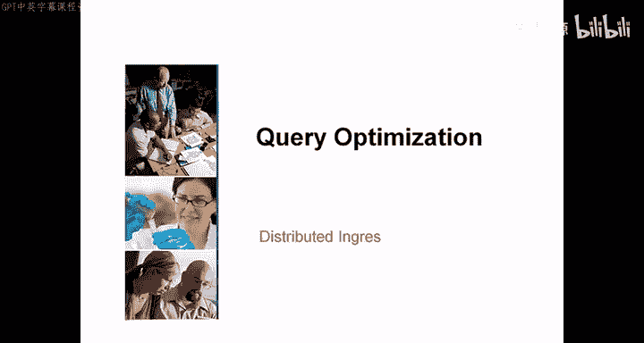
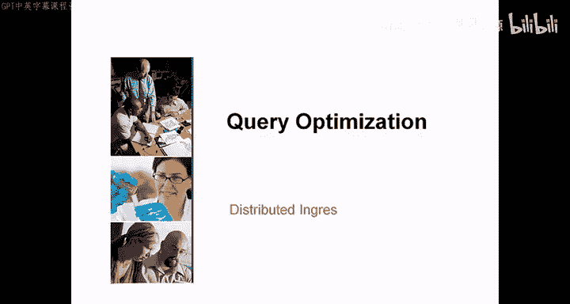
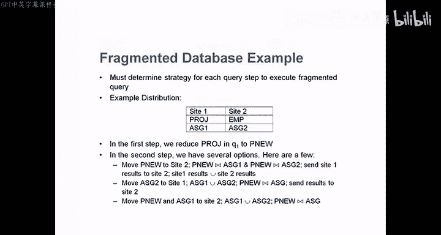
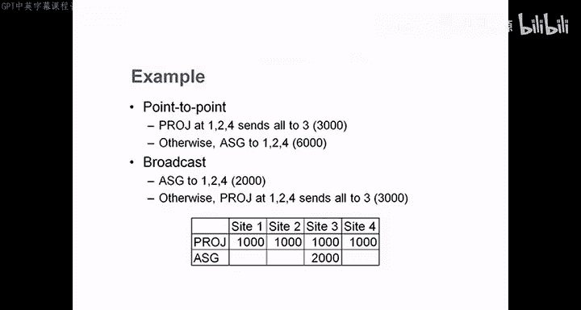

# 约翰霍普金斯大学《大规模数据库系统｜Large-Scale Database Systems》中英字幕 - P28：10_分布式INGRES.zh_en - GPT中英字幕课程资源 - BV1N2urzvEjK

Welcome to Queery optimization。And this unit will discuss distributed ingress。

The book actually goes through a long discussion of the algorithms through English for a distributed angress。

 but I'm just going to present a few slides to actually make it very simple。

 So in a fragmented database， there's a fragmented database example。

 We have to determine the strategy for each query step to execute a fragmented query。

So here's an example distribution。We have two sites on site one， we have the project table。

 and we also have one fragment of the assignment table and on site2。

 we have the employee table and the second fragment of the assignment table。

So if you remember when we do detachment。In substitution， the first step。

 we're going to reduce the project table to the detached query Q1。

 And we're going to take its result and send that to a new table， a temporary table called Pnew。

In the second step， we have several options。Especially in a distributed database。

 this actually illustrates that there are lots of different options and is way more complicated than a regular centralized database。

So here are some of the options for the next step。 And I've listed three。

 and I bet you can think of a whole much more。 But the first option is to move Piu to sight 2。

So we have a copy of Pnu on site 1 and Pnu on site 2。And then the next step is join。

Pu with assignment 1 on site 1， en join Pu with the assignment 2 fragment on site 2。

And take the results of the drawing from the first sight and send that to second site。

And union those results with the results of the query between Pu and the assignment2 table。

Or the assignment 2 fragment on the second site。 That's one option。

Option number two is we can move the assignment to table。Off back to Psych 1。

And we can union the assignment 1 and the assignment two fragments。

And then join pinu with the Union assign table and then solve the results to site 2。

 A third option is we can move Pu and assignment 1 over to site 2， union。

 the assignment 1 and assignment two fragments。And then join Pinew and the Union of Frraments。

 which is just the assignment table。So if you notice in each of done of these options。

 it requires moving various fragments and tables from one site to another。

 since communication time and a distributed database system is a very significant cost。

 we'd like to minimize that to the extent possible。 so in general。

 if you look at the table at the bottom。

Let's assume that we have four sites。And we have two tables and the project table has fragments distributed across all four sites。

And the assignment table has just one table at S 3， this doesn't relate to the previous slide。

Except for the fact that I'll speak about the evaluating joint cost by evaluating the cost of sending various fragments from site to site。

But in this example， we have four sites。 The project table is fragmented across four sites。

 and the assignment table exists on one site。 So if you recall early on one of our early modules。

 we talk about different network architectures， Arch number one is a point to point a architecture。

 where each site is connected by an individual。Wire individual communication path to the other site。

 Whereas in our broadcast type of network， they're all connected to each other。 And we don't。

 we only have to worry about sending the data out all at was。

 So getting back to the point to point example。 So we have for every time we send。

Some data from one site to another or to multiple sites。

 we have to send them individually to each other multiple sites。 So we have a choice。

 Are we going to send the project fragments to the site where the assignment table is。

 or are we going to send the assignment table to each of the individual sites where the project fragments exist。

 So in a point to point architecture， the cost of sending all the fragments that are not at site 3 where the assignment table is。

 That means the fragments of the project table is site 1 site 2 and site 4。

 to site 3 cost on the order of 3000 times times the cost of sending and an individual tuple So there are 3000 rows to send that cost will be approximately 3000 times the cost of sending a tuple。

Otherwise， we would have to send the assignment table to each one of the other sites。

As since this is a point to point architecture， we have to send 2000。Rose to each site individually。

 and the cost will be 2000 times3 because we have to send them in individually。

 The network architecture is a point to point architecture。 Okay。

 so in this case in a point to point architecture。 Our strategy appears to be to send the project fragments site 3 where the assignment table is located to perform the join there。

 However， let's say we have a broadcast architecture。 So we have a choice again。

 do we send the assignment table to each of the different sites。

 where do we send the project table to all the project fragments to site 3 where the assignment table is residing。

 So in this case， we have a broadcast architecture。

 and we don't incur in a new cost for every time we send those tuples to a different site。 really。

 we're just sending out 2000 tuples And there they'll find their way to each one of the sites that will eventually host them。

 So the cost of that that transmission will just be 2000。

Whereas if we send all the project fragments to site 3。That'll be a cost of 3000。

 so in a broadcast architecture， the cost that the strategy will be to send the assignment table to each one of the other sites where the project fragments reside。

 but in a point to point architecture the strategy will be to send the project fragments to the site where the assignment table resides。

 so the network architecture is very integral in determining the best strategy for moving tables and fragments around from site to site。

 which is again contributes to the cost of the final cost or the cost estimate of the query。

