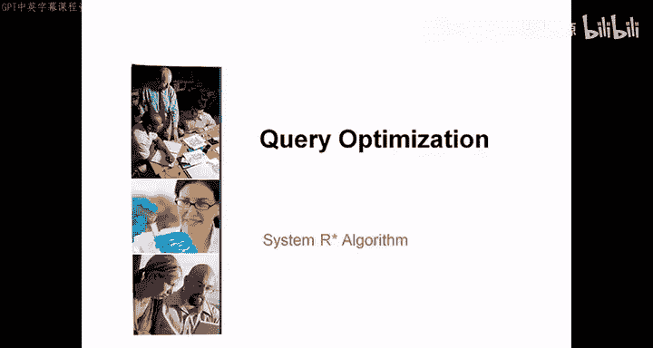
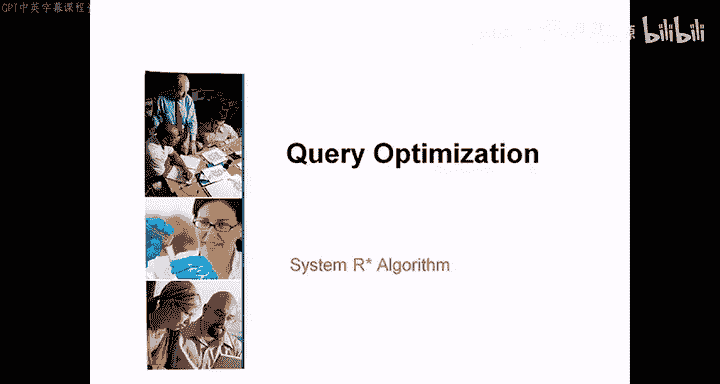
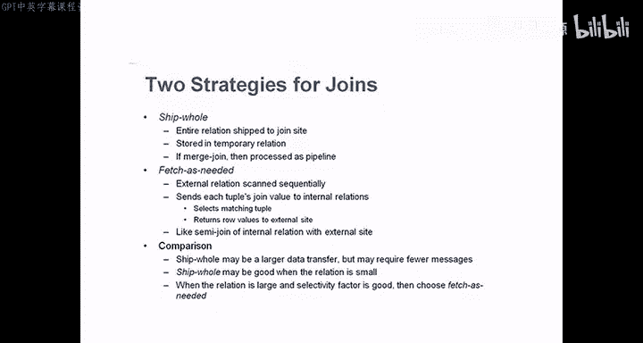
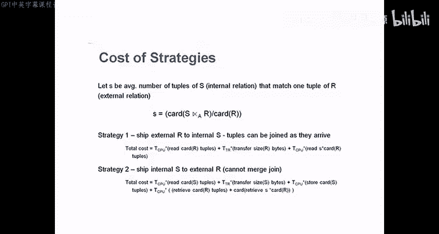
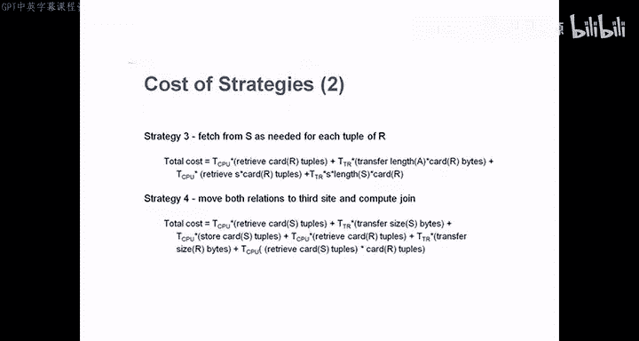

# 约翰霍普金斯大学《大规模数据库系统｜Large-Scale Database Systems》中英字幕 - P29：11_System R算法.zh_en - GPT中英字幕课程资源 - BV1N2urzvEjK

Welcome to Que optimization。And this unit will discuss the system R star algorithm。

This is distributed System R。There are two strategies for joins。

These are the strategies used for presenting rows of tables from one site to another in order to execute the joins。

The first strategy is shipping an entire table from one site to another。

 And the second strategy is fetch a row as needed and ship that row。 So in shiphole。

Ship an entire table。 The entire relationship relation is shipped to a join site and stored in temporary relation。

 Now， if， if they're both sorted， both tables are sorted， you can actually execute a merge join。

And as the rows come in， you can process it as a pipeline。

 as the row from the ship to table comes in， you can now find the corresponding row in the table that's residentant on the system that you're shipping it to。

 and you can process the mortgage showing as a pipeline， a very efficient algorithm。

In fetches needed， the external relation is scanned sequentially。

It sends each tuple's join value to the internal relation。

 and it selects matching tuples and returns the row values back to the external site。

 So one row at a time is matched。Is sent off to the other site。

 the other site performs the join at the other site。

 just on that row sends the result back to the initial table。

The comparison is shiphole may be a larger transfer of data， but may require fewer messages。

 You only have to ship the table once， whereas fetch is needed enough to ship a lot of rows。

Sphole may be good when the relation is small， but when the relation is large and the selectivity factor is good。

 then perhaps we could choose fetch as needed again statistics will help us determine which is the better strategy how do we calculate statistics I only have to apply a cost model to these strategies and use the the cost model。

Now， the lowest cost of the strategy or the strategy which is the lowest cost。

 so we're going to define a number s， which is the cardinality of taking a row of R。

 shipping it to S you see the semijoin notation there， we should take a row of S sending it to R。

And determine how many rows are going to be selected there。

 divided by the number of rows in R that becomes a selectivity factor。

 that is going to be a useful constant for calculating the least cost strategy。

 So strategy number one is where we ship the external table to an internal table to the site where the internal S is ship external R to internal S。

And that tuples can be joined as they arrive， so the total cost of this strategy is reading the rows of of R and multiplying that by the time to do a CPU read。

 which is T subcP。And then transferring this entire table。

 table R off to the site where table S is located， and that's basically transferring the size of R。

To S。And then reading each row of R that's applicable to be joined to S。

 and that becomes read of S times Car of R。 Well， if we see the definition of S above。

Car ofar is in the denominator of S。 And now we're multiplying that by Car ofar in the number of rowsn R。

 So really， we're just reading card of just those rows that are appropriate for for joining to us。

 And that becomes a smaller number than Carar。 So the total cost of that。

That strategy is reading the rows of Rs， sending it off to the site S。

 and then reading the appropriate rows of site S。That's strategy， number one。

Strategy number two is ship the internal table back to the external table。

 in this case we cannot to un merge join。In this case， we read the entire table of S。

 so TCPU times read of card S doubleples， we transfer all of S。We store S on the other site。

We're not doing a merge join right now。 We have to store it。

 and then we have to retrieve Car our tuples from our。

And multiply that times the selectivity on S times R。

And that gives us the number of TC the CPU reads we have to make。

This is very similar to the calculations we've done in the past。 These are two strategies。

 And depending on the statistics， the size of the tables and and the indices on the tables In this case。

 I'm not talking about indices， but S implies that there is an indiceice。

 The small S implies there end an index and there is a faster read into table S。

 given those statistics。It heals a total cost estimate for each one of these strategies。Now。

 this is shipping entire tables from one site to another。

 But remember if that system Mar you also uses the fetch as needed strategy。

 So the cost of fetch as needed is the following。 If we fetch from table S as needed for each couple of R。

So the total cost is reading each row of R， which is retrieving the card R tuples and multiplying that by the cost of a CPU read。

Plus， transferring those tuples that we need and those columns that we need。

 so we transfer the column we made， which is length of a。Times card our bys。

 those are the rows that we're reading。 And then we've got to retrieve those rows of S that correspond to the rows of R that we sent。

 Shall we have to。We have to multiply that by the cost of a CP read。

 and then finally we have to transfer the number of rows back。

 which is a selectivity factor times the length of S times the number of rows in R Car R。

 and that becomes the cost of the third strategy。In the fourth strategy。

 we move both relations to a third site and compute the join。

So the total cost of strategy 4 is retrieving all the rows of S。And storing it on a third site。

 and then reading all the rows of R， transferring it to a third site and storing it on a third site。

 But as restoring it， tree the corresponding rows of S and multiply those by the number of rows of R。

 And that will give us the cost of the join。So when System R star performs a join。

 it looks at each one of these four strategies， determines which is the least cost strategy and selects that to become the strategy for the joints in System R star。

