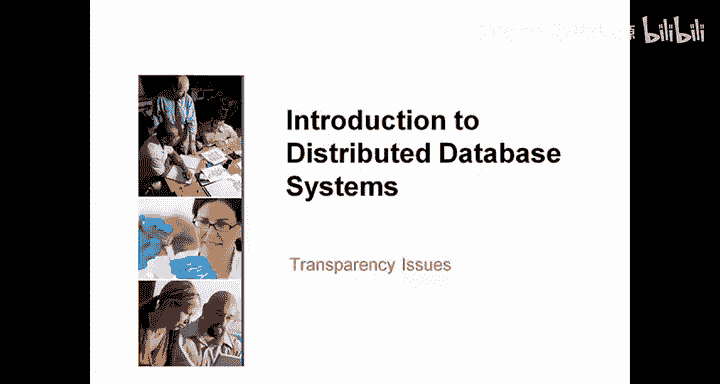
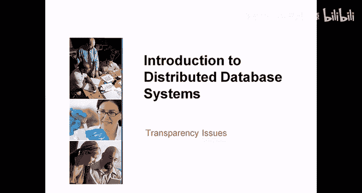
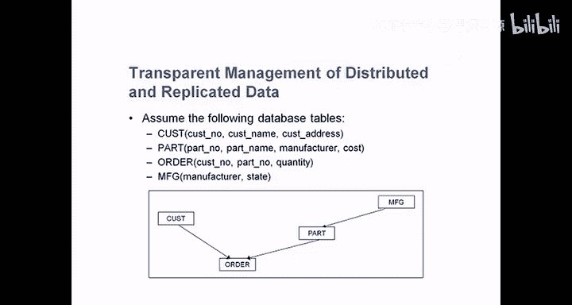
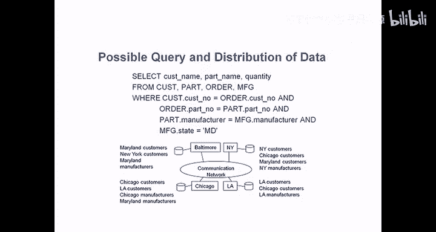
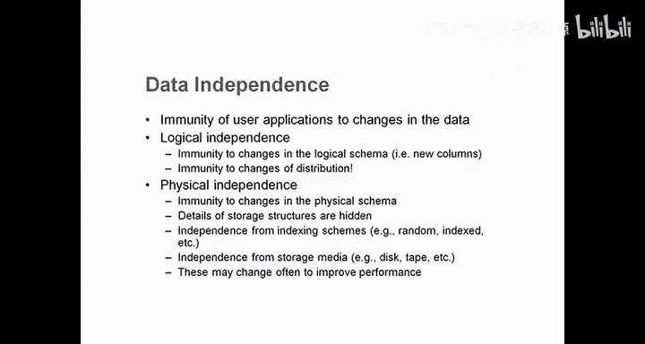
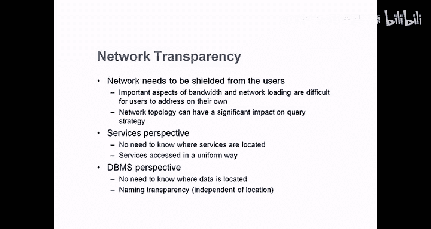
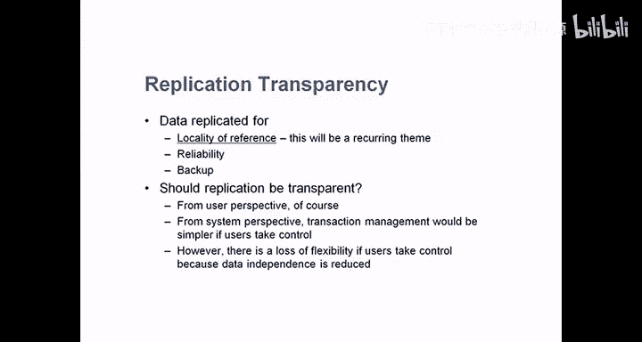
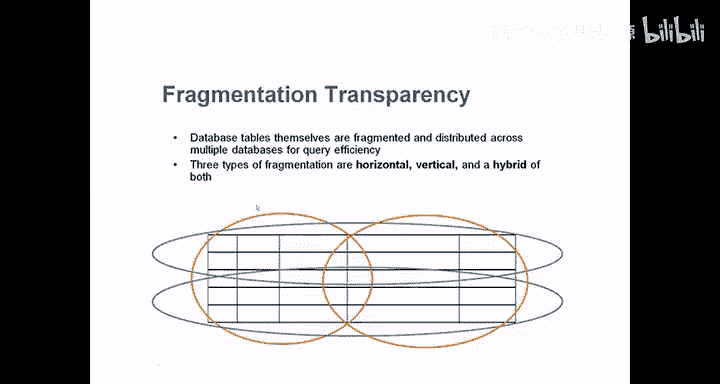

# 约翰霍普金斯大学《大规模数据库系统｜Large-Scale Database Systems》中英字幕 - P2：1_透明性问题.zh_en - GPT中英字幕课程资源 - BV1N2urzvEjK

Welcome to the second unit of the first module in the introduction to distributed database systems module In this unit I'll discuss transparency issues there are several aspects of distributed database systems that are important to discuss in light of their transparency that they provide to users of distributed database systems the first issue and transparency is the transparent management of distributed and replicated data so assume a database definition and I'll use this database definition throughout the course they consists of four tables。

 the customer table which consists of a customer number， customer name and customer address。

 a part table which consists of the part number， the part name， the manufacturer and the cost。

 the order table which is the customer number， part number and quantity and the manufacturer table which consists of the manufacturer and state you notice in the diagram。

 the customer is related to the order table and a one to many relationship between customer and order one customer can have many orders you also notice that one manufacturer can manufacture many part and a single part。

can be part of many order， in fact， the combination of customer and part actually forms a unique part entry and part unique order entry in the order table So there are possible ways to distribute the information。

 the tables across the distributed database system we discuss this in the last unit in this case we have again for different nodes the Baltimore Note New York Note Chicago node and LA node and parts of tables are distributed geographically across different processors across the country that represent information in this database in this case I only show customers and manufacturers being distributed across these tables across these locations but in reality I think the order and the parts tables will be distributed as well execute query across distributed database system the distributed database system provides a level of transparency to the users so the user doesn't have to understand where all these parts reside。

So a user can execute a single query that asks for the customer name， for example。

 part name and quantity from four different tables and provide joins across those tables and provide a constraint onman state so in this case I'm looking for customer names part names and quantities created manufacturerd by manufacturers in Maryland。

 it would be very difficult for a customer or user to actually write a query like this if they had to understand and know where all the different parts of the database were located and have to understand how to pull them all together to satisfy a query so distributed database system provides the trans so that a user formulating a query doesn't have to understand where all the different parts of the database are located geographically they also don't have to worry about the replication of the data across the large distributed database systems and so that's an important aspect。

Transparency that a distributed database system provides another part of the transparency that it provides is data independence so user applications don't have to understand changes in the data for example logical independence means that if there's a change to the logical schema for example their are new columns or if there's a change in the distribution the user doesn't have to be aware of it user will formulate their query and the distributed database system will automatically redirect portions of the query new portions or changed portions of the database and the underlying distributed database system without the user have to having to know anything about the changes in the database system also it provides transparency to physical parts of the database physical parts of the schema change or the details of the storage structures or change then the user doesn't have to know anything about it all those changes are managed by the distributed database system In addition。

 indexing schemes such as random scheme。Index schemes etc are also independent users don't have to understand what the schemes are。

 they just have to understand that there are indexes available and the distributed database management system will handle it Furthermore they don't have to understand the storage media and they don't have to understand what will take to improve the query performance that distributed database management system will understand the underlying topology。

 the underlying locations of the different tables， the underlying structures of the different tables and know how based on the distribution of the data know how to formulate optimal queries another aspect is network transparency if a user were to tables by themselves without a distributed database system to to manage the access to the tables the users would have to understand about the network configuration some important aspects of optimal query formulation execution of distributed database systems requires knowledge of which aspect which parts of the network。

are heavily loaded which aspect which parts of the network are not heavily loaded and direct queries and direct communication across the non-heavi loaded aspects of the network that's very difficult to ask a user to manage distributed database management system can have a knowledge about the network loading and use that information to formulate optimal queries to distributed databases located across the distributed database topology users don't have to know where services are located services are accessed in a uniform way and they don't need to know where the data is located。

 they don't need to know specific names for the data as they are stored on individual database systems。

 they only have to use the names of the data that the general distributed database system is aware of there's replication transparency so data replication for locality of reference and this is going to be an recurring theme throughout the course cany of reference based on the fact that users who are located geographically at one location。

Will want their data to be close to them， even though even though sites have need for that data。

 locality of reference enables the distributed database system place the data closest to the users who will need them and there are distributed users meaning geographically distributed users the system will replicate the information and the data so that the users will have fast access to that data the data is also replicated for reliability and backup reasons talk about that later in the semester so should the replication be transparent of course from a user perspective。

 nobody wants to manage that kind of that kind of knowledge of the deep knowledge of the database topology on the system perspective transaction management would be simpler if the user take control answer is that transaction management would be almost impossible if it wasn't managed by a single distributed database management system and we'll talk about that great detail later on in the course there's also fragmentation transparency in order to get。

gain locality of reference benefits it's often wise to fragment tables and move those fragments to different parts of the database system so as you see these orange circles represent vertical fragmentation。

 present horizontal fragmentation and there are benefits to horizontally fragmenting data and vertically fragmenting data and we'll talk about that in great detail later on。

 but ultimately the point is to provide the greatest locality reference for users who query the database。

