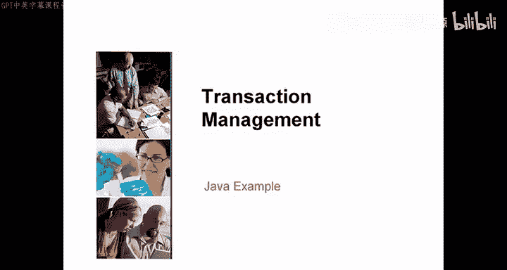
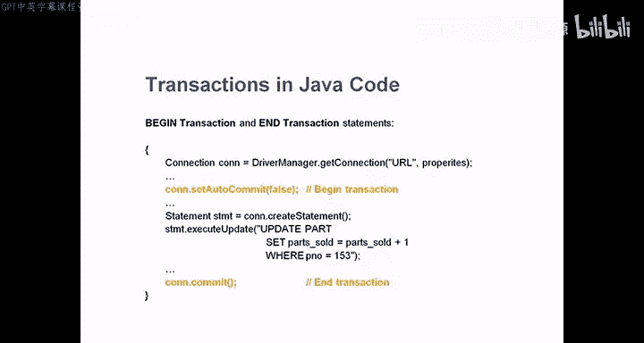
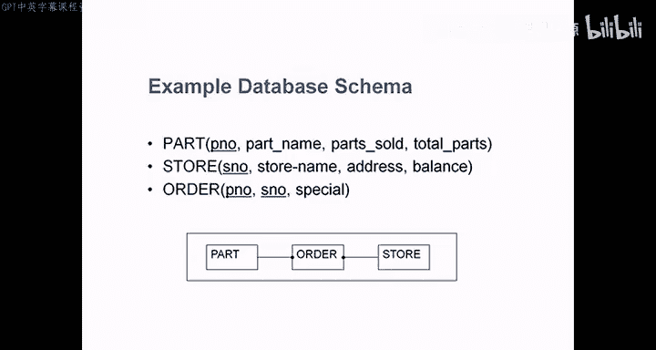
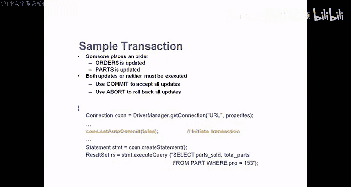
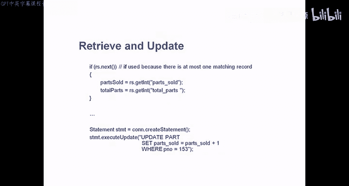
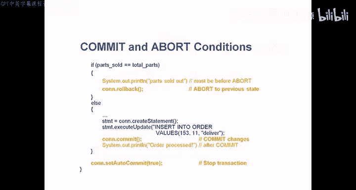

# 约翰霍普金斯大学《大规模数据库系统｜Large-Scale Database Systems》中英字幕 - P30：0_Java示例.zh_en - GPT中英字幕课程资源 - BV1N2urzvEjK

Ex management and this unit will provide a Java example。

Before I get too deep into transaction management and discuss the many different ways transaction management is done and database systems。

Let me highlight how Java actually handles transaction management。

 So remember transaction management means you'd like to bundle a bunch of operations together and you like them either to all work。

 not work at the same time， but you don't want some working and others not to work。

So in order to do that。Java， by default， will。Commit each operation automatically。

 So any time you execute an update， you execute an insert or delete。

 it automatically gets committed to the database， but if you'd like two or more operations to work together either they will all commit or all not commit together you have to create a transaction and by doing in Java the way you do that is first of all。

 you get a connection by calling the driver manager connection， you pass it a parameter URL。

 which tells you where the database is or tells a driver manager where the database is。

 and ultimately it returns a handle to that database called connection。 If you like to。

Start executing transaction management。 You want to set auto commitmit false。

 which says all the operations after this point are now bundle together until I either commit it or roll it back。

 So here I might have a number of updates。 I illustrate one update as an update on parts。

 And what it allows me to do is bundle them together until at the very end when I decide to commit that bundle of operations。

 I will call connection commit and that ends this particular transaction。

 to illustrate this in more detail。 So we have three tables。 we have the part table。

 the store table and the order table。 If you look at the diagram at the bottom of the slide。

 you notice that there's a part table which represents all the parts in your system。

 there's a store table which represents all the st。

 and the order table represents many to many mapping between the parts in the stores。

 So parts there's a limited amount of parts and supply and you like any time somebody makes a purchase you'd like to be able to。

To decrement the number of parts and your inventory are actually increased the number of parts sold when the parts sold equals total parts。

 you have no more parts to sell。 You'd like to be able to make purchases of different parts。

 but only purchases on the number of parts you actually have。 So in a sample transactions。

 somebody will place an order and the orders table is updated and the parts table is updated。

 So from a store， somebody make place an order， which implies there's a new relationship between store and order that's created。

 and you'd like to update the number of parts， because somebody bought a part you'd like to be able to increment the number of parts sold。

 but you don't want to buy too many parts because you only have so many in stock。

 So the way it handle in Java is you call driver manager to get your connection。

 And now you have a handle on the database， you'll set autocommit to be false which tells you the next few operations together will form a transaction。

 and either will all work or all that work。 in J2BC。

 you now connection create statement to create a statement。

Which will eventually execute a query。 So you want to be able to select the number of parts。

Sold and total parts from the part table where part number is 153。

 So now we get a handle on the parts record。 That's the part we want to purchase。

 In the next statement， we want to build retrieve and start updating the parts table。Normally。

 I would have a where clause to iterate all over all a row。 But since I chose one specific part。

 part number equals 53。 And if statement is sufficient here。 So R S S dot next gets me the next row。

 And then I can retrieve the value of the parts sold column of that row。

 And I can retrieve the value of the total parts。

Value of that row。 The next statement。 I'll actually update the parts sold。

 So now I have that value part sold and want to add one to it to say now I'm been selling another part。

 This is the first operation in really a set of operations that I want， I want to create。 Number one。

 I want to update the parts sold。 And number two， write the order record that connects the or store to two parts。

 So there are two updates I have to make to the database。 And this is the first。

If the second doesn't work， I want this one to go away。

I don't want the effects to last in the database。 So observe in the next slide。

 What I'll say if the parts sold equals total parts， meaning I've sold out of parts right now。

What I want to say is parts sold out， and I want to roll back my operation。

 I want to roll back my transaction。Note that I print the statement parts sold out before I actually do the abort or do the rollback。

Because if something， if the roll backward were to crash。

 I would never get feedback that the parts are sold out。 So I print the statement parts are sold out。

 and I roll back the connections of the database is as it was before I ever started this operation。

 This whole piece of software。 Otherwise， if parts sold is not equal to total parts that I want to continue。

 and I want to insert or insert a new row into the order table。 while。

 the value is 153 that points the part number and 11， which points to the store number。

 So I' have created a new relationship between store and parts in the order table that says that one part was sold。

 And now I'm identifying that relationship between the store and the part table by creating a new order record。

 after that's done， I'm going to commit the update in this case， the insert。

 as well as the previous update which incremented the number of part soul。

 And then after only after the commit， am I going to print out orders processed。

 If I print that out before the commit。 it's possible there could be a crash during the crimp commit。

And I would think that the order is process。 But really， it's not。

 Any message about a commit has to occur after the commit contrasts that to a rollback。

 Any message about a rollback has to occur before the rollback。 What I'm done。

 either when Either I went before， either after Ive roll back or committed this transaction。

 I'll set auto commitm back to be true。 which means I now new updates to this database will be will be committed for each operation that that is executed。

