# 约翰霍普金斯大学《大规模数据库系统｜Large-Scale Database Systems》中英字幕 - P31：1_事务的形式化定义.zh_en - GPT中英字幕课程资源 - BV1N2urzvEjK

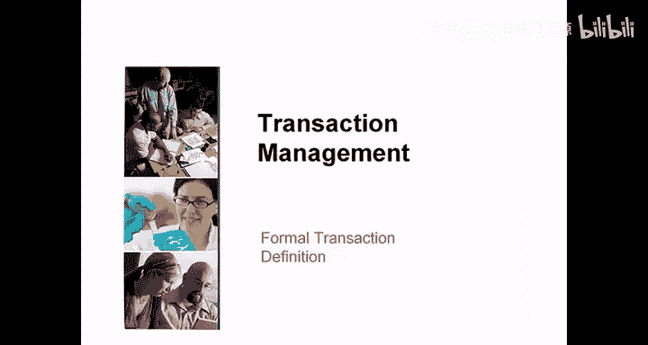

Welcome to Transaction Management。And this unit will cover a formal transaction definition。

 So bear with me， there's some oddnotation here， but I want to describe what this notation is because we're going to be using it throughout to the discussion of transaction management。

 So first of all， we define a transaction T sub I， which is some transaction。

 or could be there are three transaction， there be T1， T sub 2， T sub 3。

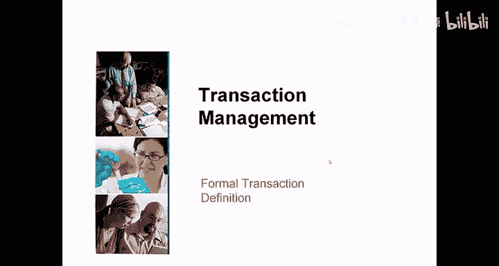

As the partial ordering of all of its operations and its terminations。

And we're only interested in certain operations。 remember in any transaction。

 there are lots of operations that are going on in the software。

 The only operations that we really care about are reads and writes。

So when I speak about all of its operations， all I really mean is the reads and writes。

 this transaction and the terminations， the terminations are either commits or their aborts。 Okay。

 so what is a partial ordering， P ordering is defined by the term sigma， the sigma or the operations。

In this partial ordering and this funny curvy less than sign really means that you have some kind of ordering。

 Les than implies that you've got an ordering。 Curvy less than sign means that theres a partial ordering。

 So take of an intuition about partial ordering partial ordering。

 you might have defined partial ordering about putting on your socks and shoes。

 So you can put on your right sock first， and then your left sock and your right shoe and your left shoe or you can put on your right sock。

 right shoe， left sock， left shoe。 You can put on your left sock， left shoe。 I'm sorry left sock。

 left shoe， and then right sock， right shoe。 You have lots of different orderings that you can put on your socks and shoes。

However。There's not always strict ordering between the order that your socks go on。

 you can put on your right sock first or your left sock first。

You can put on your right shoe first or your left shoe doesn't really matter。 One， I mean。

 putting on your shoes first， meaning that with respect to each other。

 you can put one on before the other。 But there is some kind of ordering between your right sock and your right shoe。

 The right sock has to go on before your right shoe。

 and your left sock has to go on before your left shoe。

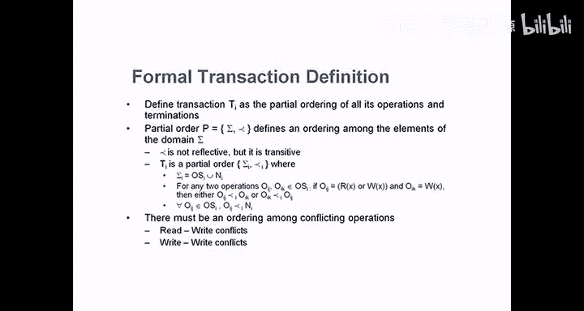

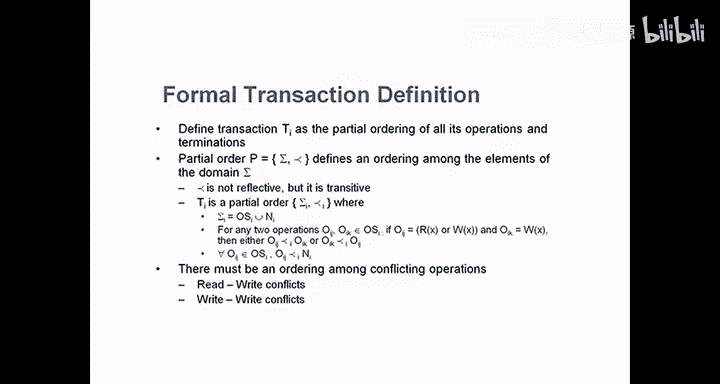

It doesn't need to go out immediately before your left shoe。

 but it needs to go on at some point before your left shoe。

So the partial orderiteing defines all the orders that need to be preserved。

 while leaves open all those that don't necessarily need to be preserved。

So the partial orderiteing of putting on socks and shoes is that your left sock has to occur before your。

 putting on your left sock has to occur before putting on your left shoe and putting on your right sock has to occur before putting on your right shoe。

But no other ordering is implied。 There's a partial ordering， not a strict order。 Okay。

 so this funny less than sign。 this partial ordering sign is not reflective， but it is transitive。

 so。A before B does not mean B before A。But a before B and B before C certainly means a is before C。

So transaction subs a partial ordering of the sigma sub by those of the operations。

Either reads or writes or both。Plus， the the termination conditions which are represented by he。

 So Sigma is the union of all the operations。Of the schedule said I。

And the union of its termination conditions。 and note for any two operations that were considering。

In I sub J and I sub K， so within this transaction sub I， there are two different operations J and K。

Oabai J has to be a reader a right， and Oabai K has to be a right。Remember。

 there are no conflicts between reads and reads， there only conflicts between reads and writes。

And rights and rights。And then for all the operations。

 there is some kind of partial ordering such that the operations have to occur before its termination condition。

 So again， there has to be an ordering among conflict conflicting operations as to be some ordering of reads and writes of the same data value and writes and write of some data value。

 So here's an easy example。 Have a simple transaction where we read X。

 We add x and Y together to produce X。 We want to write the new value of X out to memory and commit it。

 So we represent this in a directed acycllic graph called a dag。

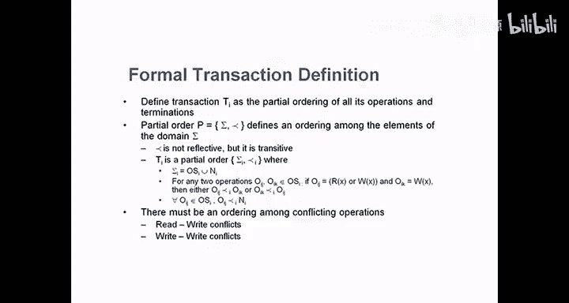

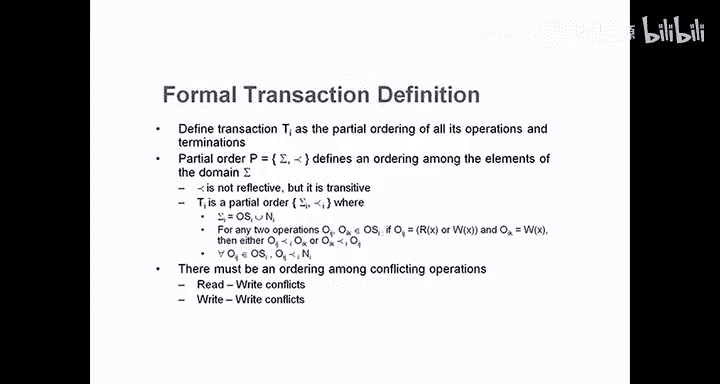

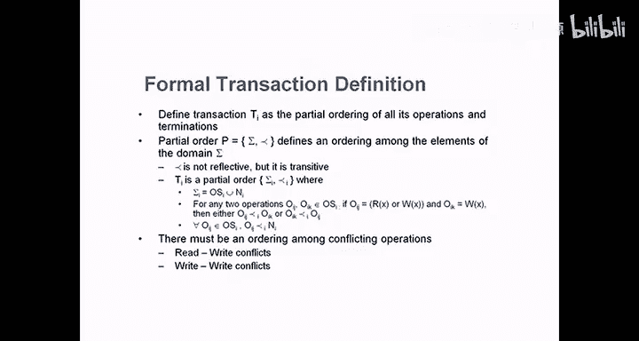

Which is representation of the operations we care about。

 Note the only operations we care about are 12，4 and 5 because their reads， writes or commits。

 but we don't care about the addition。 We just care about the reads and writes and commits。

 So you can represent this in a very simple partial ordering where you can read X。

 and you can read Y。Mely don't you don't care which order the reads are done in。

Just as long as they're red。Both of them have to be read before the right。 You cannot read one。

Before the right and read the other one after the right， it won't make any sense。

 There is a strict ordering。That is imposed upon the reeds。On the right。

 but there is a partial ordering with the reads respect to each other。 And finally。

 there's a strict ordering between the right and the commit。

 So this is a partial ordering graph represented in a directed acyclic graph。

 So to look at this partial。

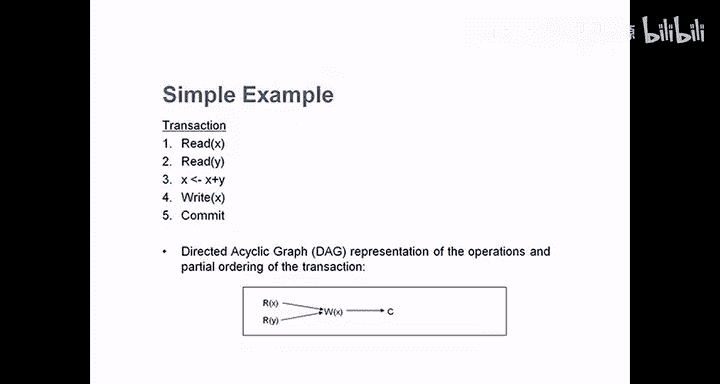

Ordering notation， operation im partial nor ordering notation a little bit more detail。

 so in that previous simple example we gave， so if you look at the sigmas， the sigmas。

 the operations are read of x。Read of Y， write of X。And commit， if you look at the partial orderings。

 you'll notice that there's a partial ordering between the read of x and the right of x。

 between the right of x and the commit。Between the read of x and the commit and between the read of y and commit。

 But since we understand the partial ordering rules。

 we can actually represent this in a much simpler ordering notation。

 So if you notice the third line of this slide where we listed out all the partial orderings。

 certainly you can derive the read of X has to occur before the commit。

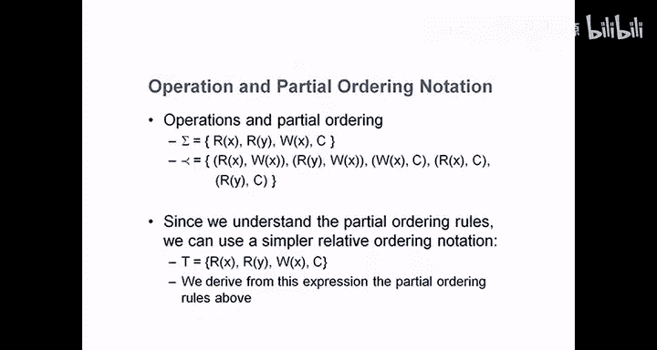

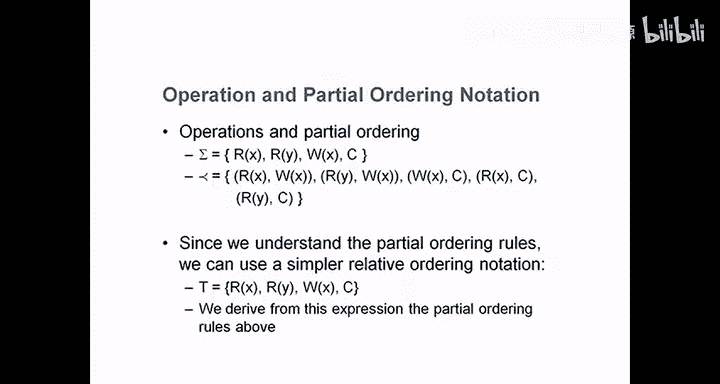

From two other partial orderings that we already specified， namely。

 the read of x has to occur before the right of x， and the right of x has to occur before the commit。

 Similarly， you could also infer that the right of y occurs before the commit by looking at the partial orderings of read of y comes before the right of x。

 right of x becomes before the commit。So knowing this information。

 you can actually represent a transaction in much simpler terminology。

 You can represent this transaction and the following way can say the read of x and the read of y in some ordering occur before the right of x。

Which occur before the commit。 If we look at the second to last line。 Now。

 because we know that the reads are not conflicting with each other， they can occur in any order。

 but those reads aren' conflicting with W with the right and they are conflicting with the with the commit and the right conflicts with the commit as well。

 So there has to be a strict ordering between the right and the commit。

 And there's a strict ordering between the reads and the right。 However。

 there is not necessarily a strict ordering of the reads。 So in this notation。Given our knowledge of。

Conflicts。We can actually create an identical transaction that leaves an identical effect on the database by swapping the order of the reads。

Which doesn't change the transaction meaning at all， it's just a different type of transaction。

 but it'll leave the same effect on the database。

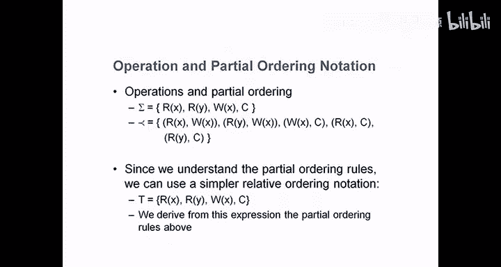