# 约翰霍普金斯大学《大规模数据库系统｜Large-Scale Database Systems》中英字幕 - P32：2_ACID属性.zh_en - GPT中英字幕课程资源 - BV1N2urzvEjK

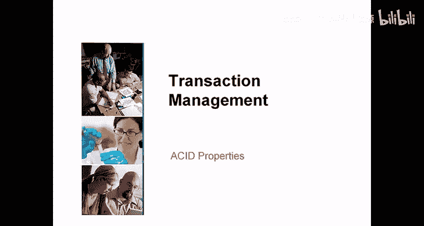

Welcome to Transaction Management and this unit I'll discuss the asset properties of transaction management。

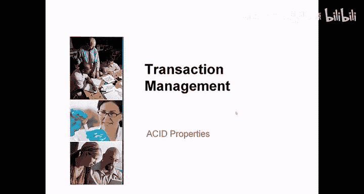

AI actually stands for fours， atity， consistency， isolation and durability。

 I'll describe each of those features of a transaction database management system and describe what they mean and how they apply to transaction management。

Number one， atimity。Is the property that a transaction is a unit of operations。

 It museumine of operation。 All transactions， all operations in a transaction。

 either complete or do not complete。 It's an all or nothing property。

 If I bundle a bunch of operations together， it will complete。 All is one or not complete at all。

 There is no half way completion of operations。Because when somebody defines a set of operations as a transaction。

 they intend for those to work together， and I'll show you an example of that coming up shortly。

 if a failure occurs， the database management system must either undo parts of the transaction or complete them at a later time。

So if I'm updating salary。Or if I'm updating a bank account。

 or and I have a bunch of operations that need to be executed at one time。

 I either have to do all of them at once。If it fails in between， I have to undo parts of them。

 the parts that I changed， or put it on hold till the database comes up and running and complete the rest at some later time。

So basically a bundle of operations known as in transaction has to happen all at one time。

Or or if it doesn't， there is a failure， they will all fail at the same time。

 There are two types of failures。 There is logical errors such as data errors or deadlocks or consistency problems。

 normally the transaction aorts itself or the database management system aborts itself。

 There system crashes where their media errors system crashes， network problems。 In least。

 in this case， we need crash recovery will'll talk about that in one of the upcoming units。

 that in all cases， no matter if somebody pulls the plug。

 the disc crashes if there's a divide by zero error。 in the middle of a transaction。

 we have to ensure that all that has been done up till now。

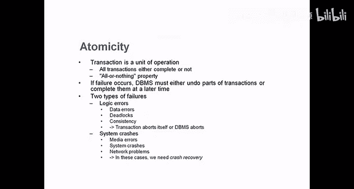

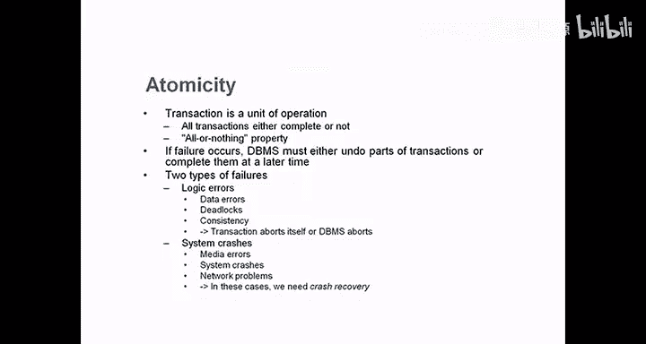

Is removed from the database。Or complete the rest of the operations at some later time。

 The second property is called consistency and consistency really means correctness。

 So a transaction， a set of operations has to map one consistent database to another consistent database state。

 So remember we had consistency checks in that we've defined before。

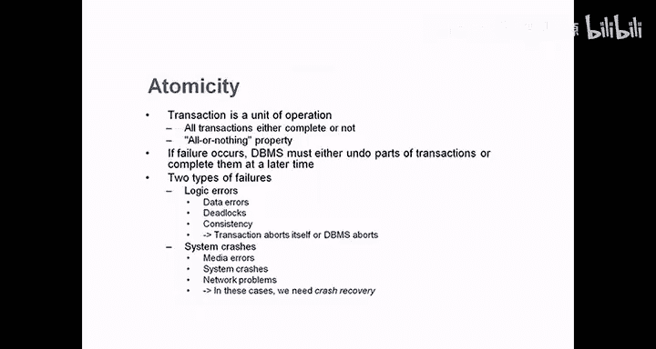

Somebody makes a change through an operation and the database becomes inconsistent。

At the end of that operation or the end of the transaction。

 we have to roll it all back and say the database is not left in a consistent state。 Therefore。

 none of these operations can go through。 Now， it's quite possible there are inconsistencies during the transaction。

 but at the beginning of a transaction and at the end of the transaction。

 the database has to be in some consistent state。 for example。

If we insist that all projects have at least one person on the project。

 we might remove a person temporarily and add another person to that project。

 So in between the project， the database is not consistent， but at the beginning。

 there was a person on that project。 and at the end， there is a person on the project。 So therefore。

 according to that constraint that there must be a person on a project。

 we know that the database is consistent both before and after the transaction。

 Third property is isolation， and this is probably one of the most complex to understand。

 and this forms a significant amount of the discussion for concurrency control that's coming up。

 Each transaction must see a consistent database at all time。 Every user of the database。

 they know that there are other users working on the database at the same time。

 but when they operate on that database。 they want to see consistent。

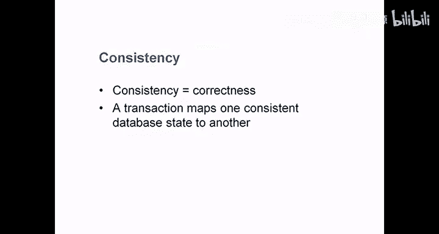

Transactions， a consistent copy of the database at all times in their transaction。

 they don't want to see the effects of other users while they're executing their transaction。

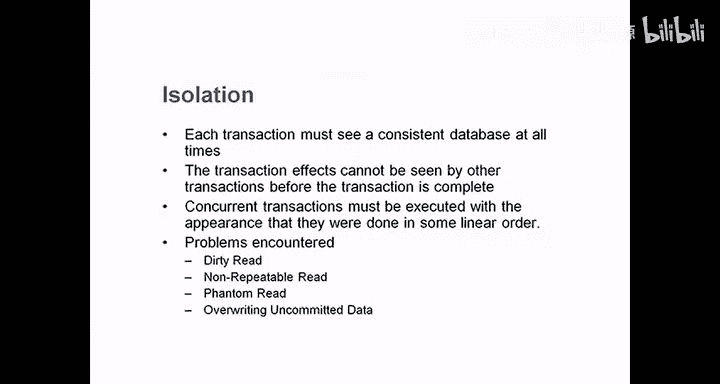

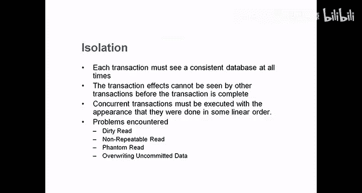

Now， in reality， the database needs to operate efficiently by letting lots of people operate on the data all at the same time。

But。There have to be limits and we'll discuss those limits because people don't want to see part of their operations write some data just to be cloered another transaction operation。

 So therefore people need to see consistency and need to see that theyre the only ones affecting the data that they need to affect the database during their transaction。

 So the database needs to execute concurrent transactions。

 if the parents that these transactions are executing in some linear order。

 So the problems that are encountered can be illustrated by the dirty we read problem。

 but not repeatable read problem。 The phantom read problem。 and overr uncommit data problem。

 Here's an example of the dirty read problem， sometimes it's referred to as the lost update problem。

 In this case， imagine we have two transactions。 T1 transfers 100 from one of its accounts to another account very innocuous operation。

 T2 adds 6% to each account。 So imagine if the database schedule or scheduled these transactions。

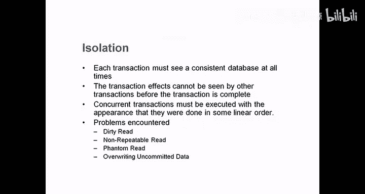

The following way， transaction1 read some value from one account subtracted $100 from it back wrote the value in that account。

 So I removed $100 from my checking account， let's say in the meantime。

 the bank has an operation giving interest to each account in the background。

 and now it picks up and the scheduler schedules the following operations。

 the bank's transaction now reads the value of X adds 6% to it and writes out the value of X。

 it reads y reads maybe its checking account its savings account， adds 6% interest to it。

 writes out the value and commits that operation。 Meanwhile。

 the rest of transaction1 now starts to operate where transaction1 reads the amount to money in the savings account It now adds 100 that it pulled out of the checking account previously and writes that value to the database。

 So it's the problem here。 noticeice the arrow indicates that there is a conflict between the right from T1 and the read from T2。

 Sose X had $100 in it。

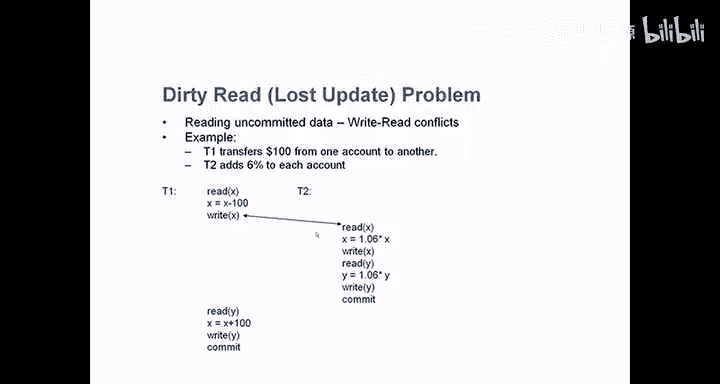

suppose account X had $200 in it and account Y had $100 in it if twe1 runs entirely before T2。

 so account X transfers $100 to account Y。So now X will be have $100 in it and y will have $200 in it。

 So when t2 comes and add $6% to x 16 and y will have $212。

 so the value of x plus y will be $318 perfectly fine it's okay if T2 runs before entirely before T1 as well So the effect on the database will be the following it'll add 6% to x which will increment x' is value to $212。

 Y will also have an additional $6% added to it， Y will be $106 and then when t1 runs account x will transfer 100 to account Y So now x will have $112 in it y will have $206 in it when you add the values of x and Y together there's $318 and perfectly fine。

 doesn't really matter if you if you run transaction1 first or transaction 2 first they both leave identical effects on the database in our scenario。

 however， where t2 interrupted the operations at T1。So after the first operation of T1。

 T1 removed $100 from its checking account。 So now the checking account has $100 in the why and the savings account now has $100。

 and T2 comes along and adds $6% to each account。 You have 1006 now in each account。

 and then T1 adds $100 back into savings account。 So the value of the account is now that the checking account is $106。

 and the savings account is $206， and you add the value together。 And you notice there is only $312。

 there's $6 missing。 And the reason is because there is a dirty read。

 And transaction 1 will lose money in the end。 The next type of conflict is nonrepeatable or fuzzy read problem。

 This is illustrated by 2 different transactions。 transaction 1 will read the balance from its account。

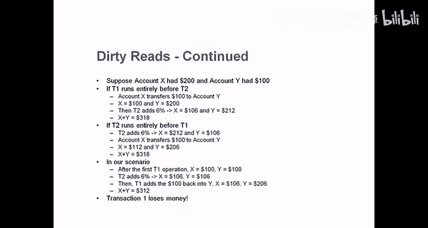

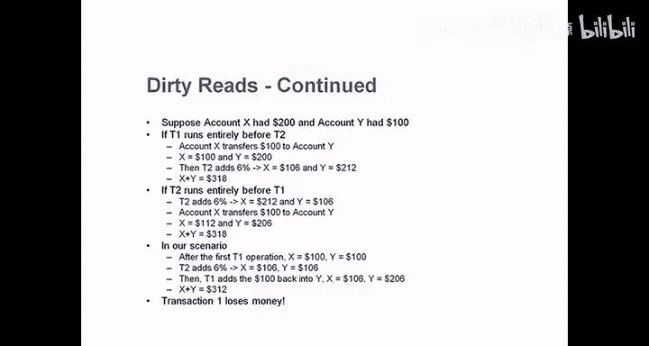

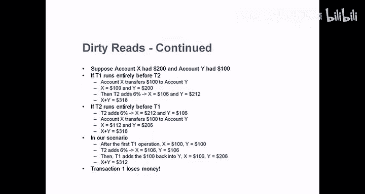

And subtract $100 from it it'll take out $100。 But transaction 1。

 if you go further down into its operation。 if the balance is less than 50。

 it's going to read the balance again。 What it saw it didn't make any changes to the database。

 try to read that 100 again and write it out again back to its database back to its value。

 So it's thinking that it's going to write 100 back。 However， T2 comes along。

 reads the balance takes $50 out and writes the balance $50 out。

 So when the transaction operations are interleaved in the following way。 T 1 will read $100。T2。

 in the meantime， takes $50， thinking there's still $100 there， takes $50 out and then。

T 1 will now read the balance that it thinks is $100。

 But T 2 just made it $50 and a write the balance out of $50 and commit its value。 Oh。

 and then notice that T 2 aborted its transaction so it doesn't really want to take the $50 out。

 So if T 2 really never happened。The value of the balance should have after。

 after running transaction T 1 should have been $100 dollars。 Unfortunately。

 because there was a non repeatable read or fuzzy readed problem。

There is only $50 left in that account。 transactiona 1 loses money。 Theres a phantom read problem。

 These are readr conflicts。 And the problem is， T 1 is reading a value。

 and T 2 is going to write a value to it。 But T1 still thinks it has the red value。

 even though T 2 changed that value underneath T 1's I， so to speak。

 So T1 is reading the deposit list。 It' printing the deposit list。 And for some reason。

 it reads it again and then writes it out。

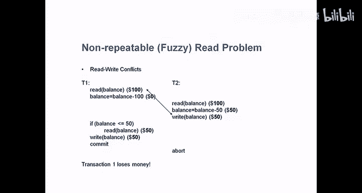

However， T 2 came in and wrote a new deposit。And committed that value。

So what Tron originally read and printed out。 And then what it eventually wrote after T 2 wrote a new deposit are going to be different。

 transaction one will have what is it will not have what's indicated on the deposit slip that will be a new deposit that will have been slipped in。

Even though the deposit list。Does not capture that new deposit。

 And this is because of the read right conflict of of Phanttom Re。 Finally。

 this overr uncommitted data。 So let's say a company has a policy that all employees of the same category must have the same salary。

 So if you look at transaction1 without looking at transaction 2。

 transaction 1 will set X to be $4000。 It'll write its salary out to $4000 and write y salary to be $4000 and commit that T 2 will read will write out x y salary to be $5000。

 Itll right excess salary to be $5000 and write that Both transactions are consistent。

 They adhere to the laws of the database consistency。 However。

 because they are a right right conflicts between these operations and they're interleaved with each other。

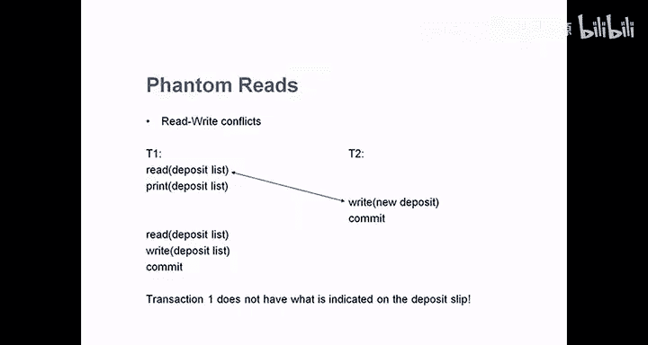

The end result is y will have a salary of $4000， and X will have a salary of $5000。

 which will leave the database in an inconsistent state。

 We're going to see a lot more about how to address these issues when we talk about concurrency control in the next module。

 Finally， the last property of the asset properties is durability。

 Once a transaction commits its permanent。 The transaction will survive all subsequent failures。

 So this means when you write write value out to the database。

 And you mean not write it out to the database immediately。

 you might write it to cache for the operating system or the database system to write the values of cache to the database later on。

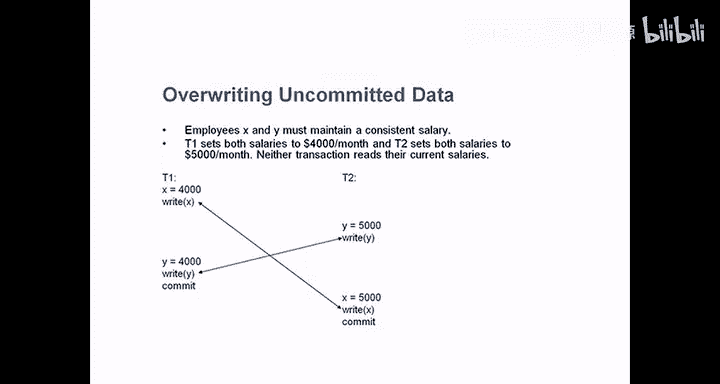

You're expecting that data to show up on the disk at some point later in the future。

 So imagine the database tells you that that transaction has committed and is written it out。

 reality all it really did is road it out to cache。

 but you're expecting it to appear on disk and notice and under the situation where the cache will crash and that the data never made it out to disk durability ensures that the next time I access that database on disk that data will magically appear on disk and we'll talk about that later on how a database enables those kind of changes。

 enables that kind of durability。 the asset properties make up the properties for concurrency control and also recovery。

 we'll talk about concurrency control in the next module and that specifically focuses on consistency and isolation when we talk about recovery management that specifically talks about atity and durability。

 So the。In the eye， consistency in isolation and concurrency control。

 aticity and durability are dealt with in recovery。

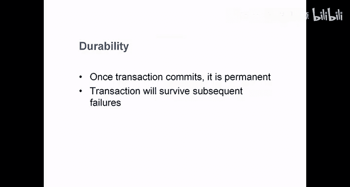