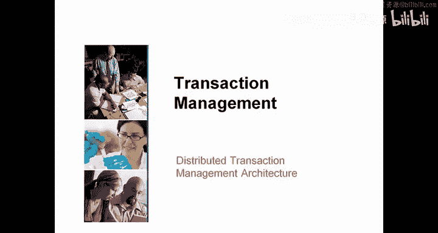
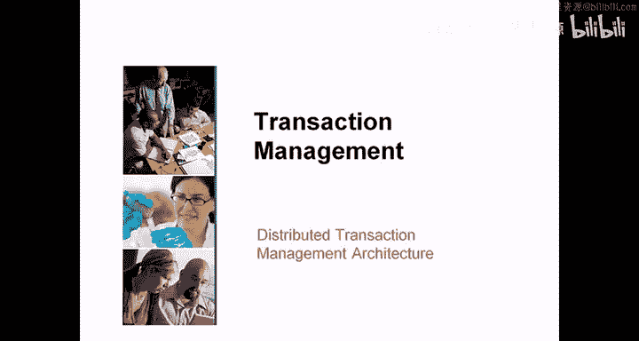
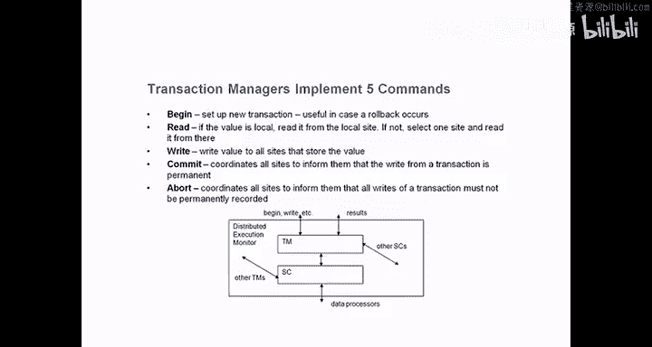

# 约翰霍普金斯大学《大规模数据库系统｜Large-Scale Database Systems》中英字幕 - P33：3_分布式事务管理架构.zh_en - GPT中英字幕课程资源 - BV1N2urzvEjK

Welcome to transactiona management and this unit will discuss a distributed transaction management architecture really all I'll to do is discuss this slide notice that the picture at the bottom describes a distributed execution monitor。

Imagine that there is one of these boxes associated with each database in your distributed database system inside the distributed execution monitor。

 there's a transaction manager defined by TM and a scheduler defined by an SC。

 so a distributed execution monitor gets a be or a read or a write or a commit or an emor。

 any of these operations。It will go into effect。 N one。

 itll start scheduling the operations on its own data processors。

 but given that there are parallel schedulers associated with other databases。

 itll also inform other schedulers of the scheduling activities it has to perform So it will be in contact with lots of other schedulers。

 potentially all the schedulers of all the distributed databases。

 So when there's a begin or a read or a write or a commit or an abort。

 that information is now sent to the transaction manager communicates with the schedulers it needs to communicate with the srs。

Line up the operation based send those operations now to data processors and sends the results back to transaction manager。

 Now， schedulers can receive。Commands from its own transaction manager or distributed transaction managers associated with other distributed execution monitors。

 so it will send back the values to other distributed。

executionec monitor specifically to the transaction managers in them。

 and the results will be sent back to the calling application so when we talk about a transaction manager architecture。

 we're discussing a distributed execution monitor and potentially this distributed execution monitor associated with each distributed database system we'll talk about this later on when we talk about transaction management for distributed database systems transaction management for distributed database systems is similar to that of a centralized system but the distributed execution monitor now has to。

Worry about controlling multiple transactions and multiple schedulers。

 We'll see this in more detail coming up in the next module。

