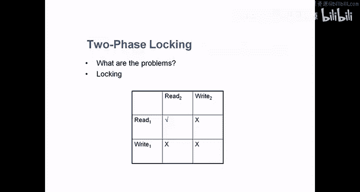
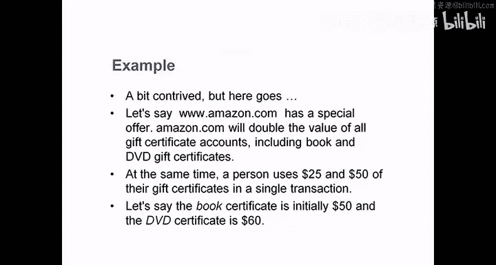
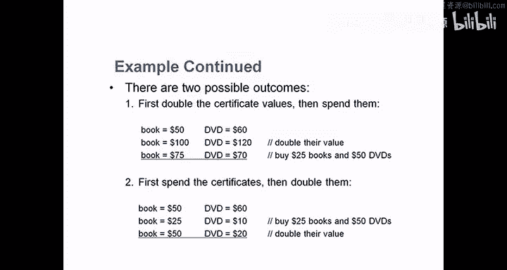
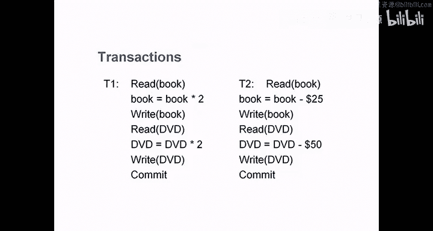
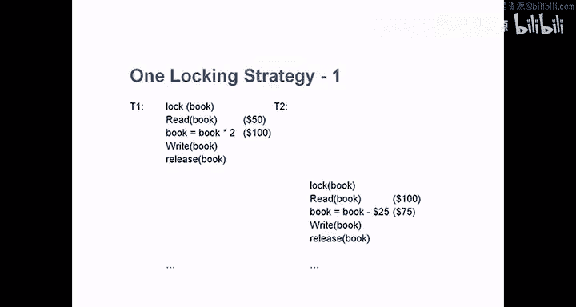
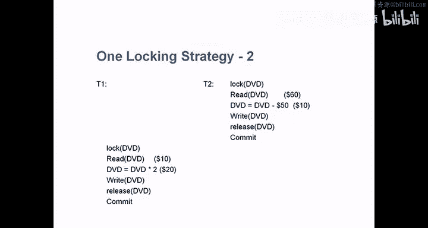
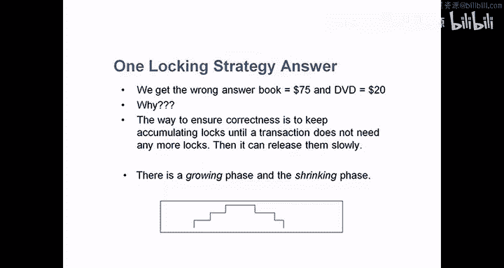
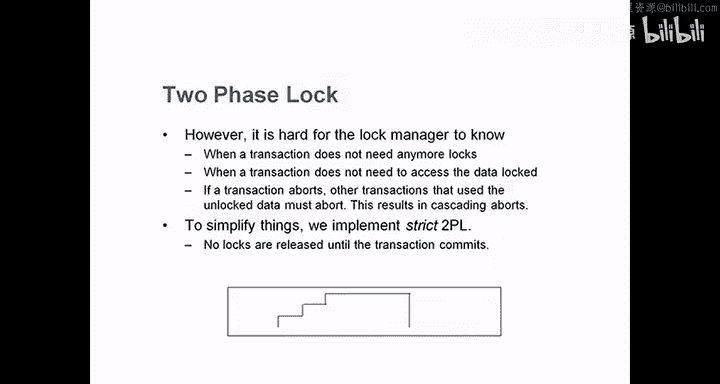

# 约翰霍普金斯大学《大规模数据库系统｜Large-Scale Database Systems》中英字幕 - P34：4_两阶段锁协议.zh_en - GPT中英字幕课程资源 - BV1N2urzvEjK

Welcome to Concurrency Control and this unit will talk about two phase locking。

 what are the problems with two phase locking？

Notice that the matrix below shows the read and write operations for transaction 1 and the read and write operations of transaction 2。

As long as multiple people want to put a readlock on some value to ensure the value doesn't change。

That's perfectly fine as long as nobody's changing a value。

 you can certainly lock that value to ensure that nobody else will modify it along the way。

Two readlocks from different transactions are certainly compatible。

 but once somebody wants to put a ride lock， ride lock on something that transaction 1 for example。

 has a readlock on not allowed to do that until transaction one releases its readlock。Similarly。

 if transaction 1 has a right lock， both read locks and right locks。

By a different transaction are not allowed until transaction 1 releases its right lock。

 Here's an example is a bit contrived。 But let's go。

 Let's say Amazon com is going to double the value of all gift certificate accounts。

 including book and DVD gift certificates。 At the same time， a customer uses $2550。

Of his gift certificate in a single transaction。 So let's say the book certificate is initially $50 on the DVD certificate is $60。

 There are two possible outcomes。 Transa1 is that Amazon will come in double the value of the gift certificates。

 and then the customer will buy books and DVDs using values from their gift certificates。

 So let's say the customer won， the customer has a $50 on the book certificate and $60 on the DVD certificate。

 Amazon comes along and doubles the values。 Now， the customer has $1001$20 on on his gift certificates。

 Finally， the customer purchases books and DVDs and now reduces the values on those certificates yielding a book value to be $75 and the DVD value to be $70。

 perfectly good。😊。

It's possible that the transactions can execute in a different order。

So we start out with the same initial conditions， the book and DVD values are $1560 respectively。

But the customer buys $25 worth of books and $50 of DVDvs before Amazon comes along and doubles them。

 His bad luck， I guess。Leaving only $25 and $10 on his certificates。

 And then Amazon comes along and doubles some。And now he's got $50 and20。

 So there are two correct answers。Though you， the customer can ultimately have $75 and70 or $50。20。

 either one of those answers is correct， but no other answer is consistent or correct。

 because the transactions have to appear as if they're isolated。

 They are the only ones who have access to the database at the time that theyre operating。

 No other transaction can have some kind of effect on the data。

So here is transaction 1， Amazon's transaction， It reads the book value doubles it， writes it out。

 reads a DVD value， doubles it， writes it out again it， and then commits the transaction， the user。

Our the customer now reads the book value， subtracts $25 and writes the value out to the database。

The customer reads a DVD value， subtracts $50， writes out again。

 and then commits till let's say we have a database manager that interleaves the transactions。

 But luckily， we've chosen to lock the information so transaction one comes along。

Locks the book， reads it， doubles the book value， writes it out and releases the lock transaction 2 and an interleave transaction。

 the operating system or the database management system decides to interleave these transactions transaction 2 will now lock the book。

Read the book's value， subtract $25 from it， Write its value out。

 The transaction manager will now execute the rest of the operations for transaction 2。

 it'll lock the DVD value， read it， subtract $50 write out the value and release the lock and commit the transaction。

 a transaction manager now goes back and finishes up transaction1， locks the DVD value。

 reads the value， doubles it and writes the value， releases the lock and commits the transaction。

 sounds good。 however we get the wrong answer。

The value of the book certificate at the end of both of these transactions is $75。

 and the value of the DVD is only $20。 What happened。

 It's either supposed to be 75 and 70 or 50 and 20， but not 75 and 20。 What happened。

 And the reason that this went wrong was because as transaction 1 was ramping up。

 got locks and released them when it no longer needed them。

 But transaction released their locks before gathering all the locks。

 meaning that somebody else could step in and take a released lock and make a modification to it before transaction 1 finished。

 So this is exactly what happened。 transaction 1 made a modification。

 It was supposed to be a consistent modification of all the resources。 Both the books and the DVDs。

 It made a modification， released a lock and transaction 2 now came and grabbed that lock and made some modifications before transaction 1 ever finished。

 So the way to ensure correctness here is to for a transaction to accumulate locks until it。

Doesn't need them anymore， so this is the growing phase of a transaction management and then the shrinking phase is when the transaction no has grabbed all the locks that it needs and then doesn't need a resource。

 it can slowly release the locks so if you look at the diagram at the bottom the diagram shows that every step up is another lock that it's executed and the horizontal lines implied that there's some processing vertical line means there's another locks。

 more processing another lock， more processing went as long as all the locks have been gathered at one time then now we can start releasing locks。

 there's a growing phase。When locks are being gathered and a shrinking phase。

 when locks are being released， this is the reason it's called a two phase locking algorithm。

 The two phases are growing and shrinking。 There are some problems with a two phase lock manager system。

 The problem is， in the shrinking phase， as we release locks？

 There are some things that are very difficult for a lock manager to know， First of all。

 how does it know when the data is no longer needed。 How does it know when it can release locks。

How does it know that theres no need for that data and elsewhere in the transaction。

 So as it's releasing locks， other transactions can come along and grab the value。

 the modified value， transaction1， saw on initial value made some modification to it after lock the value and then released the lock。

 but it's not finished operating transaction 2 comes and grabs a lock on that value makes some modifications based on transaction 1's modification。

And then what happens if transaction 1 now aborts。 So transaction 1 is going to have to roll back its values。

 and it also has to inform transaction 2， that it's aborting。

 So the value it grabbed is not the real value。 It has to release its values as well。

 It has to do a rollback。 This is called a cascading abort。 So to simplify these problems。

 We implement a strict two phase locking algorithm。Weve。😔。

Imose on our two phase locking algorithm that no locks are released until the transaction commits。

So looking at the diagram below， we increase locks slowly。 We grab them until we've got them all。

 and we don't let go of one of them until a commit has occurred。 And then we let go of all of them。

 This is strict two phase locking。 It deals with some of the issues of regular two phase locking。

 specifically。Some of the problems induced by the shrinking phase。

And it's strict two phase locking that we're going to be dealing with with for the rest of the semester。

