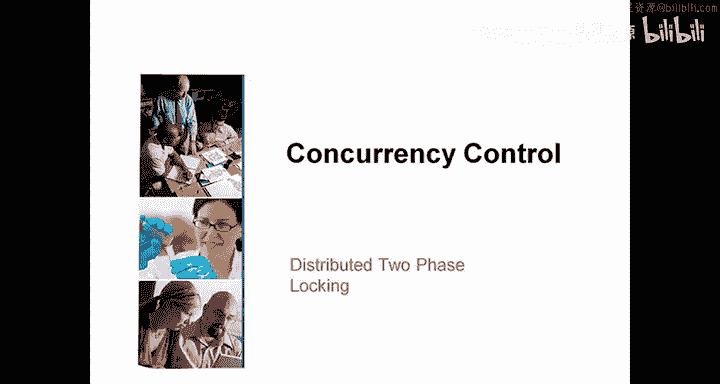
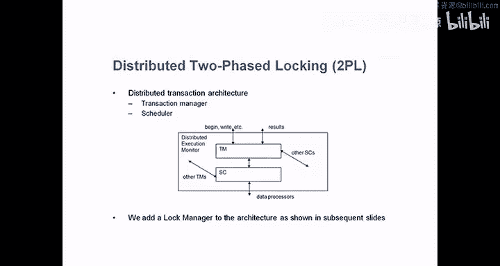
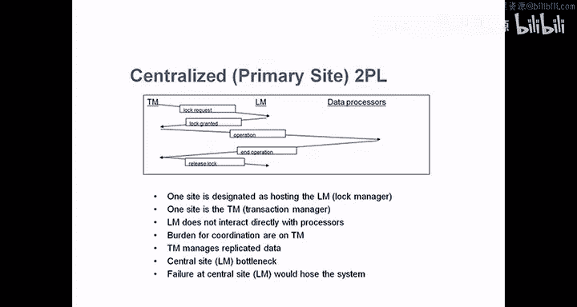
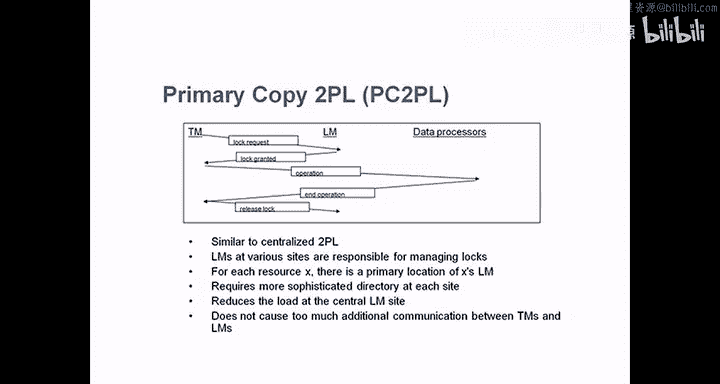
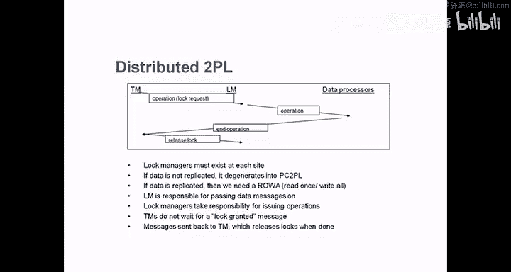
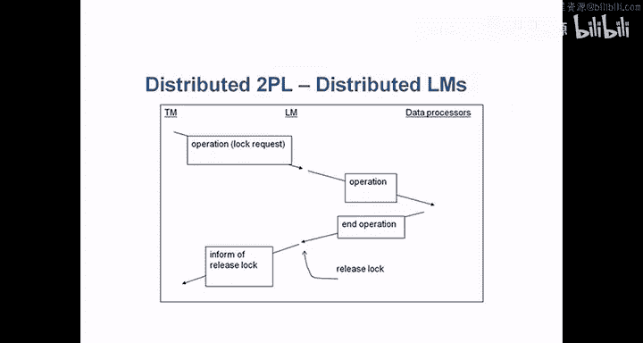

# 约翰霍普金斯大学《大规模数据库系统｜Large-Scale Database Systems》中英字幕 - P35：5_分布式两阶段锁协议.zh_en - GPT中英字幕课程资源 - BV1N2urzvEjK

Concurrency control and this unit will describe distributed two- phasese locking schemes。

 If you recall the architecture of a distributed distributed transaction architecture where we had distributed execution monitor spread across the enterprise。

 we included a transaction manager and a scheduler。

 if you recall operations were sent to the transaction manager。

 transaction manager would identify the right schedulers to send the operations to schedulers were initiate the operations with the database processors results are sent back to the appropriate schedulers and appropriate transaction managers then finally the results are sent back to the application for distributed two phasese locking。

 we're going to have a lock manager， as we'll see in the subsequent diagrams in a centralized which is called also a primary site two phase locking algorithm。

 you notice the schematic。 you have a transaction manager which gets request for some operation transaction manager reaches out to the lock manager ask for lock request。

 the lock manager responds with a lock granteded message the transaction manager will then reached。

The data processors the data processors will process the operation it'll send a message back to the transaction manager at the ended the operation has ended and then the transaction manager will send a message to the lock manager to release the lock this case one site is designated as hosting the lock manager one site is designated is hosting the transaction manager and the lock manager does not interact directly with the processors so the transaction manager is really burdened with all the coordination of messaging throughout the system also realize that a centralized lock manager will cause a bottleneck in the system if the lock manager goes down nothing can operate in this database system so failure at a lock manager site would hose the system and also failure if there is only one lock manager there was only one transaction manager that would ho the system as well but right now we're talking about again centralized scheme where there is only one lock manager a primary copy to phase locking algorithm is almost identical。

Similar to the previous twophase locking algorithm that we described the centralized two-phase locking。

 the order of operations is identical， it's just that we have lock managers distribute throughout the enterprise。

 and each lock manager is responsible for various resource X。

 there is some lock manager that is responsible for X's primary location。

 meaning that there might be copies in the system but the lock manager is managing the primary location for that resource so when the transaction manager needs to update some value or modify some value。

 it sends a lock request to the appropriate lock manager。

 a lock manager grant is given and then the operation is sent to the multiple data processors where X is located and then a response is sent back to the transaction manager saying that the operation is ended and then the transaction manager will release a locks。

 it certainly reduces the load at the central lock manager site。

 and it doesn't cause too much additional communication between the transaction manager。

And the lock managers Okay， moving on。We do realize as there still is some kind of burden of centralizing or theres some burden of the lock manager。

So in this case， for distributed to phase lock management， we distribute lock managers to each site。

If the data is not replicated， it really degenerates into the previous primary copy to phase logging algorithm。

 but in this case we got a lock manager at each site， if the data is replicated。

 then we need to implement a read once write all。Method so that when we read something。

 we can read it from any of this any of the replicated data sites， when we write it。

 we have to write to every site。 The lock manager is responsible for passing data messages on。

In this case。When the， if you look at the diagram at the top when the transaction manager requests the lock。

 the lock manager will grant it， but not let the transaction manager know about it。

 itll proceed to send them message to the data processors for the operation。

To proceed when the data processor is finished， it sends a message back to the transaction manager。

 and it turns around and releases the lock from the Ro lock manager。

 You can take this even a step further。 The transaction manager all the operations trust in the lock manager so that when the transaction manager requests an operation with the lock request。

 it'll send a message to the lock manager。 the lock manager will turn around and perform the operations on the data processors。

And then when the operations are ended， the data processors will inform the lock manager in this case to release the lock and inform the transaction manager of the released lock。

 so each of these different schemes have different advantages and disadvantages from more control to less control to more bottlenecks to less bottlenecks and picking the right scheme is really dependent on the characteristics of your distributed database system。

But we covered a number of different options and all of them are valid。

 but which one you use really depends on the scenario and the usage of your distributed database system。

