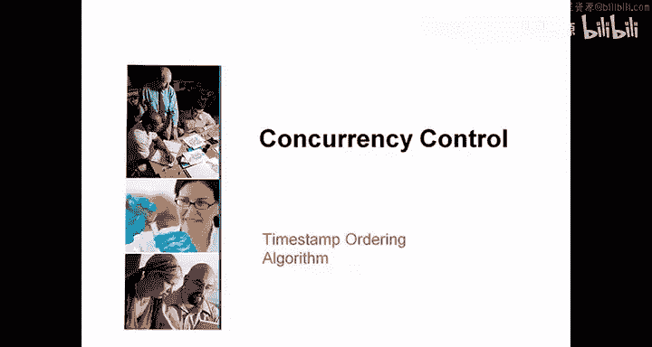
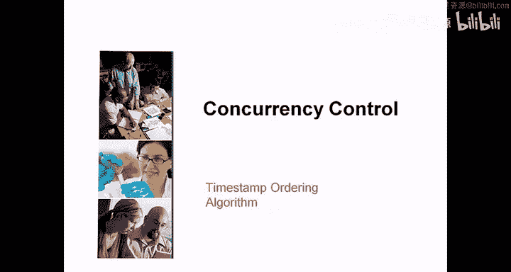
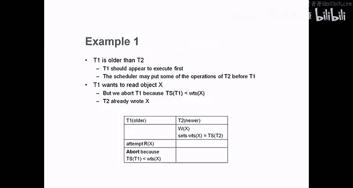
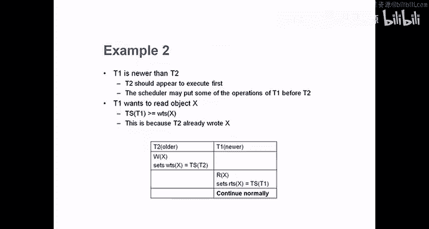
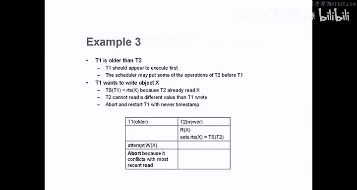
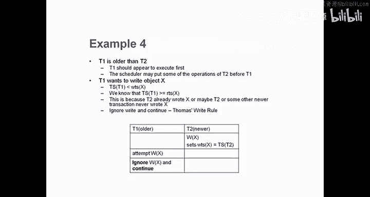
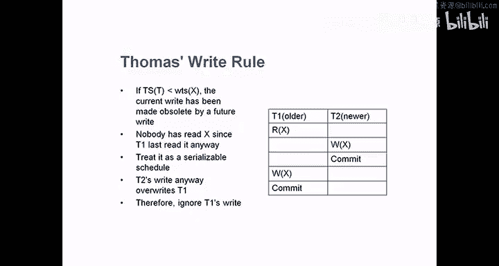
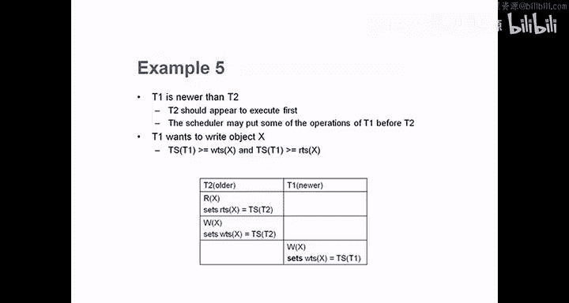

# 约翰霍普金斯大学《大规模数据库系统｜Large-Scale Database Systems》中英字幕 - P36：6_时间戳排序算法.zh_en - GPT中英字幕课程资源 - BV1N2urzvEjK

Welcome to Concurrency Control in this unit we'll talk about the timestamp ordering algorithm。

Remember this is not a locking algorithm it's all based on timestamps。

 so I'm going to walk through every decision in the algorithm I displayed on the website and explain exactly what's going on at each step we're going to assume that transaction 1 is older than transaction 2。

 and since the timest is older。T1 should appear to execute before transaction 2。 Now the scheduler。

 of course， may schedule some operations of T2 before T1。

 and that's okay as long as the operations are not conflicting what this algorithm will do stop us then the operations are conflicting and abort and restart the transaction。

So here's the case in the first case， T1 wants to read an object of X。

If you look at the diagram below， you'll notice that T1 is older。And T， too is newer。 And t， too。

Wrote X， it should have written it after T1 read the value。

But because the scheduler placed the right operation of T2 before the read operation of T1。

T 2 already wrote its value。 Now， T 1， the older operation。

 attempts to read the value and operate on it。The problem is， is that T1 should have read a value。

Should have read a value that was modified by some older transaction， not by some newer transaction。

The newer transaction should have performed the right after T1 has already read X and operated on it since the scheduler placed the right operation of T2 before T1。

 and now T 1 is only getting around to reading the value since the timet of the T1 operation the T 1 transaction is less than the right timetamp。

 We know that a newer operation is already written this value。

 which will make it appear to me that I'm reading the wrong value。 Therefore。

 T1 is going to abort and restart with a much newer timestamp。 The second option。

Is that again， T 1 is newer than T 2。T2 should appear to execute first。T 2 is older here。

 Schr may put some of the operations of T1 before T 2。 T 1 wants to read the object X。

It can do so very well because T which is the older operation， has already written the value。

Now T1 comes along and tries to read that value， it's a newer operation。

 it read something that an older operation， an older operation， I mean an older transaction wrote。

 therefore it can continue normally。Because we're reading a value。

That was modified by an older transaction， which is perfectly fine。

 That takes care of the read examples。

What happens when we want to write in our diagram below， we have two transactions， T1 and T2。

 so even though the scheduler might schedule the read of T2。

 which is a newer transaction before the operations of T1。um。Sometimes。

 sometimes there are conflicts。 And in this case， there is a conflict。 If T1。

 the older transaction attempts to write a value that T2 is already read。

So T 2 should have read the value that was written by T 1， the older transaction。But in reality。

 it already wrote a value that was that was written by some yet older transaction than T 1。

 So since T 2 should have read T 1's right， But T 2 jumped the gun， so to speak and read a value。

 not from T 1。 T 1 will realize that I'm trying to write a value that some newer transaction had already read。

It's going to mess up T 2。 the newer transaction。 If I attempt to write it now。

 So what I will do is I'll abort it because it conflicts with the most recent rate。

 The second example is。

T1 is older than T2。Therefore， its rights should occur before T2's rights。And in this case， however。

 T1。T2 did not read anything specifically， it's just writing。

So it never read some value that some alter transaction created。

 Its just taking some value that it wants to stick in the database and write it without any knowledge of any previous values of X。

So we might think that really T2's right should occur after T1's right。

 T1 changed the value after all， but since T2 never reads it， T2 is a newer transaction。

 never reads that value， it just forces in some value， independent of what was there before。

So when T2 writes the value。If T 1 had gone first， T1s would have written the value。

 and then T 2 would have overwritten it。 So now that T 2 has written the value。

 And now T 1's attempted right occurs。 and we noticed that T 2 had already performed a right。

 T 2 had never attempted to read the value。We use Thomas's right rule to say， O。

 no matter what I would write right now。 anyway would have been overwritten by T 2。 Therefore。

 I'm going ignore the right and continue my， my transaction。

 Let's examine Thomas's right rule a little bit and little bit more detail。 If you have T 1。

 which is an older transaction。 And T 2 is a newer transaction。

And in the real order of things， T1 should execute its operations first。

 and T2 should execute its operations after T1 completes。

 but somehow the scheduler mixes up these operations， which it's allowed to do。

So T1 reads some value and then writes a value。 T2 comes along and performs its right before T1s right。

 And since T2 never read a value that was written by an older transaction。

 it just unilaterally decided to overwrite what was ever written in the database。

 So when now T1 comes along and wants to write the value。 It'll say okay， T2。

 the newer transaction performed a unilateral right anyway。

 I'm just ignore my right because T2s would see a superseded anyway。 That's Thomas's right rule。

 Finally， the last situation is when T2， the older transaction reads and writes a value and T1。

 the newer transaction comes along and wants to perform a right。

 Certainly can do so because it's a newer transaction。

 That explains the five steps of the timest ordering algorithm。

