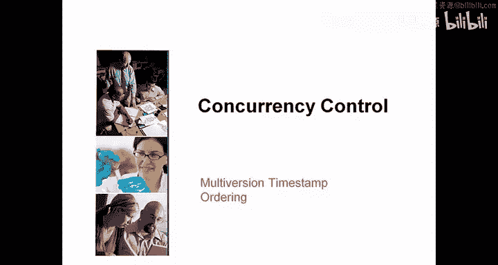
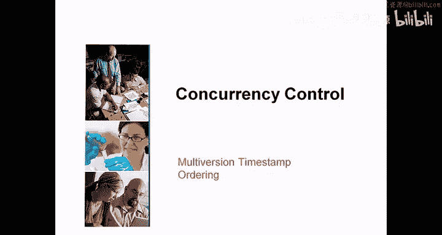
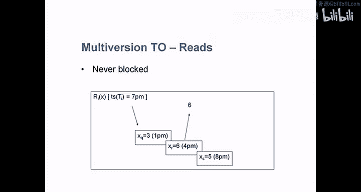
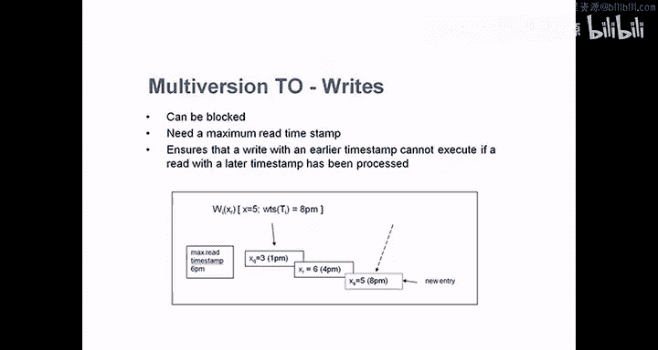
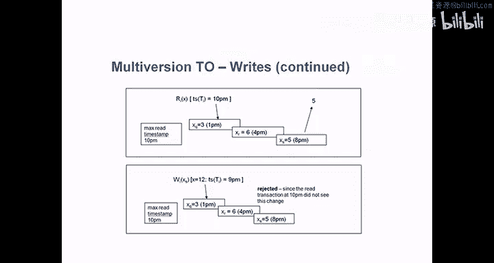

# 约翰霍普金斯大学《大规模数据库系统｜Large-Scale Database Systems》中英字幕 - P37：7_多版本时间戳排序.zh_en - GPT中英字幕课程资源 - BV1N2urzvEjK

Welcome to Concurrency Control。In this unit will cover the multiversion timestamp ordering algorithm。

 This is actual clever algorithm。

Notice that in the timestamp ordering algorithm， there was one case where reads were blocked and there was one case where writes were blocked。

The case where reads were blocked was when a later transaction came along and actually wrote a new value。

But in the multiversion timestamp ordering operation。

 we keep track of all the values of each other resources and a timestamp of when they were written。

So therefore reads can never be blocked， here's an example， let's say I want to read the value of X。

And my transaction， the timestamp of my transaction is 7 pm。 noticeice in the database。

 we have x at various times。 x is valued 3 at 1 pm。 x' is value 6， 4 pm。 and x's value is 5 at 8 pm。

 we want to read the 7 pm version we keep the values at various timestamps。

 we can go to the value of x at the timestamp， the last timetamp before the timestamp of the current transaction。

 if I want to read the value of x at 7 pm。 I don't have to worry that another transaction。

 a newer transaction wrote the value past my transaction time。

 I can just go look at the value of x at a time before 7 pm at the last time before 7 pm。

 in this case 4 pm was the last time was written before 7 pm。

 and I would have turned the values 6 If I reads are not blocked。 However。

 write still can be blocked we're just dealing with with optimizing the read nonblocking we still have to block rights here。

Unfortunately， and here's an example of how rights can be blocked。

So in this algorithm we need something called a maximum read timestamp， so here's an example。

 if we look at the bottom we have x of value equal 3 at 1 pm， exit value is equal to 6 at 4 pm。

 and now our right operation wants to write x equal 5 with a timestamp of 8 pm。

So each version of x has its own right timestamp。And we add a new value， x equals 5。

 what the right times stamp at 8 PMm。Notice， however， the maximum read time stamp is 6 PM。

 The last time anybody ever read one of these rows was at 6 p and presumably must have read the value x equal 6 at 6 p。

 Now， if I want to read something at 10 PM， there's no problem。 The maximum。

 I read the latest version latest value of X before 10 PM， which is the8 PM read。

 which is8 PMm write and I retrieve the value 5。 and now since I read this at 10 PM。

 I set the maximum timest to 10 PM。 If I want to write the value。

At the transaction 9 PM。 Now， unfortunately， some other transaction read at already past 10 p。

 so the value is now to the maximum read time stampamp。9 pm is less than 10 pm。

 so the value is rejected。The right is rejected because I know somebody had actually read the value。

A Vex， much later。It really， if the time， if the transactions were ordereded properly。

 that red would have occurred after this write， but now this transaction is trying to get in after the newer transaction。

 the 10 PM transaction already did its read。 It's trying to put it insert its value into the database。

 it cannot do that any more， because then we would say that the transaction that read the value at 10 PM would not have read a valid value。

 And therefore we reject。This transaction value。We were checked this right。

So ultimately the multiversion timestamp algorithm， the timestamp ordering algorithm。

It doesn't block on reads， but there are circumstances where it still blocks on rights。

 It's a little bit more efficient time wise because we will never block on reads。

But what it makes up for in time， it loses in space。

 We have to keep many versions of a value around for each version we are going to lock in a system。

