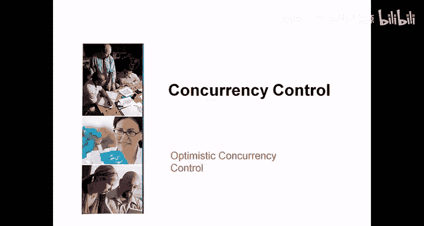
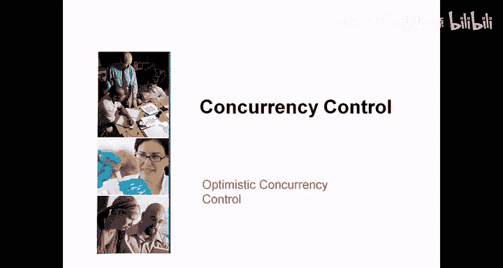
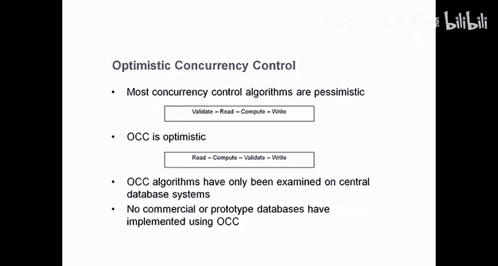
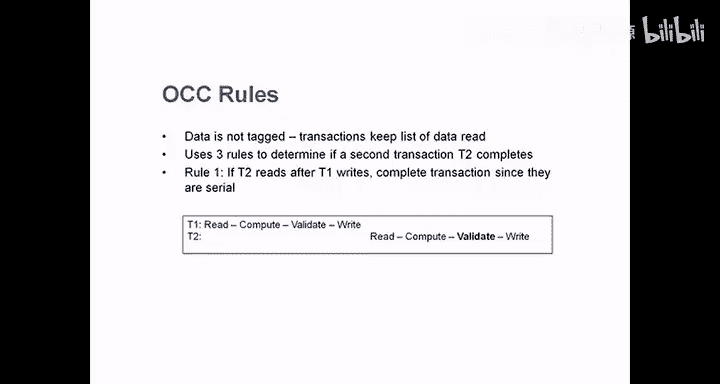
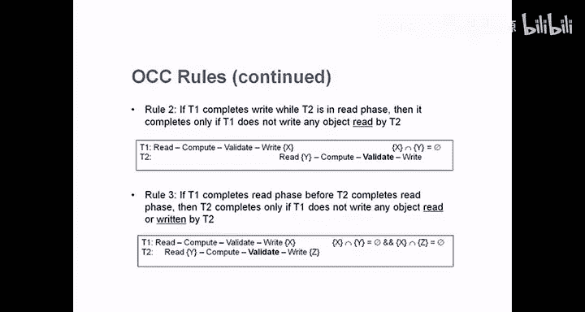
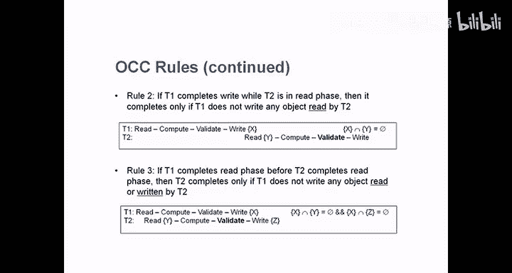
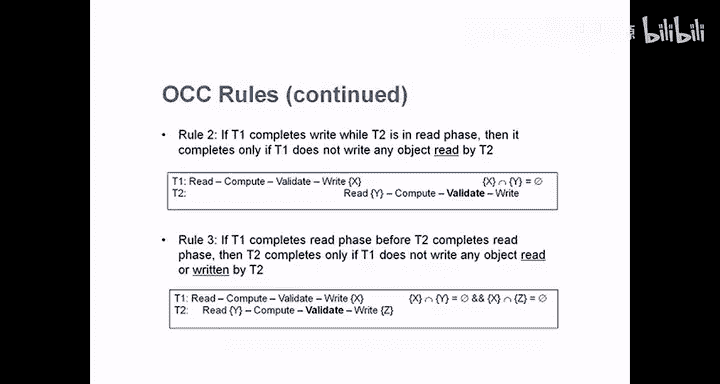

# 约翰霍普金斯大学《大规模数据库系统｜Large-Scale Database Systems》中英字幕 - P38：8_乐观并发控制.zh_en - GPT中英字幕课程资源 - BV1N2urzvEjK

Welcome to concurrency control and this unit we'll talk about optimistic concurrency control。 First。

 most concurrency control algorithms are pessimistic What does that mean it has to validate the operation before it's going to read compute or write the values Okay Op concurrency control decides。

 you know these problems are not going to come up very often we're not going to have conflicting operations very often。

 let me go ahead and read and compute and then before I write I'll validate whether I really I'm going to have a problem or not。

So most concursency control algorithms validate first OCC validates just before the right OCC algorithms have only been examined on central database systems and in reality no commercial or prototype database systems have implemented used and have been implemented using OCC but what are the rules of engagement basically data is not tagged at all instead transactions keep a list of the data read and the data that's going to be written and it uses three simple rules to determine if a second transaction T2 complete remember that transactions can be underleaved。

But ultimately the newer transaction has to look as if it's making the changes to the database after the first transaction will have been completed。

 so while there might be overlap， you want to make sure that they don't step on each other。

 So rule1 says that if T1 T2 reads after T1 finishes its right。

 there's nothing to worry about T2 is in fact supposed to read the values that T1 wrote。

 if it's reading any values at all from T1。 So rule 1 is if the reads of T2 occur after the rights of T1 there's no problem the validation step passes with flying colors Rule2 is a little bit more complex。

 if you see in the diagram you have a read compute validate for T1 and then you start to write some variables。

And that's a set of variables in X。 During that right， T2 will start to read。

And it'll compute and validate， but it's only going to validate true if those resources that are written in T1 do not overlap at all with any of the resources read by T2。

So if any of the resources X overlap with any of the resources in y， then it doesn't validate。

 but you notice to the left if there are no common， I mean I'm sorry over to the right。

 there are no common，Resources that are written by T1 and read by T2 then the stuff is valid in T2 completes Finally。

 rule3 examines a case where T1 and T2 overlaps significantly。

We assume that T1 read the values that it needs to read。

 it does its computation and validation and writing of X。

 T2 will come along and read shortly after T1 finishes its read。

 it'll compute and validate and want to write Z。In this case， where there's so much over overlapping。

T2 is reading some resources。Represented by the set Y。

 and it's writing some resources represented by the set C。

 T1 is writing resources represented by the set X， so if any of the resources written by T1 or either read by T2。

Or wanting to be written by T2。Then we abort T2。But if none of those resources are overlap with each other。

 then T2 is free to validates and it writes the values， that's an overview of OCC， again。

 it's not used by any systems。On the other hand， it is useful。

 it's a useful way of performing validation of potentially conflicting transactions。

 and it's all based on the notion that no matter how much overlapping occurs。

 conflicting operations of the newer transaction will always execute before the operations of the earlier transaction。

