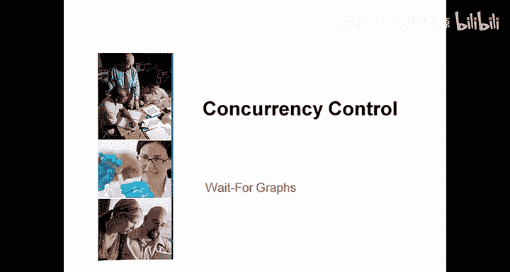
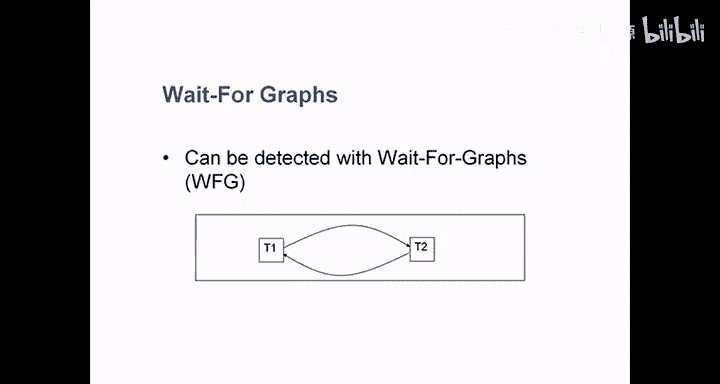
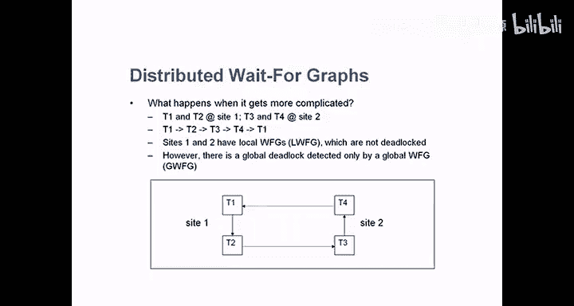
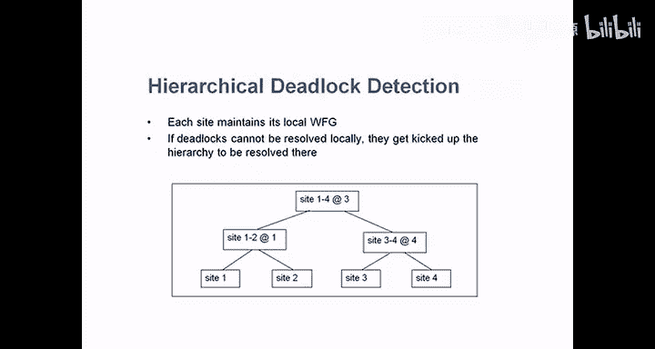

# 约翰霍普金斯大学《大规模数据库系统｜Large-Scale Database Systems》中英字幕 - P39：9_等待图检测.zh_en - GPT中英字幕课程资源 - BV1N2urzvEjK

Welcome to Concurrency Control， and this unit will discuss weight4 graphs。

Wight for graphs are a marvelous way to deal with deadlock conditions。

Notice that we have in our diagram two transactions。

 Trans 1 is waiting for resources the transaction 2 has locked， and the meantime。

 transaction 2 is waiting for the resources that 10 transaction 1 has locked。

The transactions will wait indefinitely， unless we。Deal with the deadlock。

 one way to deal with them is to create weight for graphs if if we have。

 if your distributed database system or even a central database system keeps track individual transactions are waiting for。

You can detect that there is a cycle here transaction 1 is waiting for transaction 2。

 Trans2 is waiting for transaction 1 cyclecle detection is a very easy thing to do in reading graphs。

 there's a graph of two nodes and there's a cycle between those two nodes。

So immediately the system can step in and address the deadlock。

 it could abort one of the transactions or both of the transactions， it has those options。

But the weight fore graphs clue it in to know that there is a deadlock that it needs to deal with。

 It becomes a little bit more difficult when you're dealing with multiple sites。

 So you might have transactions1 into two at one site and transactions 3 and 4 managed at a different site。

 and you create local weight fores at each site。 So T1 is waiting for T2。

 and that's what we know about at P site 1。

And at site 2， we know that T3 is waiting for T4， but across sites。

 T4 is waiting for T1 and T2 is waiting for T3。So in reality， across our enterprise。

 of plus the global system， there is a cycle， but locally there are no cycles that exist。

 So what we have to do is create a global weight4 graph to determine if there is a cycle and determine if there is a global deadlock。

 how do we manage this。 Well there are a number of ways of managing it you can actually have deadlock detection and addressing deadlocks at multiple levels So in the schematic below。

 you notice that site 1， site2 and site 3 and site4， each have their own local weight4 graphs。

 plus an algorithm that will detect any cycles and deal with the deadlocks if it indeed does detect a cycle。

 then at site 1， the lower level sites。 you can have a sitete 1。

 you can have a global weight4 graph just representing the graph at site1 and site 2。

So you can even house that global graph at site 1。And what that does。

 in case sites1 and two don't detect any cycles， you can put those weight four graphs together and have a global weight4 graph that deals with site1 and site 2。

 and you can deal with that at site 1， and at that case you can actually see that if theres some deadlock between the two sites and deal with it there。

 Similarlyly at site 4 you can start to represent a global weight4 graph at siteite 4 and at site 4 you can deal with any deadlocks between siteite 3 and siteite4。

Ultimately， you still have to worry about in an enterprise wide deadlock cycle。

 so at site 3 you might hose really， you might host a really global weight for at site 3 in which all the local weight fores are brought together and are dealt with at site 3。

 so this is one way of dealing with hierarchical deadlock detection and a distributed system。

