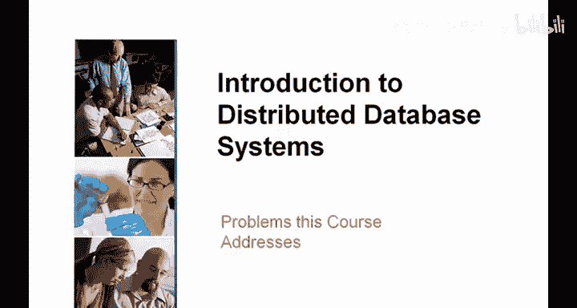
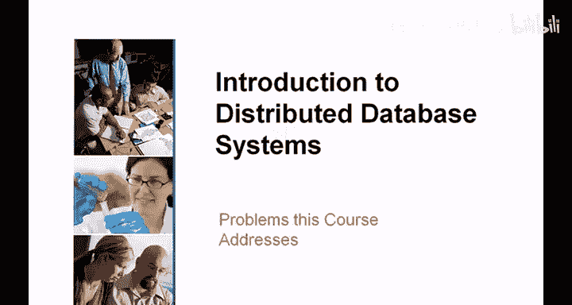
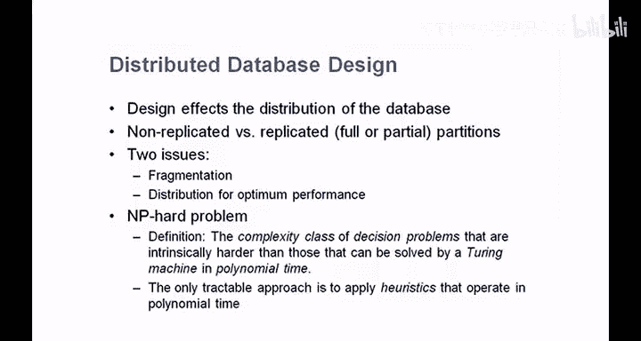
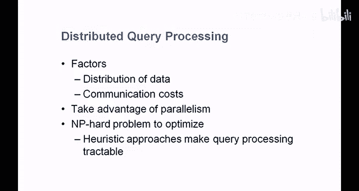
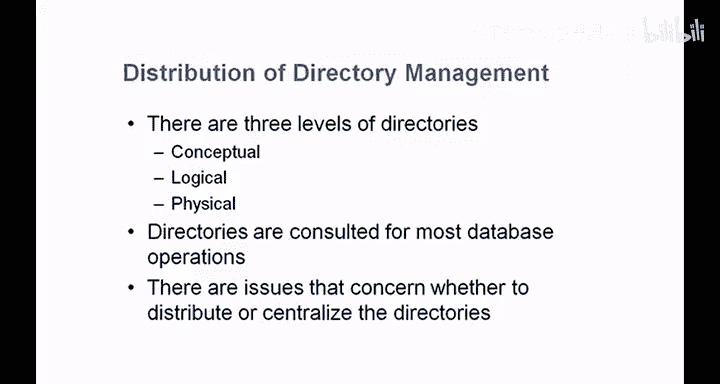
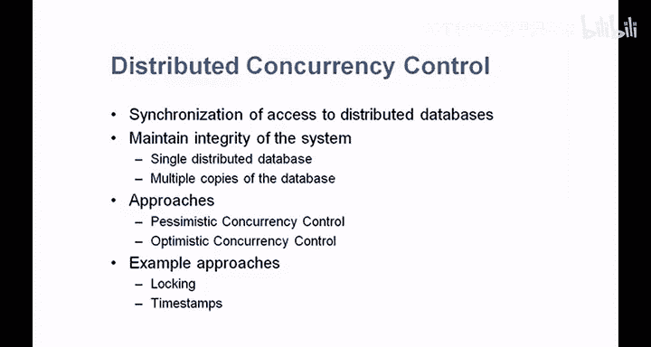
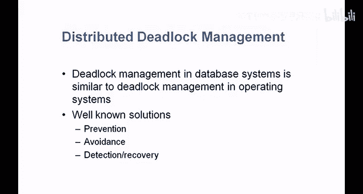
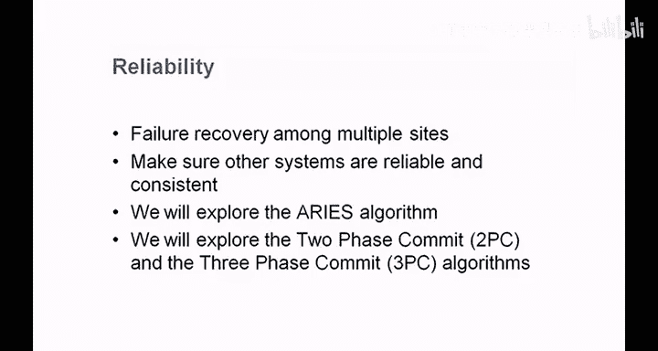

# 约翰霍普金斯大学《大规模数据库系统｜Large-Scale Database Systems》中英字幕 - P3：2_本课程解决的问题.zh_en - GPT中英字幕课程资源 - BV1N2urzvEjK

Welcome to the third unit of the first module of the distributed database systems course and this unit will discuss the problems that this course addresses In fact there are many problems that this course addresses these following slides will discuss a few of the significant highlights of the course the first problem that the course addresses is how as a designer do you design a distributed database system there are a lot of designs or designs and a distributed database system those designs will directly affect the performance of queries and your distributed database systems so we'll look at the effects of how to choose different designs for database systems and look at the effects of replicating data across many systems they' are two significant issues that we're going address number one is the fragmentation of tables fragmentation of tables means that design a table you have to place it somewhere you may even replicate it they sit in two different locations so that you have a backup copy and so that both of those tables are located in two geographically distributed areas however taken to the extreme。

That means that your entire database will be duplicated in many different places that's not something you really want to handle or you want to manage in reality what you'd like to be able to do is fragment your tables under certain circumstances fragmentation means that you pull apart the tables both either horizontally or vertically or both so horizontal fragmentation means that you'll take certain rows and place them in one geographical location and other rows of a table and place them in a different geographical location applications in one location use certain columns of a table and applications in a different location tend to use other columns in a table which case you'll do vertical fragmentation and move break the table in half so to speak vertically and move some of the table to the one location and another table to another part of the fragment that table to a different geographical location fragmentation is ultimately done for optimization of distributed queries we'll talk about that in great detail in the next few weeks breaking tables apart into fragments distributing them geographically is a very hard problem to solve。

If you were to go through all the options， it would be an NP hard meaning that ultimately it would be an exponentially complex problem to solve and that takes a long time for a computer to calculate the distribution of tables if the algorithm is exponentially hard so while you might get the best distribution and fragmentation of tables using an exponential algorithm that algorithm will take a long time to finish So what we do is we apply Hu risk that will find a really good solution not necessarily the optimal solution find a good solution in polynomial time meaning that the algorithm that we use to distribute fragment tables will finish in a reasonable amount of time and we're guaranteed to get a good distribution of the data explore thatal detail coming up in the next few Another issue that this course addresses is distributed query processing fact this is the main part of the course where once we've gotten a distributed design we have to determine how to formulaulate queries to distributed databasesulating。

Quries could be difficult to solve it's also anmp hard problem。

 finding the optimal query plan to formulate joins to distributed tables。

 distributed table fragments could be very difficult and very very long as there are lots of ways to come up with good query plans coming up with the optimal query plan will take exponential amount of calculation and that a user doesn't have the ability to fit and wait for when a person formulates a query and sends a query to the database system a user expects a response in a reasonable amount of time we use an exponential algorithm to calculate a distributed join that calculation could take a long time and the user would be waiting for the response However if we use heuristic heuristics will take less in that amount of time find a good solution not necessarily the best but a good solution but it'll end in a reasonable amount of time and the user will get their results in a reasonable amount of time Also in distributed query processing will be able to take advantage of parallelism and ultimately we have to worry about where the data distributed and。

Communication costs in formulating the right query plan or distributed databases Another issue' discuss is distribution of directory management there is a there are three levels of directories there's a conceptual directory which is the conceptual schema applications formulate their queries against and this is a conceptual schema of your entire distributed database system independent of geographical location internally in the distributed database management system there are logical schemas and those logical schemas are the schemas that exist at each of the database points database locations and then finally there are physical schemas those schemas that are the layout of the tables on the dis themselves there are all three related to each other and in almost any application or any query。

 any other type of operation on the database those directories are consulted So there's a question about whether to distribute or centralize these directories we'll talk about tradeoff in actually distributing or centralizing these directories Another issue that this course discusses does distributed concurrence。

controltro when you have multiple users formulating queries to the database at the same time those queries could eventually clobber each other。

 somebody can be reading from one table thinking a certain piece of data is there while somebody else clllabs that data with a different value while the first person still thinks that the original value is there and does operations using that original value This ultimately leads to is inconsistency in a database so their distributed concurrency control algorithms that we will explore to maintain the integrity of a distributed database system certainly a lot of these algorithms apply to single single database systems。

 we will apply not only single database systems distributed database systems as well two major approaches in concurrency control one is pessimistic concurrency control and the other is optimistic concurrency control pessimistic concurrency control assumes as a starting point people are going to collabber each other when you have multiple users accessing and modifying the same database so all the precautions are taken up front ensure that nobody clos each other and if there's any chance that。

body will clobber each other Now one person will clobber another the appropriate method and the appropriate precautions will be taken。

 the optimistic concurrency control approach is that doesn't happen too often so we're going to go ahead and modify the database and at the last moment we'll check them and whether we're clobbering somebody or not many of those approaches pessimistic and optimistic concurreency and control approaches later on in the course and some example approaches that you might be familiar with are locking almost everybody's familiar with their are other types of approaches such as timestamps not everybody is familiar willll explore those in great detail later on in the course there's distributed deadlock management when you have a distributed database system there are going to be resources distributed locations that are going to be waiting on each other So deadlock management and database systems is very similar to deadlock management and operating systems so multiple resources might be waiting for each other and therefore they'll sit and wait forever because one is waiting for the other to relinquish some process so two in database management systems there's the opportunity for different users who have。

Want access to different data in the database be waiting for data that is locked by or used by another person and that other person might be waiting for resources that's in use by the first person in which case everybody sits in weights until some deadlock management scheme comes and breaks it up in some manner there are some well-known solutions there's prevention of locked deadlocking there's avoidance of deadlocking and there's detection and recovery we'll discuss these approaches in future in future classes Finally there's the reliability issue not finally there is a reliability issue what happens when you have failure among sites so for example。

 if you write data to the database and the system tells you it's been written that data in your mind it always be there no matter what so even if the data is itself is in cash when the system tells you that it's been written you expect that ultimately that data is going to make it out to the disk and the next time you access that data that data will be there as you wrote it out to the database however it's possible that the database system can crash in between case you've lost your data。

So when the database system tells you that the data will be there and it guarantees it will always be there and the system recovers from a crash it has to ensure that the data it said it told the users would be there will be there so we're going to explore some algorithms that ensure that in fact data is there even when the system fail and data is lost in a failure we're going to explore the A algorithm which is an algorithm that applies to a single database system and then we're going to extend this to multiple database systems and we're going to talk about the two- phase commit protocol and the threeface commit protocol final issue' discuss our heterogeneous database systems they're sometimes called multi-d systems this is not exactly what this course is about at least the first part of the course first part of the course is creating a distributed database management system from Sc in other words you have control of the tables you have control of the distribution you have control of the database management system many times applications you don't have that kind of control your given database systems that are。

Control of other people yet somehow you have to integrate them so you don't have the access to the statistics of those database systems or to the usage patterns of those database systems。

 whether you have to do the best you can in integrating the databases many of the techniques we'll learn in this class will help us in integrating distributed databases that are already in existence and that we don't have control over and we'll see how they apply to heterogeneous databases。

 how we would integrate those even though we don't have full control over those systems。

