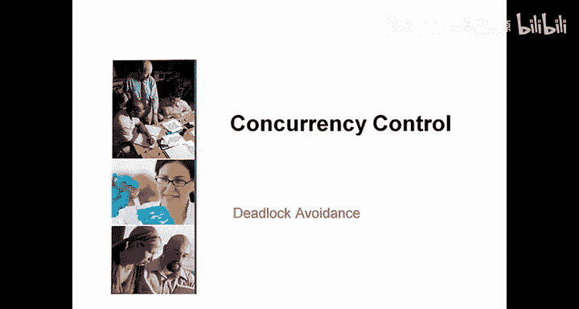
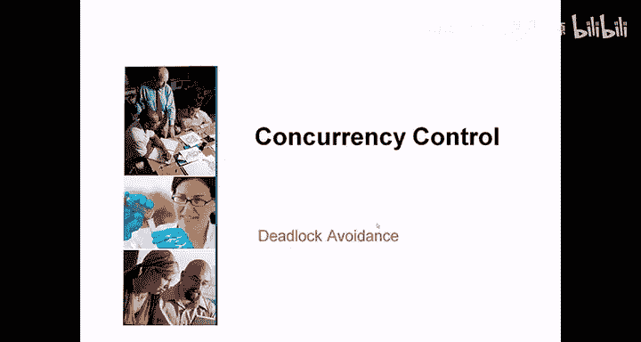
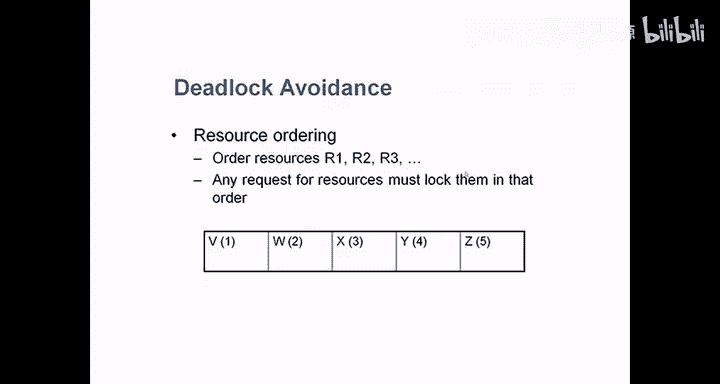
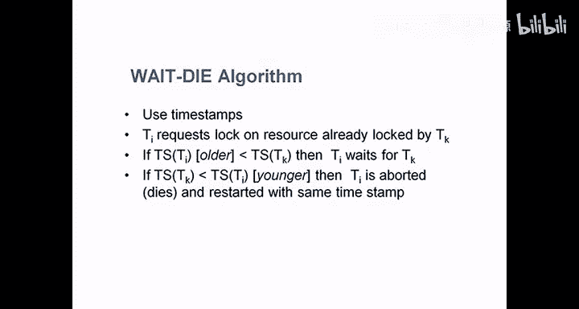
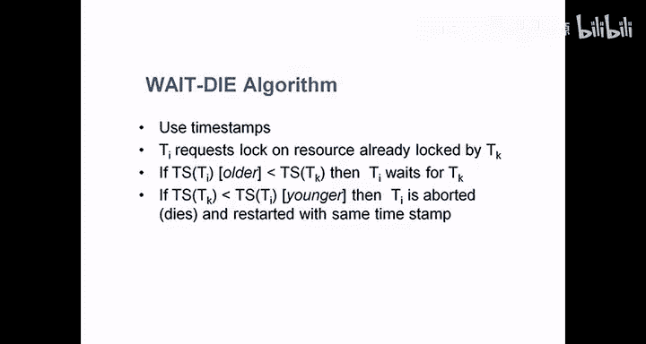
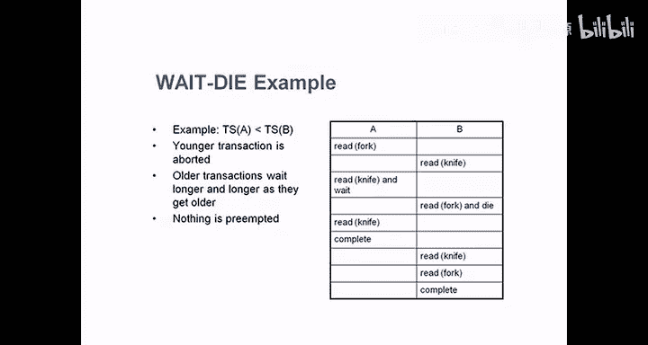
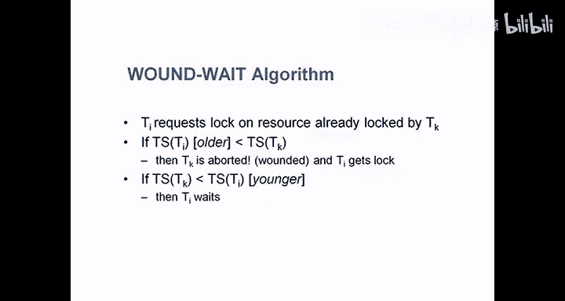
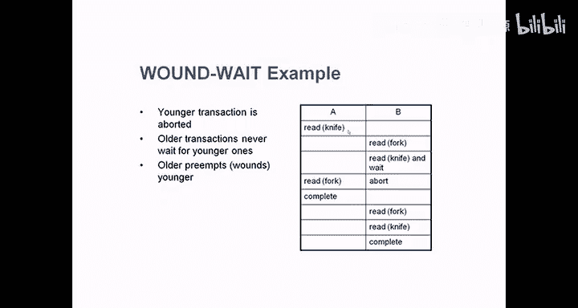
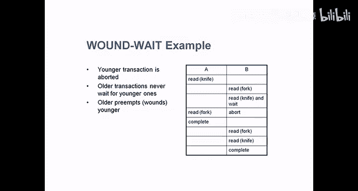
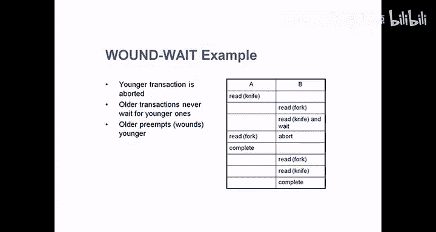

# 约翰霍普金斯大学《大规模数据库系统｜Large-Scale Database Systems》中英字幕 - P40：10_死锁规避.zh_en - GPT中英字幕课程资源 - BV1N2urzvEjK

Welcome to Concurrency Control， and this unit will talk about Delock avoidance。

There are a number of different schemes for deadlock avoidance。

 One scheme is to actually order the resources in the system。

So that when anybody requests locks on resources。They have to lock them in the order that they're numbered。

 So transaction1 comes along and locks the resources is has to start from the lowest numbered resources and work its way up to the highest number of those things it wants to lock if we notice we have resources represented by the bottom diagram we have a Vw X。

 Y and Z and they're all given numbers if transaction1 wants to lock any of those values or all of those values it has to lock them in the order that they're numbered Trans 2 comes along and wants to lock any of those resources it has to also lock them in that order This way it they'll never be waiting for lock for resources that are locked by the other transaction。

The only reason that resources are locked in an ordering scheme is if somebody starts from the bottom on the lowest numbers and works their way up while another transaction starts from the upper numbers。

 works its way down。 then you have the opportunity for locking。

 but to avoid deadlocks if all the transactions lock them in the order that they're numbered。

 they're never going to run into a deadlock situation。

 This is a little bit impractical for a large database system because they are a lot of different resources that all have to be given numbers。

 there's another algorithm called the wait and die algorithm， which uses timestamps。

 The idea is that if one transaction wants to lock a resource already locked by a different transaction。

 if this transaction that wants to to lock。

Something that's already locked by T sub K。 If it's older。

 it'll wait for the younger transaction to be done when it's when the younger transaction is done。

 it'll grab the locks at knees and complete。 If， however， if it's younger， if Ti sub I is younger。

And the older transaction has a lock on something。 Tabby is going to abort itself。

 It's going to die and then restart itself with the same time stamp。

 So eventually it'll become an older transaction， too， it might have to restart itself many times。

 but eventually， it'll be the older transaction。 and then nobody's going to abort it。

 It will complete。

Here's an example， A reads of for。It's the older transaction B is a younger transaction， B reads a I。

 A reads a if and since it's an older transaction it'll wait for B。

 the younger transaction to complete complete using the knife， but B isn't finished yet。

 it needs to read a fork， it's a newer transaction and since it's a newer transaction and once the lock something that an older transaction had。

 it will kill itself it'll abort itself it'll die。And then release its locks。

 A will continue reading the lock on knife。He now has the forkin knife locked， It'll eat。

 and now it'll complete and drop its its locks when it's done。

B will then pick up and read the knife and fork when it restarts and complete its eating in the wait and die algorithm。

 Older transactions wait longer and longer as they get older and older。

 so that's one one drawback to the weight and die algorithm。

To address this， we also look at a wound and weight algorithm。

So Tiabby requests a lock on a resource already locked by T sub K。

 If it's older and it needs a lock from a younger transaction。

 then the older transaction will reach out to the younger transaction and abort it。

 kind of interesting。 One transaction can abort another transaction。

 but it does avoid the problem of sitting around getting older and older。

 losing its locks that that the weight and die algorithm ha。In this case， as it's older。

 it's going to complete if a younger transaction has already locked that resource。 And by the way。

 if this is a younger transaction， it'll wait till the older transaction is done。 Here's an example。

 A reads a knife。 It's the older transaction。 B reads a fork。 B reads a knife and waits。

 It's the newer transaction。 It has to wait for A A to complete its use of knife。 So it'll wait。

 But now when a， the older transaction wants to read a fork。

 It knows that the younger transaction already has a lock on the fork。

 So it's going to reach out to the newer transaction B and aboard it。

 So a will never wait for younger transaction。 It'll complete itss eating。

 It has a lock on the knife and the fork。 It'll complete。 how B。

After a completes， we'll grab a lock on the fork and on a knife and then complete。

 So these are various strategies with dealing with deadlock avoidance。

