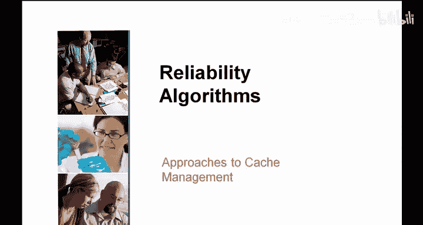
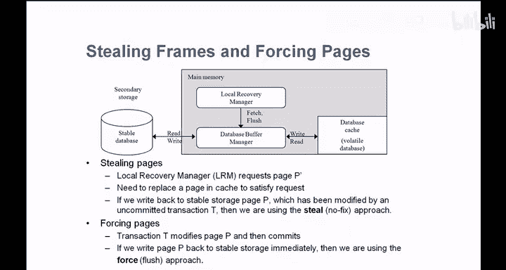

# 约翰霍普金斯大学《大规模数据库系统｜Large-Scale Database Systems》中英字幕 - P41：11_缓存管理方法.zh_en - GPT中英字幕课程资源 - BV1N2urzvEjK

Welcome to Reability Alrims in this unit will talk about approaches to cash management。

In this diagram， you see a typical cache management scheme。

 you see that Ma memory contains both local recovery manager and a database buffer manager。

The database buffer manager manages movement of data between the secondary storage on the left side and the database cache on the right side。

 so since the database cache is a main memory， it's volatile because the main memory can crash and the system itself can crash。

 so we expect the database cache to be wiped out every once in a while because of system problems。

 that's a volatile database。On the left side， we have secondary storage， which is a staple database。

 it's a disk system which we won't fool ourselves crashes once in a while。

 but is way more stable than main memory。So the idea of cache is to bring pages from stable memory to the database cache so that applications have fast access to the data and commod the data in Ma memory much faster。

 you get a lot more performance in your applications by moving data into the database cache。

 so there are two different approaches to cache management。

 there are two different aspects I should say of cache management， one is stealing pages。

 so when the local recovery manager requests a page P prime， let's say。

So we pull P Prime from the stable database， and when we move it to the database cache。

 the database cache might be false， so we'll need to replace a page in the database cache back to stableable storage so that we can take the new page P prime and move it to cache。

It seems fine， except for the fact that if the page that we're writing back to stable storage has not been committed。

So we're writing some uncommitted data to stable storage。Which could be problematic。

Because if the system crashes。What were left with was this uncommitted transaction in stable storage。

 meaning that that's not really the data that should be in stable storage。

 It's uncommitted data and really should not be there at all。

So if we actually take uncommitted data from volatile memory or the database cache and move it to stable storage。

 we're using the Steel approach that's called Steing a page。

 or sometimes it's called a no fixed approach。Okay so that's an issue ideally you'd like to keep only committed transactions in secondary storage and uncommitted transactions in database cache The second aspect is forcing pages so when we bring a page into volatile memory and the database cache we would like to perform a transaction and modify data and when we're finished with that transaction we'd like to force the data back to secondary storage since we don't need it anymore we've finished our transaction we'd like to force it back to secondary storage that's called the force method or the flush approach so certainly no steel and force is the easiest to implement no steel means that we don't take any uncommitted transaction and move them to stable storage and it also means that when we've committed a transaction we do move it or we flush it back to stable storage。

So that's actually quite useful because we're always sure that in our cache memory。

 we have only uncommitted data and in our stable storage， we only have committed data。

 meaning that if the system goes down，The only thing we lose in the main memory is uncommitted data anyway。

 and the only information， only data we have in the stable storage is data that has been committed。

 so it would be very useful to be able to separate the two。

 having only committed data in stable storage and only uncommitted data in volatile storage。

But unfortunately that doesn't really work so well。

 because often we want to pull in more pages than we have room in cache and many of those pages or the entire cache might be full of uncommitted transactions。

 yet we're going to need to pull that page into cash to ensure that we have good performance on our databasep transactions。

 so often what we'll have to do is we'll have to actually steal the data。

 meaning put uncommitted transaction data back to stable storage， not something we want to do。

But what can we do， we'd like to have performance as our key goal。

 and sometimes that means moving uncommitted data back to stable storage。

The other issue is always forcing committed transaction pages back to stable storage is not ideal for IO that requires excessive IO and the disks。

 so if you're alwaysting taking committed transaction data and pushing it back to disk you're using a lot of system resources and ultimately you're application response time will be slower because there's a lot of disk IO going on when you finish committing a transaction so realistically the types of recovery algorithms that are used are the steel no force algorithms。

 where we keep stable data in volatile memory or committed transaction of volatile memory and uncommitted transaction pages in stable memory。

 of course the problem is what do you do when the system crashes。

So the recovery steps during normal execution are the following， so we log all the transactions。

That are done all the modifications。That are done。 we keep that in stable storage。

 and that's guaranteed to be permanent。 We have a permanent log of any modification or update that's made to our database that's made to the database for all transaction updates deletes。

 etc ceter。 And those log entries must be written before the actual changes made because you don't want the situation where actually make a change。

 then the system crashes， but there's no log entry as a result。

 because we haven't written a log entry。 So what we really want to do is write the log entry first。

So the log enables the local recovery manager to do the following。

So in the case that we have unstable data out in the uncommitted data and stable storage。

 we want to do the undo the actions of the aborted and incomplete transactions。

 meaning we'd like to reach out to stable storage and undo that so that we can actually replace the information and stable storage which of the last committed transaction data。

And then finally。For the data that was committed but kept in volatile memory before it was ever written out to stable storage。

 we want to redo those actions and so that we can actually build up the data in the stable storage area in the cache so we can move it out to stable storage so we want to undo those transactions that rewarded or incomplete so we can remove the uncommitted data from stable storage and we want to redo the actions of committed transactions so we can create the committed data that's in volatile memory so this is going to be the basis of our local recovery management operations and we'll see how to do that as the module moves on。

