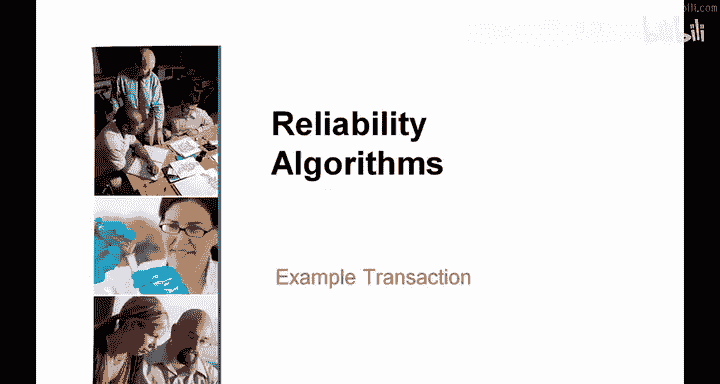
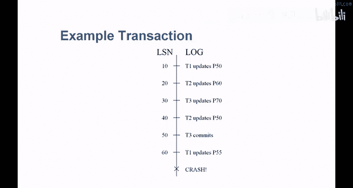
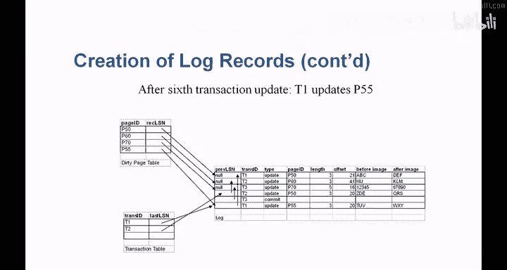
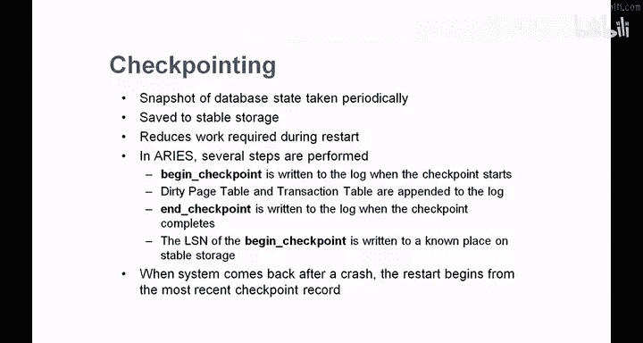
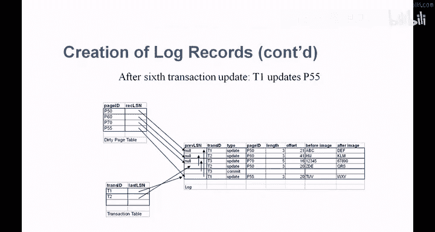
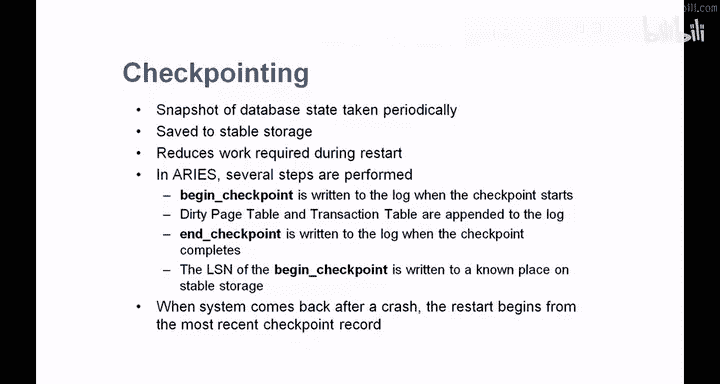

# 约翰霍普金斯大学《大规模数据库系统｜Large-Scale Database Systems》中英字幕 - P42：12_事务案例.zh_en - GPT中英字幕课程资源 - BV1N2urzvEjK

Welcome to Reability algorithmris in this unit we'll talk about an example transaction。

So here's an example transaction that occurs over time， we have a log sequence number on the left。

It's assigned in sequential order， so the first transaction takes on a log sequence number of 10。

 the second one takes on 2030， as long as it's monotonically increasing。

 it doesn't really matter what increments choose between the log sequence numbers， it could be 1，2，3。

4 etc， or it could be 1020， 30， 40， or any other monotonically increasing sequence of numbers。

On the right hand side。Represents different transaction operations over a period of time。

So the first transaction operation is transaction1 updates page 50 of our memory database memory。

Transaction 2 then updates page 60， Trans 3 updates page 70。

 Trans 2 pops in again and now updates page 50。Which， if you notice。

 transaction 1 updated page 50 has the first operation of this sequence。

And then transaction 3 commits， and then transaction 1 updates page 55。

And then a system crash occurs。Sou。😔，During this unit。

 I'll walk you through the steps of how the dirty page table。

 the transaction table in the log after the first transaction update T1 updates page 50 so if you look at the log table。

There's no previous log sequence number， this is the first operation in this transaction。

 so we create an entry where with no previous log sequence number。

 a transaction ID of T1 type update because this operation was an update。

 the page ID that was modified was page 50。And let's say that the data on this page started that we modified and started at offset 21 for a length of  three。

So we capture the before image of the page， which has ABC and the after image this is DF。

 So we updated three characters ABC and we update in this operation， those characters to become D EF。

 So we capture all that information in the first entry in this log table。

 Now in the dirty page table， we place an entry page 50 as a page I D。

 which became dirty and a pointer to the record log sequence number， which points to the first。Inst。

 in the log where this page became dirty。The transaction table is updated。

 we enter a new transaction because T1 is now a transaction that's modify information modifying pages in the database。

 and the last log sequence number in this case was the first entry in the log table。

So the dirty page table will always point to the first entry that made a page dirty and the transaction table will always point to the last operation of a transaction the second step is that T2 updates page 60 so we place a new entry in the log again there is no previous log sequence number for transaction 2。

 transaction ID is transaction 2 the type is an update。

 the page ID is page 60 and we modified offset 41 for a length of three characters。

The before image was HJ and the after image was KLM in the dirty page table。

 we now have page 60 that was made dirty， so we place an entry in the dirty page table for page 60 and point to the first entry where page 60 was made dirty。

 meaning it's dirty because it's not a committed transaction。And in the transaction table。

 we add transaction 2 and point to the last entry for T2。

 which happens to be the first entry right now for T2。

 the third transaction update is or T3 updates page 70。So again。

 we create a new entry in the log where we have no previous entry for transaction T3。

 so there is no previous log sequence number for this transaction T3， transaction ID T3。

The update type is update， the page that we've made dirty is page 70。

 we changed five characters at offset 16。The before image it was 1，2，3，4，5， and the after image is 6。

7，8，9，0。 We put an entry in the dirty page table because we now made page 70 dirty。

 and we put an entry in the transaction table for a transaction 3， because this is the first。

 this is the last entry for transaction 3 in the log table。 so far so good。

The first transaction is where T2 updates page 50 so we place a new entry in the log table。

 every operation we place an entry in the log table notice that transaction 2 actually had a previous entry in the log table so we look at the transaction table。

And we notice that T2 used to point to or it currently is pointing to the second row。

 so we take that value out of the transaction table and place it in the previous LSN。

Entry For this tape for this entry in the log。And then we replaced a transaction table to last entry in the log table with this new row that we've been replacing in the log table。

So now in the transaction ID of this log entry is T2， it's an update of page3 page 50。

We made the modification at。Position 20 for a length of2， and we've changed ZDE to QRS。

 Now notice that the first entry of the log change that page at entry 021 we've changed ABC to DEF。

The offset of 20 is some character followed by DE， which is what we changed positions 21 and 222。

So now the before image is EDE， the after image is QRS。

There's no new entry in the dirty page table because all we're concerned about is the first point in the log where page 50 became dirty and we already have a pointer to the first entry of the log。

In the transaction table， as I said before， we now point transaction 2 to this entry in the log because it is the latest entry for transaction 2 in the log。

After the fifth transaction， T3 commits， so we put an entry in the log to say that T3 does commit。

 and now the previous log sequence number 4 t3 is the third entry in the log。

 but notice something about the transaction table since it committed。

 we no longer have to concern ourselves with T3。Because T3。

 the transaction table only keeps track of those transactions that are not committed。

 once the transaction commits， we remove it from the transaction table。

And there is no newde dirty page， so the dirty page table is identical to the state it was in in the last slide。

 moving on to the next transaction， the6 transaction update。Up T1 updates page 55。

 so we place an entry in the log where T1 updates page 55。

 the offset is 20 for a length of 3 and we've changed T V to W X Y。

And we put a new entry in the dirty page table because this is the first time that page 55 is now is now updated。

 so it becomes。So it has data that is uncommitted。And T 1。

Of the transaction table now points to the last entry for T1 in the log。

 so we change the pointer in the transaction table to the last entry of the log。

And it's at this point that the system crashes， so what we've done is we've created a dirty page table of memory。

We've carried。 it， created a transaction table in memory， and we have a log in stable storage。

 So at the point of the crash。

If I move back a slide， all we really have is this log and we're going to have to reconstruct our dirty page table in our transaction table so that we can reconstruct the database to the point it was in before the crash We don't want to keep around any information about transactions T1 and T2 because they were not committed so we want to make sure that the databases in a state where none of the changes of transaction T1 and T2 take effect in the database。

 We can't rerun the applications that ran transaction 1 and transaction 2 because we can't start up a transaction in the middle and figure out where we started。

 so we basically want to say those transactions never committed。

 so all memory of those transactions will be deleted from the database。 Now。

 the problem is is that some of these records could be in stable storage so we have to bring ourselves to a place where where we remove those entries from stable storage if they are in stable storage。

And finally， we will from the dirty page table， we want to start where the earliest。

 dirty page starts and start reconstructing in the redo phase。

 reconstructing the state of these tables， and in the transaction table。

 we want to start deconstructing all the changes made by the uncommitted transactions。Now。

 notice that the dirty page table and the transaction table can get really large over time。

 The log is the log。 It's going to always be， you know， it's going to be incrementally growing。

 It's going to be huge， but that's often stable storage and we don't have to worry about that ostensively。

 but the dirty page table in the transaction table will be a lot to reconstruct。

 especially if we keep the history from the beginning of the database。 we know the log is huge。

 but we don't want a huge dirty page table and a huge transaction table and we don't want to start from the very beginning of the log several years ago when we started making updates to the database。

 So what we'd like to do is every once in a while， we like to checkpoint our our information。

 So we want a snapshot of the database state。

We want to save that to stable storage， so we're going to write an image of the dirty page table and an image of the transaction table。

Into into stable storage every once in a while and in the log。

 we're going to checkpoint that information So we write a begin checkpoint to the log and the dirty page table and transaction table are appended to the log and an Ed checkpoint as written to the log when the checkpoint completes。

 So that just means that when the system crashes， we don't have to go back to the beginning of the log to reconstruct the dirty page table and also to reconstruct the transaction table we've got some more recent copy of the dirty page table and the transaction table write we can start from that point and then reconstruct the last and the last few entries of the log when we reconstruct these tables。

 that ends this portion the next video I'll speak about how the dirty page table and the transaction table are reconstructed and and then dirty transactions or uncommitted transactions are removed from the database。

