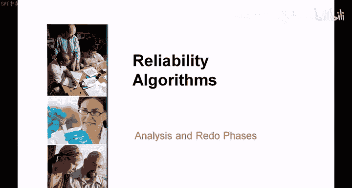
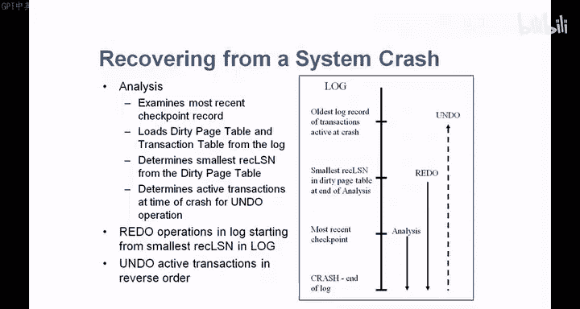
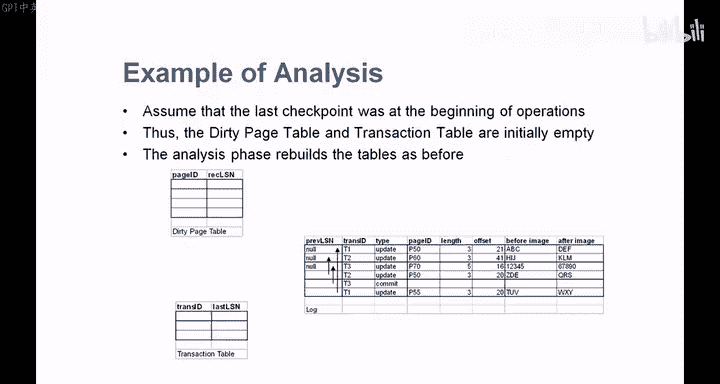
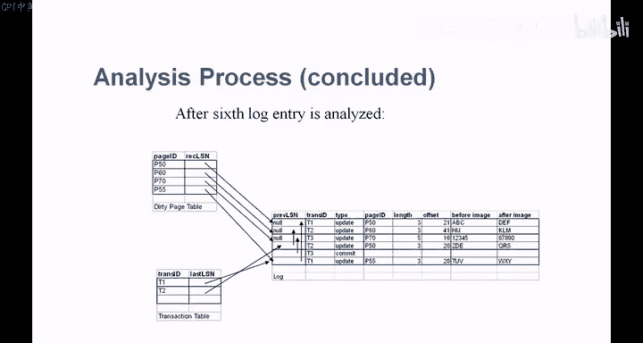
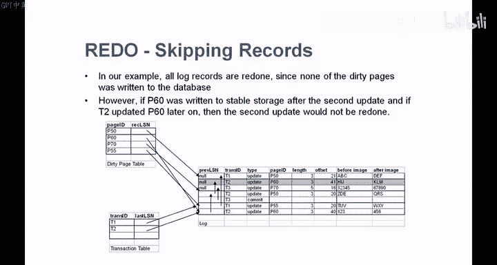

# 约翰霍普金斯大学《大规模数据库系统｜Large-Scale Database Systems》中英字幕 - P43：13_分析与重做阶段.zh_en - GPT中英字幕课程资源 - BV1N2urzvEjK

Welcome to Reability algorithmris and this unit cover the analysis and redo phases of the A algorithm。

So what do we do when we recover from a system crash there's an analysis phase。

 which is the first phase， a redo phase， which is the second phase and an undo phase。

 which is the third phase。 so looking at the diagram on the right。

 he notice that we have a log file which if you view the top of that line as being the older transactions so we have a set of transactions that goes back from the beginning of the time to beginning of the database and as it moves down the line further there's more and more transactions until the bottom of the line is the crash。

So。There are three phases in the analysis phase we have to figure out where we're going to redo the records that were not committed。

And undo the records that were already committed， but never made it out to the database。

So what we want to do is the first analysis is we examine most recent checkpoint record。

 so if we look at the log， we have the most recent checkpoint。

 rebuild the dirty page table at that checkpoint and the transaction table at that checkpoint。

And we loaded into memory。And there what we want to do is we want to determine the place to redo。

 start redoing the operations， the transactions， and then we want to see where the transactions that we want to undo so the redo operations and log starts from the place where the earliest dirty page was made and the undo operations want to undo all those transactions that were not committed so the analysis phase rebuilds a dirty page table and transaction table from the last checkpoint record scans a log forward and to ensure that the dirty page table and transaction table are at the state they were at the time of the crash so if new pages were made dirty you add it to the dirty page table with with the log sequence number if a transaction was committed you want to remove it from the transaction table。

So we're doing all the steps that we did to create the dirty page table and the transaction table during the regular operation of the database。

Okay， at the end of this process， the dirty page Hibble and transaction table will be at the same state they were in at the time of the crash。

So here's an example of the analysis phase， we assumed that the last checkpoint was at the beginning of operations just to make this easy。

 as an example， but in reality the checkpoint will actually contain information in the dirt page table and the transaction table。

 but just to make it easy for this example， we'll assume that we're starting with a clean slate。

 and if you notice we do have a log with all the operations that are on the database before the crash。

So the analysis phase rebuilds the tables as before。Very simply done。

The first log entry is analyzed。 we noticed that what we did was we made page 50 dirty。

 so we entered page 50 and the dirty page table and the log sequence number。

Is is a pointer to this record and notice that we entered a value for transaction1。

 so we move that value of to the transaction table and we point to this record in the log table after the second log entry is analyzed we notice that we updated page 60 so we'll recreate the information of the dirty page table and in the transaction table we modify the transaction 2 and we modify data with transaction 2 and we made page 60 dirty。

The third log entry is analyzed， we made an update in transaction 3。

 so the transaction table now has a new entry， transaction 3 points to this row。

 and we made page 70 dirty， so we had a new entry in the dirty page table。

After the fourth log entry is analyzed， so it's a update on T2。

 so we change the pointer in the transaction table to now point to the fourth entry in the log table。

And nothing changes in the dirty page table because we don't have a new dirty page that was made dirty。

After the fig fifthif log entry is analyzed， that was a commit， so we noticed that T3 was committed。

 so as was during the operations the regular operations of the database。

 we removed T3 from the transaction table， we removed it here as well。

After the six log entry is analyzed， T1 now has a latest entry。

 so we modify the transaction pointer to T1 point to this last row。And the log table， which is T1。

And we notice that page 55 is made dirty。 This is the first time it's been made。

 It has been made dirty and in the log。 So we add a new entry in the dirty page table。

 So at this point， the dirty page table and the transaction table are in the same state they were when the system crashed。

 Now， we have enough information for the redo phase and the undo phase。

The reto phase applies all of the transactions， both to committed and uncommitted transactions right from the beginning。

So if I move back a slide， we look at the dirty page table and look at all the pointers to the log。

 the earliest pointer pointer to the earliest log sequence number。

 is the pointer that we start with first。 So we look in the log and we notice in this case。

 it's pointing to the first row of the log， But in reality this log could have many。

 many entries before it。 but we look at the earliest dirty page。

 and we start with that row of the log， and we now change the actual database based on the rows of the log。

So it starts from the oldest Rex log sequence number in the dirty page table。

 and for each redoable log record， we redo it in the database。So as I moved back。😔，To this slide。

 what we do is we're going to change。Page 50， offset。21， length 3 from ABC to D F。

 We're going to change page 60， offset 41， length 3 from H J to K KLM。

 Every single log entry is going to be looked at and used to modify the actual database pages。

To get to the point where we were in before the crash so there are certain circumstances wheret redos are not done the pages in the dirty page table log sequence number and the actual page is greater than that log sequence number or the log sequence number in the database is greater than the log sequence number of the log record so which case that means somebody actually pushed it out to memory early。

 the dirty page table is incorrect， but basically if the page is already written after this log record ignored that log record。

 but what we're going to be doing is writing all the dirty pages with the values that they had before the time of the crash。

 that is the redo phase。

The next phase is the undo phase。 that uno phase is where we undo those uncommitted transactions。

 Now one more thing about the redo phase。 supposeuppose that well in our example。

 all the log records are redone since none of the dirty pages were written me to the database。

 However， if page 60， if you look at the second row， the log table。

 if that was written to memory and the earliest dirty page table value is now something later on。

 maybe some new transaction entry at the end of the log table。 This is not our example。

 I'm just modifying the example a little bit。 If we notice that that page 60 was already written to memory。

 we're not going to do that operation， we're going to pick it up at the point where page 60 was made dirty。

 we're going update those values， but we're not going to update page 60 where it was already clear that it was written out to memory in the next video I'll talk about the undo phase。

