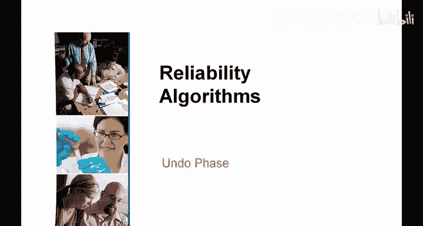
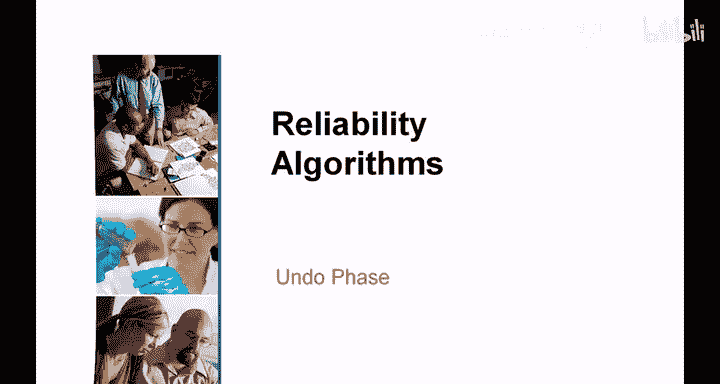
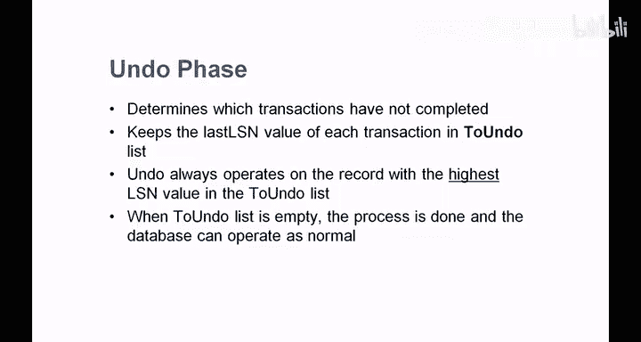
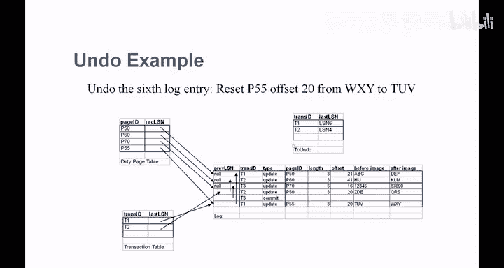
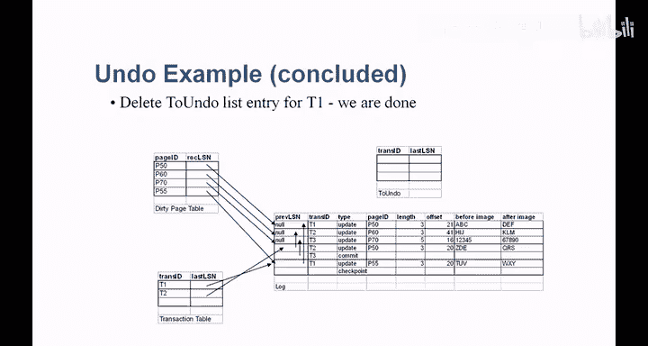

# 约翰霍普金斯大学《大规模数据库系统｜Large-Scale Database Systems》中英字幕 - P44：14_撤销阶段.zh_en - GPT中英字幕课程资源 - BV1N2urzvEjK

Wecome to reliability algorithms in this unit， we'll talk about the undue phase of the As algorithm。

So the undo phase is the last step of the As algorithm。

 we've already reconstructed the database to the point we were at the cr before the crash。

But what we want to do is remove all the entries in the database for values that were not committed。

 so in the undo phase we look for at all the transactions that were not committed and we step backwards through them to undo those values in the database。

So we look at the transaction table to determine which transactions have not completed。

 and we put them in a two undo list。 and undo constantly moves backwards through the transaction to undo what was done。

 And it always looks at the last。It always operates on the last entry of the log sequence number。

 the highest log sequence number to undo， I'll illustrate this soon。

So here's an undo example， so in this case we reconstructed their dirty page table to be in the state it was before operations before the crash。

 and the transaction table is also reconstructed in the state before the crash in the redo we looked at their dirty page table and we reconstructed all the data in the database to be as it was before the crash。

However， we would like to undo those uncommitted transactions to T1 and T2 in order to do that。

If you notice， we created a new box on the upper right side called the two undo list。

The two undo list is basically all those transactions that need to be undone。 So initially。

 it's populated with information from the transaction table。 So if you notice T1。

Points to the sixth entry in the log， so we place T1 in the two undo list with the log sequence number of6。

T 2。It also not committed。 and it points to the fourth entry of the log table。

 So we place it in the2 on delete list log sequence number 4， so。

What we do is we set the two un。 What we do is we undo the first。Element， the first， the last。Well。

 what we do is we take the highest log sequence number of the two undo list and we undo the database。

Change that was made by that entry。 So if you notice what we did， the last entry was T1。

 which pointed to the last row of the log。 and that was an update at of page 55 from offset 20 for a length of3 what the change that we made in the operation was when we replaced T U V with W X Y。

 So in the undo phase we take W X Y and replace it back with T UV。So in this way。

 we're slowly moving the data。The data it found in the  dirty pages back to the values it had before the transaction1 and transaction 2 operations started running。

 so before transaction 1 and transaction 2 started running。

 were're moving the data back to the values it had before those transactions。

So notice after we modify page 55 to move its values back to TUV instead of WxY。

Then we follow the pointer of the last row。 The previous log sequence number at points to log sequence number one。

 So now we've that we've undone row 6。We now say the transaction T1 is not done being undone yet。

The next entry for T1 to be undone， we have to look at the log sequence number1 under the first row of the log table。

 So we replaced the last log sequence number went from log 6 log sequence number 6 to log sequence number1。

Now， the highest log sequence number to undo is log sequence number 4 and log sequence number 4 is the fourth entry in the log。

 and that's an operation， the update operation by transaction 2。 and what we'll do is we'll move。

The actual operation chains ZDE to QRS。 What we're going to do in this undo example is we're going to move QRS back to ZDE。

So when we do that。We now notice that T 2。Pointed to its previous value。

 which was the second entry in the log table。 So we take the second entry。Of the log table。

 and we place it in the two undo list log sequence number 2。At this point。

 log sequence number 2 is the highest log sequence number in the two undo list。

 So what we're going to do is we're going to look at the second row of the log。Table。

 the second entry and the log table， and the operation actually changed HJ to KLM。

 What we're going to do is change KLM back to HJ。And when we do that。

 we'll notice we'll look at the two undo list and we'll replace the value of T the last log sequence number for T2。

 the pointer。Fund in the previous log sequence number to the previous row of that T2 modified。

 the previous row in the log， but if we look at the second entry of the log。

 the previous log sequence number is null， so that was the first operation of T2。

 so we'll remove it from the2 undo list。So the last thing that Tetu un duos does now is it operates on T1 and it undoes the effects of t1。

 So if we look at log sequence number1， the operation changed ABC to DF。

 we're going to take those values DF and move it back to ABC。

 and we look at the previous log sequence number for the first entry in the log and notice that's null。

 That means we're done with transaction T1。And we have nothing left to do。

 and they'll tell you undo list。So now at this point in memory at this point in the transaction we're ready to go again。

 what we've done here through the redo phase is redo all the operations to bring the database to the point it was in before the crash and now we took all the dirty transactions。

 the uncommitted transactions and undid their effects in the database so now we have only the effects of T3 and we've removed all the effects of T1 and T2 now the database is in a stable state and we ready to continue processing。

