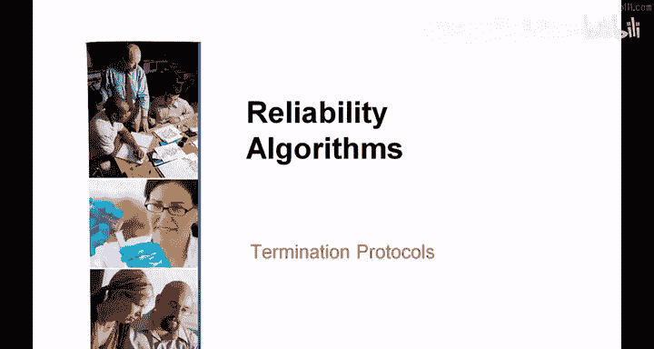
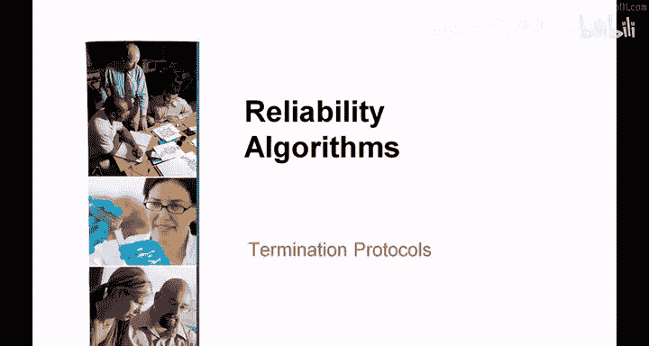
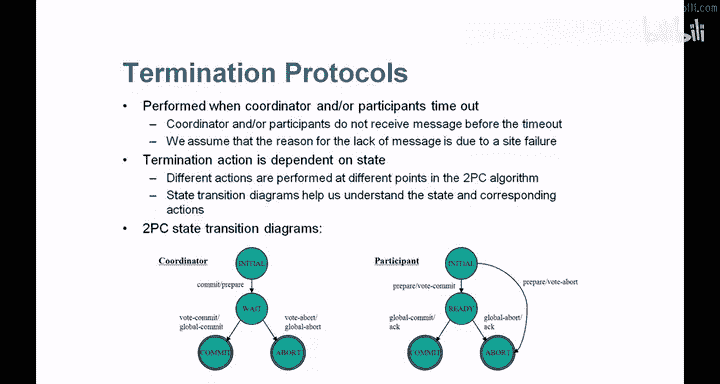
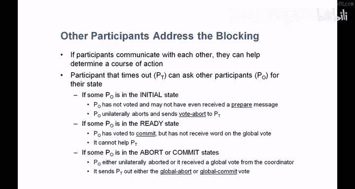
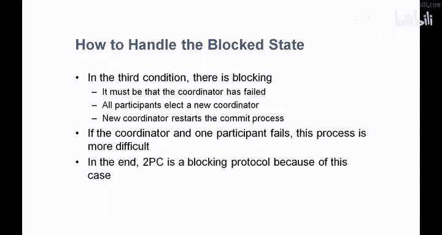
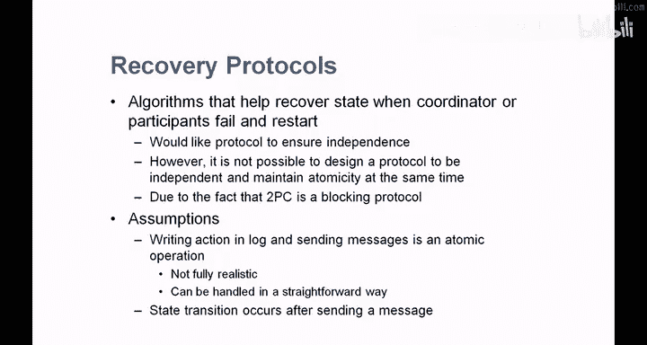
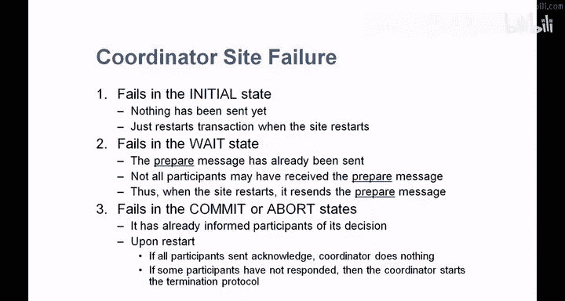

# 约翰霍普金斯大学《大规模数据库系统｜Large-Scale Database Systems》中英字幕 - P45：15_终止协议.zh_en - GPT中英字幕课程资源 - BV1N2urzvEjK

Welcome to Reability Als， and this unit will talk about termination protocols。

Tour anim protocols occur under two different circumstances。

 they occur number one when either the coordinator or any of the participants time out。

 something has to be done to reset the status， we'll talk about what needs to be done then。

Termination actions depend on the state and really depends on where you are internally to the process of the two phasese commit protocol There are also actions done if the coordinator or the participant dies during that time and what happens。

 what it must do when it comes up again， we'll talk about both what happens when it times out when they time out and what happens when it comes up again。

 whengno when it dies and comes up again， so the two phasese commit state transition diagrams are the following。

If you look on the left， you'll notice that the coordinator starts out in the initial state。

 and in the initial state， it sends a message to all the participants that they asking them whether they're ready to commit or not。

 so it sends a commit prepare statement。And then it moves to the wait state waiting for the responses from the participants。

If all the participants say that they are going to commit， they vote that they want to commit。

 the wait state sends out a message to all the participants saying， go ahead， go commit。

And then it'll move down to the commit state， or if one of the participants say that it can't commit one to abort。

It sends a message back to all the participants telling it that it's going to abort and it moves to the abort state。

 That's the state transition diagram for the coordinator。

 All of the participants following follow the straight transition diagram on the lower right side。

 They start out in the initial state。 They receive a request or prepare a commit request。

If they cannot commit， they vote to abort and move directly to the abort state。

 send their vote back to the coordinator， and then the coordinator will in turn tell all the participants you've got to abort。

But if the participant moves。Decides to commit， it moves to the ready state。

 It sends a message back to the coordinator， and the co waits for the coordinator's final decision about whether this transaction is going to commit or not。

So it waits until it receives a response from the coordinator。

 if the coordinator again received a vote to commit from all the participants。

It sends a message back to the participant in the ready state says， yes， go ahead and go commit。

And that's exactly what the participants do， they commit and then they move to the commit state。

If the response from the coordinator was to abort， that means that one of the participants was aborting。

Decided to vote to abort。 So it will say， O， even though I was prepared to commit。

 I'll move to the abort state and not commit the transaction。

Okay， so that's the simple case， but what happens when the coordinator times out。

 what happens when it's in some one of its transition states and doesn't receive a response。

 it can't sit forever， it's got to move on so it sets a timer and waits。

 and when it doesn't receive a response it has to act。

So there are two real cases that we have to worry about in the coordinator。

 what happens if a timeout occurs in the wait state and what happens if a timeout occurs in either the commit or board states。

 Okay， so this is pretty straightforward。In the wait state。

 it's waiting for everybody to vote on whether they've aborted or committed。

It hasn't received a message from at least one of the participants and is waiting and still doesn't hear from them。

It can't unilaterally commit because you need a unanimous vote。 It's not receiving a unanimous vote。

 So all it could do is really decide to abort。 It always has that decision to abort and always has the ability to abort。

 So it can unilaterally abort。 And that's what happens。 after a time's out， says， look。

 I haven't heard from everybody。 I'm going to send a message back to all the participants。

 Let's not go through with this this transaction。 I'm going to send all the participants and abort signal。

 And that's what happens。 And then all the participants。

 even whether they've committed said that they would commit or not。

 they will move to the abort state。O， if the timeout occurs in commit or abort， what happens， Well。

 it doesn't know if the participants have completed their task。

 but it certainly told them what to do。 So if it told them that there's a global commit or a global abort who repeatedly sends out these messages until it receives responses from all the participants。

 it will eventually hear， we hope。Now what happens if the participant times out。

 so we really care if it times out in the initial state or the ready state？

So if it times out in the initial state。It's waiting for a prepare message。

 So we assume that the coordinator failed in the initial state somehow。 So the participant。

 after waiting for a while。Gotta move on。 It'll It'll unilaterally abort at that time saying， look。

 I'm waiting。 I'm waiting。 I haven't heard anything yet。 I'm going to vote abort。

 and it moves itself to the abort state。 And it sends a message back to the coordinator。 Ultimately。

 the coordinator will receive that message and it will send out a universal abort or global abort to all the other participants。

 And that's because this participant cannot wait。 for a long time。

 It's got a time out and makes some decision。 So it decides to abort。Okay。

 what happens if there's a timeout in the ready state In this case， the participants vote to commit。

It did。 I mean， the participant did vote to commit， but it doesn't know the global vote。

 And it can't make an unilateral decision one or the other to to outboard or commit。

 It's got to wait for the entire enterprise。 All the participants to make their decision。

 So is really stuck in a state and the ready state。

There are certain of circumstances where we can deal with。What to do at this point。

 it hasn't heard from the coordinator and it's waiting for the coordinator' input hasn't heard it anything from it。

 It decides it will decide what to do without the coordinator。

 and I'll talk about that in the next slide。But in the worst case， it's going to block。

 It can't move on because hasn't heard from the coordinator， doesn't know what to do。

Doesn't know if he universally committed or universally aborted。

 don't know we you just have to remain in the block state。Okay。

 so there are things that can be done to address this if the participant communicates with other participants。

 so they can gather together and make some kind of decision。Remember， they haven't heard。

 this participant hasn't heard from the coordinator。

This participant can only assume the coordinator is timed out has craft something。

 But if it speaks to the other participants， it can find out what to do。

So if it takes a poll for all the other participants。And if some participants in the initial state。

 that means if hasn't even voted， hasn't may not have even received a prepare message。

 So in that case， it'll universally abt a unilaterally abort， saying vote abort。

 And it tells this participant that made the inquiry to go ahead and abort。 And that's what it'll do。

 So we know that from if any of the participants in the initial state vote to abort the whole。

Transaction is going to abort。 So in this case， the participant who's pinging the other participants。

Receives a message from one of the participants that's stuck in the initial state to that it's going to abort。

 So it knows that ultimately that even if the coordinator were up。

 the coordinator would get abort vote from this participant and then the coordinator would tell the current participant whos wondering what to do to abort。

 so。In this case， the other participant can abort。And this participant will vote will abor as well。

 If some other participants in the ready state。It has voted to commit。

 but it hasn't received word either from the coordinator。 It can't help。

So some participants in the abboard or commit state we know what the coordinator voted。

 had told everybody either to globally abort or globally commit。

 So this participant who hasn't heard from the coordinator also decides that it's going to abor or commit based on what this other participant is doing。

But we notice the second step of some other participants on the ready state。

 it cannot help this participant。So what are we going to do about that。

 let's say all of them are in the ready state， nobody can help each other。So。Let's just。

Dulve into how this participant interprets the responses from the other participants。

 So as I said before， if this participant receives a vote aboard from other participants。

 it means that they've abor it so this participant can vote can abor as well。

If it receives a vote abort from some participants， but others are in the ready state。

 it knows that at least one of the participants would have aborted。

 so the coordinator would have aborted as well， so therefore this participant will abort。

 and ultimately all the other participants will abort。However。Step 3 here。

Reflects the step in the previous slide and middle step in the previous slide。

 if it finds that all of the participants are in the ready state。

 no participant could proceed because it hasn't received any message from the coordinator and they're all blocked waiting for the coordinator so they're all back to where they started。

 they don't know what to do。Okay， we're going to come back to that step in the next slide。

 we're going to address that in some way。If it gets a global a or a global commit from all the other participants。

 it can proceed accordingly， it knows that the coordinator has voted to either a board or commit and it will act in kind。

 she receives a global award from or a global commit for some participants。

 others might be in the ready state， it knows that it can go ahead and commit because ultimately that's what the coordinator had told at least some of the participants to do。

Okay， so let's come back to step3。All participants are in the ready state。

 but they don't have a coordinator and they can't move on。

 They don't know what the coordinator has decided。So。We've reached a blocking state。

 and the coordinator certainly has failed。So in this case。

 all the participants elect a new coordinator and the new coordinator restarts the commit process。

If the coordinator， so it they might all actually go ahead and commit because they're all ready。

 They've all voted to commit。 This new coordinator knows that they've all voted to commit。

 So the coordinator will say go ahead， globally commit。However。

 if the coordinator and one of the participants fail。

 this is difficult because nobody knows what that participant decided and nobody knows what the what the coordinator decided globally。

 there's nothing you can do at this point。So。If a coordinator and a participant fails。

 the phase2 phasese commit protocol is blocked， and that's really bad because the participants are just going to sit there and they cannot move on somebody has to come and just reset the whole system。

 not a good protocol in that case， so generally two phase commit works very well。

 but in this case it's not very not ideal because they could all end up in a block state if of one of the coordinator and one of the participants fail。

Okay， so there are recovery protocols， so you want to so what youd like to do is。

When the coordinator and the participant potent fail。

 he'd like the protocol to ensure some independence that they'd be able to restart or move on with their transactions。

 but it's not possible to design a protocol that to be independent and maintain atomity at the same time。

 and that's due to the fact that this two phase commit protocols of blocking protocol。嗯。

You want something that works that achieves atomicity without inhibiting without inhibiting any of the messages。

 without inhibiting any of the other operations that these participants have to participate in。

 we're going redress this with the three- phasese protocol coming up But before we address this problem with the three-phase protocol。

 let's just continue on with the two phasese protocol。

 we've discussed what happens when a participant times out or what happens when the coordinator or the participant sites fail。

 what do we do， Okay， if the coordinator sites fail， if it fails in the initial state。

 nothing's been said yet， So we just restart the transaction when the site restarts。 Not a big deal。

If it fails in the wait state， it knows that it sent a prepare message to everybody。

 not all participants may have received the prepare statement。 So when the site restarts。

 it resends a prepare message and then waits for the participants to vote again。

 So if they decide they're going to commit， they'll vote commit， they decide they're going to abort。

 they'll vote aboard， but it'll just wait for the participants a decisions。

 If it fails in the commit or abboard states， It's already informed the participants of this decision。

 So upon restart， it just sends if all participants sent an acknowment。

 the coordinator doesn't do anything because presumably they're all committing or abboarding。

 If some of the participants have not responded， then the coordinator starts the term termination protocol。

This is the algorithm that we discussed a few slides ago。

 what does it do when when it's as if it timed out in the commit or abort states and it proceeds in the manner that it did。

When it timed out in the committee board state。It also proceeds the same way when the site fails during the commit or aort states。

 What happens when a participant site fails so it fails in the initial state upon recovery。

 the participant should abort the transaction unilaterally。

 certainly can do that and then the coordinator will either be in the initial or wait state in any case。

 if it's in the initial state and might send a prepare message anyway and we move to the wait state。

But in any case， it'll get to the wait state。 It'll receive of an abt statement。

 Abbort message from this participant。 And then the entire transaction will be aborted。

 It's pretty straightforward。 If it fails in ready in the ready state， this is problematic。

 So the participants is already voted to commit。 So in recovery。

 the participants can handle this as a time out and transfer this to the termination protocol， Right。

 This is what we discussed a few slides ago， it comes back in the ready state and is it just waits for the message from the coordinator。

 If it doesn't receive a message。 it could be blocked， it'll pull all the other participants。

 if the other participants， If there is a participant that also failed， it doesn't know what to do。

 it could potentially block。 Not a good， not a good thing。 Finally。

 if the participant site failed in the abort or commit states。

 So these are the termination states upon recovery， it either did the abboard or it did the commit。

 So the special action needs to be taken。