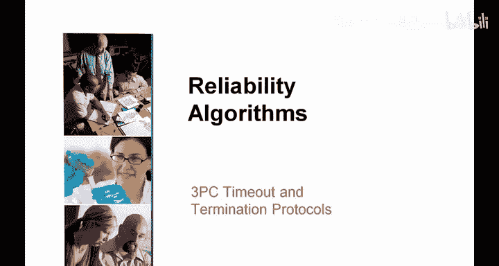
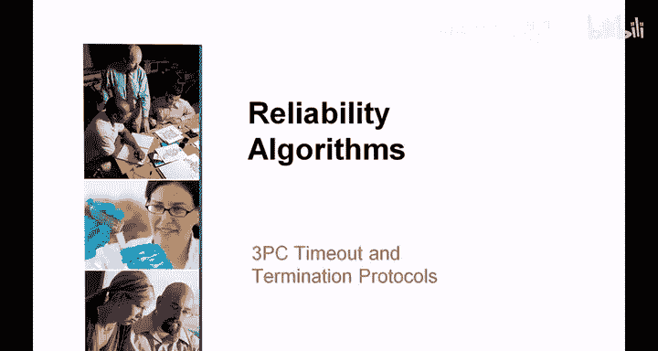
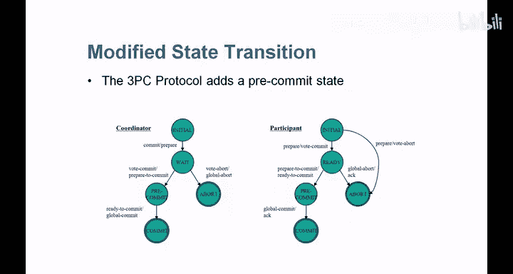
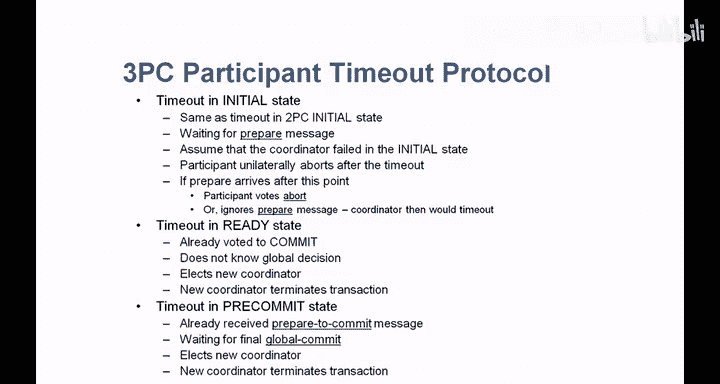
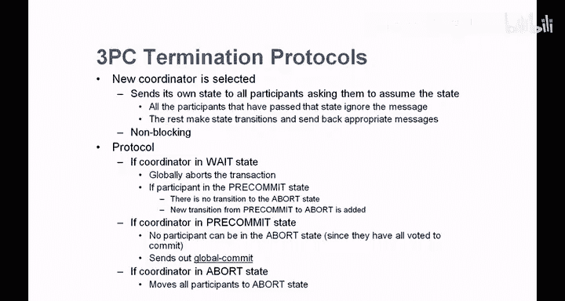

# 约翰霍普金斯大学《大规模数据库系统｜Large-Scale Database Systems》中英字幕 - P46：16_3PC超时与终止协议.zh_en - GPT中英字幕课程资源 - BV1N2urzvEjK

Welcome to Re the Lady algorithms and this unit we'll talk about the three phase commit protocol。

 its timeout and termination protocols。

So the three phase commit protocol modifies the state transitions。Specifically。

 what it does is as a third state called a pre commitmit state to both the coordinators and participants。

 what this does is it removes the weight state of the coordinator or the ready state of the coordinator from being adjacent to a commit or abort。

When it's adjacent to a commit or abort， there are circumstances where we discussed in the last unit。

The participant may be blocked because it doesn't know which state to move into with a pre commitmit。

A state transition phase。Basically， both the coordinator and the participants have decided that they are going to vote。

 Yes， they are going to commit， but they haven't really committed yet。

 and it gives them the last opportunity to decide whether they really want to commit or not。

 So it says yes， I'll commit will I really want to commit。 Yes， it really want to commit。 Okay。

 then go commit。 what that enables you to do is it enables you to abort at some point when you in the do you really want to commit stage。

 And that allows the participants to be non blocklocking in which it enables participants to be independent and be able to move on in case coordinators and other participants are down。

 So let me describe me in more detail。If you look on the web page。

 you'll notice a more detailed transition state and the communications between the coordinator and the participant。

 but I'll just describe the coordinator transition phases and I'll describe the participant transition phases。

 So from the coordinator's perspective， initially the coordinator starts a transition。

 sends a message to all the participant and says， preparepa yourselves to commit。

 Are you going to commit or not。The participants will either vote， yes or no。

The coordinators moved into the wait state now and in our waits all the participants' decision。

 So again， if one of the participants says no， it globally aborts and votes aort。

 and it globally aborts and tells all the participants go abort yourself。

If all the participants say yes， so it moves to the weight state。

 it moves from the wait state and moves to the pre commitmit state。

 and the pre commitmit state waits for all the participants to say。

 are you truly you truly going to commit？And when they say yes again。

 it'll send out a message to all the participants truly commit and it'll move to the commit state。

From the participant perspective。When it gets， it starts out in the initial state waiting for some directive。

When it receives a prepare。It says it decides whether it's going to abort it or will whether itll commit。

So if it aborts if it decides to abort， it moves to the abort state and sends a message back to the coordinator telling it I've aborted。

 and that means the coordinator is going to tell all the participants to abort。

But if the participant wants to move into the ready state， if he wants to commit。

 it'll send to commit back to the coordinator and a coordinator and then it'll move to the ready state Wait for the directive of the coordinator。

 as the coordinator gets a commit from all the participants。

 sends a message back to the participants saying， yep， it looks like we're going to commit。

 Pre yourselves to commit。And the participant will move to the precommit phase。

 and it'll wait there for the final word from the coordinator。Finally。

 when the coordinators in the pre commitm state， it sends out another message when it's really sure that it's going to go through with the commit。

 sends a message to all the participants that are in the pre commit state。 Go ahead。

 We're really going to commit now， and they do commit。

 So we'll see in the next slides exactly why this helps the participant become a non blocking part protocol。

Okay， so what happens when the coordinator times out。

So let's say there's a timeout in the wait state。Meaning that the coordinator has already sent out an initial message to all the participants go ahead。

 prepare yourselves。 Are we going to commit or not， But if it comess out in the wait state。

 it's waiting for some of the participants to get back to it。 Can't wait forever。

 It assumes one of the participants is down。 or first of， some other reason is unable to respond。

 So in this state， it certainly has the ability to unilaterally abort the transaction。

 So it does that since it does abort the transaction and sends a global abort message to all the participants。

That's a very simple case to deal with。If it times out in the precommit state。So。

 the coordinator doesn't know。If nonreents have moved to a pre commitm state or not。

 it knows they're at least in a ready state because it couldn't have gotten there unless they got a vote from all the participants that they are willing to commit。

 So it sends a prepare commit message to everybody。And it globally commits the transaction。

And then it sends a global commit message to all the participants。

 and it moves all the participants speak to be it to the pre commitmit state。 So at some point。

 those participants are going to move to the pre commitmit state。

 They've already said that they wanted to commit so by sending the prepared to commit message。

 they are telling them to move into the commit state。In the precommit state。

So that's pretty straightforward forward。If there's a time out in the commit or a states。

 it doesn't know if the participants have actually permitted their commits or awards。

 but they did know that they they voted to， to do so。

And that the if they're in the board in the abboardt states， so theyre in the abboardt states。

 so they're ready to abort， or it knows that if they voted commit。

 that they're at least in the pre commit state， so it knows that they are going to commit very soon and it will need to follow the termination protocol or describe that coming up in two slides。

And that's how it recovers from this state。 O， in the meantime。

 what happens if it a participant times out。 So if time's out in the initial state。

 same as the two phase commit initial stay time out， waiting for a prepare message。 Times out。

 didn't hear anything。 It assumes that the coordinator failed in its initial state。

 So the participants's going to theilaterally abort after the time out。 Can't wait around forever。

 So I could have would have voted to abort。 So I will vote to abort。 And that's exactly what it does。

 Ultimately， the coordinator will get the message back and say that coordinator can't tell everybody to commit until it receives a vote from everybody。

 I'm the participant that's timed out。 I'm going to vote abort。 Eventually。

 everybody will abort as well。If I time out in the ready state now。

 remember this is the blocking state and the two phase commit protocol。

 that means I've already voted to commit， but I don't know the global decision yet。

 So what I'll do isll elect a new coordinator。And the new coordinator will go ahead and terminate the transaction transaction。

 Remember， I haven't moved to the pre commitm state。

 So I certainly have a second shot at terminating a transaction right now。

 It's only when I move to the precommit state that I really don't have that shot any more。

 So given that I can terminate the transaction at this point， I'm not blocked。

 I can decide that even though I voted once to commit， I don't have to vote a second time to commit。

 can go ahead and terminate the transaction。If I've moved it at the pre commit state。

 which says twice， I've said I'm going to commit。 So I've already received a para prior commit message from the coordinator coordinator。

 So if I'm in this state， the coordinator has already said that all the all the participants have decided to commit。

 So I can't be here unless I know that everybody's decided to commit。

So I'm just going to wait for the global commit。 I haven't heard from the coordinator。

 So I left a new coordinator。 And at this point， the the coordinator。

 the the coordinator can ultimately say， look， you're ready to go。

But I can go ahead and terminate the transaction， even at this late stage。

 So that's what the coordinator will do， Ma sure that that the transaction is universally terminated。

 So note that when time when a participant times out in any of these states。

 there is never a a blocking stage。

Finally， so what is the termination protocol？The new coordinator selected and sends its own state to all participants asking them to sue the state。

 So all the participants that have passed that state ignore the message to rest make the state transactions and send back the appropriate messages all non blocking。

 you know， it it just catches up basically to where the previous coordinator was。

So if the coordinators in the wait state， it globally aborts the transaction。Says， look。

 I'm in the wait state。 I caught up。 I'm in the wait state。

 I can decide to translate to globally worth a transaction at this point。

And if a participant is in the precommit state， there's no there's no transition to the abort state。

 the new transition so that you have to create a new transition from precommit to abort。

 So if you remember the state diagrams a few slides ago。

 I did not have a transition from the pre commitmit to the abort state， but in this case。

 as precisely what I have to do。 I have to be in the precommit state waiting for the I will go ahead and it is always possible in this case。

 especially that I will have to move to an abort state。

 So that's exactly what I'll do is I'll move to an abort state。

 if the coordinators in the wait state and Im in and I as a participant or in the precommit state。

If the coordinator is in the pre commitm state， so no participant can be in the abort state because they've all voted to commit。

So if it's in the pre commitmit state， they will send out a global commit and they will all the participants will commit。

If the coordinators send the abboard state， it lose all the participants they abor state。

And therefore， the coordinator is not blocked。 The pro of the participants are not blocked。

 Everybody's happy。Maybe the Trans transaction。Gets aborted where it wouldn't have had to have been aborted if one of the sites did time out or one of the sites did go away。

 So this is the best we can do to ensure that all the participants and the coordinator are not blocked。

 and then the transaction will either all commit or all abort。

 So this achieves the atomity that we're looking for。 without blocking。

 So the threeface commit protocol addresses the problems of the twoface commit protocol in that all the participants will never block。

 they can move on with their lives and if it doesn't receive a response from some from the coordinator。

 it can elect a new coordinator and move it through the various transition states。

To achieve a nonblocking state。