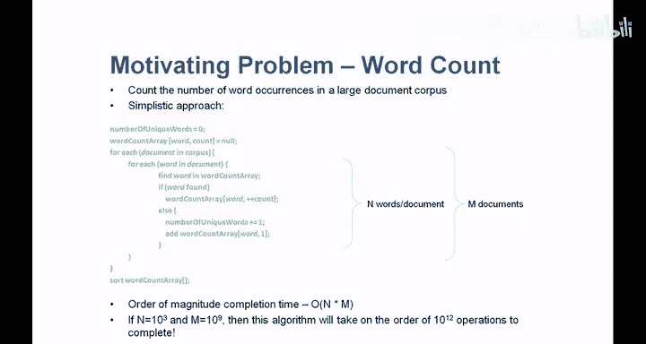
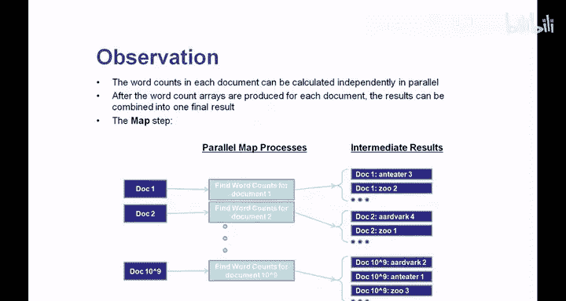
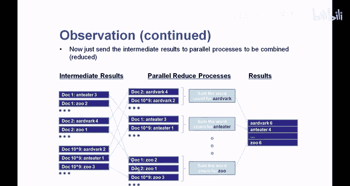
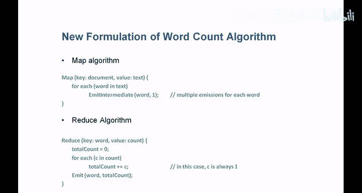
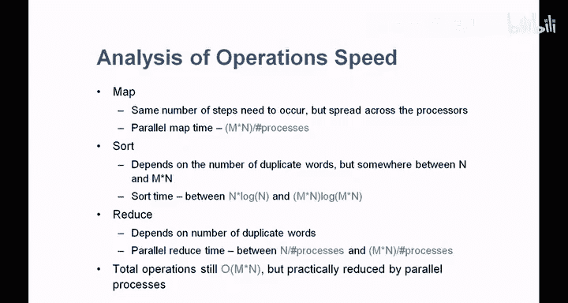
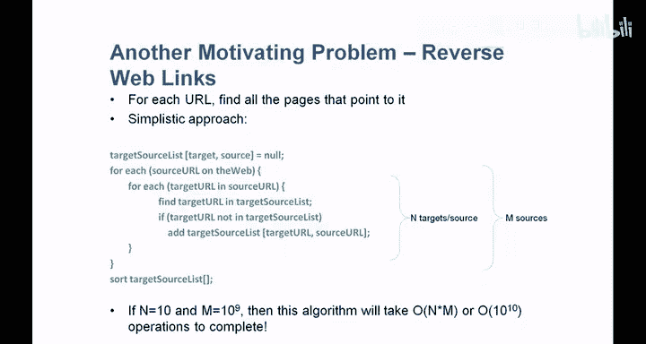
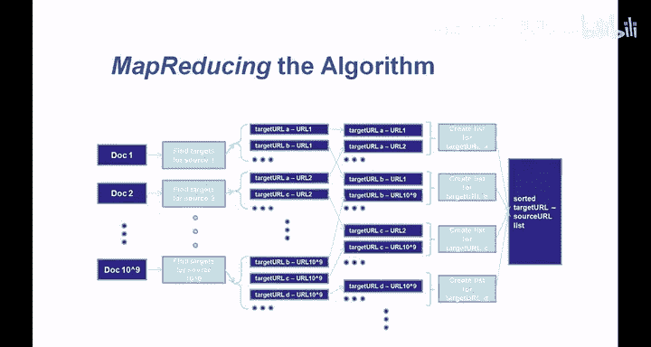
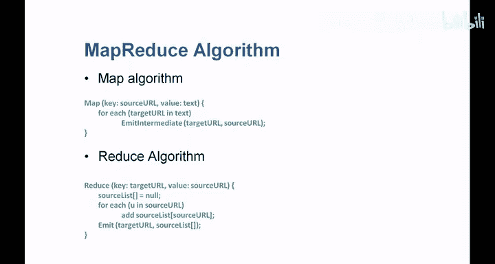

# 约翰霍普金斯大学《大规模数据库系统｜Large-Scale Database Systems》中英字幕 - P47：17_MapReduce的驱动性问题.zh_en - GPT中英字幕课程资源 - BV1N2urzvEjK

Welcome to cloud computing and map produce。 And this unit will talk about some motivating problems for map produce。

 The first motivating problem is a simple problem。 We have a large corpus of documents。

 And what we'd like to do is build an array of each unique word and count how many times that word shows up in all of the documents。

 So if you look at the algorithm。 algorithm is sub nested loop。

 What we do is we start out with number of unique words， we have a word count array。

 the elements of the array are the word and then the count itself。

 And for each document in the corpus， we are going to do the following。

 we are going to look at each word in the document， find the word in the count array。

 the word is found there， we're going to increment the count for that word。 Otherwise。

 if the words not found there， we're going increase the size of the array by one。

 We're going to insert that new word and set its count to one。 So for each document。

 we're going to count the words， the unique words in that document and we're going to increment one for every time that word shows up。

 And for the entire corpus， we're going look at how many of those words show up over and over。

hand count the number of words in every document in the entire corpus of documents if you look at the inner loop。

 if there are n words per document on average， so we're going to have n iterations of that inner loop and if that outer loop if we're looking at M documents in the corpus we have M iterations of the outer loop。

 so the number of times we're going to iterate through this loop is going to be n times n so the order of magnitude of completion。

 it's going to be big o of n times n if n is let's say100。

 let's say 1000 words per every document and we have 10 to the ninth documents the algorithm will take on the order of 10 to the 12 operations to complete and that'll take a long time we'd like to speed this up in some way so if you notice the inner loop is really pretty independently it could be run independently for each individual document in parallel。

The only thing is that at some point， we have to take each individual word counter and merge them at the end to satisfy the outer loop。

 So when we put all the values together at the end， we understand。

we get a account of for each unique word in the entire corpus of documents。

 we'll have a final count so let's look at the。

Let's look at the problem from a mapprouce perspective。

The word count in each document can be calculated independently and in parallel。

 and after the word count arrays or produced for each document。

 the results can be combined at one final result。 Here's the map step。

 If you look at all the documents on the left， we'll assign a map process in the middle for each document。

 So we'll find the word counts for document 1 and word counts for document 2 and word counts for document 10s to the 9。

And we'll produce results so our intermediate results will be the following will have document one results will be aneaer has three appearsce three times in that document and zoo appears twice in that document for document2 hardVrc shows up four times zoo shows up one time in document 10 of the9 hardV shows up twice Aneaer shows up once zoo shows up three times now we have our intermediate results and we now sort them and we're going to sort them by word so our intermediate results are sorted and yields a new set of document if you look at hardVrc it shows up four times in document2。

 two times in document 10 of the9 Aneaater shows up three times in document1 one time in document 10 of the9 etc。

 and now we applied the reduced processes each of these groups of data each of these groups of key value pairs。

Ks would be the word and the values would be the count。 So we the reduced process is very simple。

 We sum the word for word count for artvarc， we sum the word count for hand eat all the way down to zoo。

 and the results just a simple list shall pull key value pair list of the word plus the count in the entire corpus of documents。

This is a very simple process note that we did all the maps in parallel and we did all the reduces in parallel and the sorts in the middle just required some sorting。

 so the new formulation of the word creating a map algorithm。

 where the map takes in a key value pair and for each word in the text all we do is emit the intermediate value of the key value pair。

 the word itself plus the number one and in the reduce algorithm。

We'll take the entered those words and the counts associated with them。

And for each grouping of key values， for instance， Avaar Corzu。

We're just going count up the number of values in the count we're just going to add up the counts and we're going to emit the word and the total count。

 So the total count will be whatever is associated that with that word for the entire corpus of all the documents so we've got a simple map program and a simple reduced program that actually does the same thing that our initial algorithm did So if we do the analysis of the operation speeds we see that the map time it's really the same number of steps need to occur but it spread across all the process so you can run them in parallel。

 so it'll be m times n or of m times n operations， but you divide by the number of processes and if you have lots of processes running in parallel we've reduced significantly the time it takes to compute the sort itself depends on the number of duplicate words but it' occurs somewhere between n and m times n words So the sort time is always that number of words or the number of things you have to sort times the log of that number so it's somewhere between n log n and m times n log n times n still going to be a long sort but sorting could be fast on many machines。

Finally， the reduce process， it depends on the number of duplicate words you want to eliminate duplicate words。

 but a parallel reduced process is really somewhere between n。

And divided by the number of processes and m times n divided by the number of processes。

 So the total operations are still m times n， but it's practically reduced by the parallel processes。

 and that's the key to map reduce is that you run lots of parallel processes do an intermediate source and then reduce the results to get the results that you're looking for here's another motivating problem this is something that was certainly in of interest to many of the web search engines what youd like to do is understand how many for each page and the entire internet。

 you ought to understand how many other pages are pointing to me。

 So any individual page doesn't know who else is pointing to them so you really have to look at all the other pages on the Internet and so for every page on the Internet you want to find out how which pages they are pointing to and then kind of look at point to two pages and sum up how many pages are being pointed to so if you were to look at this algorithm from a simplistic appropriate approach you want to target target source list that's what you want。

TargetAnd who's pointing to me。 that's the source。 So for each source on the web。

 then you're going to take the targets on each source page in that source URL。

 find the target URL in the source list If the target URL is not in the source list。

 you're going to add it to the target source list。 So all you're doing is for all the pages on the web in the inner loop what you're doing is you're saying who's pointing to me or as as a page I'm sorry who am I pointing to。

And then take all those pointed two pages， sort them and then figure out how many people are pointing to me So the inner loop is n targets per source。

 the outer loop is M sources， So if you have let's say10 links on a page that would be N and the number of web pages that you're examining or 10 to the9 then the algorithm will take o of n times n or maybe or on the order of 10 to the 10 operations to complete that's a lot of operations and the map produce algorithm that's very simple you line up all the documents。

 they broken into shards， each map operation finds the target for the source so it looks all the places that that page is linked to produces a list of here's my target and target URL A target URL B。

 all coming from URL1 or document1 and then the second map process produces target URL A target URL C those are the links that are produced from URL2 and you do this for all the documents you go through a sort。

And you sort them by target URLs and then for the reduce process you just create a list of target URLs for each URLs for URLA count up all the URLs URL Bs。

 you count up all the URLs etc that point to it and then you get a good count of how popular this page is how many people are pointing to me on the web it's very simple mapreduce process but you've parallelzed it on the map process and the reduced process and the result is a sorted list of target URLs and the source URL list and you can certainly count the source URL is to determine how many pages are pointing to me very fast very efficient and it beats the linear nested loop to figure out how many people are pointing to each page on the web the mapreduce algorithm is very simple the map problem the map algorithm is for each source URL you take the text on that URL and for each target URL and the text you admit in the intermediate key value pair which is a target URL and the source page that you're just reading the reduce。

Takes that target URL and the list of sources and just adds that to a source list for each target URL。

 and it admits the target URL and the source list very simple， very straightforward。

