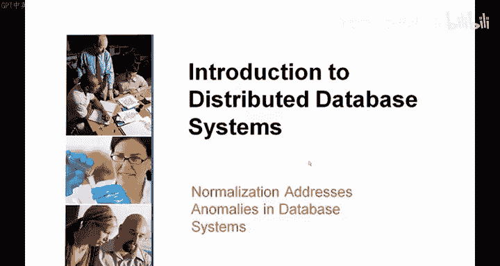
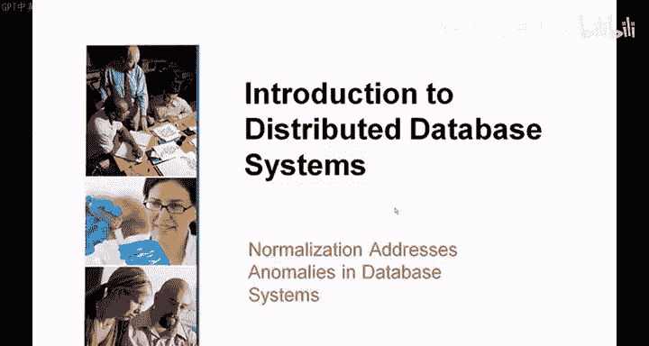
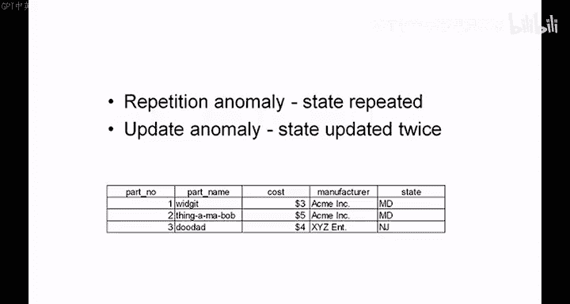
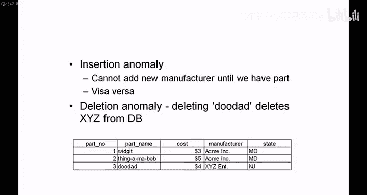

# 约翰霍普金斯大学《大规模数据库系统｜Large-Scale Database Systems》中英字幕 - P4：3_规范化解决数据库系统异常.zh_en - GPT中英字幕课程资源 - BV1N2urzvEjK

Welcome to Uni 4， a module 1 of distributed database systems class in this unit。

 I'll discuss the motivation for normalizing database tables。

Normally we understand that when we when we design database tables we typically have front tables that are somehow related to each other。

 Each of those tables contain columns that are closely related to each other。 For example。

 we might have customer tables， we might have part tables， manufacturer tables。

 But what would happen if we didn't do that kind of normalization。

 and we just had one large universal relation。 So let's look at this table。

 which contains information about parts and manufacture normally we would if we would design parts table and a manufacturer's table and relate。

 but imagine we had a universal relation which contain parts column part names cost manufacturer and state and we put them all in one table。

 two of the anomalies we would run into if we did this would be a repetition anomaly and an an update anomaly。

 noticeice there are two parts that are manufactured by ame incorporated and ame exists in Maryland。

 so its state is Maryland。

And in real database systems you'd have not only state。

 but you'd have addressed you'd have telephone numbers， perhaps shipping information。

 perhaps president of company， a lot of information you would list in the manufacturer's table So notice that every time we wanted to enter a new row in this table。

 a part number table we would add a new row with the new part if that part came from Acme Incorrated or XRYZ Ens we'd have to enter all the information about that manufacturer as well letting the state address president of company telephone number a lot of information to repeat every time you add a new row Act we already have that information we have a single table we're left with very little choice but to enter that information every time called the repetition anomaly also imagine if Acme Incor and moves from Mari to Delaware any changes to the state and the other information would have to be made in every row so we can have thousands of parts made by Acme Inc they make a change to their telephone number to their state we'd have to update that in all the rows in this entire table。

W to do so by normalizing table into two separate tables。

 a part number of manufacturer table you don't only have to represent manufacturer information once every time you added a new part。

 it would just refer to that one entry in the manufacturer table a similar set of anomalies would be the insertion and deletion anomaly so insertion means that every time you add information about a manufacturer better have information about a part if in a new manufacturer comes on board and you want to refer to that manufacturer but you don't have a part from them yet you're left to a very little option。

 you can't have that information to this large universal relation and the reason is because you have no part information so you can't add any information about a new manufacturer until you have at least one part that helps describe what that manufacturer make So that's an insertion a deletion anomaly is just a flip side of it because I wanted to delete the dode and it's the only part that we have in the database that's manufactured by Xyz Ens So if I delete that part I'm forced to delete the entry for XyZ enterprises。

I don't really want to do that， I want to keep that information around so the next time I order apart I won't have to go hunt down that information or at least repeat that information in the database。

 so the insertion anomaly and the deletion anomaly motivate very strongly the need to normalize databases normalized table so this table would be better would be better represented as a part table and a manufacturer table to avoid both the insertion anomaly and the deletion anly so in summary normalizing database tables can address many anomalies that occur if you don't normalize those tape this is the end of Uni4 module1。

