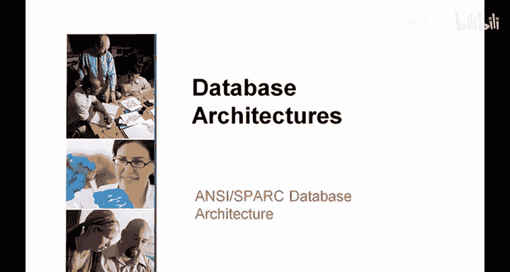
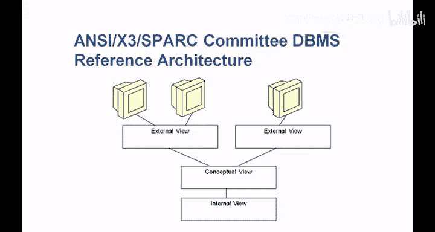
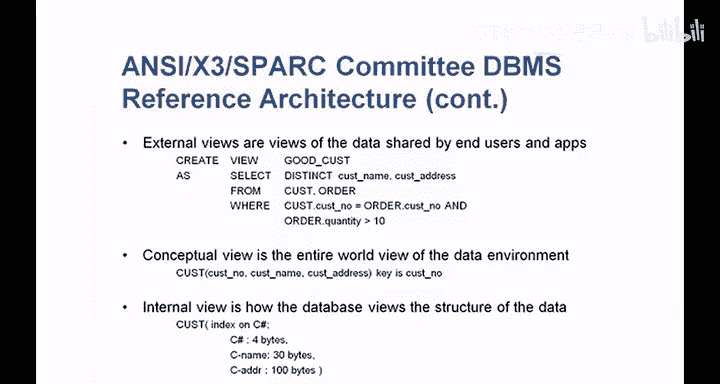
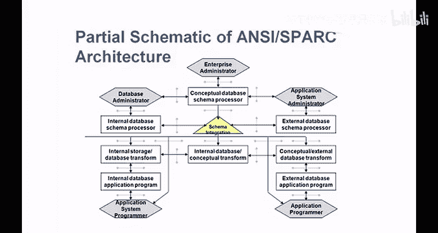

# 约翰霍普金斯大学《大规模数据库系统｜Large-Scale Database Systems》中英字幕 - P5：4_ANSI SPARC数据库架构.zh_en - GPT中英字幕课程资源 - BV1N2urzvEjK

Welcome to unit3 of Mo2 entitled Nancysy Spark Data Architsy Spark Committee has defined a database management system reference architecture by very very high levell presentation of how database systems need to catalog their data how they need to view their data Imagine let me start from the central box over here the central rectangle somebody defines a conceptual view of the system this might be an entity relationship model of a system this might tables and relationships of how the entire database system all works together that's a common view probably put together by some database administrator that has to understand everybody's needs for the data that's being stored in the system has to make sure that all the data is being stored in some location has to make sure that that the entire system hangs together very well in a very unified way Now from the top level you have represented by the computer terminals the primitive computer terminals each one represents an application external user。

External application that wants access to the data they don't all necessarily have the same conceptual view of the system。

 they have their own views of the system。 they view the data that's important to them and they interact with it on that perspective So as you see in the slide the two left share a single external view while the rightmost computer shares has a different external view that's okay because all of those external views will map to a single conceptual view and then finally that conceptual view is mapped to the internal view that internal view is how the actual database management system views the data as it's laid out in the case of a distributed database system there might be many internal views they all map to a single conceptual view So the AnsSparark committee defined three levels of views the external view conceptual view and internal view they're all mapable from one layer to another Here's an example of how these views might work from an external view perspective some user application might have a notion of what a good customer is so they view the database and interact with the database from the perspective of good customer。

View might be shared by other users or might not be shared by other users。

 but in any case this is their external view of the data or at least one external view of the data they will define that view or creative view good customer find in terms of an SQL query and that SQL query is a query based on the customer and order table where there are more than 10 order for a given or given order customer order that a good customer they order lots of and that's all the end user cares about the conceptual view might be the thing that's common to all the users of the system need access to a customer they may not be aware of the definition of the customer but the person the database administrator that put together the database certainly has to have a view of the customer has to understand what elements are there the customer the order table and they will define the customer table and order table in this case they're define a customer table as three column table with customer number customer name customer address notice that the end user doesn't access the customer table conceptual view they only access the good customer table then the internal view is。

The database views the structure of the data itself This might machine language code。

 so to speak machine database language code which defines how the data is laid out on the system on the database on the disk system it might define an index might define different column names which are not the not the conceptual view names and it'll define exactly how the data is laid out on the last slide I'll talk about is actually pulled from the book which describes thechematic of the ansparark architecture itself since it's a bit complicated I'm going to explain it all the hexagons。

 the shaded hexagons represent roles in a database system The rectangles represent processes in the system and the triangle represents some level of integration different views of the system so let's start with the left side the database administrator database administrator is responsible for helping define well in fact let's start start with the enterprise administrator En administrator defines the conceptual scheme of the database he he or she understands all the data that's laid out on。

stem you know what must be there， the relationship everything about what users need in the system and they will define conceptual database schema that conceptual schema goes into this if a triangle the schema integration triangle there's a database administrator the top left side the hexagon on the top left side person has to worry about how the internal database is laid out resolve it Vi v the conceptual database schema so you notice connections between these roles a database administrator between that and the internal database schema processor and that and the database schema processor notice that the book uses these lines you have these doublearrowed lines crossing those doublearrow lines are line diamonds at the end I grade them out because I don't think they're so important they represent interfaces and I think the doublearrow lines to just a good job is representing an interface so ultimately the database administrator must define the internal database schema schema Vi V the conceptual database schema and all that gets entered into the schema integration triangle the application systems administrator will define the。

External users so I'll define external external views through the external database schema processor and they have to resolve it Vis via the conceptual database schema processor so ultimately reviews of the system are all placed in the schema integration trying view conceptual view and the internal view looking at the hexagons on the bottom you have an application programmer and an application systems programmer from the perspective of an application programmer they write their application and they act with the database and the database imagine is off to the left somewhere where that line seems to not the middle line seems to be not connected to anything they ultimately interface with that database through the conceptuals through the external schema so when they send an application to the external database external database application program program has to now resolve the external schema visas via the conceptual schema so all of these things with the schema integration module do that mapping between external and then finally that information now gets translated between the down。

sent to the next box， the middle lower box， the internal database s conceptual transformation box and that translates the conceptual model to the internal model。

 finally information is now sent to the internal storage database transformation program and then ultimately information is now sent out to a database data is requested from the database and the format that the data recognizes and then information is now sent back to the application programmer translated at each level from schema level to schema level until the application programmer receives the results in or the application program receives a results in the format of the external view of similar the application system programmer。

 the hexagon on the lower left side writes application programs。

 they're mostly concerned about the internal structure of the data and when they write application they deal with the exclusively with the internal structure of the database that includes a description of the NCpark architecture。

