# 约翰霍普金斯大学《大规模数据库系统｜Large-Scale Database Systems》中英字幕 - P6：5_数据库架构分类.zh_en - GPT中英字幕课程资源 - BV1N2urzvEjK

Welcome to Uni of module tool of the distributed database systems class and this module we'll talk about distributed database architecture categories Remember there are three independent measures of distributed database systems one is autonomy one is distribution and the otherss heterogeneity before we discuss the author of the book definition of autonomy it's useful to know that there are several other definitions of autonomy one is gligors Le definition of autonomy local operations are not affected by participation and global multidabase systems so this means that any database that's connected to some distributed database are a multitab system really can operate independently without any knowledge of the global schema a global system also query processing and optimization are not affected by global query access whatever global queries due to the system individual database system doesn't really affect them and all they operate pretty independently they're automous they operate autonmously。

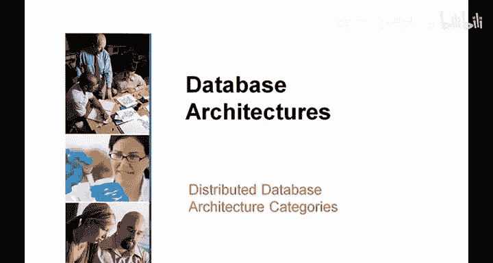

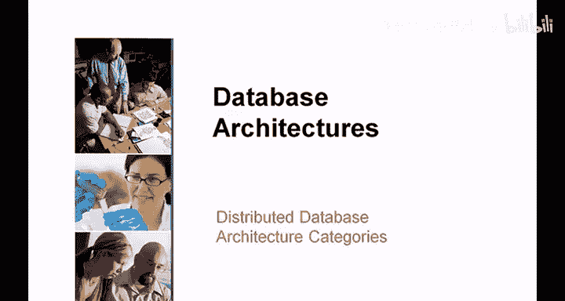

sency is not compromised when databases are added or removed from a global database system autonomy if they don't really care what else is added to the global system they're not really in tune with it。

 it's really up to the global system to manage the distributed database systems so that's really these are really one end of the spectrum of autonomy perspective from a glar gives a Latin perspective thegarid actually define autonomy and different measures they talk about design autonies to the databases use database models trans transaction management systems they want or do they all have to participate in a common model and a common transaction management schemeche of communication autonomy decide from the perspective of a database they could be more autonomous if they decide they want what they want to provide to a large distributed database system they're forced to provide everything then it would not be often finally execution autonomy means that database participating in a distributed database system with execute for queries in the way they want to execute it。

Autonomy would be that the distributed database system will tell individual database systems how to execute queries So again these are two different perspectives on autonomy actually our author O who actually autonomy in a different way it defines three classes of autonomy and tight integration single image of a database is available semiomous determine what parts of the database they want to share what can be exchanged among database systems what can be modified among each other that's semimous total isolation is that you have standalone databases and they participate but they don't really not really concerned about what the other databases have and how they they represent the data so we're working through a spectrum here integration to some autonomy total isolation which means total autonomy that's one one that finding characteristics of a distributed database system the design could actually take into account one option0 or one there are lots of different ways to。

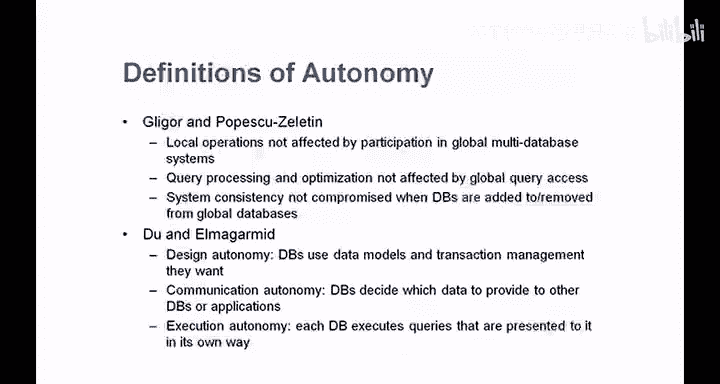

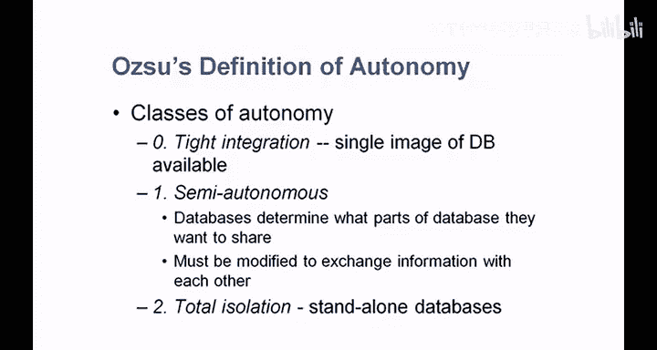

diistributed database systems， many designs will pick one of these options from the perspective of database distribution would be considered not distributed if nothing were distributed that's option zero1 is a client server type of type of architecture where the functionality of the database is distributed it among the database individual database systems and finally peer to peer which is fully distributed database system each of these systems act and concert with each other I'll describe some examples of this again this is the second vector which is orthogonal to the autonomy vector but again when you're designing your distributed databases any of any of these attributes and decide how you want to define your distributed database system any of the autonomous attributes and mix them together in any way you want finally there's heterogeneity are the databases that you're integrating homogeneous are they very much alive the heterogeneous now heterogeneous means it could be different hardware。

 different data models， different query languages， different transaction model to the extent they're different a more heterogeneous they are。

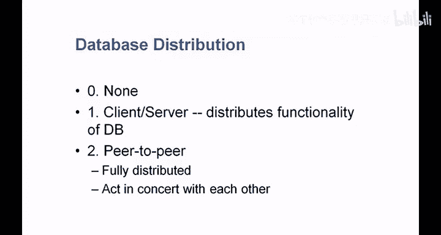

This would be the third vector of determining architecture a distributed database system So as an example you could pick any different combination of these you can pitch for autonomy the zero option which means they're tightly integrated and you can say that their distributed the database management system is located as a peer to-peer system if you pick the second option for distribution and if you pick the first option for heterogeneity say it's the same platform same accessa and certainly define a distributed database system in these terms the second option is where you have a semiautonous system where you might have different types of somehow related to each other somehow now some information is shared some is not0 says there is no distribution they're all located on one machine H1 says there's heterogeneous access so maybe some of the datas video some of the data might pick this would be an example of a heterogeneous federated database system but it would be all located on one platform because a distribution level is zero third option is where you have a fully autonomous database system where you。

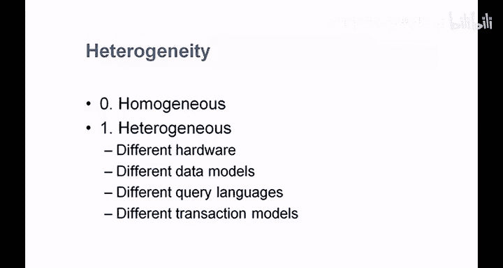

Have a lot of these information database systems that are scattered about the one means that it is distributed among different machines H one says that they're all heterogeneous you can put together a database distributed database architecture in any one of these three forms or any other form you just pick your level of autonomy you pick your level of distribution and you pick your level of heterogeneity client server architectures tend to be let me talk about those in a little bit more detail that the D1 option can have multiple clients to a single server a single database system it's located at the server in a distributed system there might be some differences with respect to transaction management transaction and action management is a complex issue that will be spoken about later on in the semester all intensive purposes from our perspective multiple clients with a single server is a know a one style of a client server architecture can have multiple clients going to multiple servers in which case you have two options can have each individual application。

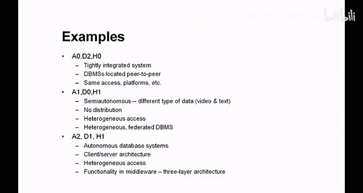

Individualual client managing the data access， which makes it somewhat complex because the application would have to understand a lot about the different database systems and be able to put them together in some reasonable way and each application would have to duplicate the integration of the distributed database is located in a multiple servers the other option is that the application access is one server and that server manages requests to multiple client multiple servers so there's this intermediate server that does do the managing of requests to other servers the first option puts certainly burdens the client because the clients have to know a lot about the database systems the second puts the burden on the server so this would would create a light client where the clients don't have to know much about the data integration it's really on the servers to provide data integration I'm going to be talking about peer to peer soon so it's a little bit different than client server but from the user perspective client server and the differences are in their so let me talk about client server。

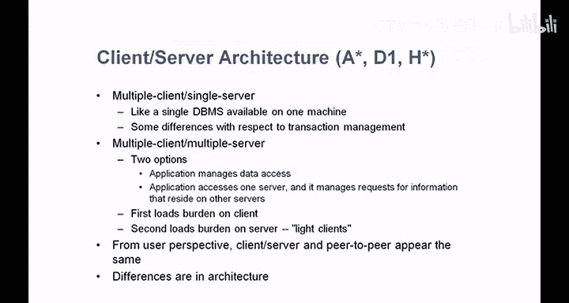

Architecture a little bit so the top level of boxes represents a an application program or a user interface。

 they deal with a client database management system and then there's communication software the server at the bottom happen handles the communication and all the processes of solving a query and we're going to get to these processes later on in the semester seman data controller query optimization transaction management recovery management on time support and operation operating all these are layers that that request that solved SQ query request but notice that all of those are piled to the other packed together in a single server So this would be a client server type of peer to peer architecture would be where you have there's a typo here it could be any level of autonomy a0 means that there is that the databases all sort of encodes with each other they understand that they're related to each other in some way peer to peer architecture actually integrate data that is。

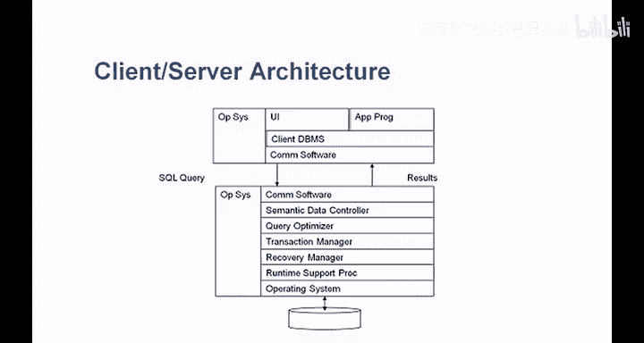

that is lacking some autonomy because they all participate and all have to be very aware of the greater system they're parts of you do have some data independence in that they're located separately you have transparency user queries are independent of location the global mapping of the request taken care at a global conceptual schema level local mappings are taken care of at the local conceptual schema and schema itself's this's mapped on the disk so the peerto- peer architecture you have an external schema lots of different external schemas mapped to a single global conceptual schema mapped to local conceptual schemas and then again map to local schemas schemas are laid out on the disk note that a peerto peer architecture provides a user integrating with a user interface handler and a semantic data controller notice many of these operations are moved up now to to the central layer this is a distributed database management system layer handles a query as a whole。

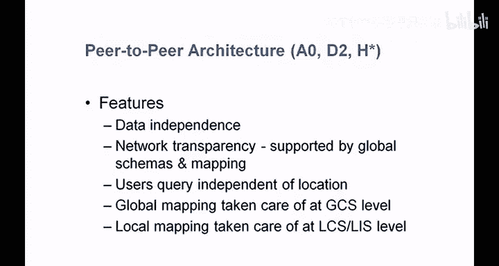

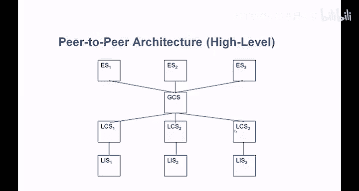

Understands how to globally optimize and that determines how to dish out parts of that query to if you notice the bottom box to individual servers or each of the individual database systems。

 so at the very middle layer when user submit it's a query to the middle layer。

 the middle layer needs the external schema and the global can s schema and the global data dictionary in order to process part of the query。

 this would be the medium level to be the distributed database management system processor and then ultimately it gets sense its queries out to the local database servers and they process the local queries in their own way for there you need the local schemas in order to solve the query。

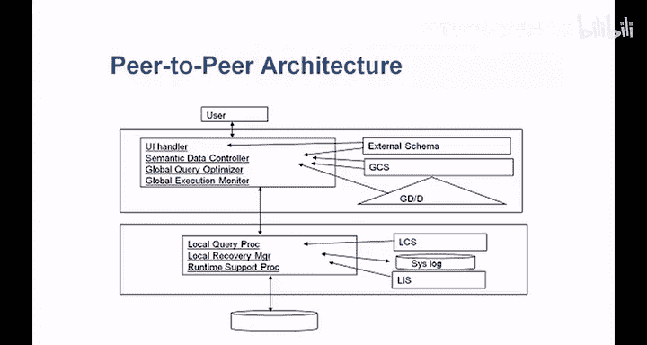