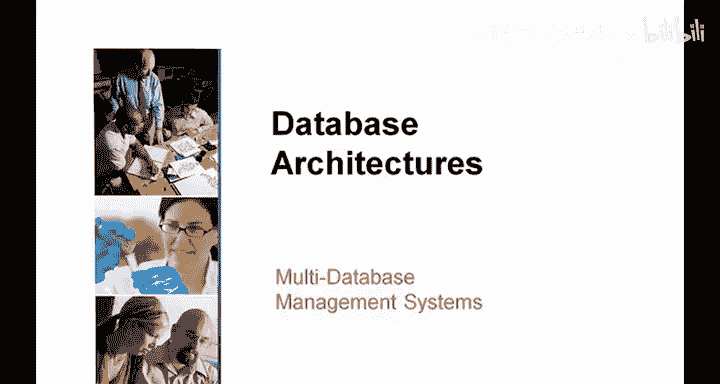
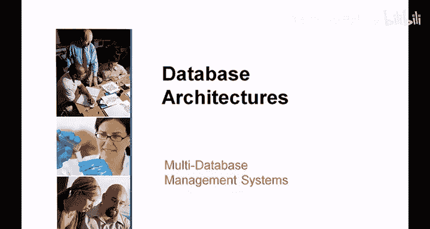
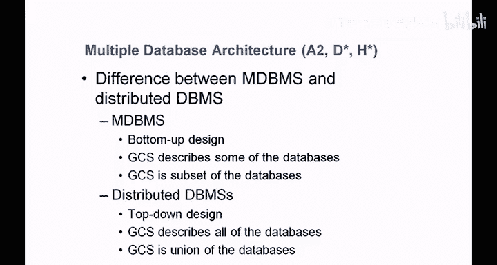
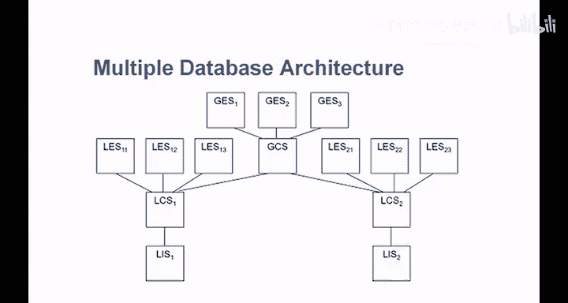
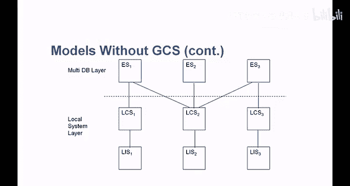

# 约翰霍普金斯大学《大规模数据库系统｜Large-Scale Database Systems》中英字幕 - P7：6_多数据库管理系统.zh_en - GPT中英字幕课程资源 - BV1N2urzvEjK

Welcome to Uni 5 a module tool of the distributed database systems course in this unit I'll talk about multidaatase management systems In reality I'm not going be talking about this too much throughout the course or the purpose of describing different distributed database systems architectures makes it complete here we're talking about notice that the autonomy is second levell autonomy which means all these database systems that you're integrating are pretty autonomous these are database systems that are already in existence they have their own user communities now somebodys coming along to integrate them some federation of distributed database systems The requirements are they still have to operate autonomously it's hard to integrate them it's much harder to integrate differences between a multiditried multidabase management system and a distributed database management system are following really in a multitab management system you're dealing with a bottom up design you have the databases at your access already it's your job to integrate them you far less inside into these databases far less control over how。

were design where they're going to be resident and even how they're used and how they're going to be integrated you only have limited ability to integrate the data typically you'll have some global conceptual schema that describes the data as is it appears in a federation with some mappings to which individual database systems contain which data it's not always true that any of the individual database systems will want to share all of their data they'll show parts of it so the GCS only describes the parts that they all share in the commonality and relationship among those databases distributed database management system which is what we're going to be talking about for most of the course is a top-down design you have control over where the individual databases reside what's on those databases which fragments or which tables are going exist on those databases how to control of the global conceptual schema In fact the global conceptual schema describes all of the databases or the union of those databases because you've designed them you know you want to know what the design should be and you know how to lay it out so multidaatase systems are a little bit。

Harder to integrate so in this schematic over here notice that we have two local database systems their user committee can communities well established so you have your local internal schema one local internal schema2 local conceptual schema one local conceptual schema2 these are all these are all the individual these are two individual database systems with their conceptual schemas all laid out and the user communities have their local external schema11。

1，2，13 talking to local conceptual schema 1 meaning that there's already a preexisting user community with external schemas onto database one community of users onto database2 Now you come along and define a global conceptual schema that somehow integrates all of the local databases through the GCS and what this GCS is supporting is global external schemas so you're having you now have a new community of people that are interfacing with the federation of distributed。

Daatase systems fact it's really a multiple database system that you're integrating to preexisting database systems that have their own communities notice that the people that are interacting with those databases as they are the local external schema people they don't want to change their interface they want the system to operate as it always have challenge now you as the multidaab architect have to pull them all together to ensure that all those local external schema always still have the same access to the databases that they have but now you have to support global external schemas as well there are different styles of interaction with these database systems to multidaatab systems there's a unillingual and a multilingual database Unilingual means database system only understands one query language has one database model which is most common act but it does place a burden on the users the users themselves might have already different models in mind and user community has its own has its own schema external schema has its own language need therefore。

It's a burden on the user now to formulate new queries。

 queries in the new unilingual language of the multidaatabase system should have been different than the query language they would have formulated and a multilingual multi multidabase system the global conceptual schema must understand many different query languages so each user can actually formulate queries to this in its own language and it's really now a burden of multi multidaatabase system to interpret each of those query languages and formulate the queries to the underlying enterprise this is much harder and very not common in multidaabase system first unilingual multidaabase management systems are much more common there are models without global conceptual schemas at all in fact many of the commercial products that integrate distributed database systems or multidaatabase system actually do not have a global conceptual schema so it's up to you to manage many different database systems without a local schema so you basically basically integrate。

database systems and you see now instead of individual tables you see all of the tables in front of you and it's up to you to formulate the queries to you to formulate the joins your responsibility to put those all together you every time you formulate a query have to have to understand the mappings between the external schemas your view and the local schemas requires a lot more knowledge of all the database systems that you're integrating and you have to be an expert in understanding their semantics。

 their relationship and how to formulate queries to there's a schematic of multi-daatabase system without a global conceptual schema so you notice you have multiple external schemas interact with lots of different local schemas and it's really up to them to interact directly with those local schemas now it could be that the integrating system actually provides the ability to do joins among the local schemas that does make it easier for the external users but still the external users have to understand a lot all the data that's available to it and it has to understand how to join the data together。

Or to get the results it's looking for。