# 约翰霍普金斯大学《大规模数据库系统｜Large-Scale Database Systems》中英字幕 - P8：7_关系代数表示法.zh_en - GPT中英字幕课程资源 - BV1N2urzvEjK

Welcome to the fifth unit of the first module of the distributed database systems class and this unit I'll discuss relational algebra notation there are several fundamental operations in relational algebra remember that you have operations that operate over tables and those tables can be viewed as set in a single table you have rows and columns and some of the fundamental operations on that table will be selection meaning select some of those rows based on some criteria projection select some of the columns based on the request for columns pulling two different tables that look an awful lot alike together set difference removing some rows from a and a Cartesian product is outer the main join operation I'll discuss that in more detail from this there are derived operations there's an intersect operation there's a theta join operation a natural join operation semijoin which I'll discuss later in the course and a quotient there's no I'm not going to discuss quotient because I've never seen it actually used in real life there are other operations。

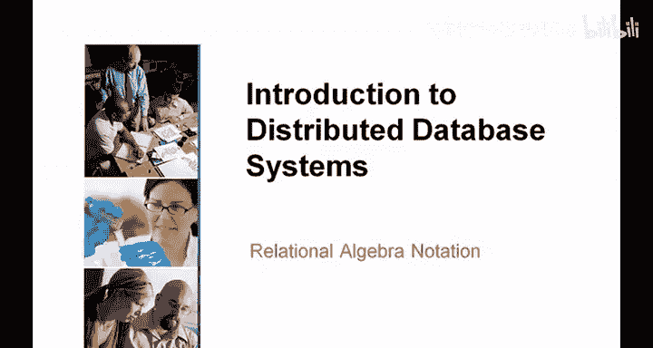

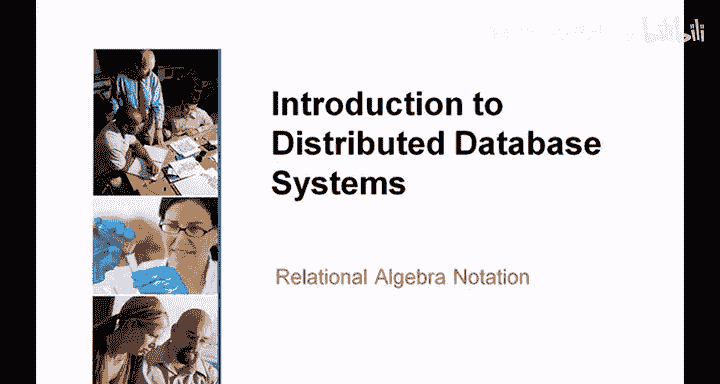

outer join and transitive closure， which I won't describe either but what I'm going to describe are the fundamental operations。

 these are the ones that we're going to be using mostly in the course and the derived operations which are shorthand notations for combining sets of fundamental operations together noticeice we have a part table below we have a part number part name cost to manufacturer and there are three entries in this table so the sigma notation for selection is a notation for selection where we define sigma or selection based on some formula some constraint on some relation R is a formula usually first order logic and we'll get into that but think of constraints what we'll do is in a specific selection we'll say select those rows where the cost equals3 from this relation R note that row where the cost is equal to3 is gray out So by expressing a selection based on some formula in this case cost equals3 we' are able to identify or select rows of relation in SQL it would be represented by this query select R。

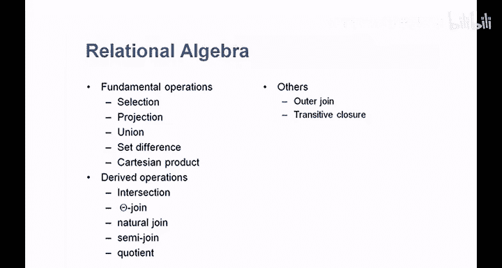

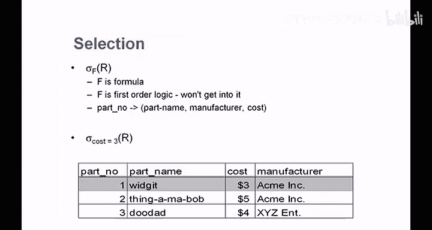

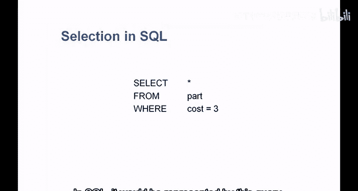

all the columns from the table part based on the constraint where cost equals 3 projection operation is represented in relational algebra as a capital pi and the subscripts are the columns that you want to pull from a relation R in this case we want to pull columns A and B from relationlation R so the projection of part name and cost from this table yield that table which is identified by the shaded area part name and cost so when we select part name and cost from the larger table from the part table we will just end up with all the values from just these two columns part name and cost the way represented in SQL is select part name and cost from part there are no constraint except to define which columns we are interested in we can union tables together if R and S are relations then are identical in their columns in their domains so we in relation R describes parts number1 through3 and relation S describes parts number5 through7 we can union them to get a larger table as a result。

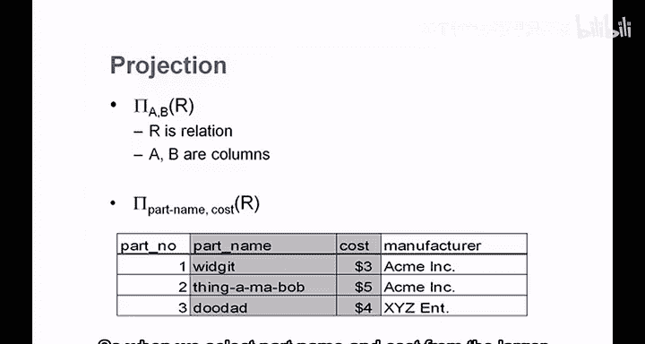

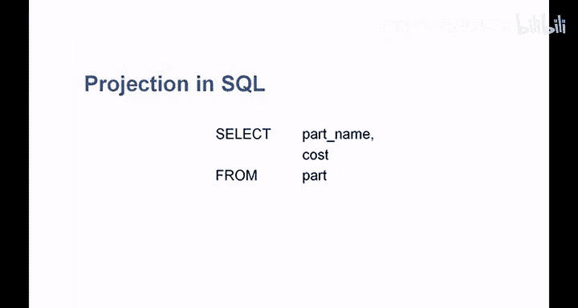

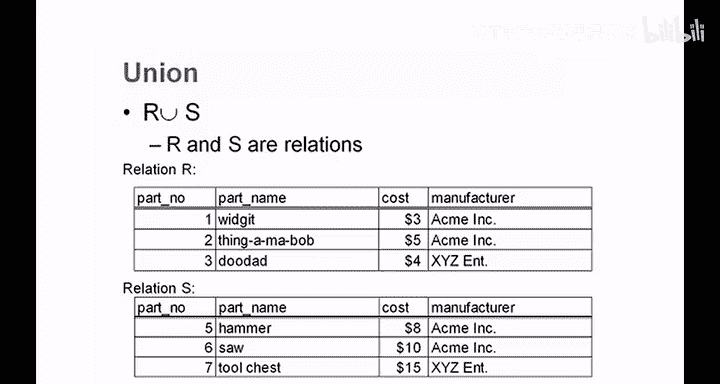

In SQL would be the union statement， R union S and the result would just be a single table which represents the union of both tables together In a real SQL statement。

 we would represent that is selecting part name and cost from R manufacturer is ame Ik this is the selection this is a criteria So we're actually combining here projection we're asking for part name and cost selection we're asking for manufacturer equals ame I and unioning the results so the first select will select part name and cost from R where the manufacturers ame in the second union the second select will select part name and cost as well from relation S for manufacturers X Yz enterprises and will union the results together the resulting table is the following part name and cost the individual elements are widget for $3 thing them above $5 and tool chest for $15 A difference is where we have two sets and we want to remove all the elements from one set that exist in another set So if R and S are relations we want to remove all rows from R。

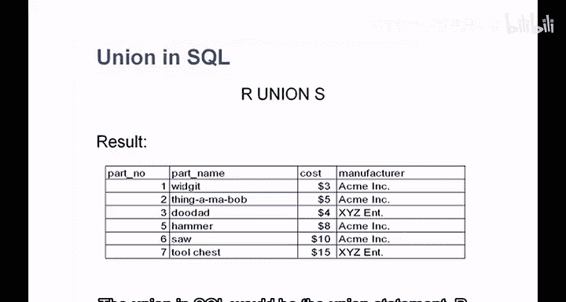

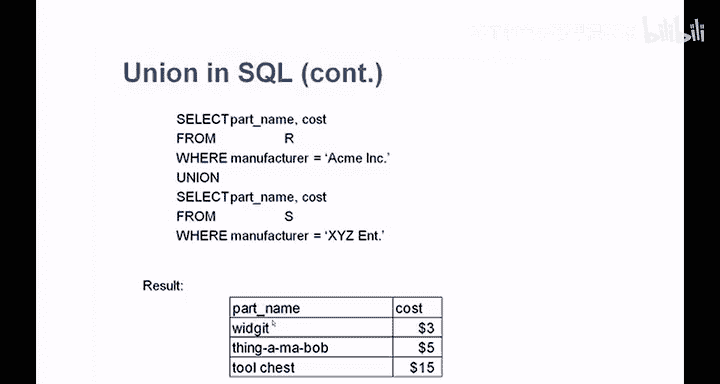

That occur in S Now there might be other rows and S that are not in R at all。

 but we just want to look at those values， those rows and s that exist in R and remove that from R。

 So if you notice the Venn diagram where we have R and S intersecting each other R minus S or R difference S is just that part of R minus elements of S previously exist in an R are now removed from set R a difference in SQl may look like the following we have a part name from R part number part name cost a manufacturer and we have a widget and a thing of bo in relation R in relation S we have a thing of above and a dod I'll notice that dod doesn't occur in R but we want to subtract S from R So we're going to subtract all those things in S that already exist in R from R and we're going to look at the result the result of R minus S is just widget there's a Cartesian product where R and S R relations and there is no join criteria in which case we're going take every row of S paired up with every row of R so if there are N rows and S and M。

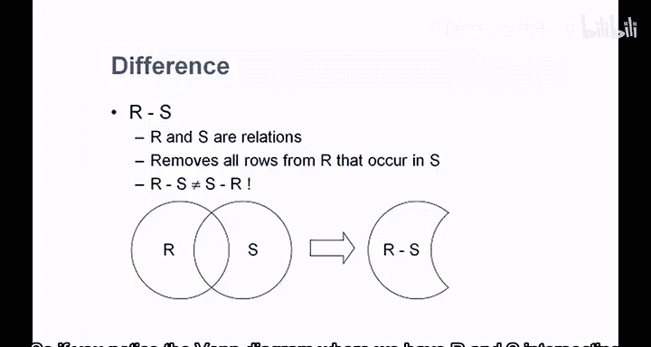

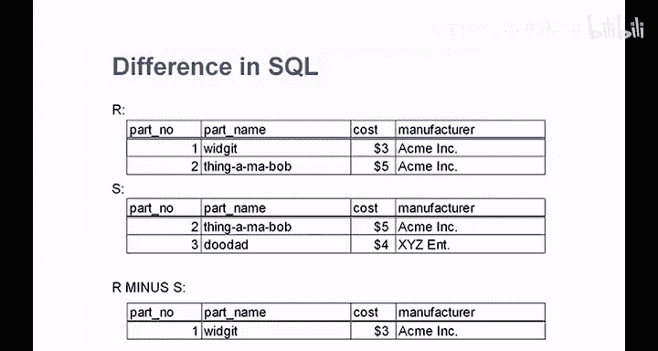

Rs and R， the resulting table will have n times M row。

 So for each row of S we're going to pull out all the corresponding rows of R。

 second row of S we're going to again pull out all the corresponding rows of R and we'll continue till we produce the final table in SQL the expression would look like the following we're going to select part number and part name we're going to select cost to manufacturer from S and there will be no join criteria we're just going pull all rows from R pair them up with all rows from S or if we wanted all the columns we'd say select star So if R and S is part number and part name which is widget and thing of a bo and S is cost to manufacturer Cartesian product product with S pull widget pair it up with every element of cost to manufacturer and then it'll pull thing of a bob and pair it up again with every element from manufacturer so the resulting Cartesian product of R times S which is just the product of two rows of R times three rows of S the intersection operation an operation that enables you to find where are R and S。

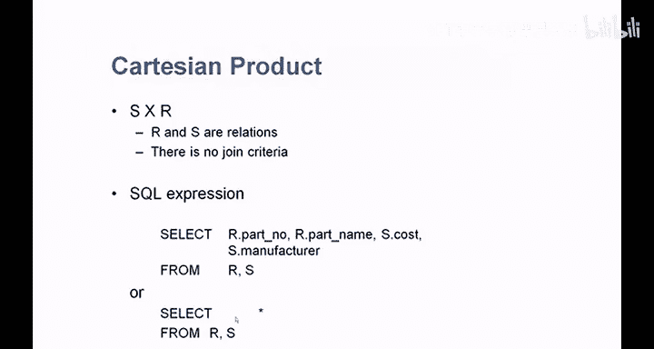

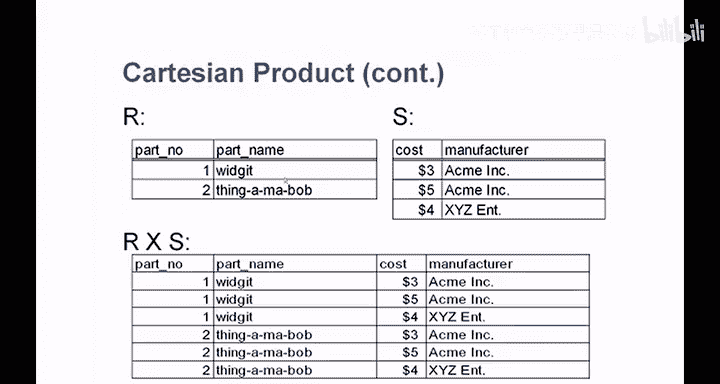

Have common rows。 So R intersect S is something that says find the common rows of R and S。

 Now intersect not a fundamental operation because it can be defined in terms of set difference Act R intersect S R minus S R minus S looking over here。

 R minus S says take away R minus S take away S All those things at S that already existed in R and then take that resulting set and now subtract that from R again and that yields the intersection of R and S。

 So intersection is very convenient， although it is not a fundamental operation。

 It's very convenient to use it as a derived operation Inter in Sql would say take R and S and find the intersection of these two different relations and looking at these relations there is only one row in common R interect S will yield that single row thing of above Theta join is a join based on some formula。

 Some relationship between R and S。 So it is a Cartesian product grabbed every row of S and matchshed it up with every row of R。

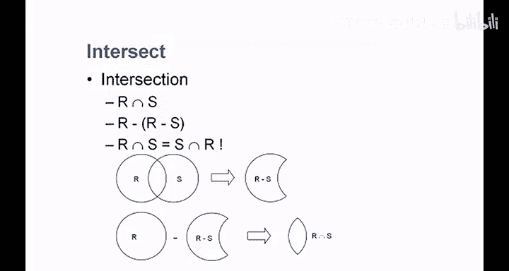

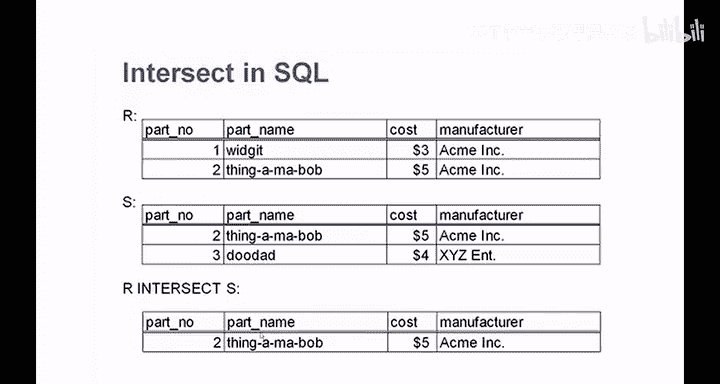

Theta join will actually limit that based on some kind of formula So F is a formula usually based on equality inequality greater than less than etc So take two rows or take two tables R and two relations R and we have part number part name cost and manufacturer number in R and there's a manufacturer number in S one of the things we might be inclined to do is do an Ejo meaning join with all rows and s where they have equal manufacturer numbers to pair up widget with the manufacturer ame with manufacturer ame and do dad with Xyz enterprises that's not necessarily what you want to do all the time So we might create a theta join where we select all the rows all the columns from each of these tables and our only join criteria is where the manufacturer number of R is less than a manufacturer number of s may not make any sense in this context but it is something we might want to do on occasion so in this case we'll grab widget which has manufacturer number one and pair it up with the。

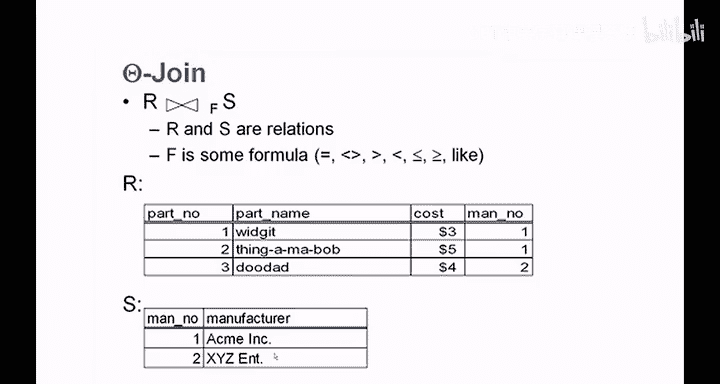

Mafacturer number two， which is greater than what in same thing for thing of about This result may not make any sense。

 but it is a theta join based on some kind of criteria where we're joining the manufacturer number of1 one's relation with the manufacturer number in another relation a natural join is what we would expect we want to pull things of like values together in this case what we want to do find a formula where there's a quality between column values this case we want to pull all the rows from both R and S and join them on a quality where the manufacturer number of R equals the manufacturer number of S and in this case the resulting join will yield a table which has the part numbers joined up with the appropriate manufacturer information from the manufacturer table。

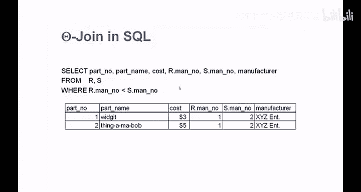

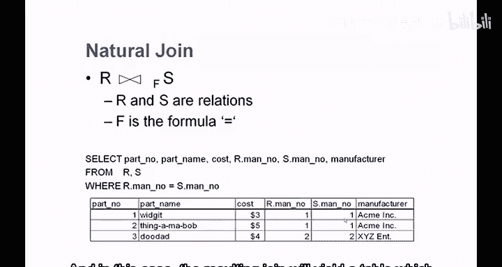