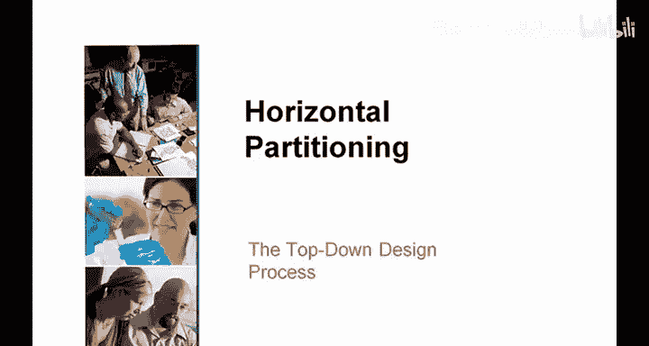
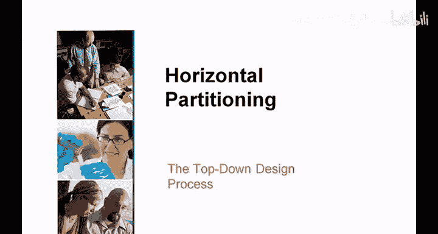
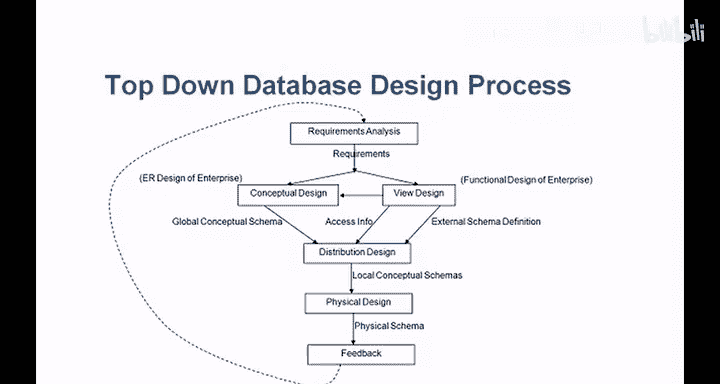

# 约翰霍普金斯大学《大规模数据库系统｜Large-Scale Database Systems》中英字幕 - P9：8_自顶向下的流程.zh_en - GPT中英字幕课程资源 - BV1N2urzvEjK

Welcome to Unit1 of moduleule 3， titled horizontalontal Partitioning。

 this unit will examine the top town design process。

The top town design process starts with requirements analysis。

 it requirements its analysis of what data is being stored。How the data is related。

What types of tables are involved， what types of fields are going to be in those tables。

 who's going to be accessing the database and where are these people going to be accessing the database from。

 all of those requirements are gathered together during the requirements analysis process。

At that point。After requirements are gathered， the effort actually splits into two different activities。

 one is conceptual design。 This is the design of the entire database from the point of view of given a perfect database and perfect perfect understanding of the fields and entities and relationships of the design of the database we come up with a perfect design for perfect conceptual design of the database。

 this is the database taken together and an aggregate。

 and this is as if all the people were looking at this database contains all the information that everybody who would ever need information about this database would understand how the data is related to each other。

 so this actually produces a good global conceptual schema how is the entire system represented and what are the relationships between those representations that produces a global ER diagram on the right side we have a view design and this is specifically coming from the users of the system。

These are the external schema views of the system， how individual applications individual users will want to use that data。

 not every user will want to use every aspect of the conceptual design。

 and some users will have very sophisticated views of parts of that conceptual design。

 although those are taken into account when designing external views of the database system。

So from the perspective of the global design， the global conceptual schema is a feeder into the distributed design。

 but also information about how individual users will access that information through views and generally the external schema definitions from our external users all go into the definition of a distributed design and it goes into the process of laying out the distributed design across the enterprise。

 once we lay out the distributed design across the enterprise taking into account all the。

Endities and the relationships of the conceptual design。

 plus understanding who has need for what data and where to place that data based on the need and based on the access information。

 the distributed design is complete and all the tables are now distributed across the database system。

Once we've distributed across the database system， each individual database will be designed according to the local conceptual schemas and there will be a physical design on data on each of those databases that are now members of this larger larger distributed database system and that is the initial layout of a distributed database system after use we'll see the usage patterns we'll see what works。

 what's efficient， what's inefficient and based on that feedback。

 we'll be able to feed that information back to a new requirements analysis that obviously won't start over but may make modifications to the conceptual design may make modifications to the view design and ultimately may make modification to the distributed design and physical design。

 and this process of feedback requirements analysis and design continues until we have a stable database system。

This ends unit 1 of moduleule 3。

