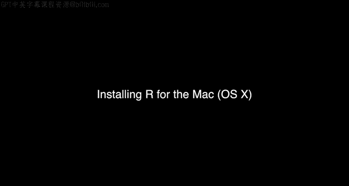
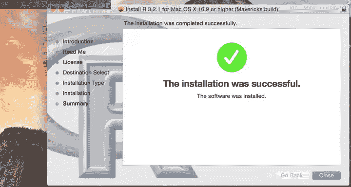

# 约翰霍普金斯大学《数据科学R语言基础｜Data Science： Foundations using R》中英字幕（deepseek - P102：2_在Mac上安装R 3 2 1.zh_en - GPT中英字幕课程资源 - BV1tsFQemEts

In this video， I'm going to briefly show how you can install R on the Mac。

 It's a very simple process。 you just have to it only takes a few steps。

 so the first thing you need to do is open your web browser。And。Go to Crranons。

 this is the comprehensive R archive network and you'll see that there are a number of options for you to download here for different platforms。

 and so we're going to download the Mac platform here。So we can go to download R for the Mac。

 and you want to download this package file here， so just click on this and you'll see that the download meter will start going and it might take a few minutes depending on the speed of your internet connection。

 so just be patient。Okay， so it's finished downloading。So I'm just going to open up here。

The package and you can see it'll start the installer and it'll guide you through all the steps you need to install our so I'll click continue here and this is just the description of what's going to get installed can continue the software license agreement is the Ganew general public license version2 so you should agree to the license after having read it of course。

And then you can just click install here and you might have to type in your administrator password。

 so just go ahead and do that。And it'll start installing the files on your computer。

Now that's finished， I can hit close and then it'll be in my applications folder so I can just go to my applications folder。

 which is right here。And they're at alphabetic order， so I'll just scroll down to R and there it is。

And there you have you have an installed R on your computer， and now you can go ahead。

 you can just use it directly， or if you want to， you can install an interface like RSt， if you like。

