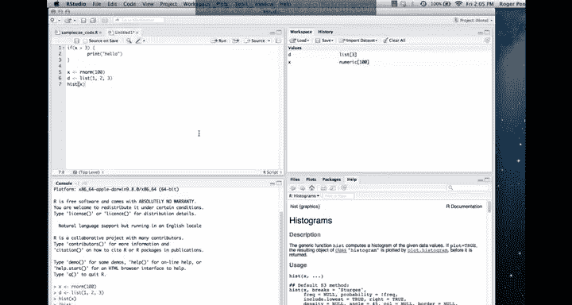

# 约翰霍普金斯大学《数据科学R语言基础｜Data Science： Foundations using R》中英字幕（deepseek - P103：3_在Mac上安装RStudio.zh_en - GPT中英字幕课程资源 - BV1tsFQemEts

One piece of software that's actually quite nice to use and can make R a little bit nicer to work with is called R Studio。

 which is R studio is an interactive development environment or IDE that connects with R and provides a lot of nice features that don't come for the basic R system itself。

 So the first thing you need to do of course is you need to install R。

 But once you've got R installed you can download Rst and install that if you want so here I've got the web open I'm going to look at've got to go to Rstudio。

 org org。You can see that here's a screenshot of the software and you can just click on the download R Studio and you want to download the RSt desktop。

So it should recognize what kind of computer you're coming from here it knows I'm coming from a Mac。

 so I'm going to download the one that's recommended for my system， it works on Windows XP。

 Vista set and Windows 7， it also works on a variety of different Linux formats。

 so if I'll download the Mac version here。And it's fairly quick， and I'll open it up here。So。

So now all you need to do is drag this into the applications folder。And。

I had an older version there installed so I'm going to replace it。

 and you're pretty much ready to go。 So now I open up the applications folder。 I can go down here。

And load up our studio。Sa okay。And you can see I've got some stuff from the previous project open。

 but you can see that there are four windows here。And I'll just delete this for now on the bottom left over here。

 you can see R is open， I'm running 2。15。1 on the upper left I got a file open which can be used to edit our code so I can type in some R code here。

啊。This is not really。That useful。ButAnyway， you can see I've got our code there。

On the upper right I've got my workspace or any objects that I created。

 I haven't created any objects， but if I had， they'd be there， so for example， I could say，嗯。

X is R norm 100， and then I can hit Apple enter， and it will execute that line。 So now it created a。

An object called X。 you can see it's in the workspace has a little summary。

 It's a numeric vector with 100 length， 100。 I could have created like a list， for example。

At Apple enter， it executes， and you can see it's down at the bottom left over here and also on the top right。

 it's in the workspace browser。 And then on the bottom right here， you've got your file system。

 which has your files。 you can also if you make any plots， they will appear here。 So for example。

 I could say。Hist on x。And it'll create a little histogram and now the plot appears in the lower right。

 if you want information about packages， these are the packages that I have installed and the ones in the checkbox。

 the check boxes are the packages that are loaded right now。And if you ask for help for anything。

 it will appear here， so I can say help， hist。And the help will appear right here。

 So it's quite a nice little tool for using R。 and I recommend it I think it'd be quite useful for this class。

So check it out， it's our studio。

