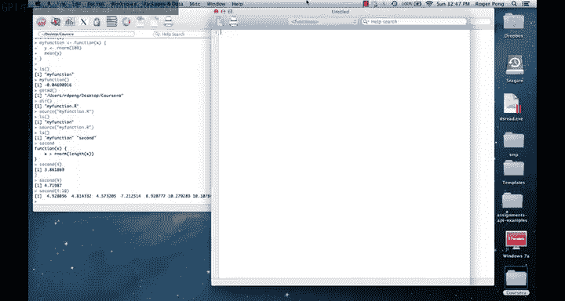

# 约翰霍普金斯大学《数据科学R语言基础｜Data Science： Foundations using R》中英字幕（deepseek - P105：5_设置你的工作目录Mac.zh_en - GPT中英字幕课程资源 - BV1tsFQemEts

I'm going to talk about two things in this video。 The first thing is how to set your working directory and the second thing is how to edit our code files using the text editor。

 So when you start up our it's important to know what your working directory is because the working directory is where R reads and writes files to the computer and if you don't know where that directory is then you're not to be able to find any of the files that you save or any of the data that you write out So when you start up R you can find out what your working directory is by just typing the function get WD。

And you can see that I've loaded up R here and it sets my working directory to be slash users s Rpay。

 which on the Mac is just your home directory So this may work but if you store all your files in your home directory。

 but you may want to change your working directory to be something else if you happen to store all of your data and code files in a different directory。

 maybe a subdirecty， So for example I can go to the miss menu here。And choose change Work directory。

And I can choose one of these directories to be my working directory。 Now。

 before I go the first thing I want to mention actually is that if you want to read a file。

 then that file has to be in your working directory。 otherwise you'll get an error。 So for example。

 suppose I want to read a data file using read CSv and I want to read the my data do CSv file So if this file is in my working directory。

 then I'll be able to read the data and it will load into R。

 but if it's not I'll get an error like this because the file can't be found in my working directory。

 So one thing I can do is I can change my working directory to be wherever that file happens to be。

 so I'll choose the class directory here。And if I type DR in this directory。

 it'll list all the files in this directory。 and now I can see oh my data do csv is in this directory so I'm gonna now I can read the file into R by using read cv and now you can see that the data will appear in R So so knowing what your working directory is and being able to set it is important because then it will give you it will give you access to all the files that you need in R in particular when you save files say from the web onto your computer you need to know where those files or store it on your computer and so that you can set your working directory to the appropriate place or you can move those files into your working directory I recommend for this class that you create a specific directory for this class and store all the files in that class that way you don't have to worry about changing directories all the time。

 one thing you can do is maybe just create a directory right here on your desktop so I'm going to create a directory here called。

Coursera。And now when I'm in R， I can say change change working directory here。

 and if I go to my desktop， I can choose my Coursera folder there。 And now when I say get WD。

You'll see that it has set the working writer to be my Coursera folder。

 so now if you save files in there， they will be there and you can read them from R。

 so that may be the easiest thing for one to do。So the one thing that you're going to have to do a lot of in this course it' to write code in R and and you're going to need an editor to do that。

 So one nice thing about。R on the Mac is that it comes with a text editor that you can use to edit code files。

So I can load up a text editor by clicking on this little button right here。

 and this gives me an empty file。 So I'm going to move this over here。

And you can start editing code right away。 So I can say I can create a my function。

 called my function。嗯。And I can it will start indenting things。 So I can say， you know， x is。Hundred。

And this function。Is。Going to just take the mean of x。So actually， let me just change this tool。喂。

And， and it just returns the mean。 So it ignores the argument for now。 So， and then。

 and then one thing you have to do is figure out how to get this code into R。

 So what you'll notice if I just type my function here。

It's not going to be able to find it because the code has not been loaded into R。 If I type LS。

 you'll see that there are no objects in my workspace。 So the question is。

 how do I get this code that I've written over here into R， Well。

 the easiest thing you can do if you just have a little bit of the code is just to hit select all。

 So this is command A or you can go to the edit menu and just hit select all。

And then command C copies the code， and then I can click into my console window over here a command V。

And， and then return。 and it will paste my function into R。 So now if I type L S。

 you'll see that my function is an object in my workspace。 So I can save my function。

And it will return the mean of 100 random normal variables， which is not very interesting。

 but the function does work。So the other thing you can do is you can save this file I can go to the file menu。

 and I want to save as， so I haven't saved this file before。 I need to save as。

 and I'm going to go into my course error folder。And I'm going to save it as my function。

And it's typical to add the dot R extension for code files。And I can hit save。

And so now I can double check my working directory and make sure I'm in the right place here。 Yeah。

 I'm in the coursera working directory。 If I typed DIR。

 you'll see that the my function dot R file is there now。 So I just sourced the file。

 my function do R。And it will have the same， it will have the same effect as cutting and pastcing。

 So I， so I haven't done anything new because I already cut and pasted that function。

 But one thing I can do， I can write， I can write another function here， so。Say。

I'll call it second to indicate it's second function。And it's going to take the input X， excuse me。

And it's going to add a little bit of noise to it。And and that's all it's going to do。

 is's going to return that。 So， so now before I do anything。

 I need this now that I've changed the file， I need to save it。

So I can just go to file and then save or you can do command desk。 And now I can source my this。

 this。File into R again。 And you'll notice I type L S。 I got， I have my second function there。

 So if I type this out， you'll see that's the code for it。 So now I can say second， I say 4。

And I return 4 plus a little bit of noise。 if I do it again。

 it'll be 4 plus a little bit of more noise。 I can give it know 4 through 10。

 and it gives me each one of those numbers with a little bit of noise。

 So that's how I write code in R。 and that's how I can use the text editor that comes with R。

 If I want to create a new file， I can hit this button。Again。

 it'll give me a new file and I can save this under a different file name if I want。

 I'm not going to use that now so I can close this window。

And， and that's how we can use the text editor in R for the Mac。

 The text editor that comes with R is very simple， but it will definitely be sufficient for this class。

 So even though there are other kind of custom text editor that you can maybe be able to find on the web and download for free。

 You don't have to do that。 The text editor that comes with R should be sufficient for this class。

