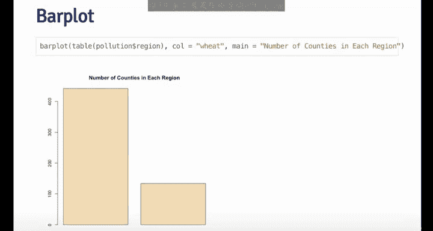

# 约翰霍普金斯大学《数据科学R语言基础｜Data Science： Foundations using R》中英字幕（deepseek - P107：7_探索性图形第1部分.zh_en - GPT中英字幕课程资源 - BV1tsFQemEts

。

This lecture is going to be about constructing exploratory graphs which are graphs that you make more or less for yourself so that you can look at the data and explore kind of what's going on in the data sets that you're looking at And so I mean the basic question that we're trying to ask here is know why do we use graphs and data analysis and there are a couple of different goals that we want to achieve here understanding the data properties finding patterns in the data basic patterns。

 maybe just suggest some modeling strategies know do we want to use a linear model or a nonlinearar model to debug and analysis or maybe you started doing an analysis and you want to figure out what's going wrong and then we want to communicate results too so we want to present things to people in a graphical form and exploratory graphs are really about the first four things on this list here so we want to basically understand properties about our data we want to look at some basic patterns suggest some modeling strategies and to debug an analysis but in this particular lecture we're not going to talk much about how to build graphs for communicating results and we'll talk about that a little bit。

Later in other lectures。So some of the characteristics of exploratory graphs are that they tend to be made very quickly。

 so they're kind of made on the fly as you're looking through the data。

 you tend to make a large number of them because you want to look at very different aspects of the data。

 you're going to look at lots of variables and you have to go through them kind of one at a time often。

And the goal is for you to develop as the analyst， to develop a personal understanding of the data set and to get a sense of how it looks and what are the properties。

 what are the problems and what are the things that need to be followed up。

's just so you can get a sense of kind of what the data is looking like。

And so if you think of an underlying question， essentially of all exploratory data analysis。

 it might be what do my data look like？And so this is the goal for making exploratory graphs and a lot of the things that you typically worry about you later on in terms of the appearances of a graph or how it's presented。

 you don't worry about now it' things like the axes and the legends。

A typically going to be cleaned up later things like and color and size are primarily used for you to kind of separate information。

 but might if you were going to present this in a different setting for example。

 in a presentation or a talk， you might think a little bit more carefully about color and size so I just want to go through a specific example in this lecture is just so we can talk about the various types of exploratory graphs that you might make using a real data so here this data set involves air pollution ambient air pollution in the United States and it comes from the US Environal Pro Agency which sets national ambient air quality standards for outdoor air pollution and the particular type of air pollutant we're going to look at is called fine particle pollution or PM2。

5 and the standard in the United States is that the annual mean averaged over three years at a given location cannot exceed 12 micrograms per meter cubed and so any state that exceeds this level of 12 micrograms per meter cubed when you take the annual mean and average at over three years is considered to be。

Of compliance with the national standards and so。There's data available on PM2。

5 from the US EPA's air quality system， and so I've downloaded that data and summarized it here just for the purposes of this presentation and the basic underlying question in this exploratory analysis is just going to be。

 are there any counties in the United States that exceed the national standard for fine particle pollution and so。

We have monitoring data from many counties in the United States where air pollution is a problem and we want to see whether or not they exceed the 12 microgram permeter cubed standard that has recently been set。

So the data here are available， you can read them in using the read。

cv function and I' put the code here so you can take a look and here are the first couple lines of this data frame and so there is the first column is the level of PM 2。

5 it's the annual average sorry it's the annual mean averaged over the past three years so actually the years 2008 through 2010 and then the FIPS column that's it's an identifier for the county。

And then the region is just whether whether this county is in the east or the west。

 the longitude and latitude basically is a。I is the locations of the monitor in that county the longitude and latitude coordinates or the monitor in that county So we basically remember the underlying question is we want to see do any counties exceed the standard of 12 micrograms per meter cubed and even in an exploratory analysis where you're just kind of you know looking through the data and seeing if there are any problems you still want to have kind of an underlying question that you're thinking about in the back of your mind。

 even if it's a little bit of a vague question at this moment because the question that you ask will drive you're thinking about what the data look like and so something that maybe a problem for one type of question maybe not a problem for a different type of question so when you look through the data you have to have a background question kind of in mind so。

We want to see if counties exceed this national ambient air quality standard so a couple of so we can look at one dimensional summaries of the data and here are a couple that I list out one is a five number summary。

 there's box plots， histograms， density plots and bar plots。

 and I'll illustrate a few here so I mean。The first one is the five number summary。

 which is really not a plot at all， obviously， but it's a summary of just some particular aspects of a given variable and so the summary function in R can produce this summary and actually it's a six number summary。

Because it includes the mean， the traditional five number summary is the minimum， the first quartile。

 the median， the third quartile， and the maximum， and the summary function just puts the mean in there too。

So here you can see the median is 10 micrograms per meter cubed， which is under the standard。

 and the maximum is 18。4 which is over， so there must be some counties that violate the standard。

 at least during this time period and you can see the third quartile is 11 and the first quartile is 8。

5 and the minimum is 3。38 here。So here's a box plot of the PM2。

5 variable and I've just specified color it blue and you can see that the median is about 10 just as we saw in the five number summary。

 and you can see that there are a number of counties that appear to be over the 12 microgram me cube limit and then there are many that are under it。

 so they are in compliance。Here's a histogram of the same data and so the nice thing about the histogram is that you get a little bit more detail about the shape of the distribution of this variable and one nice thing that I like to do is put a rug underneath the histogram so the rug basically plots all of the points in your data set that are underneath the histogram so you can see exactly where the points are that make up the histogram and so you get on the one hand you get the histogram which is a summary but you also get some fine detail with the rug underneath so you can see where the outliers are and where the bulk of the data are so you can see that the bulk of the data seem to be centered around 10 or so but there are a couple outliers kind of above beyond 15。

One thing you can do with the histogram is change the breaks。

 the number of essentially the number of bars that are going into the histogram and so you can see in the previous slide the bars are kind of wider so the histogram is a little bit smoother but in this slide I made the bars smaller by setting brakes equal to 100 and you can see that you get a little bit more of a rougher histogram and so one of the things that you have to worry about when you set the brakes argument is that you don't want the number to be too big so that you get lots of little bars and then the histogram becomes very noisy of course you don't want the number to be too small because then you just might get a few bars and you can't really see the shape of the distribution so it's usually useful to play around with the brakes argument just to adjust the number of histogram bars there are is to get the histogram that you'd like the best。

Here's a box plot that I showed you before， but now I've overlaid some a feature onto the plot which is this a horizontal line at the level of 12。

 so number 12 is the National Ambient air quality standard and so I've overlaid the line right at 12 just didn get a sense of how many what counties are above and below the line so you can see the bulk of them over 75% are below the line because the entire blue box is below that line and the upper end of the blue box is the 75th percentile or the third quartile。

So that's useful for summarize kind of po out specific features you can do this on a histogram too。

 so here I put a vertical line at 12 so that's the black line and then I put another vertical line which is in magenta at the median just so you can summarize can see exactly where the median of the distribution is that was easy to see in the box plot because the box plot contains the median as a feature that the histogram does not and so it's sometimes nice to put a vertical line in there to highlight the median so you can see again that the median is below the standard but there are a number of counties that are above it。

A bar plot is another graphical summary for categorical data and here I'm plotting the region variable so you can see how many counties there are in the east and how many there are in the west。

 so you can see that the majority of the counties are in the eastern part of the United States and there are a little over 100 counties in the western part of the United States and so。

That just summarizes this particular variable， which is a categorical variable。

