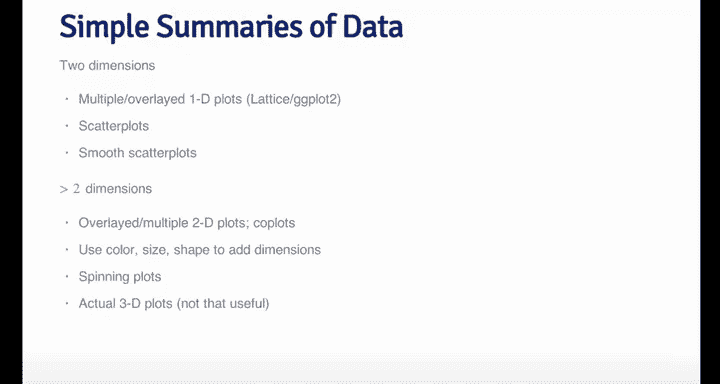
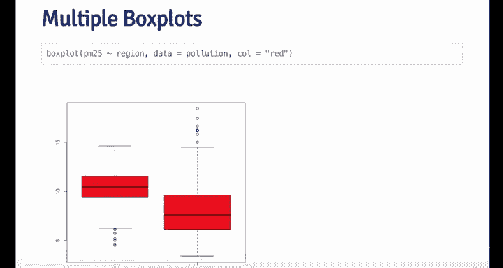
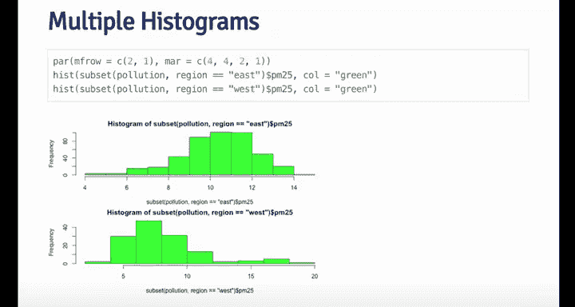
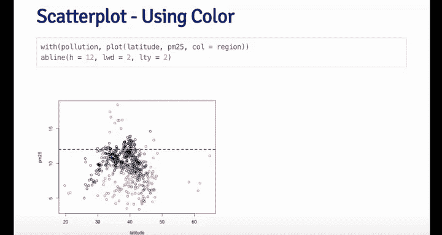
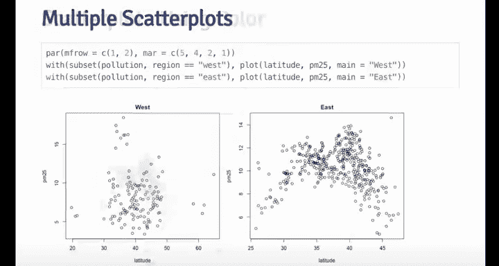
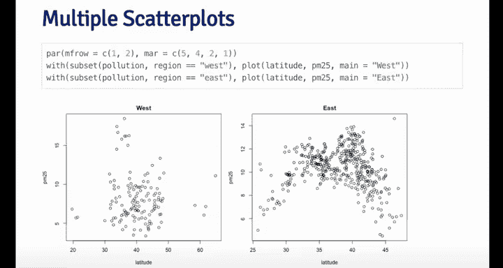
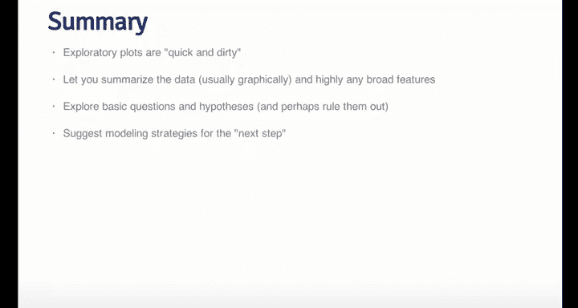

# 约翰霍普金斯大学《数据科学R语言基础｜Data Science： Foundations using R》中英字幕（deepseek - P108：8_探索性图形第2部分.zh_en - GPT中英字幕课程资源 - BV1tsFQemEts

So we've gone through some one dimensional summaries and now I want to talk a little bit about some two dimensional summaries which include things like scatter plots。

 but also you can kind of group together lots of one dimensional plots to look at two dimensional data and in particular lattice and G plot are good at this。

So we can look at scatter plots， smooth scatter plots and also and in looking at greater than two dimensions。

 then you have to get a little bit more clever in terms of how you present the data because one possibility of course。

 is actual three dimensional plots where you might need3D a set of glasses to wear them these are not usually not that useful but I have seen them you can have spinning plots which where it allow you to kind of move the data around in three dimensions。

 these can be useful sometimes， but often the most useful techniques are to take two dimensional plots and kind of array them or organize them in a special way that you can look at a third variable or even a fourth variable and so we'll talk a little bit about these methods。

You can also use things like color and size and shape of plotting symbols to add dimensions to your data。

So。Here's a way to look at two dimensional data I've got in one dimension， the eastwe variable。

 which is categorical and in the other dimension I've got the PM2。

5 variable and you can see that I've got two blocks。

 plots one for east and one for west and you can see that in the east and on average， the PM2。

5 tends to be quite a bit higher than it is in the west and。

And so that's a nice summary of these two dimensions。 Now in the West， you'll see that on average。

 it tends to be a little bit lower， but all of the extreme values of the distribution， so to speak。

 are in the western United States。 So the West has an average that's lower but has generally a larger spread。

 So that's kind of interesting。

You can do a similar type of plot with histograms instead。

 so now I made a histogram on top which is the eastern counties and the histogram at the bottom which is the western counties and you see the same basic features。

 the Western counties tend to be lower on average， but they have more extreme values that are higher。

 and the eastern counties are generally higher on average。

 but they tend to be but they don't have those kind of very high extreme values。

嗯。So of course， one of the easier things to do the most obvious things to do is a scatter plot and here I'm plotting the latitude of the monitor in the county versus the PM2。

5 just to see if there are any north south trends so as the latitude gets increases you're going north and you can see that there's a very strong particularly strong north south trend it does seem that the PM2。

5 tends to be higher in the middle latitudes and not quite as high in the upper and lower latitudes I've added horizontal dashed line here at 12 so you can see roughly where the national ambient air quality standard is and you can see that there are a number of dots that are above it which are technically speaking would be out of compliance。

So you can use color to add another dimension so for example remember there was the latitude and the longitude and the eastwe variable in this data set and so what I've gotten the x axis here is the latitude and the y axis to the PM2。

5 and then I've added the colors are the red and black dots indicate the east and west variable and so the black dots are the east counties and the sorry the black circles are the eastern counties and the red circles are the western counties so you can see now you see you're looking at three different variables here。

Another way to look at these three variables is to just makes two plots。

 and now I've got a panel of plots on hand left hand side I've got all the western。

Counies and on the on the right hand side I've got all the eastern counties and I'm plotting them by latitude and PM 2。

5。 so you can see that in the in both cases， the kind of higher pollution counties tend to be in the middle latitudes and and the north and south northern and southern latitudes tend to have generally lower pollution。

 but this is both the case in the eastern and western United States。 So that's kind of interesting。

So that's a quick summary of plotting one-disal and twodial data in R and even using color and multiple panels for looking at three dimensions that are greater than two and in general these exploratory plots are meant to be quick and dirty。

 you notice I didn't spend any time working with the axes or setting the labels and so just kind of use the defaults and for the most part use the defaults in R but the nice thing about exploratory plots is that they let you summarize the data and highlight any broad features in the data which may be of interest you can explore kind of basic questions and hypotheses remember the basic question that we were looking at was what are there any counties that may be out of compliance and these plots may suggest useful modeling strategies for the next step。

 which may be more detailed analysis or model fitting。

Lastly， here just a couple of resources， there's a nice website called the RGraph Gallery which has lots of examples of graphics and plots made in R and of course the R bloggers website will often highlight lots of plots that people have made and have published through their blog。

 so take a look at those to get a sense of what's possible。

