# 约翰霍普金斯大学《数据科学R语言基础｜Data Science： Foundations using R》中英字幕（deepseek - P109：9_在R中绘图系统.zh_en - GPT中英字幕课程资源 - BV1tsFQemEts

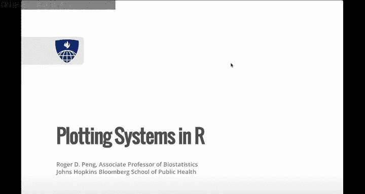

This lecture is going to be about the different plotting systems in R and over time R has developed three core plotting systems that vary from each other and in slightly different ways and are useful for achieving a few different goals I I thought I'd talk about the three different systems what makes them different and how they're useful for various types of plots So the first system that I'll talk about was usually referred to as the base plotting system the base plotting system is the oldest system in R it came with the original version of R and the kind of conceptual model that it uses for building plots is a kind of artist' palette model。

 the idea is that' of you have a blank canvas and then you kind of add things to it one by one So first you create a box with some maybe some points in it and then you add labels and then maybe you add a regression line through it and then maybe you add titles and access takes and things like that and so you kind of piece together as plot one by one every little piece of the plot takes another line of code。

another couple lines of code。 And so you kind of add to it one by one。

 So this is a kind of an intuitive model because especially when you're exploring data because you may not know right away what's the plot that you want to make and so maybe you'll just throw some points on the canvas and then you'll add some colors and you'll add some labels and eventually you'll piece it all together and so this is all well in good as long as you're kind of keeping track of all the code that you use to make the plot then you can always reconstruct the plot later And so the typical mode is for this type of model is to use the plot function so there's always a function that generates a plot and then there are other functions that so- calledled annotate the plot and these are functions that add things like text lines。

 labels and things like that to the plot So there's the generation and then there's the annotation。😊。

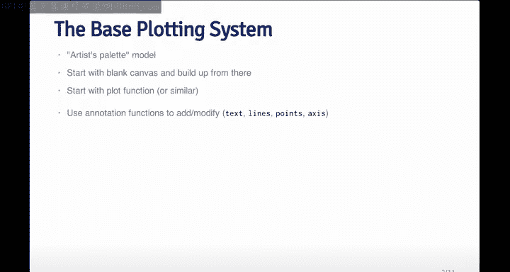

So nice thing about this system and it's very convenient， it's kind of intuitive。

 I think many people think of building plots in this manner。

 but one of the drawbacks is that you can't go back so if you make a plot and you add something to it you can't take it away so it's kind of an increasing process or a kind of a cumulative process it's difficult to translate a new plot to another person so for example if you develop a new kind of plot。

 there's nearly no way to translate those ideas to another person because there's no language。

 there's no kind of conceptual language to use every plot is is just a bunch of R code basically and and so that's a little bit of a drawback sometimes another drawback with the base ploting system is that is because you have so much control over the system you therefore have to control everything and therefore set everything very carefully if you don't like the default values。

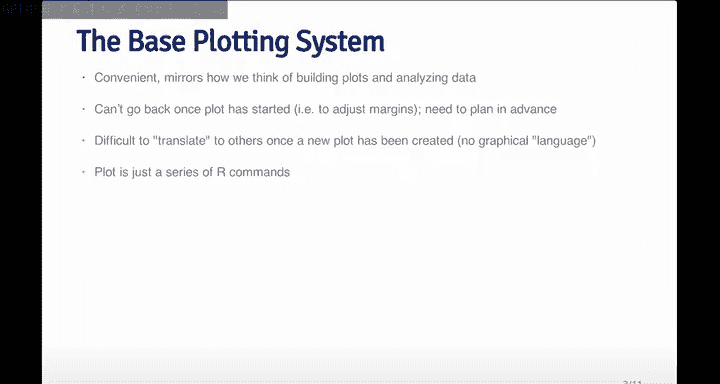

So here's an example， a very simple base plot， you can see what a base plot looks like and this I've used a data set called the Cars data set which shows the speed at which a car is moving and the distance at which it takes to bring the car to a full stop and so you can see it's just a simple scatter plot with speed on the X axis and distance on the Y axis and so base plots look like this you could add a lot of other things you could add a title you could add labels in the plot。

 you can make the points a different color， you can make them a different shape。

 there's all kinds of options that you can choose from and we'll talk about that in detail later。

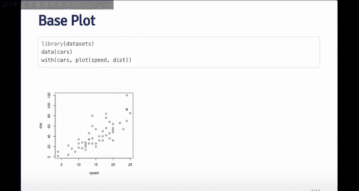

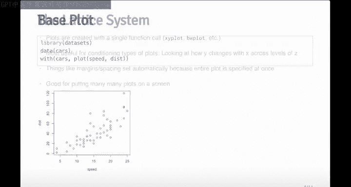

The second major plotting system in R is called the lattice system and this is implemented in the lattice package so this the idea here is actually quite different from the base plotting system rather than piecing a plot together one by one through a series of commands every plot is constructed with a single function call and so the most commonly used function is going to be the function XY plot but there are other functions like BW plot etc ce。

 and so these functions basically construct an entire plot all at once and so therefore you have to specify a lot of information。

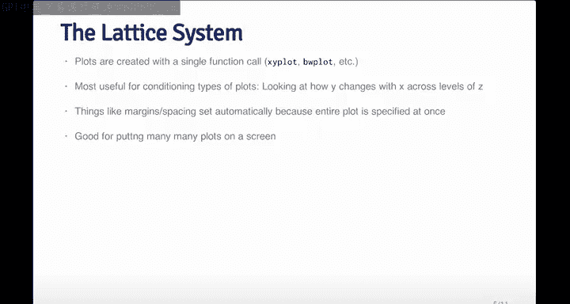

In the call to the function so that it has enough data to build the plot in an appropriate way the lattice system is most useful for what are called coplots or conditioning plots where you have we want to look at the relationship between let's say X and y as it changes across levels of Z and so so you idea that you're conditioning on different levels of z and then you looking at x and y and each one of those plots these are sometimes called panel plots because you're looking at the same thing in every panel but just for different levels of a third variable and you can even combine variables。

 you can look at multiple factors so the system is very useful because you can put a lot of plots on a page very easily and very quickly as long as you kind of follow this conditioning model and then furthermore。

 a lot of the details that you would have to specify directly in the base plotting system are kind of calculated automatically so things like the margins and a lot of the spacings are calculated automatically and as long as you can accept those defaults。

😊。

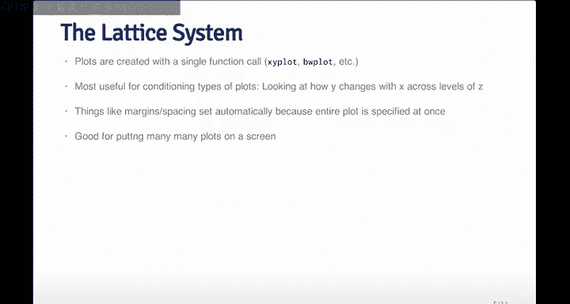

Then most things will look quite nice。

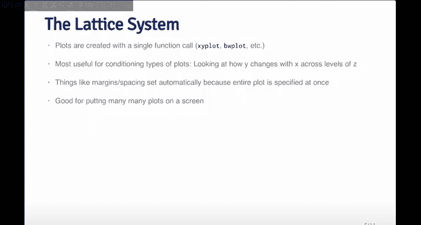

So the downside of the lattice system is that sometimes it's can be very awkward to specify an entire plot using a single function call and sometimes it seems more natural to kind of piece things together one by one like in the base system it's difficult to annotate a plot especially after the plot's been generated you can't add anything to the plot it's done and if you want to add something you kind of have to reconstruct the function call altogether there is a way to annotate each of the individual panels in a lattice plot。

 but it's very tricky and not very intuitive， you get to use functions like panel functions or things like subscripts which is not very intuitive and finally。

 like I said you can't add to a plot once it's done。

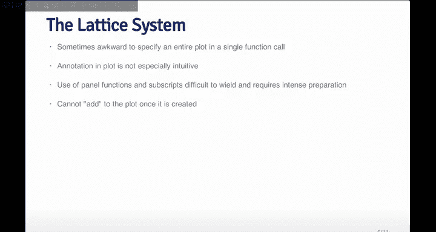

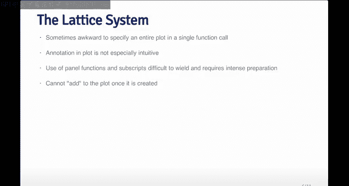

So here's a basic lattice plot I use some data from the lattice package and I basically plot life expectancy so the average life expectancy in a state versus the average per capita income in that state this is data from the late 60s。

 early 70s and then I condition on the region of the country that the state is in so the country is divided into four regions and you can see look at the relationship between income and life expectancy by state within each sorry across states with by region and so you can see that this type of panel plot is very just a single function call in lattice。

 I use the XY plot function and it's very simple to construct where something like this and the base plotting system would involve many different lines of code and would be much more involved。

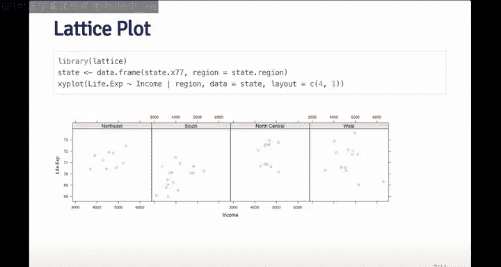

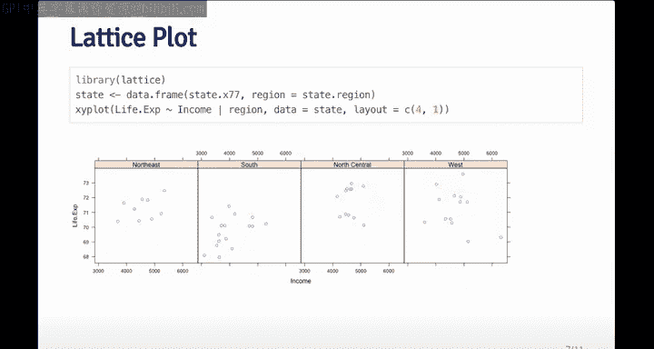

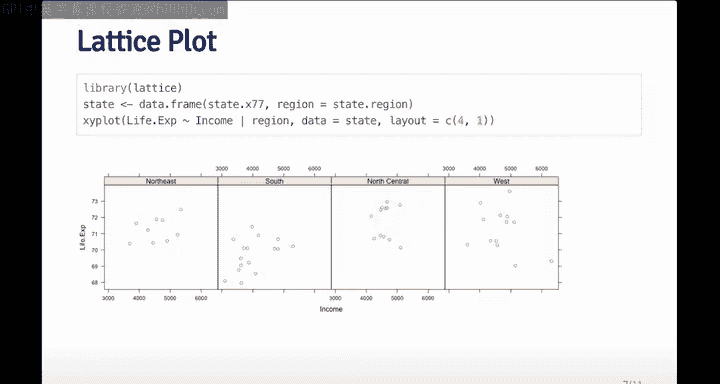

So the last system plotting system that I want to talk about is the Gpl2 system so this comes from the grammar of graphics which lays out a set of principles for kind of plotting and creates a kind of language or grammar for describing different aspects of a plot so it's based on kind of a wellgrounded rigorous theoretical system and it's been implemented in R in the G2 Gpl2 package it kind of splits the difference between the lattice in the base package so it mixes ideas from both so on the one hand you can kind of build a plot incrementally by adding things one by one so that's kind of like the base system on the other hand a lot of a lot of the kind of aesthetic calculations are done automatically without you having to directly controls things like spacings and labels are all kind of put in the right place so that's kind of like the lattice system the Gpl2 system is very useful for condition plots just like in lattice and so you can make the。

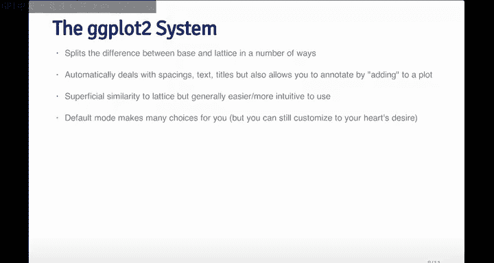

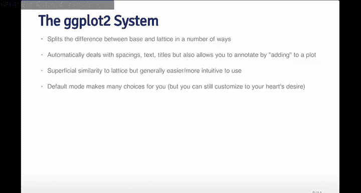

kindss of panel plots and the default the default so the G plotot2 system has a lot of defaults and if you can accept them。

 it's quite handy， but you can always customize them if you don't like what the defaults are and so if you know how to use the lattice system the transition to G plot2 is not too difficult。

 although there are some differences that I'll talk about in the lecture on G plot。

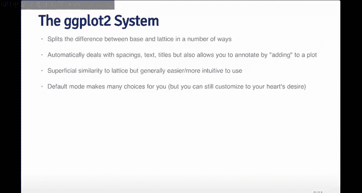

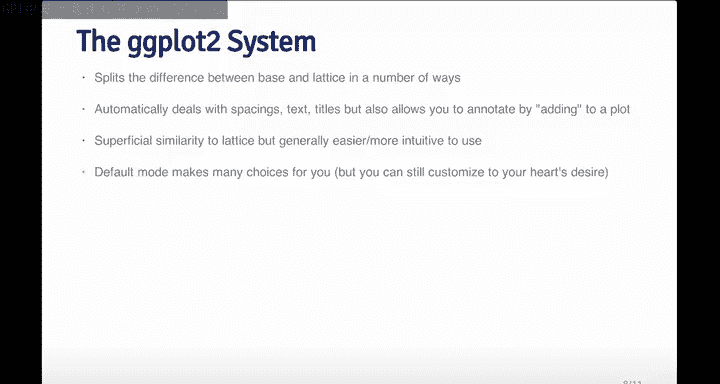

So this is a typical default GGpl2 plot here I use the miles per gallon data from the Gplot2 package and I'm plotting on the X axis the displayplace image or essentially the size of the engine of a car and the Y axis is the mileage on the highway for that car and you can see that roughly as the size of the engine is increasing the mileage is decreasing and so you can see that the GGPot2 package creates plots in a slightly different aesthetic there's a kind of gray background with white grid lines。

 the default is to use solid circles rather than open circles and so these things you can always customize if you want。

 but the defaults are a little bit different than the other two systems。

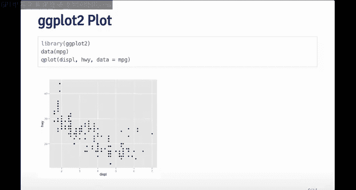

So just to summarize there are three basic plotting systems in R。

 there's the base plotting system which is kind of has this artist palette model where you kind add things one by one。

 there's the lattice system which you kind of specified an entire plot using a single function call and then there's the Gpl2 system which which kind of mixes some ideas from both systems one of the important things to know when you're using these three systems is that they can't be interchanged you can't use them interchangeably so if you're going to use the base plotting system you have to use all the functions associated with that system similarly if you're going to use the G plot2 system。

 you have to use all the functions associated with that system so you can't mix the functions between systems because otherwise you'll get the plotting will be confused and so you typically have to choose a system and kind of go with it when you make your plots So those are the three main plotting systems in R and then in separate lectures I'll cover in detail how to use each one of them。

