# 约翰霍普金斯大学《数据科学R语言基础｜Data Science： Foundations using R》中英字幕（deepseek - P10：9_在R中进行项目.zh_en - GPT中英字幕课程资源 - BV1tsFQemEts

One of the ways people organize their work in our is through the use of our projects。

 a built in functionality of our studio that helps to keep all your related files together Our studio provides a great guide on how to use projects。

 so definitely check that out first off what is in our project when you make a project it creates a folder where all files will be kept。

 which is helpful for organizing yourself and keeping multiple projects separate from each other when you reopen a project。

 our studio remembers what files were open and will restore the work environment as if you had never left which is very helpful when you are starting back up on a project after some time off functionally creating a project in our will create a new folder and assign that as the working directory so that all files generated will be assigned to the same directory the main benefit of using projects is that it starts the organization process offright it creates a folder for you and now you have a place to store all of your input data。

 your code and the output of your code everything you are working on within a project。

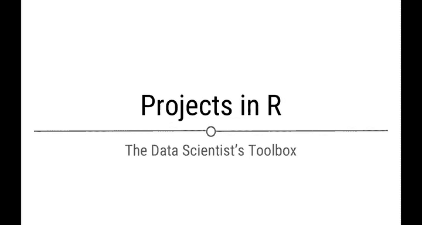

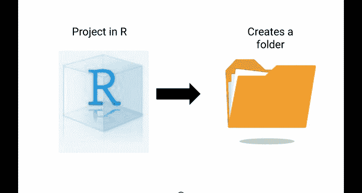

I selflf-contained， which often means finding things is much easier there's only one place to look Also since everything related to one project is all in the same place。

 it is much easier to share your work with others， either by directly sharing the folder/ files or by associating it with version control software we'll talk more about linking projects in are with version control systems in a future lesson entirely dedicated to the topic Finally。

 since our studio remembers what documents you had open when you closed the session it is easier to pick a project up after a break。

 everything is set up just as you left it。

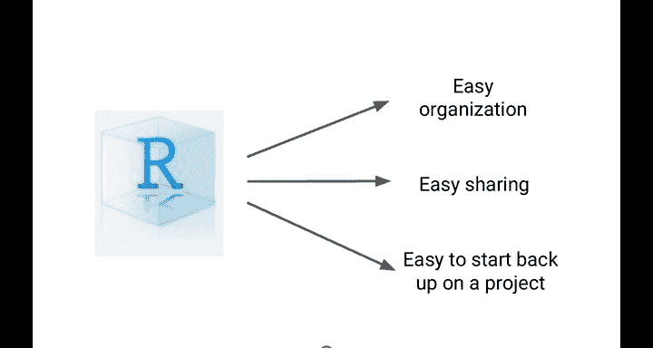

There are three ways to make a project first you can make it from scratch。

 this will create a new directory for all your files to go in or you can create a project from an existing folder This will link an existing directory with ourSt Finally you can link a project from version control this will clone an existing project onto your computer don't worry too much about this one you'll get more familiar with it in the next few lessons Let's create a project from scratch。

 which is often what you will be doing open ourSt and under file。

 select new project you can also create a new project by using the project' toolbar and selecting new project in the dropdown menu or there is a new project shortcut in the toolbar since we are starting from scratch select new directory and when prompted about the project type。

 select new project pick a name for your project and for this time save it to your desktop this will create a folder on your desktop where all of the files associated with this project will be kept click Create project。

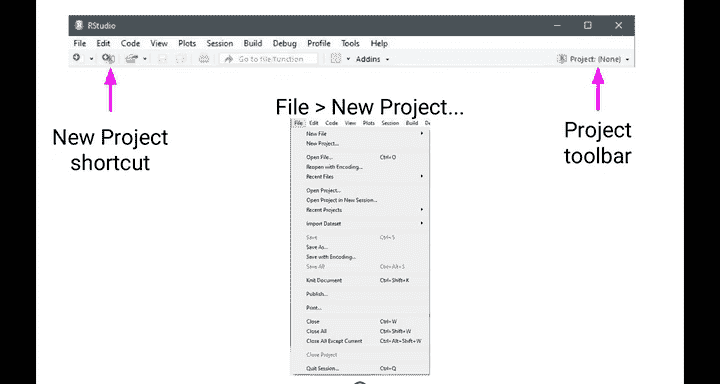

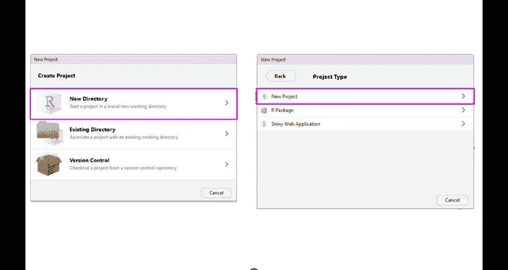

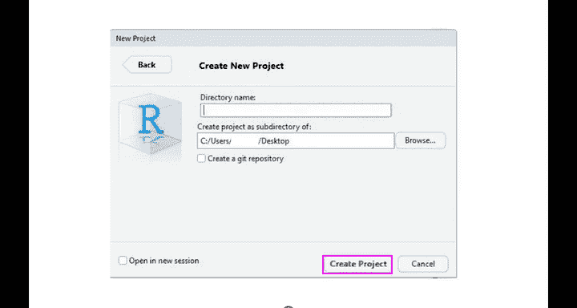

A blank art studio session should open。A few things to note one in the file squadron of the screen。

 you can see that ourSt has made this new directory your working directory and generated a single file with the extension our project and two。

 in the upper right of the window， there is a project toolbar that states the name of your current project and has a dropdown menu with a few different options that we'll talk about in a second opening an existing project is as simple as double clickicking the R project file on your computer。

 you can accomplish the same from within our studio by opening our studio and going to file then open project you can also use the project toolbar and open the dropropdown menu and select Open project。

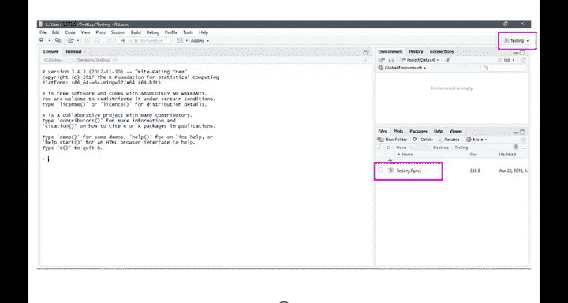

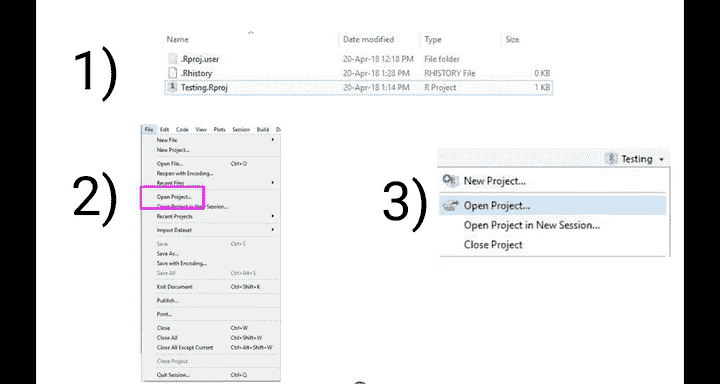

Quitting a project is as simple as closing your R studio window you can also go to file close project and this will do the same Finally you can use the project toolbar by clicking on the dropdown menu and choosing close project all of these options will quit a project and doing so will cause ourSt to write which documents are currently open so they can be restored when you start back up again and it then closes the R session when you set up your project。

 you can tell it to saveve environment so for example all of your variables and data tables will be preloaded when you reopen the project but this is not the default behavior the projects toolbar is also an easy way to switch between projects click on the dropropdown menu and choose open project and find your new project you want to open This will save the current project Close it and then open the new project within the same window if you want multiple projects open at the same time do the same but instead select open project and new session this can also be accomplished。

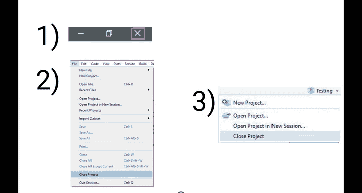

Through the file menu， where those same options are available。

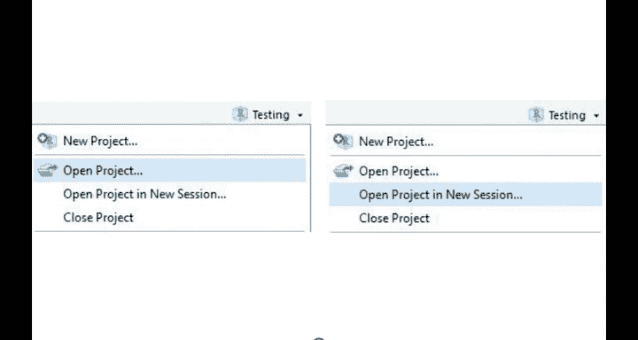

When you are setting up a project， it can be helpful to start out creating a few directories。

 try a few strategies and see what works best for you。

 but most file structures are set up around having a directory containing the raw data。

 a directory that you keep scriptris slash our files in and a directory for the output of your code if you set up these folders before you start。

 it can save you organizational headaches later on in a project when you can't quite remember where something is。

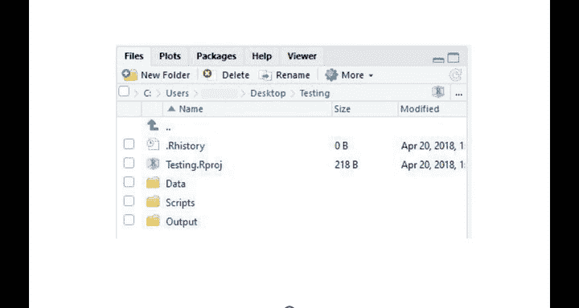

In this lesson we've covered what projects in RR， why you might want to use them， how to open， close。

 or switch between projects， and some best practices to best set you up for organizing yourself。

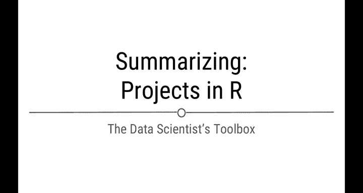