# 约翰霍普金斯大学《数据科学R语言基础｜Data Science： Foundations using R》中英字幕（deepseek - P111：11_基础绘图系统第2部分.zh_en - GPT中英字幕课程资源 - BV1tsFQemEts

So some of the key base plotting functions that you'll use a lot， of course is one。

 the first is the plot function， which makes a scatter plot and it can make other types of plots depending on whether you're plotting a special type of object。

 but for the most part you usually want to make scatter plots。

Lines is a function that doesn't create a plot but it adds to a plot and so sometimes you want to connect a lot of dots together so you want to make a time series type of plot you so you want to draw lines instead of scatter plot lines is useful for that points adds points to a plot so sometimes you want to create a plot and then you want to add some other points that might represent a different group or different subset of the population text adds labels you want to annotate the plot with text labels title adds so text can be used as you say to add labels within the plot and the title function is typically use to add annotations outside the plot like x and y axis labels。

 titles and subtitles and things like that M text is the M stands for margins so used to place text in the margins of a plot both the inner and the outer margin and the axis function is used for specifying the axis ticks。

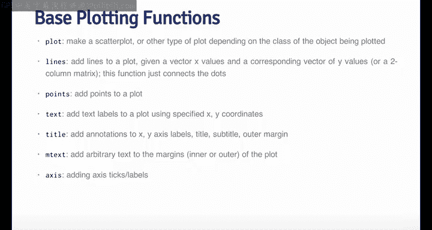

So here's a couple examples of how to make plots and then annotating them。

 here I'm plotting the wind and ozone。That I had before a scatter plot。

 but now I'm adding a title to the top of the plot。

 so here's you can see it's ozone and wind from in New York City。

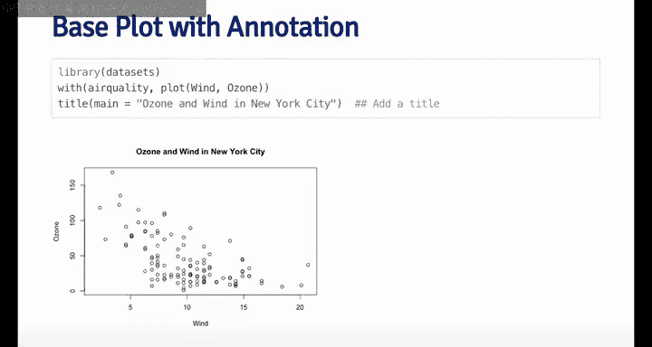

In this plot I'm again doing a scatter plot but instead of using the title function to add the title I I put the title directly into the call to plot。

 but then what I want to do is I want to I want to kind of plot all of the data points that are in the month of May different color and so what I do is I subset the data frame just to include the observations where month equals five and then I use the points function to add to kind of read points this time colored them blue so you can see in the plot below that there are a subset of blue points and those correspond to the data points in the month of May。

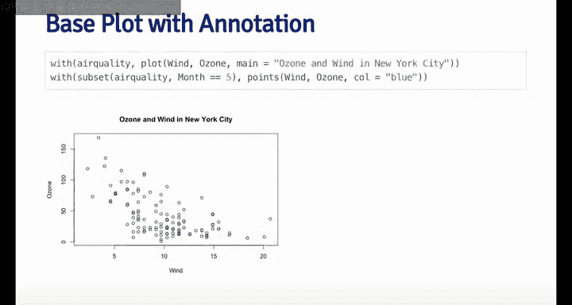

Now I could do。

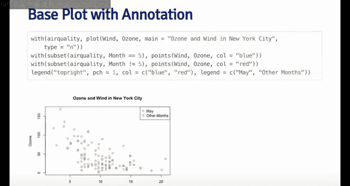

More。

Subsets or so I can plot them in different colors。 So here I'm plotting but I'm initializing a plot。

 but the one thing you can see is that I've added the argument type equals n。

 And so what type equals n means it basically sets up the plot and initialize the graphics device but it doesn't actually plot anything so it doesn't put anything into the plotting region it just makes it sets up all the other stuff in the plot without the actual data and then as in order to put the data into the plot。

 I kind of go through subsets to the data frame to add the data from the month of May and add data for the month of not May So for the month of May I make that color blue and then for the other months that are not equals to May I just make that color red so you can see all the other points are red。

 So now I can kind of accurately which ones are blue。

 which ones are may without kind of over plotloting existing points。

 and then as the last touch I add a legend to the top right part of the plot so I can distinguish which ones are may and which ones are not may。

Finally， one common thing that you will typically want to do is to add a regression line or a smoother to a plot so here I've just added a regression line to the same scatter plot so I first make the scatter plot and you can notice I've changed the default plotting character PCH to be 20 so 20 is a kind of small filled in circle and then I fit a linear model to the data which is using the LM function and then I can just call the AB line function which is another annotation function and I just pass it the linear model object and I specify LWD equals to two which is a thicker line than the typical default line so AB line can interpret the regression model output and plot plot with a given intercepted slope and so here you can see I've added the regression line to the plot and so you can see the downward trend。

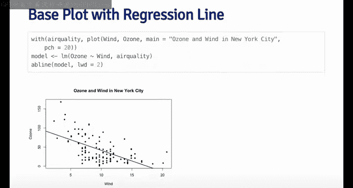

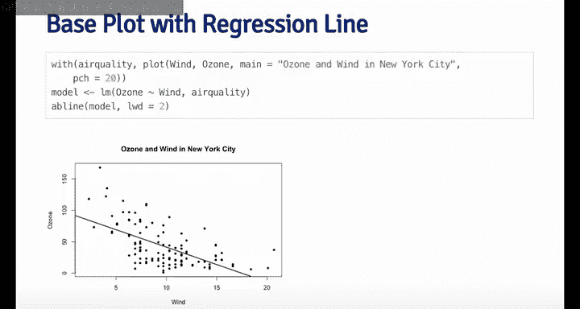

So all the previous plots have been single plots that might then would appear on the graphics device。

 but sometimes you want to have multiple plots on a single device so here I made two plots one plots ozone versus wind and the other one plots ozone versus So radiation using the same data set and so in order to do that I just set the par MF row equals to one row and two column so I can make the two plots side by side and then I just call plot twice so every time I call plot it creates a new plot and so the first one will be in the kind of lefthand side and the second call the plot will be in the right hand side and that's how I use MF row。

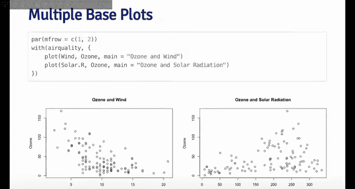

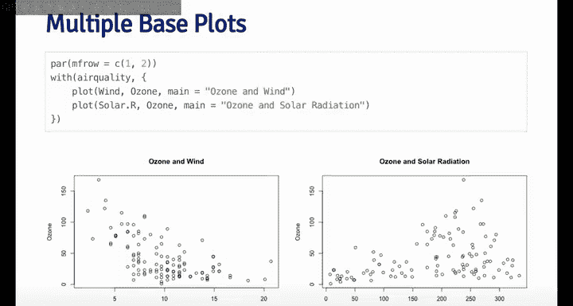

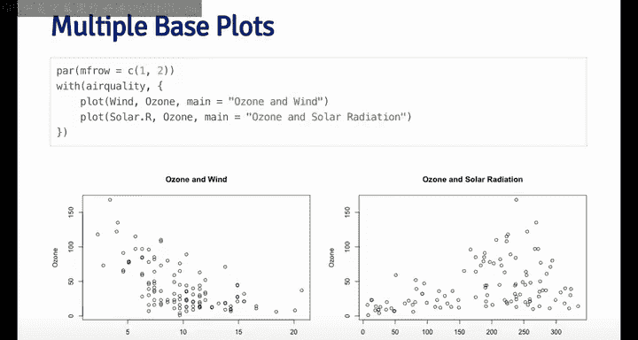

Now， you can see that when I use multiple plots， I have a title on each plot。

 So which tells me kind of what the two variables are， the first one's ozone and win。

 the second one's ozone and solar radiation and the third one here is ozone and temperature。

 But then sometimes you want to have a label that's kind of covering the entire panel of plots。

 And so that's what the outer margin is for。 So here in this call to par。

 I set MF equals to one row three columns。 I set the margin is to be a little bit smaller than the defaults。

 and then I set the outer margin to be actually bigger than the default the beat the default for the outer margin is zero all around。

 So on the top， I want a little extra space so I can add the title ozone and weather in New York City。

 which is kind of a title for the entire panel of plots。

 And then I call plot three times to make the three different plots。

 and then I use Mt to add the kind of outer title to this panel of plots。

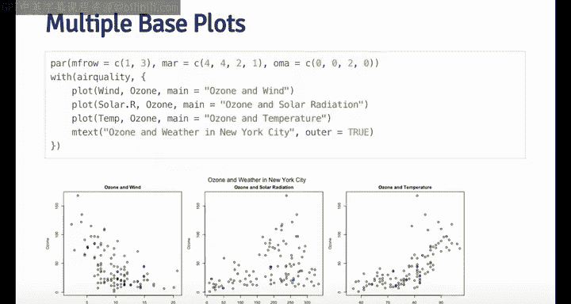

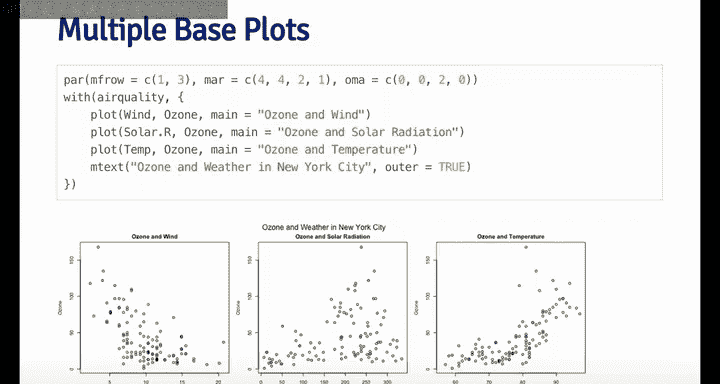

So that was a quick kind of introduction to the base plotting system covers some of the basic functions that you would use including plot and a couple of annotation functions like a line and points and things like that so you can see that by creating when you create base plots you are kind of building up a plot function by function and you kind of end up with many lines of code to create one plot and that's typical lots of base plots every plot starts with a function that initiates the plot so like plot or hist or box plot and then a series of functions which will typically annotate the plot by adding points。

 lines， text and legends so the base plotting system is very flexible it gives you a lot of control over all of the various details of a plot of course this can be a little bit tedious if you need to control everything all the time but often the defaults are okay and but the flexibility is quite useful if you want to make kind of publication。

quality plots and and so it's nice to have that degree of control with all for things like legends and spacings and all that and so so that's the kind of the bass ping system we'll talk more about the other p systems in other lectures。

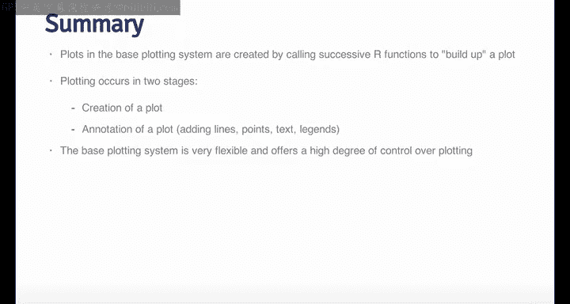