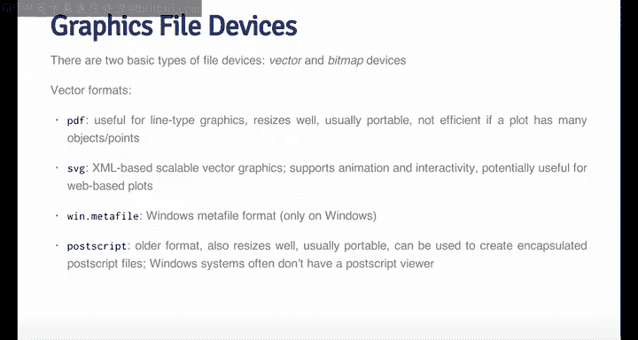
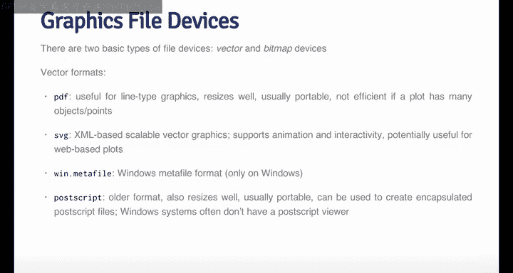
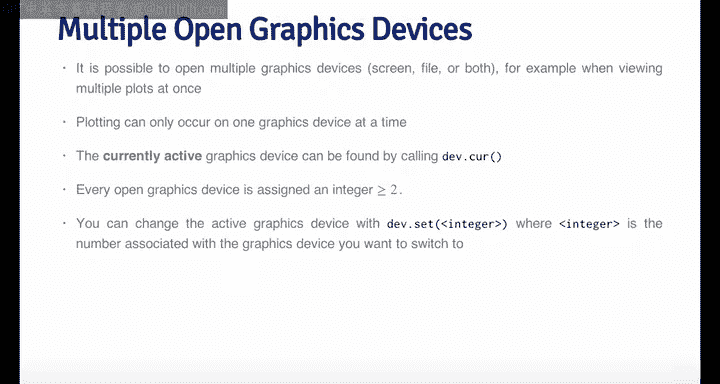
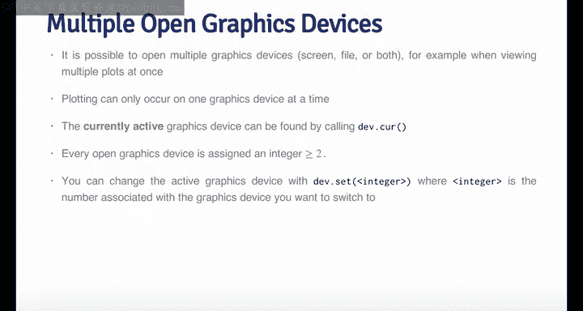
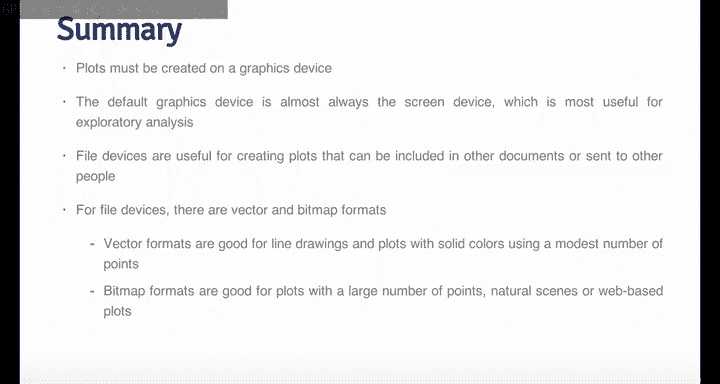

# 约翰霍普金斯大学《数据科学R语言基础｜Data Science： Foundations using R》中英字幕（deepseek - P114：14_R中的图形设备第2部分.zh_en - GPT中英字幕课程资源 - BV1tsFQemEts

So when it comes to graphics file devices there are basically two broad categories of devices。

 one is called vector devices or vector formats and the other format is called bitMap so vector formats usually are most useful for things like line graphics so if you have a scatter plot and maybe you draw a regression line through it these are line graphics they don't have they're not like natural scenes or images of photographs or things like that and so these types of graphics are are useful kind of generated using vector formats because they resize well so if you have to take the image and kind of make it bigger or smaller it won't get distorted and and the quality of the graphic won't suffer for example the PDF format is very portable you can use it on almost any platform that's out there right now and so it's a good format a general purpose vector format。

Vector formats are typically not very good if you have a plot that has a large number of points because every single point has to be represented by a piece of information in the file format and so these files tend to be extremely large if you plot a lot of different points to a vector format file type scalable vector graphics or SVGs is a popular format for webbased plots it's useful because it supports things like animation and interactivity in the plot and almost all web browsers recognize the SVG format now Windows Mephile is vector format that's available only on Windows and you may see older files lying around that are in the postscript format this is kind of a predecessor to the PDF format it's not used very often but you may see it around。

In the bitmap format file formats， there are a few common ones， probably the most common as PG。

 which stands for portableable network graphics and so basically Bimap formats are represent plots or images as a series of pixels essentially and so they're very good for plots that have lots of different points because they'll be very efficiently represented in a bitmap format PNG is particularly is good for things like line drawings or images with solid colors。

 it uses a lossless compression algorithm so that the file sizes tend to be small and pretty much every web browser can read PNGs now so they're good for web webbased plots JPEG you might be familiar with if you have digital camera or something like that they're very good for things like natural scenes which don't have solid colors but gradients of color it uses a lossy compression algorithm so the file sizes are very efficient and very small。

And they're also good for just because it's a bitmap format it's good for plotting making plots with lots of points Bimap formats in general do not resize well so when you create a plot and you try to make it bigger or smaller they can distort the quality of the image and so generally speaking you should not resize bitmap plots after they've been generated JPEGs of course can be read by any computer in any web browser so they're very useful for that kind of for webbased plots they're not very good for line drawings because if you create a line drawing in JPEG you'll see some aliasing in the lines。

TIiff is another older format for Bimap files， it supports lossless compression and it's very commonly used still BMP is a native bitmap format for Windows as commonly used for things like icons。

So it's possible to open multiple graphics devices and so for example。

 for example you might want to create three or four different plots to look at at the same time and the way to do that is to have say three or four different screen devices open and so the way you do is you can launch graphics devices explicitly you can launch the screen device for example on Mac by calling the quartz function multiple times and then you'll open multiple graphics screen devices and so but you can only plot to one device at a time and so the graphics device that you plot to is the active graphics device and you can figure out which graphics is the active one by calling the dev。

cur function or dev stands for current。

And that function will return an integer that will tell you which graphics device is currently active。

 so every graphics device is assigned an integer that's between two and2 and up basically so there's no graphics device that has the number one。

 so every graphics device gets an integer and you can change which graphics device is the active graphics device by calling the dev dot set function and dev dot set takes an integer value which will switch you to the graphics device that corresponds to the integer that you give it。

 so you can switch back and forth between the graphics devices using the dev dot set function if you need to。

Finally， it's possible to copy plots from one device to another and this is probably most commonly used when you've created a plot on the screen and you decided that you really like it and then you want to put it into a file and so there's two ways that you could do this one is that if you've saved the code that makes the plot on the screen you can just open up a file device and then cut and paste the code into R and then close the file device and then you've got your plot in a file。

But a faster way and sometimes more convenient is to copy the plot from the screen device to the file device。

And you can use this with the dev。tco function， which just copies plots from one device from any device to any other device。

 and then but if you specifically want a PDF file， there is a function called dev。copy to PDF。

 which will take the screen device and copy it directly to a PDF file。

Now it's important to note that copying the plot is not an exact operation。

 so the plot that you end up within the file may not look exactly like the plot that you saw on the screen so there may be some adjustment that you have to do so here's some code that just creates a plot on the screen thats the old faithful geyser data that comes with R and then I want to copy it to a PNG file so I want to create a PG file on my computer that contains the plot that I'm looking at on the screen so I can call dev。

 copy the first argument to dev。 copy is the function that opens the file device so in this case this is the PG function。

And then I just give it a file name which is needed to create the file， so I just call it geyserplot。

png。And then once I've copied the plot， I still need to close the PNG device with devb。t off。

 so once I call devb。t off， there should be a file on my computer that's going to be in a PNG format and I can send it to someone or it can include it in a presentation。

So that's a quick summary of the graphics devices in R。

 the basic bottom lines are that every plot must be created on a graphics device and usually this is the screen device but it's useful for exploratory analysis but if you want to preserve a plot or send it to someone you have to create a plot in a file device。

 and there are a variety of different file formats that you can use there are vector formats like PDF and SVG and there are BitMap formats like PNG and JPEG that you can choose from。

