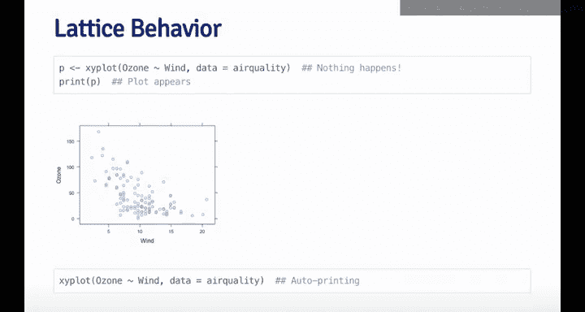

# 约翰霍普金斯大学《数据科学R语言基础｜Data Science： Foundations using R》中英字幕（deepseek - P115：15_格子绘图系统第1部分.zh_en - GPT中英字幕课程资源 - BV1tsFQemEts

The lattice plotting system in R is a plotting system that's different from the base plotting system。

 and it works very differently， and it's useful for plotting。

 often for plotting kind of high dimensional data and for plot making lot many， many plots at once。

 If you recall on the base plotting system， it was possible to。

Put multiple plots on the same graphics device using the MFO or MF call arguments。

And you can make panels of plots to look at many different features and the lattice plotting system is is kind of designed to really make it's kind optimize that type of plot and to make a very high density plots。

 And so it can be useful in many situations and so I'll talk about some of the functions in the lattice system here so the lattice plotting system is implemented in the lattice package you have to load the package in order to use it underlying the lattice package is what's called the grid package。

 which implements a lot of the kind of lowlevel plumbing of the lattice graphic system and you typically won't have to call functions from the grid package directly。

 but it's useful to know that underneath there are a there's a lot of code that's implemented in the grid package and so。

The the lattice package builds on top of grid and gives you a number of kind of user level functions to employ the one thing about the lattice plotting system is that it does not have a kind of two phasese aspect like the base plotting system did and where you kind in the base plotting system if recall you kind of create the plot and then you annotate it with separate functions here in the lattice plotting system you have to create the entire plot all at once in a single function call and so you have to specify all the details within that function call because you won't have a chance really to annotate it afterwards。

So some of the main functions in lattice are XY plot。

 this is probably the most important function it's basically used for making scatter plots。

 there's BW plot for box plots， histogram for histograms。

 strip plot is kind of like a box plot but it uses points。

 the dot plot plots points on where it look like violin strings。

 splos for scatter plot matrix it's kind of like the paris function in the base plotting system and level plot and contourpl over plotting image data。

And so I'll just talk a little bit about the Xy plot function right now because I think it's the most important。

 The basic function call for Xy plot is that you have a formula kind of notation so you have y tilde x So the y is going to be whatevers on your y axis and x is going to be whatever is on your X axis and then you have this vertical bar which separates what are called conditioning variables so F and G are going to be categorical variables that you condition on so for example。

 and the idea is that you want to to kind of interpret this function call in words the idea is that I want to look at the scatter plot of Y and X for every level of f and G right and so you don't have to use two different categorical variables I just wanted to show that you could。

And so。And then the second argument is the data argument and this is the data frame where the variables X Y。

 F and G can be found， if there's no data frame there。

 then it will look in your workspace for the variables to plot。

So here's the very simple scatter plot I load the lattice package and the data sets package and I'm plotting the ozone and wind variables from the air quality data frame。

 so you can see I just said ozone till the wind I've got ozone on the Y axis and wind and the X axis。

 and this is your basic scatter plot which looks very much like a scatter plot in the base plotting system。

Notice that the defaults are a little bit different， it does use open circles。

 but they're colored blue by default。Now here's a slightly more complicated lattice plot so here I've gotten the same data frame but I've converted the month variable into a factor and now I'm plotting ozone versus wind by month so you can interpret the formula as I want to look at the relationship between ozone and wind for each level of month and so month goes from5。

6，7，8 and9 so from the month of May to the month of September and you can see the relationship between ozone and wind it appears to change across the month so there doesn't appear to be much relationship in May or June but you can see in July and August there's a relatively strong relationship there's a negative one that's a more wind means less ozone and you can see by September that relationship is starting to die down a little bit so it's very easy so that's one of the power of the Xy plot function in lattice is that I can make these multidimensional panels very simply with just a single function call and you recall in the base plotting system there would have been many。

 many function calls to create this plot and here I just used the single。

So now I'm looking at three different variables here in the month， the ozone and wind。

 and they're all kind of arranged in one panel， which is very convenient。

So the lattice functions behave a little bit differently and it's worth noting the difference between lattice and the base graphics base graphics functions plot data directly to a graphics device so if you call the screen device or PDF files or all there are all kinds of graphics devices but lattice functions do is they don't actually they don't specifically plot anything what they do is they return an object of class trellis and then this object has to be printed in order for the data in the plot to kind of go to the graphics device there is a twotage aspect there but most of the time this aspect is invisible to the user because what happens is that when you call a function like Xy plot it returns an object of class trellis but then it auto prints that object and so the auto printing feature of R well make it so that it automatically sends the plot to the graphics device So most of the time you don't have to worry about this twostep process but it's worth noting that you can in theory save the plot object to。

Our object and then it'll be sitting in your workspace now you can theoretically store that object。

 but it's probably not wise to do this is better to save the code that generates the plot and the data。

So you can see this lattice behavior in just in this simple bit of code here so here I'm calling the Xy plot function。

 I'm saving to an object called P and then I'm printing P and that's when the plot appears。

 So if you run this code after the first line of code nothing will happen but after the second line the plot will appear So if you just call XY plot then then we use what's called the auto printing feature of R。

