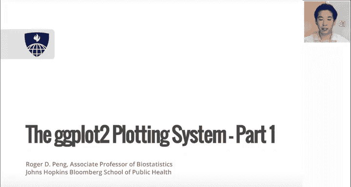

# 约翰霍普金斯大学《数据科学R语言基础｜Data Science： Foundations using R》中英字幕（deepseek - P117：17_ggplot2第1部分.zh_en - GPT中英字幕课程资源 - BV1tsFQemEts

Hei everyone， this lecture is going to be about GG plotot2 or the GGplot2 package and I'm going to talk about how to do some basic plots using the GGPot2 package and kind of what it's about and then this in the next lecture I'll talk a little bit in more detail about kind of how it's designed and how you can make extensions to the various GG plotting functions。

So first question， very basic， you know， what is Gpl2。

 basically it's a package and R that you can download from Crran and。

And it implements what's called the grammar of graphics。

 which was originally written by Leland Wilkinson and is described in a book called Grmmar of Gs。

 Now the grammar of graphics is a description of how kind of graphics can be broken down into abstract concepts you could so think of the grammar of a language like English you have things like verbs and nouns and adjectives and so the question is you what are the verbs。

 nouns and adjectives of a data graphic and the grammar of graphics kind of describes kind of those basic elements so that you can put them together to make new types of graphics。

 just like you could take a verb and a noun and adjective and make a new sentence that maybe no one's ever heard before you could take the grammar of graphics and put together various aspects of plots and make a graphic that no one's ever seen before and so that's the basic idea and it's a very powerful concept to kind of organize all kinds of data graphics。

Until recently there was no specific implementation for it in R but Hadley Wickham who when he was a graduate student at Iowa State implemented the grammar of graphics as an R package called Gpl and its current implementation is called Gpl2 so one can think of this as almost a third graphic system in R even though it's based it's built upon the grid graphic system which comes with R it's kind of a third mode of plotting that is's become very popular so if you think of the first mode as like the base plots using functions like plot and hist and boxpl and then the second mode as the lattice plot so using XYpl and these kinds of trellis type functions and then the third mode is Gpl so you can get the package from Cran you can use install that packages installs on almost imagine on all systems and you can go to the Gpl website which is Gplot2。

org。And so the nice thing about Gplot is that it is based on this grammar of graphics and in sense there's a theory of the graphics so you can take this theory and kind of reassemble the different pieces to make new types of plots and as Hadley Wickham says in his book know the basic ideas that you want to shorten the distance from the mind to the page so if you have some data that you're looking at and think of a way that you want to visualize that data you want to be able to rapidly take those ideas and turn them into a picture on your screen。

So from the GGplot2 book， this sentence kind of summarizes the basic idea。

 but the idea is that the grammar tells us that a statistical graphic is a mapping from data to aesthetic attributes。

 so color， shape and size of geometric objects， so points， lines and bars。

 and the plot may also contain statistical transformations of the data and is drawn on a specific coordinate system。

 so we have we have a mapping from data to aesthetics， geometric objects， we have statistics。

 and we have a coordinate system。So in this lecture I just want to talk about the Q plotot function。

 which is kind of the most basic function and it's probably the best place to start for someone who's transitioning from say the base plotting system so in the base plotting system the workhorse function is the plot function and so Q plotot which you can think of as standing for a quick plot is kind of the workhorse function for for GD plot and and it's analogous to the plot function in the base system so one key difference that you have to get used to when you're using GD plot is that typically when you make a plot and you pass data to the Q plot function you want to tell it where the data comes from and the data will always come from a data frame so a data frame is going to be so your data have to be organized in a data frame and then when you plot variables those variables are going to come from the data frame now you don't have to specify a data frame if you don't specify a data frame the Q plot function or all the plotting functions will look for the data in your workspace but it's generally a good idea to。

the data frame that way， when you read the code that generated the plot。

 you know exactly where the data came from。So then the data frame is very important to organize before you start plotting once you start plotting the plots are made up of aesthetics and GMs and so aesthetics are things like the size。

 shape， and color of things of points and the GMs are kind of the objects that you're plotting so are you plotting points。

 are you plotting lines are you plotting bars， whatnot？

One aspect that's important for the Q plot function and also it' similarly important when you're using lattice functions is the idea of using factor variables so factors are very important because they indicate subsets of your data so if you imagine you have a data frame where you have a Y variable an X variable and then a factor variable the factor will indicate subsets of your data in the data frame so for example you might have a factor that indicate the gender so you have a bunch of males and a bunch of females so those are subsets of your data and you might want to plot a certain relationship divided by the various subsets or you might want to color certain points depending on whether they're male or female and so the categories that are indicated by various factor variables can be useful for annotating a plot。

And so one aspect so one thing that's important about this feature is that when you have factor variables in a data。

 you want to make sure that they're properly labeled。

 so it's usually not useful to label a factor variable as one2 and3。

 even if you have three categories， one two and three is not particularly informative usually you want to label them with more informative labels so that you know what those factor variables are trying to encode now the Q plotot function is a fairly straightforward function to use。

 I think it's very easy to pick up it hides a lot of the details of what G plotot is doing underneath which is fine for many cases。

 but the GGplot function is really kind of the core function of the system it's very flexible that you can use it in combination with a lot of things that Q plotot can't do。

