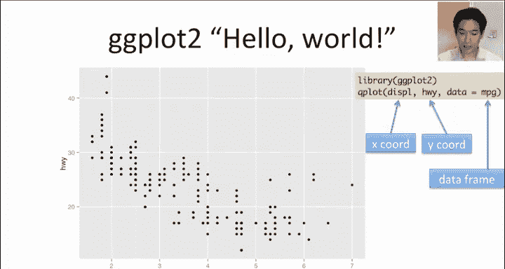
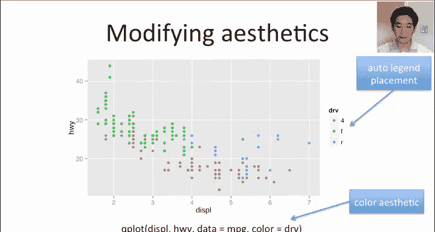
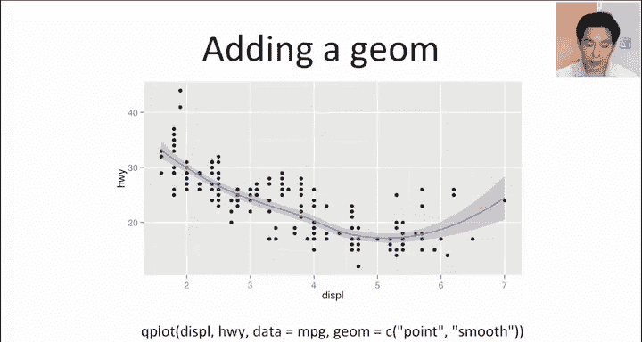
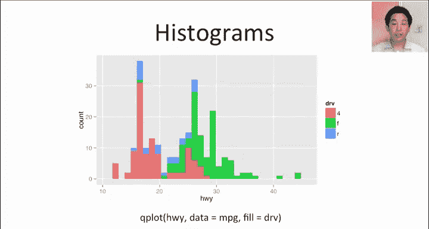
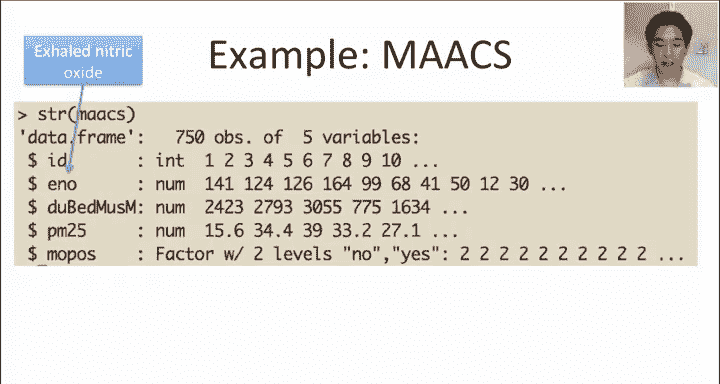
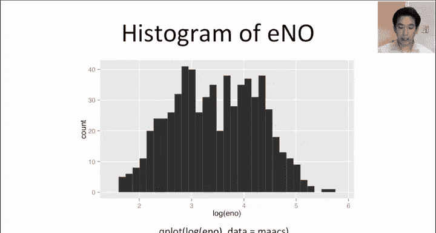
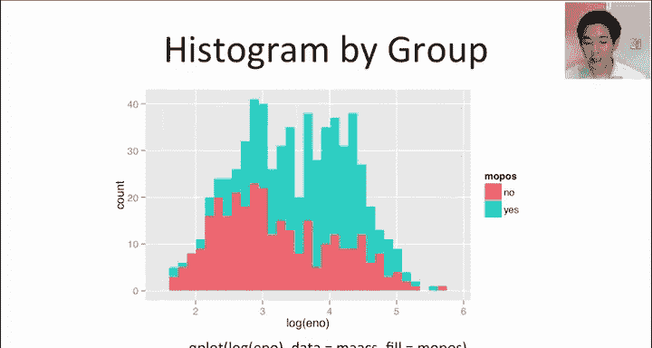
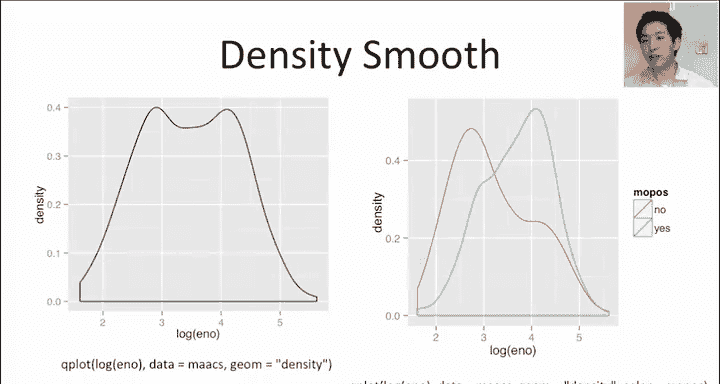
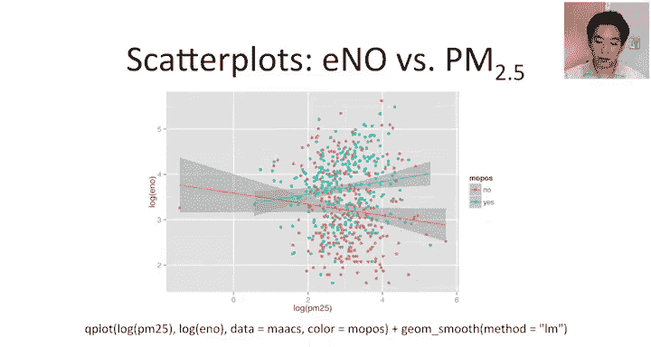
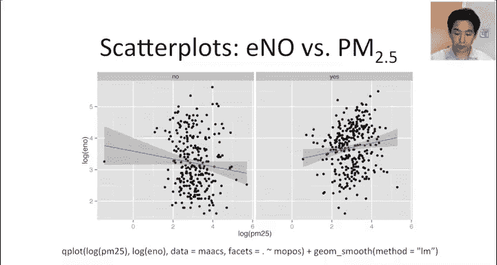

# 约翰霍普金斯大学《数据科学R语言基础｜Data Science： Foundations using R》中英字幕（deepseek - P118：18_ggplot2第2部分.zh_en - GPT中英字幕课程资源 - BV1tsFQemEts

So I'm going to start with a little example data set here。

 this data set comes with the GGplot2 package， you can always just load it up after you installed the packages after you installed the package and so this is the MPG data set it looks at miles per gallon for a variety of different types of cars and you can see that in this data from the stir that I did that there's 234 observations。

 so there's 234 different types of cars and there are 11 variables that are measured。

In particular I'm going to be looking at the displacement variable。

 which is an indicator of how large the engine is， so this is the DISPL variable。

 we' be looking at the number of cylinders and and sorry we're going to look at the highway mileage or the HWY variable。

 and then we're going to look at the DRV variable， which is what kind of drive it is it a four wheelhe drive front wheel drive or rear wheel drive。

So notice how the factors here are labeled appropriately， so for example。

 the manufacturer variable is labeled by the manufacturer of the car， Audi， Chevrolet， et cetera。

 and then the DRV variable which indicates the drive is indicated with the444 wheel drive。

 F for front wheel and R for rear wheel。So a very simple plot you can make。

 I call this the hellello world for GG plot is to call the Q plot function on the x axis I had this displacement variable which is the kind of engine size variable and then on the Y axis I got the highway mileage and you can see that I specify the data frame with the data argument so I say data equals MPG so the data come from this NPG data frame。

And so that's very simple， you can see that the plot that it makes looks very different from the traditional base plot。

 you can see that there's kind of a gray background and there's white grid lines behind it。

The points are closed solid circles rather than kind of the typical open circles from the base plotting system。

 and then therere labels on the x and the y axis。

One of the things we can do is modify some of the aesthetics so we can highlight different subgroups of the data so one of the subgroups can be determined by so there's lots of different cars here。

 some of them are front wheel drive， some of them are rear wheelel drive and some of them are four wheel drive so we can separate those observations out by looking at the DRV。

 the drive variable and so I've specified the x and Y coordinates just like before I specify the data frame just like before and then another argument I have is the color variable and I'm going to say that the color is mapped to this drive variable DRV and all that says is that the different levels of the drive variable will be each assigned at different color and notice I don't specify what those colors are they're specified automatically so you can see on this new plot here that the front wheelel drive cars are in green the realwel drive cars are in blue and the four wheel drive cars are in red and so you can see that the front wheelel drives tend to have the highest mileage the four wheelel drive。

Tends to have the lowest mileage， real ro drive is something in the middle。

And notice that the legend was placed on the plot automatically and the color coding。

 the different levels of the factor variable， I didn't have to do anything special。

 and so it's very nicely kind of organized and thought out and you don't have to do anything。

 everything's done automatically。

Another thing that you sometimes want to add is a statistic。

 so a statistic is just some summary of the data and so the summary that we've chosen to add here is a kind of smoother or the more technical name is called low S and it smooth the data so you can see the kind of overall trend in the data and you can see that I do this by adding the GM argument and the geos that I want to put on this plot are this two types one is I want to add the points themselves so I can see the data and then I want to add a smooth G and the smooth is this blue line that goes across and the 95% confidence intervals for that line are indicated by the gray kind of zone。

You can make a histogram with the Q plot function by only specifying a single variable so here I only specify the highway variable and it shows me the highway mileage for all the cars in the data。

 but then again I like to kind of separate out which cars are four wheel drive。

 which cars are front wheel drive etc ce， so again I specify instead of the color I specify the fill argument which says that the different elements of the histogram argument filled with different colors based on what drive they are。

 so you can here you can see a similar picture that you saw before which is that the four wheel drive vehicles tend to have the lowest mileage and the front wheel drive tend to have the highest mileage。

Another feature of Ggi plot is called facets and the facets are like panels in lattice。

 The idea is that you can create separate plots which indicate。

 again subsets of your data indicated by a factor variable and you can make a panel of plots to look at separate subsets together so one option would be to say it's color code of the subsets according to different colors like we did before but if you have a lot of data points that can be tricky to look at and all the colors might overlap and it may be difficult to see the separate groups so an easier way to do that is to say split out the three groups and the separate panels and make three separate plots so that's what we've done here and the left side here。

 I've got three different scatter plots of the displacement versus the highway mileage and then I've split it out by the different drive So4 we will drive from in rear and so you can see the relationship for these three subgroups and it's just a different way to look at the data rather than say color coding the three groups and I specify this with the facets variable。

So I can and the fastest variable takes a format that's basically's a variable on the lefthand side and a variable on the right hand side and they're separated by a tilde and so the variable on the right hand side determines the columns of the panels and the variable in the left hand side indicates the rows of this kind of matrix here Now notice that in the left plot which is outlined by the red box don't there's only one row and so there's no variable that indicates how how many rows there should be in this plot and so that's why in the facets argument I have a dot on the left hand side on the right hand side I've got the DRV variable which indicates that that should indicate how many columns and now because there are three levels to this DRV variable there are going to be three columns and so since there's only one row there's going to be three plots all in a row like that。

On the right hand side in this plot that's outlined with the blue box。

 I've got three histograms and notice that I put the DRV variable on the left-hand side of the facets argument now so that indicates case I want three separate rows because there's nothing on the right hand side of the Tilde I have no column so I just have the one column。

 no extra column so I just have the one column for the three plots and now I've got the three histograms you can look at the highway mileage divided up by the three groups。

So that's a quick example using the Q plot function using some of the data in the GGP package。

 I want to go through a slightly more involved example using a data set that comes from here from Johns Hopkins。

 so this comes from the mouth allergen and As cohort study which is a study conducted here at Johns Hopkins of Baltimore children age5 to 17 these children all had persistent asthma with an exacerbation in the past year。

 and the overall goal of the study was to study the indoor environment so the home environment of these children and its relationship with asthma morbidity so if you're interested in kind of seeing what a little bit of this was about we have a recent publication and I did the link here。

So here's a little bit of the max data， you can see that there are 750 observations and I just put five variables here for the sake of demonstration。

 one is the ID variable， the second one is the EO so exhaled nitric oxide is a measurement that we take that roughly corresponds to a level of pulmonary inflammation so a large value of ENO indicates some pulmonary inflammation。

 second variable here that I want to highlight is fine particulate matter so this is dust that is less than 2。

5 microns in diameter so it's very fine dust。

The last variable I want to point out here is these mouse positive variable。

 so this is a skin test that the children do which indicate and it tells us whether they're allergic to mouse allergen or not。

So here's a basic histogram of exhaled nitric oxide。

 so this is the log of exhaled nitric oxide and you can see it has kind of an interesting shape as it looks like there's two peaks or maybe even three peaks there it as you go across the histogram at the bottom of the plot here I've got the code that makes this histogram in case you're wondering how you make it and so I use the Q plot function to make the histogram。

now I've made another histogram but I've color coded the different groups and the groups are determined by this mouse positive variable so I've separated out the people who of are sensitized to mouse allergen and the people who are not sensitized so you can imagine that you can think of the children that are sensitized to mouse allergen are more allergic and they may be they have more sensitive to a variety of environmental triggers。

 and so you can see that roughly from the data the blue bars are slightly higher and the red bars tend to be slightly lower。

 so that suggests that the children that are mouse positive have slightly higher pulmonary inflammation on average。

Another way to visualize this data is to kind of do a density smooth。

 so you can see that on the left hand side I add the geoOM density to this log E&O variable。

 you can see that there are at least two peaks from the density smooth and if you separate those peaks out on the right hand side。

 notice as I say color equals moOs so I split out the colors by whether they're positive to mouse allergen or not。

And you can see that the two peaks roughly correspond to whether they're allergic to mouse allergen or not。

 and so this is a nice way to visualize this kind of one dimensional data。

Now if you want to look at some scatter plots， I want to see whether exhaled nitric oxide is related to the level of fine particulate matter in the home。

 and so that's so I'm going to look at PM2。5 at ENO。

On the very leftmost side here you can see I just make a simple scatter plot of log E andO and then log PM2。

5 and you know it's a little difficult to see exactly what the relationship might be but we'll kind of go piece by piece here in the middle plot here I've made the same scatter plot but separated the two groups so the mouse positive and the mouse and the so the nonalgic and the allergic children are separated by different shape so here I specify the shape argument and I assign the shape to be this mouse positive variable and now it's not really easy to see the two groups here so there's one group that's triangles and another group that' circles and because of the overlapping of the points it's a little hard to see so in the right hand side here instead of separating the two groups by shape I separated them by color and it's a little bit easier to see the two different groups in this plot now。

One of the things you can do is to smooth the relationship between log PM2。

5 and log ENO and I want to look at how this relationship is different in the two groups so I set the GM to be a point and a smooth and rather than use low S I'm just going to say I'm just want to use a standard linear regression model so I say method equals LM and that way I can look at the linear relationship between PM2。

5 and ENO by whether they're allergic to mouse or not I can see that roughly speaking in the。

And the non allergic children amongst the red dots here。

 there's a little bit of a negative relationship， but it's not particularly strong if you factor in the kind of the confidence intervals there。

 and then within the allergic children， there appears to be an increasing relationship between PM2。

5 and ENO。诶。

So another way to look at the same data is to split it out with facets。

 so rather than overlapping the two groups and then color coding them separately。

 I can just split them out into two plots using the facets variable so sorry the facets argument so here I specify the facets argument and I say I want two columns designated by the mouse positive variable so no and yes。

 this one would be two columns and you can see and then I smooth the relationship within each panel I you can see again the same story the mouse negative children there's a small decreasing relationship and amongst the mouse positive variable children。

 there's a slight increasing relationship。

So the Q plotot function is a simple function that you can use to make very quick plots and it's analogous to the plot function so you specify Xy。

 you specify your data and then there's a variety of options that you can choose there are a lot of nice built-in features so if you want to color code subsets of the data that's very easy to do if you want to split out different panels that's also very easy to do with the facets you can choose different plotting symbols with the shape argument and so it has a lot of nice things that you can do very quickly but that are still very powerful the syntax for the function is somewhere in between kind of the base plotting and the lattice package I think the graphics that are produced are very nice if you like the type of design but if there are features that you don't like or you don't like the design and this particular function it's a little bit tricky to kind of modify the Q plotot function to suit your needs if you want to do kind of a lower level customization of different aspects of the plot you really have to go into the guts of the GG plot function and that's something that I'll talk about in the next lecture。

