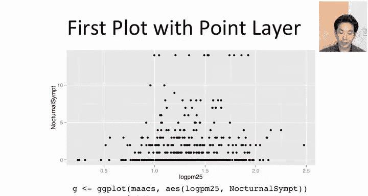

# 约翰霍普金斯大学《数据科学R语言基础｜Data Science： Foundations using R》中英字幕（deepseek - P119：19_ggplot2第3部分.zh_en - GPT中英字幕课程资源 - BV1tsFQemEts

All right so in this lecture I'm going talk about Gpl but I'm going to talk about some of the more underlying fundamental aspects of Gplot in the last lecture I talked mostly about the Q plot function and how you could use the Q plot function to kind of make your basic plots。

 scatter plots， bar charts， things like that this was in some sense a replacement for the plot function in R which we use in base plots to create the same kinds of scatter plots and histograms so the Q plot function is very handy but it doesn't reveal a lot of the underlying infrastructure that kind of is built into Gplot that allows you to make all kinds of custom plots so I just wanted to highlight a couple of the basic ideas in this lecture I don't really have time to go over every single little detail of the G package because it's so big so I thought I would try to get you started on a couple of basic fundamentals if you have a lot more interest in developing plots using the G plot framework there are a lot of references that I mentioned in the previous lecture in terms of the Gplot2 book and other。

So I encourage you to look at those resources if you want to explore this type of plotting framework further than what we discuss here in the course。

So。Let's get started just to review a little bit in terms of what is GD plot2。

 remember it's an implementation of the grammar of graphics which was developed by Leedie Wilkinson and the grammar of graphics basically describes an abstract representation for graphics and so get the idea is that it's kind of the verb nowun and adjective for plots so what of the basic elements that can be modified or cannot be modified and things like that so it allows for a theory of graphics that you can kind of build on to develop new graphics using this kind of abstract language。

So some of the basic components of a G plot kind of graphic are you need data。

 of course the data is the most important thing， that's what you're going to put onto the page and so you need to have a data frame that has all the data that you're going to plot in it。

You need something that's called an aesthetic mapping so these are these describe how the data are mapped to things like colors and sizes and points geoomes are specific objects that you're going to put onto the page like things like points or lines or tiles or shapes or whatever you have it facets are used for conditional plots so if you're going have typically you want to have multiple panels of plots where it might show the relationship of something as something as a third variable changes that's a facet and then stats are statistical transformations like smoothing binning quantiles regression。

 things like that scales are defined how the different variables are coded in terms of the plots or for example you might have a binary variable that represents sex so you the males will be red and the females blue or something like that and so that is a scaling for a particular type of dichotomous variable and lastly you need a coordinate system which we won't focus on too much on this lecture。

But you need a coordinate system that tells you how certain numerical representations get translated onto a plot。

So when you build a plot with GG plotot2， the basic idea。

 if you're not gonna to be using the Q plot function， if you want to kind of build a piece by piece。

 you can kind of think of it as the artist's palette model。

 so this is the similar to the model and the plotting system but where you kind of start with something and you kind add things piece by piece so unlike the lattice system where you kind of have the whole plot is encoded in a single function call you can start with a single you can start with the Gpl function then you kind of add things on piece by piece maybe as you think of them or as you see things in the plot you make little changes you can kind of add things here as you go So the idea is that plots are built up in layers okay and so the most fundamental later course is the data so the first thing you usually start with is you kind of tell G plotot about the data that you're working with and some basic aesthetics like if you're making a scatter plot here the x and the Y variables then you might overlay a summary。

 for example you might overlay a statistical summary like a smoother or regression line。

 something like that。And then on top of that， you might have some metadata or extra annotation for the plot。

So the running example that I'm going to use for this lecture I've spoke about previously comes from the mouse allergen and asthma cohort study which was conducted here in Baltimore just very briefly this is a study that included Baltimore children age 5 to 17 they all had persistent asthma with an exacerbation in the past year and we're interested in a lot of the kind of environmental triggers for asthma morbidity in this study so some of so one of those triggers we're going to look at is indoor air pollution as is specified by particulate matters so fine particulate matter which is PM2。

5 and we'll also look at nitrogen dioxide NO2 and we want to know whether BMI or body mass index modifies the relationship between PM2。

5 and asthma so do children with different BMIs respond differently in terms of their asthma symptoms to exposure to PM2。

5 so that's the kind of basic question that we want to answer here。

So here's a basic plot I made this using the Q plot function you can see the code down there at the bottom and the basic idea is I plotted the relationship between I've taken the kind of scientific question in the previous slide and I translated that into a plot so I plotted the relationship between nocturnal symptoms here so these are the number of days in the past two weeks where there were symptoms at night so symptoms while sleeping for example。

 and so they I plotted the relationship between nocturnal symptoms and in the log of the PM2。

5 indoor value and you can see that you know roughly speaking on the left side we had all the normal weight children and there doesn't seem to be a very strong relationship between log PM2。

5 and nocturnal symptoms and on the right side we have the overweight or obese children and there seems to be an increasing relationship between PM2。

5 and symptoms and so you can see that there's perhaps some evidence of an interaction between BMI and PM2。

5 because。relationship between BT。5 and symptoms appears to differ by BMI status。

 so of course in order to formalizes you probably want to fit some sort of model。

 do a little bit more thorough analysis， of course and adjust for various things。

 but we're going to stick here with this plot for the moment。

So you can make this plot very easily with the Q plot function and by adding things like facets and GMs to the plot。

 but I'm going to recreate this plot using the kind of more the lower level GG plot framework and so how do we build this up layer by layer so first we start with the data right so here I've got a little excerpt of the data frame and you can see that there are three variables here there's log BM2。

5 there's BMI category and that's two levels is normal weight and overweight and then I have the number of days with nocturnal symptoms so that's going to be a number between 0 and 14 because it's over the last two weeks and so the data are very important in any G plot graphic because almost everything that you put on the plot can be thought of as some sort of data。

And then in the first in the next line here， I've got my initial call the GG plot。

 you can see I just call GG plot， I give it the data frame and I give it a pair of aesthetics。

 I give it the x and the Y variables which are loggged PM2。

5 in noturnal symptoms and then I save this plot to an object that I call G。

And if I call summary on this object you can see that it shows you what the data are。

 shows you what the mapping， the aesthetic mapping is。

 and it shows you something about faceting in which case there's no faceting， so that's null。

So you can always call summary on a G plot object and it'll give you a quick kind of list of what's in this plot and what are the data。

Now the important thing to realize is that I haven't made a plot yet there's if you run this code there will be no picture on your screen yet。

 So for example， here I call G plot and if I say print G。

 I immediately get an errors because it says there's no layers on this plot and so what does that mean it basically says it doesn't know how to draw the data yet in the sense that it doesn't know if you want points it doesn't know if you want lines or tiles or other kinds of polygons or shapes and so it doesn't have enough information yet to draw the plot on the screen So the next one here I add it so notice I use the plus operator here so you can literally add things to your plot by using the plus operator and so when I add the geo underscore point function and I save it to a new object called P So my new this P object is also a Gpl graphic but it's got this geo and point thing added to it now when I print that and print that out I get a plot I get a picture on the screen。

So notice that the geo point function was called with no arguments。

 I didn't have to tell it about the data， I didn't have to tell it where the points were。

 I didn't have to tell it anything so there are a bunch of defaults that will get used。

 but the point is that the original GD plot object which is encoded in this G object has all the information that the geo point function will need and so I don't have to separately specified it again so in this first example here I saved the modified object to it something called P but you don't have to do that I could have just said G plus geo point and then the plot will have auto printed to the screen so you can use auto printing or if you want to save the object you can。

So here's the plot and with the point later added onto it。

 so I've reproduced the code down here at the bottom just for your reference and you can see that the default for the points are a solid circle filled circle。

 and so I used the default because I didn't specify anything different and so here are the data。

