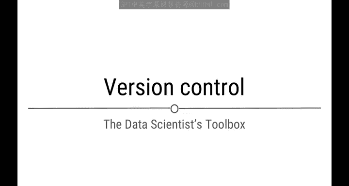
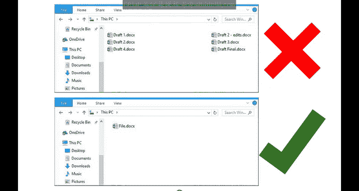
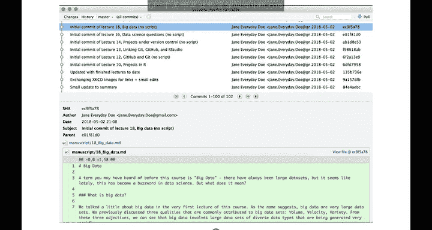
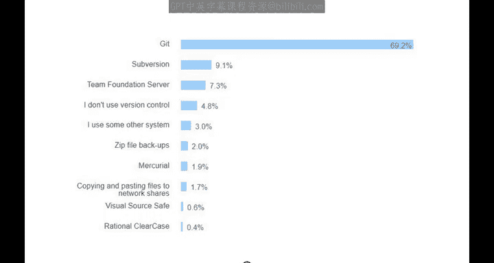
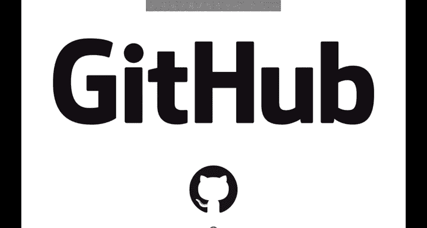
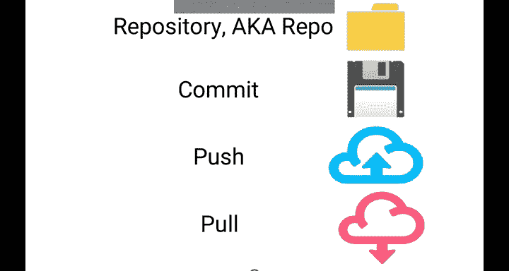
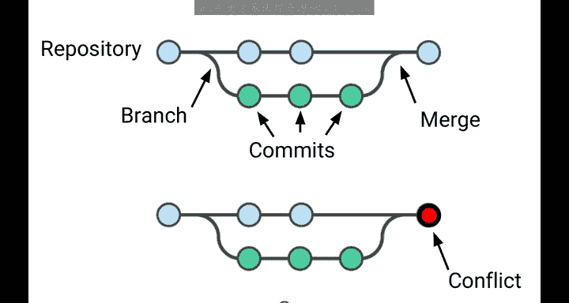
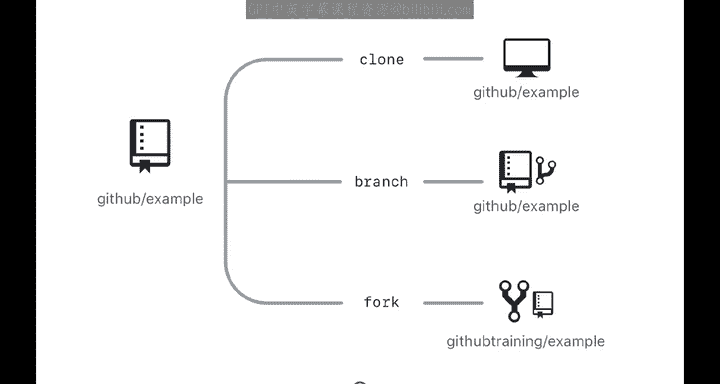
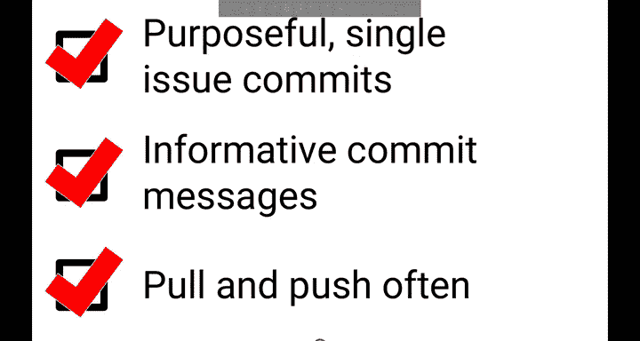
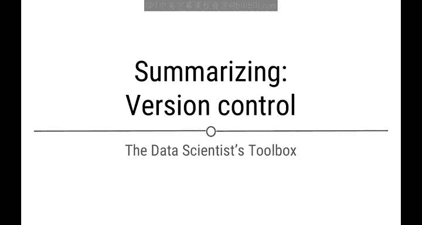

# 约翰霍普金斯大学《数据科学R语言基础｜Data Science： Foundations using R》中英字幕（deepseek - P11：10_版本控制.zh_en - GPT中英字幕课程资源 - BV1tsFQemEts

Now that we've got a handle on our studio and projects。

 there are a few more things we want to set you up with before moving on to the other courses。

 understanding version control， installing Gi， and linking it with our studio in this lesson we'll give you a basic understanding of version control First things first what is version control version control is a system that records changes that are made to a file or a set of files over time as you make edits the version control system takes snapshots of your files and the changes and then saves those snapshots so you can refer or revert back to previous versions later if need be？

If you've ever used the track changes feature in Microsoft Word。

 you have seen a rudimentary type of version control in which the changes to a file are track and you can either choose to keep those edits or revert to the original format version control systems like Gi are like a more sophisticated track changes in that they are far more powerful and are capable of meticulously tracking successive changes on many files with potentially many people working simultaneously on the same groups of files hopefully once you've mastered version control software。

 paper final Fi 2 actually Fi。 doX will be a thing of the past for you as we've seen in this example without version control。

 you might be keeping multiple very similar copies of a file and this could be dangerous。

 you might start editing the wrong version not recognizing that the document labelbeled final has been further edited to final2 and now all your new changes have been applied to the wrong file version control systems help to solve this problem by keeping a single updated version of each。

With a record of all previous versions and a record of exactly what changed between the versions which brings us to the next major benefit of version control。

 It keeps a record of all changes made to the files This can be of great help when you are collaborating with many people on the same files the version control software keeps track of who when and why those specific changes were made It's like track changes to the extreme This record is also helpful when developing code if you realize after some time that you made a mistake and introduced an error you can find the last time you edited the particular bit of code。

 see the changes you made and revert back to that original unbroken code。

 leaving everything else you've done in the meanwhile untouched Finally。

 when working with a group of people on the same set of files version control is helpful for ensuring that you aren't making changes to files that conflict with other changes If you've ever shared a document with another person for editing。

 you know the frustration of integrating their edits with a document that has changed since you sent the original file。

Now you have two versions of that same original document versionion control allows multiple people to work on the same file and then helps merge all of the versions of the file and all of their edits into one cohesive file Gi is a free and open source version control system it was developed in 2005 and has since become the most commonly used version control system around stackck Overflow which should sound familiar from our Gettinginghel lesson。

 surveyed over 60，000 respondents on which version control system they use and as you can tell from the chart。

 Git is by far the winner and as you become more familiar with Git and how it works and interfaces with your projects。

 you'll begin to see why is has risen to the height of popularity。

 one of the main benefits of Gi is that it keeps a local copy of your work and revisions which you can then edit it offline and then once you return to Internet service you can sync your copy of the work with all of your new edits and track changes to the main repository online Additionally。

 since all collaborators on a project have their own。

Copy of the code everybodybody can simultaneously work on their own parts of the code without disturbing that common repository Another big benefit that we'll definitely be taking advantage of is the ease with which our studio and Git interface with each other In the next lesson。

 we'll work on getting Gi installed and linked with our studio and making a GiHub account。

GitHub is an online interface for Git Git is software used locally on your computer to record changes GiHub is a host for your files and the records of the changes made you can sort of think of it as being similar to Dropbox the files are on your computer but they are also hosted online and are accessible from any computer GitHub has the added benefit of Interfacing with Git to keep track of all of your file versions and changes there is a lot of vocabulary involved in working with Git and often the understanding of one word relies on your understanding of a different Git concept Take some time to familiarize yourself with the following words and go over it a few times to see how the concepts relate a repository is the equivalent to the projectss folder or directory all of your versionconted files and the recorded changes are located in a repository This is often shortened to repo Reositories are what are hosted on Gitthub and through this interface you can either keep your repositories private and share them with select collaborators or you can make them public。

can see your files in their history to commit is to save your edits and the changes made a commit is like a snapshot of your files Gi compares the previous version of all of your files in the repo to the current version and identifies those that have changed since then those that have not changed it maintains that previously stored file untouched those that have changed it compares the files logs the changes and uploads the new version of your file we'll touch on this in the next section but when you commit a file typically you accompany that file change with a little note about what you changed and why When we talk about version control systems commits are at the heart of them If you find a mistake。

 you revert your files to a previous commit If you want to see what has changed in a file over time you compare the commits and look at the messages to see why and who to pushes to update the repository with your edits Since Gi involves making changes locally you need to be able to share your changes with the common online repository pushing is sending thoses。

Changes to that repository， so now everybody has access to your editdits。

Pulling is updating your local version of the repository to the current version since others may have edited in the meanwhile because the shared repository is hosted online in any of your collaborators or even yourself on a different computer could have made changes to the files and then push them to the shared repository you are behind the times the files you have locally on your computer may be outdated。

 so you pulled to check if you are up- todate with the main repository one final term you must know as staging。

 which is the act of preparing a file for a commit For example。

 if since your last commit you have edited three files for completely different reasons you don't want to commit all of the changes in one go your message on why you are making the commit and what has changed will be complicated since three files have been changed for different reasons so instead you can stage just one of the files and prepare it for committing once you've committed that file you can stage the second file and commit it and so on staging allows you to separate out file changes into separate commits very helpful。

To summarize these commonly used terms so far and to test whether you've got the hang of this。

 files are hosted in a repository that is shared online with collaborators。

 you pull the repository's contents so that you have a local copy of the files that you can edit once you are happy with your changes to a file。

 you stage the file and then commit it you push this commit to the shared repository this uploads your new file and all of the changes and is accompanied by a message explaining what changed why and by home。

Of branches when the same file has two simultaneous copies when you are working locally in editing a file you have created a branch where your edits are not shared with the main repository yet。

 so there are two versions of the file the version that everybody has access to on the repository and your local edited version of the file until you push your changes and merged them back into the main repository you are working on a branch following a branch point。

 the version history splits into two and tracks the independent changes made to both the original file in the repository that others may be editing and tracking your changes on your branch and then merges the files together merging is when independent edits of the same file are incorporated into a single unified file independent edits are identified by getting are brought together into a single file with both sets of edits incorporated but you can see a potential problem here if both people made an edit to the same sentence that precludes one of the edits from being possible we have a problem Gi recognizes this disparity。

Conflict， and asks for user assistance in picking which added to keep。

So a conflict is when multiple people make changes to the same file and Git is unable to merge the edits you are presented with the option to manually try and merge the edits or to keep one edit over the other When you clone something you are making a copy of an existing Git repository if you have just been brought onto a project that has been tracked with version control you would clone the repository to get access to and create a local version of all of the repositories files and all of the track changes a fork is a personal copy of a repository that you have taken from another person If somebody is working on a cool project and you want to play around with it。

 you can fork their repository and then when you make changes。

 the edits are logged on your repository not theirs It can take some time to get used to working with version control software like Git but there are a few things to keep in mind to help establish good habits that will help you out in the future one of those things is to make purposeful commits Each commit should only address a single issue This way if you need to identify when you changed a certain line。

code there is only one place to look to identify the change and you can easily see how to revert the code Similarlyly。

 making sure you're writing formative messages on each commit is a helpful habit to get into If each message is precise in what was being changed anybody can examine the committed file and identify the purpose for your change Additionally if you are looking for a specific edit you made in the past you can easily scan through all of your commits to identify those changes related to the desired edit Finally。

 be cognizant of the version of files you are working on frequently check that you are up to date with the current repo by frequently pulling Additionally。

 don't ho your edited files once you have committed your files and written that helpful message you should push those changes to the common repository If you are done editing a section of code and are planning on moving on an unrelated problem you need to share that edit with your collaborators now that we've covered what version control is in some of the benefits you should be able to understand why we have three whole lessons dedicated。

control and installing it We looked at what Git and GiHub are and then covered much of the commonly used and sometimes confusing vocabulary inherent to version control work We then quickly went over some best practices to using Git。

 but the best way to get a hang of this all is to use it Hopefully you feel like you have a better handle on how Git workss now so let's move on to the next lesson and get it installed。

