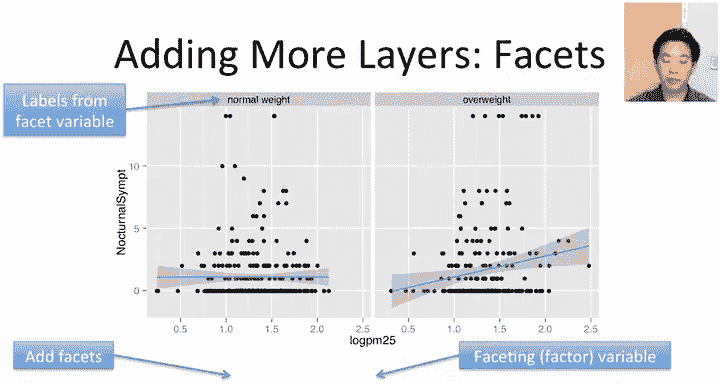
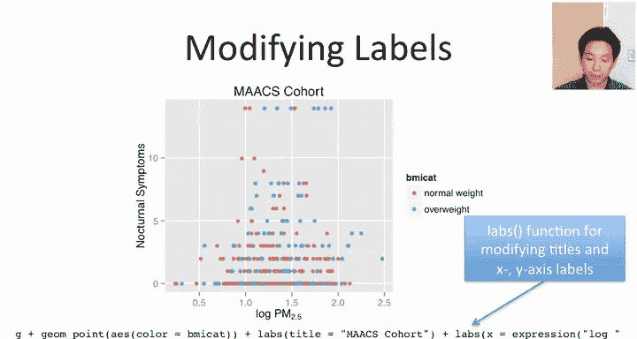
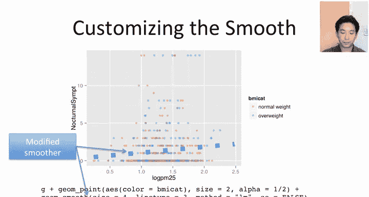
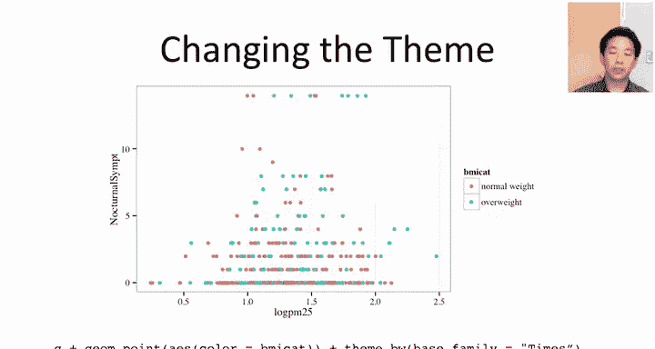
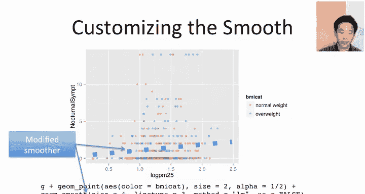
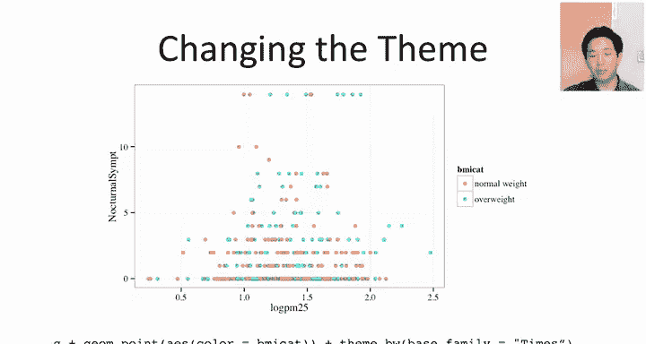

# 约翰霍普金斯大学《数据科学R语言基础｜Data Science： Foundations using R》中英字幕（deepseek - P120：20_ggplot2第4部分.zh_en - GPT中英字幕课程资源 - BV1tsFQemEts

Now。Another layer that you could add onto your po is a smoother and many times you want to do this just so you can get a sense of the overall trend in the data so you might want to just get a general sense of as PM2。

5 increases do we get more nocturnal symptoms and so on the lefthand side here this is the code down here at the bottom that I use I had my original G plot object G which just had the X and Y kind of aesthetics。

I added my points to make the scatter plot and then I added a smooth。

 the geo underscore underscore smooth function adds a little smoother。

 which is the blue line and the gray compete bands And so I use the defaults for the G smooth。

 which is a low S smoother which is generally a fine but you can see there's a lot of noise on the boundaries so on the left and right side of the smoother the confidence rules get very wide because it's flexible smoother there's a lot of noise and the boundaries because there's not much data there So I rather something a little bit simpler than a low S smooth I'm just I just want a linear regression line And so that's less flexible。

 but it still gives me a sense of the trend So here on the right hand side you can see I've remade the plot and I've added the geo smooth but I give an option I said in method equals Lm and this will do a linear model instead of a low S smoother and you can see that on the edges of the linear model the uncertainty in the compete bands is' a lot smaller than it is for low S and you see that generally speaking there it seems to be an increasing trend with P。

2。5 and nocturnal symptoms。So another layer we want to add is the facet so this is the final layer to kind of reproduce that original simple plot that I made with Q plotot so here the facets are are going to be determined by the BMI category so I want to compare children who are normal weight and children who are overweight so that's going be two separate plots but then I want to plot the same relationship in each one of those windows so that's what creates the facet and so I can add my facet with the facet underscore grid variable and this variable usually a special notation which is separate which has kind of a variable on the lefthand side and a variable on the righthand side and they're separated by this tilde and so the variables that you specify in the facet function determine how the grid how the kind of separate plots are laid out on the screen and so the number of plots roughly will be equal to the number of levels of your factor and so if I have two levels of my factor I've got normal weight and overweight then that will create two plots for me。

I were notice that I only have a single set factor variable that I want to separate on so don I'm not going to have a matrix of plots which'm is going to have a single row of plots and so I'm only going to have two plots because there's two categories in this BMI variable if I had two variables and I'll give an example of that later。

So a variable on the left- hand side and the variable on the righthand side then the product of the number of factor levels is going to be the number of plots that you generate with the facets so here I've added the facet grid function and I also added the smoother with my LN notice that it doesn't it doesn't really matter what kind of order you put these things in you can add them in at any order you want and notice I stuck the facet grid function in between the smooth and the point and that was fine it still generate the plot so the facets are useful for kind of conditioning on a categorical variable and you can see here that the normal weight children have don't seem to have any relationship between PM2。

5 and nocturnal symptoms whereas the overweight children appear to have a much stronger positive relationship。

The last thing I'll mention is that you notice that the labels in each of the panels I didn't actually label them head by hand。

 the labels come from the levels of the factor variable that you conditioned on。

 so it's important that you use the factor variables in an intelligent way and to have intelligent labels on them because the Gpl will take that information and automatically apply it to the labeling of your plots and so in GP in some sense it's easier to modify your data and make sure that the metadata is specified appropriately rather than to kind of plot things and then kind of modify the plot later。

 it's better to make sure all your data is kind of organized and labeled appropriately before you make the plot because then that makes the plotting code much simpler。

So once you've kind of made your plot， often you want to modify things like the access labels and the titles and other kinds of kind plot metadata。

 and so there are a number of functions for doing that for the labels there's the XLb function。

 the Y labb function and the GG title function， those are used to specify the X label。

 the Y label and the title， you can also use the labs function。

 which is a more general function that be used to specify X Y labels or titles。

 it doesn't really matter what you use。Each of the geo functions like the geo points and the G。

ASmooth function have options that you can specify to change things so you can explore some of those options too if you don't like the defaults there are some things that only make sense kind of a global globally meaning for the whole plot and so that the theme function is available for that so this might specify kind of the basic colors。

 the background colors here for example， the position of the legend and you can use the theme function to specify these options and finally there are some general themes that are built in that kind of control a lot of different elements of the plot so you can specify to kind of set many options at once and basically the theme underscore gray is kind of the default theme and it gives you the gray background the the white grid lines the theme BW for black and white is a kind of more stark a plain air theme if you don't like the gray background。

So I'll talk a little bit about kind of modifying some of the features of the aesthetics so for example sometimes you might want to change the colors of the points so you don't like the black points so if you don't like them to be solid。

 you want them to be transparent， you can on the lefthand side I've modified my basic scatter plot of panN 2。

5 and nocturnal symptoms by doing two things one is I've made the color steel blue I've increased the size of the points to be the default is one and I've changed the alpha transparent to be a half rather than solid and so now you can see that the blue there's blue points that are steel blue。

 there's somewhat transparent and they're a lot bigger than they were before the important thing to realize that I placed these options in the geo point function and each one of these options the color。

 the size， the alpha I've all been set to be a constant。

And so the constants basically are for the are not aesthetics。

re there're just options for the for putting the points on the page On the right hand side here。

 you can see that the plot looks similar， but。've there's two colors now and each of the colors corresponds to whether the child is overweight or normalweight so now you can see what I call genome underscore point rather than say just color equals BMI cap which would assign the category of BMI to be a different color I have to wrap it in this AES function which stands for aesthetics so now rather than specified color as a constant so like steel blue。

 the color has been assigned to a data variable and so it's very important that you know the distinction between giving assigning color to be a constant like black or white or blue and assigning color to be the value of a variable because when you assign color to be the value of a variable what happens is that all the points are split apart and each set of points is kind of assigned a different color and then they're put back on the page along with this legend on the right hand side but then outside of the AES a function I still have my size equals4 and my alpha equals1 half so those are unchanged from the left- hand plot。

So that the points are still bigger and the transparency is still a half and so in so the key thing to remember here is that there's a difference between assigning a aesthetic value to be a constant and assigning aesthetic to correspond with a variable。

 a data variable if you want it to be a constant you can just specify in the genome point function directly if you want it to be assigned to a data variable then you have to wrap it in this AES function。

You can modify the labels with the labs function so the labs function here I've called a few different times I've added on to my basic plots of the G object remember it's just the data frame plus the X and Y coordinates here I've added G on point function and I've signed the color variable to BMI categories so now the two different BMI categories are in two different colors the labels I set the title to be max cohort because that's where the data come from this is the max study I've set the X label to be this expression which is log PM2。

5 and I used the mathematical annotation that I that we talked about previously to get that PM2。

5 that 2。5 subscript on there and then I set the Y label to just be nocturnal symptoms so now it's a little bit cleaner the plot has got of more appropriate labels on it。

I can also customize the smoother if I want to， so now I'm going to modify the options to the geo smooth function so here all I've done to as I add an option to say size equals4 so I made this line a little bit thicker and I made the line type to be equal3 so three that just means a dotted line instead of a solid line I still use method equals LMs I want a regression line and I turned off the confidence interval so that's a little bit more clear to see so I say SE equals false so these are all options that you can add to the geo smooth function if you don't like the defaults。

So another thing you can do is just change the overall theme so the default theme you look in the previous slide here you can see that there's a gray background with' kind of white grid lines there's solid of thicker white lines for kind of larger intervals and then there's a kind thinner white lines for smaller intervals if you don't like that background you can change it to the kind of a more basic black and white background so this is the theme underscore BW theme and another thing I can see I've changed here is I've changed the font so the default font is going to be something like Halvetica but I've changed it to this to be a times font so now you can see that it's a serif font as opposed to the sand serif and it looks like and it uses the times font to do the labels to do the legend also the axis tick you can see the numbers in the axis are all in the times font so the theme functions the various theme functions can be used to modify these elements of the plot。

