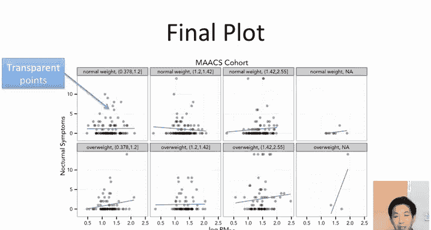

# 约翰霍普金斯大学《数据科学R语言基础｜Data Science： Foundations using R》中英字幕（deepseek - P121：21_ggplot2第5部分.zh_en - GPT中英字幕课程资源 - BV1tsFQemEts

So there's one thing that's worth pointing out which differs in G plot than it does from say the base plots is that if you have a plot where where the kind of the data I'm going to exceed the limits of the plot the behavior between base plot and G plot can change a little bit so here on the lefthand side I've just simulated some data so this is not max data and I've intentionally introduce a little outlier here so in the 50th data point I' just change that value to be 100 So now there's kind of this random series of of noisy data and then right in the middle is a point that's 100 and so if I call plot so I'm going to make a standard base plot here。

 I call plot on X and Y and I say type equals L because I want to make a line plot but then typically if you have some outlier like this maybe you don't want to look at the outlier。

 you just want to look at the core of the data so it's typical to kind of set the Y axis limits to be roughly of where the data are and then just ignore the outlier so you can see that the time series that gets drawn。

Has all the data connected and then you can see roughly where it's going to shoot off to 100 and then it comes back down to be roughly where it's supposed to be so you know that outlier is out there somewhere。

 but you don't see it in the plot。Now if I do the equivalent plot in GG plot。

 I can create my GG plot with the test data and the aesthetics to be X and Y。

 and then I add the GO line function to make a line plot as opposed to a scatter plot you can see that it just plots the whole all the data including the outliers and it's maybe not exactly the kind of plot you want to make because the outliers maybe not that interesting。

So if you want to do this you have to be careful about how you do it And so the first is that on the lefthand side you might think。

 well， I'll just change the y limits to be within in the range of most of the data between minus3 and 3。

 The issue here is that what Gpl will do is it will subset the data to include the values that are between minus3 and 3 and so of course the outlier is not included in this data set and so you won't see。

That data point in is plot， so you can see there clearly where the outlier is missing。

 the the lines are not connected， but then everything else is connected afterwards。

So if you want to recreate the kind of phenomenon that you saw with the base plot。

 you have to add this special function called chord underscore Cartesian。

 which that sets the limits to be minus3， the Y axis limits to be minus3 and3。

 you can see in the plot here that the outlier is in fact included in the data set。

 the data set hasn't been subsetted to only include the ones that are in that Y axis range。

So I just want to go over a slightly more complex example of kind of adding pieces to a plot just so you can get a sense of how the different layers are added on and then hopefully get you going from there。

So here I I've made the scientific question just a little bit more complex。

 I want to know how does the relationship between PM2。

5 and nocturnal symptoms vary by both BMI and nitrogen dioxide or no2 and so as noO2 or BMI values change how what does the relationship between B2 PM2。

5 and nocturnal symptoms look like so one tricky thing about this is that unlike our previous BMI variable which is categorize into kind of normal and overweight the noO2 variable is continuous so it's really the log of the N2 and it's a continuous variable so we need to we can't really condition on a continuous variable we're making plots because then there would be an infinite number of plots and so we need to categorize this variable into a reasonable series of ranges and so what we're going to do is we can use the cut function for this purpose to cut literally cut the data into series of ranges。

So here's some code to make N2s split N2 into tutile so this is going be three separate categories between the minimum and the 33 percentile。

 the 33rd and the 66 and the 66 to the maximum and so the first thing I need to do is to use the quantile function to figure out where in the data ranges are the 33rd and in the 66 percentiles once I've used the quantile function to find these cut points I pass that to the cut function and I use the cut function to actually cut N2 into these three different ranges and so what the cut function does is just returns a factor variable where each of the original data points is replaced by its category in terms of which turtile it's in so in terms of the low the middle or the high turtile so it's very handy function for when you're using things like lattice or GD and you have to categorize continuous variables so now you can see the levels of this variable。

 the cut variable are there's three different levels just kind of 0。378 to 1。2 1。2 to 1。42。

And then 1。42 to 2。55 so those are the three。Categories that I've split the NO2 variable into。

So here's the final plot I'll just show you what I'm going for and then we'll work backwards figuring out exactly how to do it so you can see that there's eight different plots here on the top you see all the normal weight children and on the bottom you see all the overweight children so those are the two categories of BMI and then there's there's actually four categories of N2 there's the first turtile on the left side。

 the second turtile on the second column the third turtile on the third column and then there's actually some data that are missing and so these are the data that are missing no02 values but they're not missing other values so you can still in some sense plot them and so sometimes it's often important to look at the missing data just to see if there's anything special about those missing you don't always just want to exclude them right off the bat because there maybe be something special about them that you've missed。

So what does this plot have well first of all Ive modified the transparency on the points so I've made them a little bit transparent so you can see a little bit of the density there。

 I've added a smoother to each panel so this is a linear regression smoother so it's not the default and I've turned off the confidence bands。

There are multiple panels so I've used faceing to create this plot I've changed the kind of default labels and the title so I've added it to reflect be a little bit more descriptive and then finally I used a nondefault font so the default font is Halvetica and I've changed the font here to be A year and so there are a number of options that I've modified here。

And so here's the code for doing it so in the first set of code I just call G plot and I give it the data and I give it some basic aesthetics in terms of the X and Y variables and then to this G object I add a bunch of things I add points using G point I make the panel using the facet wrap function and I add a smoother using the geo smooth where specify the Lm method and I turn off the standard error bars I change the theme to be this black and white theme and where and then I modified the font to be aboneer instead of the default and I've also made the font a little bit smaller to be 10 points instead of the default 12 and then finally I've called the labs function three different times to change the labels the X label the Y label and the title of the plot so you can see that I've added all these different things piece bypiece to make this plot a little bit more and more interesting every single time and it's easy to do this with G plot and then and the nice thing about G plot which I didn't do here is that you could in fact save this to a new object。

And then you would have everything stored in a single R object and then if you wanted to add in more layers。

 you could add to that new object， you could continue to add different things if you wanted to。

 so it's a very modular， very kind of useful framework for constructing plots that are new just for your data。

So just to summarize very quickly， I know this has been a very brief introduction to Gplot and there's a lot of things that you could talk about。

 but given that this is not a course specifically on Gplot。

 I my hope was to kind of get you started to get you typing in some basic code making some basic plots and and then if you want to know more you can kind of look at some of the references that I mentioned previously so I think in summary Gplot is very powerful it's very flexible if you can learn the grammar and learn the different pieces that you can add to a plot and that can be tuned and modified there are a lot of different types of plots you can make Ive left that a lot but you can explore and mess around because it's kind of the best way to learn about these things and to take a look at some of the reference that I mentioned in Part of one。

