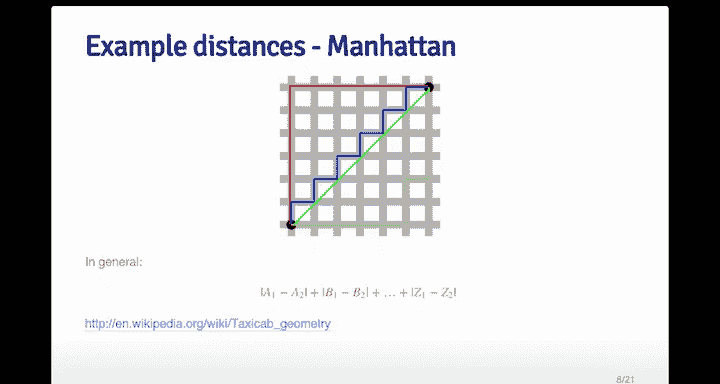

# 约翰霍普金斯大学《数据科学R语言基础｜Data Science： Foundations using R》中英字幕（deepseek - P122：22_层次聚类第1部分.zh_en - GPT中英字幕课程资源 - BV1tsFQemEts

嗯。

Hyerarchical clustering is kind of a bread and butter technique when it comes to visualizing high dimensionsional or multidimensional data。

 it's very simple to use。 the ideas are fairly intuitive for most people。

 and it can serve as a really quick way to get a sense of what's going on in a very high dimensional data set。

So of course， like most clustering techniques， for example， like K means， for example。

 the basic issue that you have to deal with when you define the method is how do we define when things are closer together and when things are far apart because all clustering methods in some sense try to tell you when one thing is closer to another thing versus。

Something else and so for example， things that are in a cluster are closer to each other than they are to elements of another cluster and so we have to define what it means to be close。

 what it means to group things together， how do we group things together and then once we've we have a distance notion and we have a way of grouping things together。

 how do we visualize the processing that we've done。

 the calculation that we've done and how do we interpret how the grouping is put together。

Cluster analysis is a really important and widely used technique。

 if you just type cluster analysis into Google， there are literally millions of results that come back and it's a widely applied method in many different areas of science and other applications。

 so it's useful to know kind how some of these techniques work。

So hierarchical clustering as is denoted by the title involves organizing your data into a kind of hierarchy and the common approach is what's called an aglomerative approach and the idea which is kind of a bottom up approach so you start with the data as kind of individual data points and you start lumping them together into clusters until eventually you have your entire data set it just one big cluster So you can imagine there's all these little particles floating around and eventually you start kind of grouping them together into little balls and then the balls get grouped up into bigger balls and then the bigger balls get grouped together into one big massive cluster and so that's the kind of a gllomerative approach to hierarchical cluster and that's what we're going to talk about here。

 and so the basic idea is that you got to find the two points in your data that are the closest together and then you kind of merge them together to create one super point so the merged point is not an actual point in your data but you can think of it as being a new point and then you kind of remove the original two data points and you。

Subitute with that kind of merged point。 And then you kind of repeat this over and over again。

 So then you find the next two closest things， and then you put them together。

And then you you and then once you've kind of put things together。

 you get like a little tree that you can show that that shows the ordering and which things were put together。

And so this approach requires two important things， one is a distance metric。So what mean。

 how do you calculate the distance between two points？

And the other thing that is required is an approach for merging points。 So once you've figured out。

 okay， well， these two points are the closest， how do you merge them together and so。

The nice thing that hierarchical clustering produces is a tree。

 which is sometimes called the dendrogram that shows how things merged together And so the most important。

 arguably the most important question to to kind of resolve in a hierarchical clustering approach as to define what we mean by close because if you have a definition that doesn't make sense for your problem。

 then you just get garbage in garbage out right so if you have a distance metric that doesn't make sense。

 then the results that you get will be relatively meaningless So there are a few examples of distance metrics that are used out there probably the most kind of familiar distance metric is the Euclidean distance which is just kind of a straight line distance between any two points。

A kind of analogous distance metric is the correlation between two points or the correlation similarity。

 and then another metric is the binary distance or the Manhattan distance and'll talk a little bit of what that means in a second so you have to make if have to pick a distance metric that makes sense for your problem so that you can produce roads result that also makes sense。

And so here's Euclidean distance， a simple diagram， so if you take two cities， for example。

 Baltimore and DC or Washington， DC。 then if you put them on a map， for example。

 and so you can imagine that a center of each city has an X and a Y coordinate。

And you want to say map the distance between the two centers of the two cities。

 well you can draw a straight diagonal line between the two cities and then you calculate the distance kind of in the usual way。

 and the distance is going to be a function of the difference in the x coordinates and the difference in the y coordinates。

So to calculate the Euclidean distance， you take the difference you know in the X coordinates。

 you square it， you take the difference in the Y coordinates and you square it。

 you add the two squares together， you take the square root。

 that's the classical definition of Euclidean distance so you can imagine know in real life it'd be like if a bird were to fly from DC to Baltimore they would just fly straight from one city to another because they can fly in the air and they're not impeded by things like roads or mountains or whatever。

And so that's the straight line distance between the two cities。

 Whether that makes sense for you depends on， you know， whether you're a bird or something else。

 And so。You have to think about kind of that in the context of your problem。

 Now Euclidean distance is easily generalizable to higher dimensions。

 but even you have you know instead of here we just have two dimensions。

 but if you have 100 dimensions， you can usually take the difference between hundred each of the dimensions square it sum together and then take the square root So it's a very nice kind of it extends very naturally to very high dimensional problems。

The Manhattan distance gets its name from the idea that you can look at points on a kind of a grid or a city block grid。

 imagine you're in the city of Manhattan in New York and you want to get from one point to another so you can look at the two black circles on this diagram and if you want to get from one point to another if you're in a city in a city block you can't just go directly from one point to another because there'll be all these buildings in the way or you'd have to follow the streets。

And so in the streets， because they're in a grid， you can either go up or down or left or right。

 The green line here， in that case would represent the Euclidean distance， which would be like。

 you know， if you' were a bird and you want to fly over everything across the two points。

 But as a person walking on the ground， you have to take either the red line。

 the blue line or the yellow line or any other kind kind of pattern in between。

 The point is that you'd have to travel along the city blocks。

 And so the distance that you would travel along the city blocks here in the gray。

 kind you can imagine the gray lines as the streets。 that's the Manhattan distance。

 And it can be written formulaly as as the absolute sum of all the different coordinates。

 So if you are two coordinates， you。Then you sum the distance that you travel in the x dimension and you sum then the absolute value of the distance you travel in the y direction and so the Manhattan distance can be useful in some context and so because it may in some contexts more accurately represent the distance between two points。

 in particularly in a city like Manhattan， two points may be very far apart even if they seem relatively close in a Euclidean distance。

Sense。

