# 约翰霍普金斯大学《数据科学R语言基础｜Data Science： Foundations using R》中英字幕（deepseek - P123：23_层次聚类第2部分.zh_en - GPT中英字幕课程资源 - BV1tsFQemEts

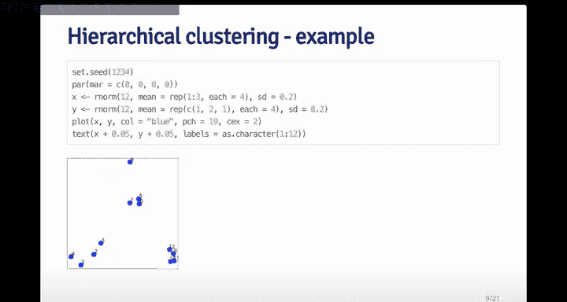

So just to illustrate how hierarchical clustering works。

 I'm just going simulate a very simple data set here。

 So I always set the seed so that the data are reproducible here so you can just run this code and simulate the data for yourself to take a look at it。

 And so I plotted a total of。

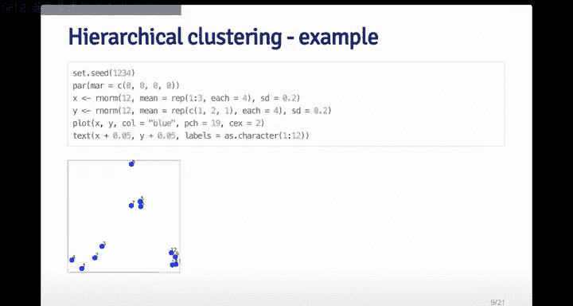

12 points here， and there are three clusters you can see very clearly from the plot and I've labeled each of the points using the text function so you can see which point is which。

And so I'm going to run the hierarchical clustering algorithm to see how the points get merged together。

So the first thing you need to do to run a hierarchical clustering algorithm is to calculate the distance between all the different points so you need to calculate all the pairwise distances between all the points so you can figure out know which two points are the closest together and so the easiest way to do this is with the disk function in R the disk function takes a matrix or a data frame here this data frame has two columns。

 the first columns the X coordinate， the second columns the Y coordinate。

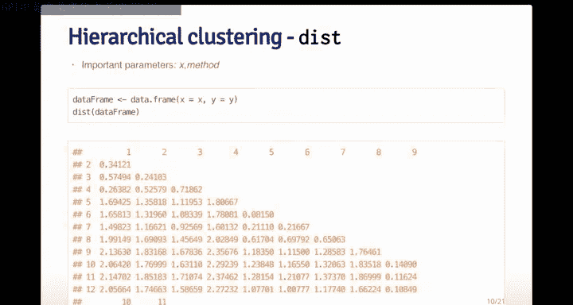

And then so it's basically a matrix or a data frame of points and what the distance function does is it calculates the distance between all the different rows in the data frame and it gives you what's called the distance matrix。

 which gives you all the pairwise distances， and so if you call D without any other arguments。

 it defaults to the Euclidean distance metric， but you can give it some other distance metrics if you want as options。

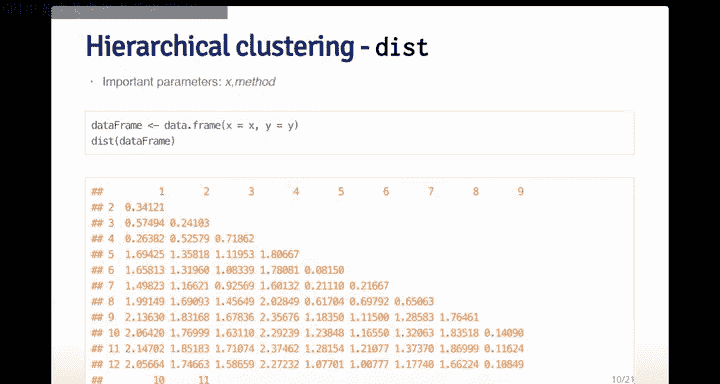

And so here down below here you can see the most of the distance matrix that is returned by disk and so you can see that it's a lower triangular matrix and it gives you all the pairwise distances so for example。

 the distance between 0。1 and 0。2 is 0。34 Of course the actual distance here is meaningless because I just simulated the data so the numbers aren't particularly meaningful。

 but you can see that some distances are farther some points are farther apart than others。

So for example， the distance between 0。3 and 0。1 is 0。574 and the distance between 0。3 and 0。2 is 0。

24 so the 0。3 is closer to 0。2 than it is to 0。1 and so you can kind of go down the line like this and see how far apart each of the various points are from each other。

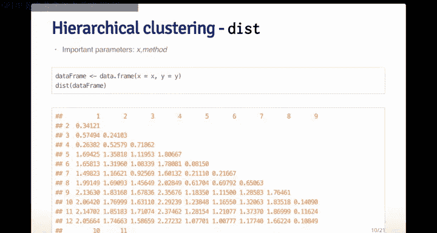

And so if you look so the idea of the hierarchical clustering algorithm here is that we're going to take the two points that are closest to each other from the start and so that happens to be05 and 6 and so I color them here in the orange and the idea is that the5 and points5 and6 because they're the closest together。

 we're going to group them together and merge them into a single cluster。

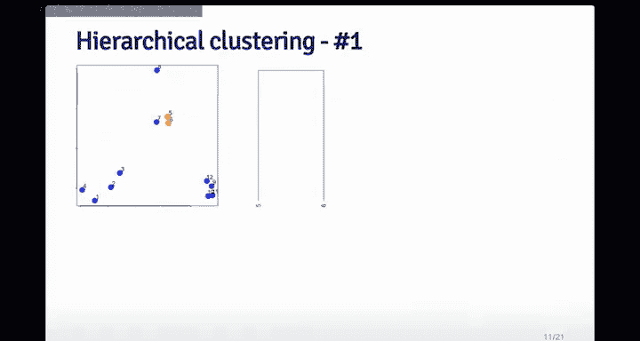

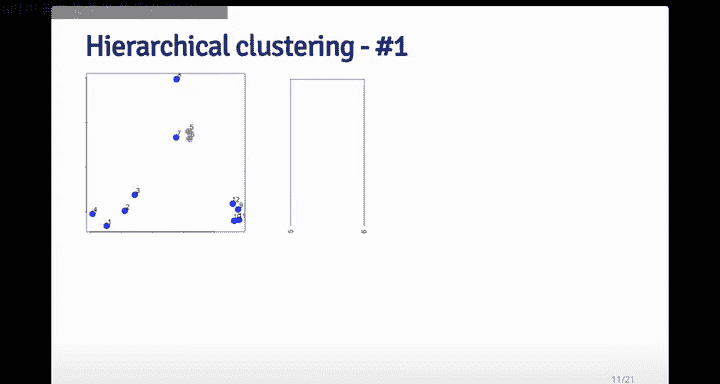

And so the idea is that here I'm going to create a single point。

 and then the little plus sign in the middle is kind of like the new location of this merged set of points。

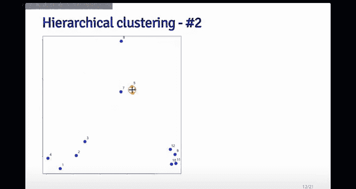

And so now instead， I've kind of taken these， taken these two points。

 five and six and merged them into a single point。

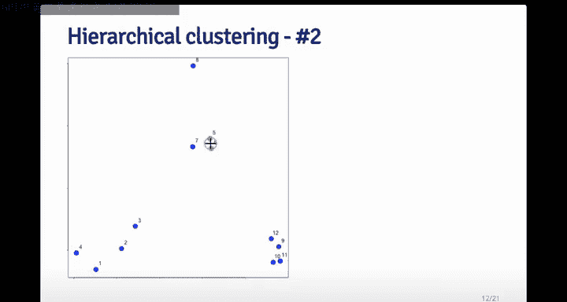

So now one of the next two points that are closest together are 10 and 11 down in the lower right in the red。

 and so I'm going to take those two points and merge them together and create a new kind of super point that will kind of filter up through the algorithm and so we can keep going along like this。

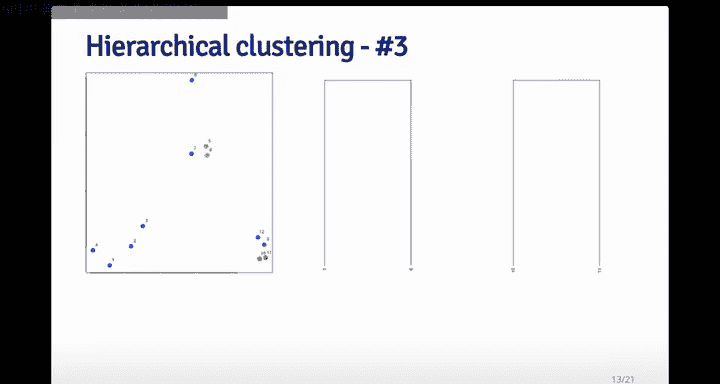

And eventually we'll get a little picture here called the dendrogram。

 and it shows us how the various points got clustered together。

 so you can see on the very right side there's points five and 6 that are grouped together。

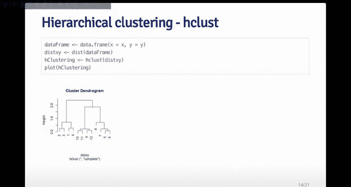

And then in the middle there you got points 10 and 11。

 and so the farther down the tree in terms of the points that the kind of farther down the tree are the ones that got clustered first。

 then the points that are farther up kind of got clustered later。

And so you can see that there are the kind of 05 and 6 when they got merged together。

 then they got kind of clustered with 0。7， and then when it  points5，6 and 7。

 they got all merged together into a single super point， then they got merged with 0。8 and etcter。

And so one of the things about the dendrogram that's produced by the clustering algorithm is that it doesn't actually tell you how many clusters there are。

 you'll notice that there's no specific label on the plot that tells you there are two clusters or three clusters or whatever。

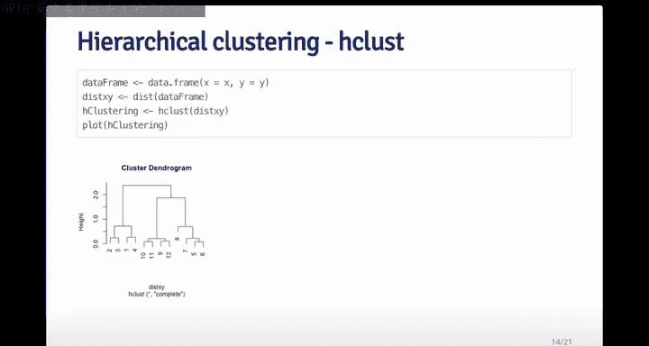

And so what you have to do is you have to cut this tree at a certain point to determine how many clusters there are。

 and so for example， if I were to cut it at the point that's labeled on the Y axis 2。0， for example。

 if I were going to draw a horizontal line。

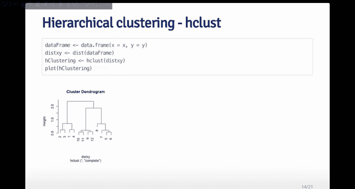

at the level of 2。0 the question is how many branches cut would I run into So if I were draw a horizontal line at 2。

0 I would run into about two branches and that would indicate to me that there are roughly two clusters。

 however， if I were draw a horizontal line at the level of 1。0 there sorry 1。0 at the height of 1。

0 then you draw a horizontal line you'll see you run into three branches there so that would tell you that there are roughly three clusters。

 So depending on where you want to draw this you want to draw this horizontal line or cut the tree。

 you'll get more or fewer clusters in your clustering。Of course， in the extreme case。

 if you were to cut the tree all the way at the bottom。

 then you would just get 12 clusters to be equal to the number of data points。

And so you have to cut the tree at a place that convenient for you at this point。

 we don't really have a rule for where to cut it， but then once you do cut it。

 then you can get the cluster assignment from the hierarchical clustering。

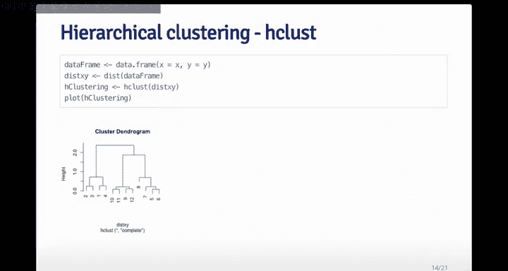