# 约翰霍普金斯大学《数据科学R语言基础｜Data Science： Foundations using R》中英字幕（deepseek - P124：24_层次聚类第3部分.zh_en - GPT中英字幕课程资源 - BV1tsFQemEts

So the cluster denrogram that's produced by default in R is relatively nice。

 but there is possible to kind of make it a little bit nicer。 So this my P cluster function。

 which is available on the course website， you can download a straight from there And once you source it into R。

 you can get this function which in turn produces a cluster denogram。

 but then all the points in the individual clusters are a labeled by their cluster labeled and B。

 they are colored in separately。 so you can see cluster one is labeled with all ones and it's。

And it' they're colored black。 The cluster 2 is colored red and cluster 3 is colored green。

So of course， in order to do this， you have to determine you have to specify how many clusters there are before you can actually label them one。

 two， and three， etc ceter。

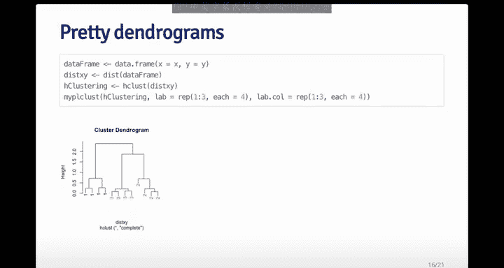

Now you can go to the R graph gallery to see some kind of more interesting cluster diagrams and to look at some software that people have used to create really nice clustering diagrams so if you want to look at for example。

 this cluster denogram which has labels on the leaf nodes and it's colored each of the groups and has added a little bit of other information。

 you can take a look at this gallery which has a lot of other really nice plots on it too。

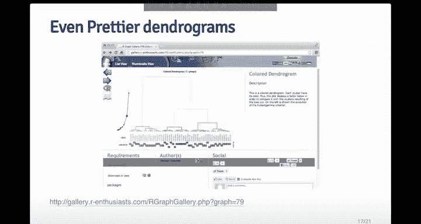

So the other issue when it comes to using hierarchical clustering is how do you merge points together and so the question is you when you merge a point together。

 what represents its new location and so one is called average so average linkage and the idea is that if you take two points and their new kind of coordinate location it's just the average of their x coordinates and their y coordinates so it's kind of like roughly the center of gravity or the middle of that group of points。

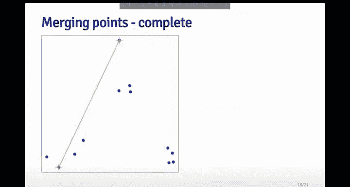

Now， that seems logical， and it can， and it can it will lead to a kind of a certain type of clustering result。

 the other type of。Of approach is called complete linkage。

 And there the idea is that if you want to measure the distance between two clusters of points。

 then you take the farthest two points from each from the two clusters as the distance。

 So for example， in this picture， if you look at the upper cluster and the low and the kind of lower left cluster。

 the distance between those two clusters is equal to the distance between the two farthest points and so that gives you the kind of complete linkage approach。

 the average linkage， of course， gives you the distance between the two centers of gravity。

 So that's the difference between the two clusteres here。

 So you can see that in the complete linkage example。

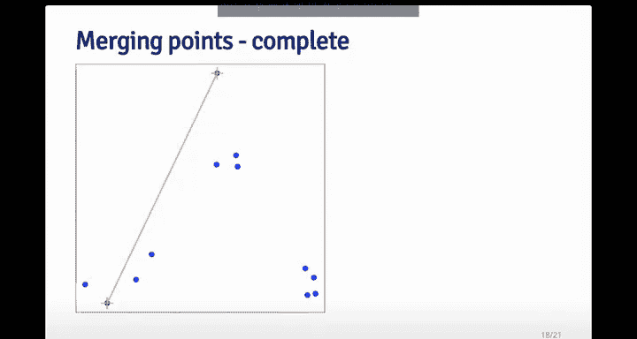

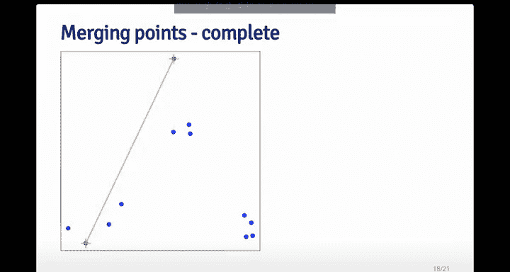

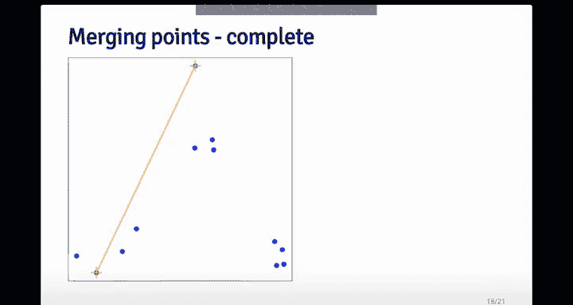

That distance is relatively far， whereas in the average linkage example。

 the distance is somewhat shorter， and so it's not like there's one right or run wrong way to do it。

 but the point is to ship that each of the two different merging approaches can give give you very different results and so it's it's often useful to try both approaches to see what kind of clustering results you get in the end and whether one set makes more sense than another。

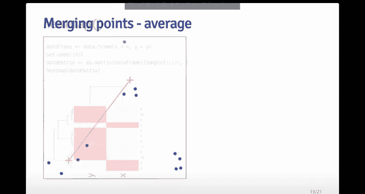

The last function I want to highlight here is the heat map function。

 which is a really nice function for visualizing matrix data。

 So if you have an extremely large table or a large matrix of numbers that are kind of similarly scaled and you want to just take a look at them really quickly in an organized way。

 you can call the heat map function and what the heat map function does is essentially runs a hierarchical cluster analysis on the rows of the table and on the columns of the table。

 So on the。😊，So if you can imagine the you know， the rows of the table are like observations。

 and then it runs a cluster analysis on the rows of the table and then think of the columns of the of the table as as sets of observations。

 even if they're not actually。Observations， the columns， for example。

 might be variables or something like that。 but think of them as just different observations。

 you can run a cluster analysis on that too。 And the idea with the heat map function is that it uses the hierarchical clustering function to organize the rows in the columns of the table so that you can visualize them you can visualize kind of groups or blocks of observations within the table using the image function。

 So what it does is it creates the image plot here here。

 and and it reorders the columns in the rows of the table according to the hierarchical clustering algorithm。

 So can here you can see that for example， along the rows。

 I've got this hierarchical this cluster denogram， which shows that there are probably you know three clusters and so those those rows are all grouped together and then there are only two columns in the data frame so it's not particularly interesting to do aer a hierarchical cluster analysis on that。

 But if you had many， many columns know you would reorganize the columns so that they would be kind of the closer ones would be closer together in the farther ones that be farther apart。

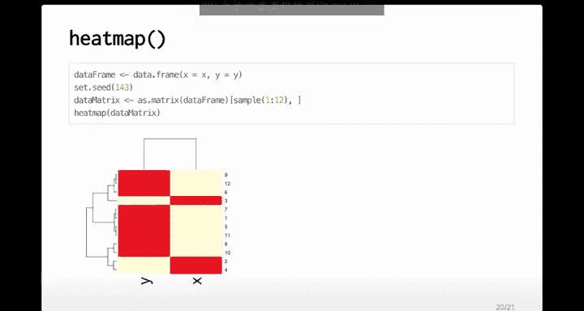

And so the heat mat function is really useful for a kind of or very quickly visualizing this kind of high dimensional table data。

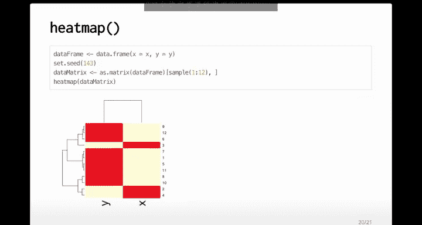

So just to summarize for a hierarchical clustering。

 it's a really useful technique for looking at high dimensional data。

 it organizes the data in a kind of logical and intuitive way and in particular functions like the heat map function are really useful for kind of looking for quickly looking at table or matrix data。

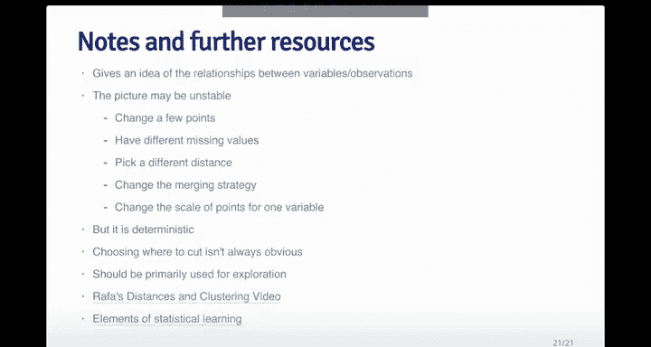

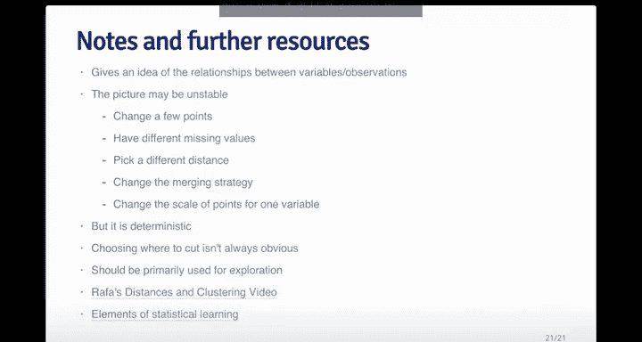

And so of course， you need to know you need to define a notion of what it means for two points to be close or far apart。

 and you have to have a merging strategy。 So we talked about complete linkage and average linkage。

 So given those two things you can run theerarch clustering algorithm will run and will produce a cluster dendrogram which shows you how the merging is done how the points got merged together through the algorithm So one of the couple of issues when it comes to hier clustering and this is often true for many clustering algorithms that the clustering picture may be unstable and so for example。

 if a few points were to change or for example， if you have some outliers then the clustering if you were to remove those points or modify them a little bit。

 then the clustering dendrogram or whatever the final product be could change a lot and so you have to be sensitive to that possibility So might often the useful things to try different metrics。

 distance metrics to make sure it's not to see how sensitive it is to the different distance metrics maybe change the merg。

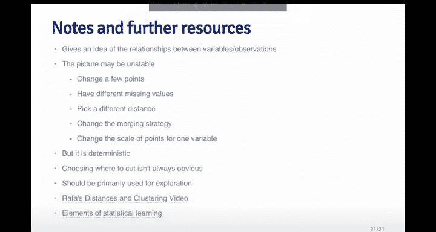

To see what kind of picture comes out if you change the me strategy and also clustering algorithms can be sensitive to the scalings of a given variable。

 So you might if one variable， for example， is measured with units that are much larger than another variable。

 then that can sometimes throw off the algorithm。 so it may be useful to scale certain variable so that they're more comparable to each other。

One nice thing about hierarchical clustering at least the algorithm was discussed here is that it is deterministic so there's no random starting point。

 there's no randomness in it if you run it once it will run and with the same parameters and the same data it will give you the same picture。

Of course， a key question in any clustering approach is is where to cut in the general ideas you know determining how many clusters there are it's not always obvious to figure out how many clusters there are and so but there are a number of algorithms that have been proposed to try to figure that out。

 but I think the best use of hierarchical clustering is probably just for exploratory analysis and just for looking at your data visualizing your data。

 getting a sense of what patterns so if there are any patterns at all。

 and then you can kind of take these ideas and formalize them later in more sophisticated models so I've given some links to kind of more details about these approaches and I encourage you to take a look at them to explore further。

