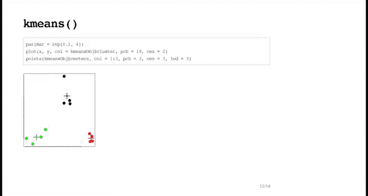
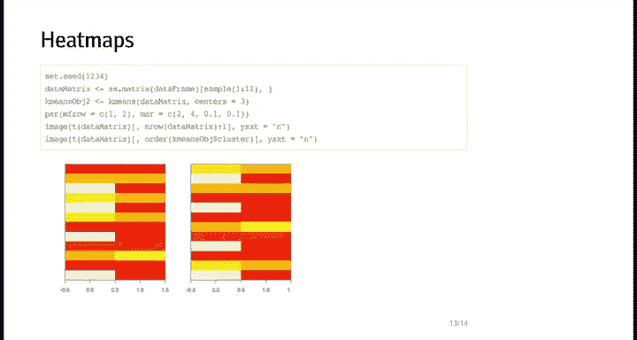
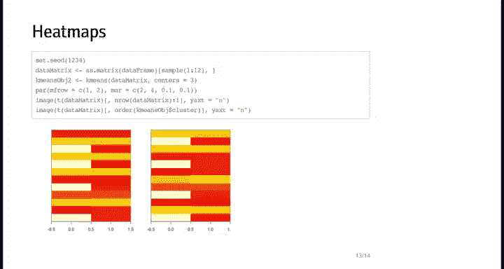
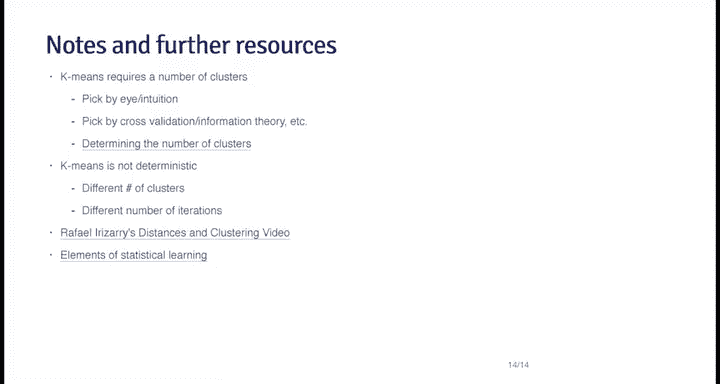

# 约翰霍普金斯大学《数据科学R语言基础｜Data Science： Foundations using R》中英字幕（deepseek - P126：26_K均值聚类第2部分.zh_en - GPT中英字幕课程资源 - BV1tsFQemEts

So in R， the K means function is the function that we use to implement the K means algorithm here。

 and I can demonstrate it here with using a simple data frame got with just two dimensions。

 and I called K meanss on the data frame and I tell it there are three centers or so three centroids。

And what Ka means returns is is a list with a number of different elements in it。 And so for example。

 probably the most important element is the cluster element。

 And you can see here when I print out the cluster element。

 you can see that it's a vector of numbers from one to3。

 So and what this shows is for each data point in in the data frame that I passed it。

 it tells me which cluster it's in。 So the first four points are in cluster 3 the next four are in cluster 1 and the next four are in cluster 2 you can see another element。

 if you look in the print out of the names another element of the object return from K meanss is called centers。

 and this tells you the location of the centroids in the space。

So if you want to plot kind of the results from K means。

 the first thing you can do you run the k means algorithm on your data and here I'm just going plot so the first thing I do is I plot the data so I plot Xy and then I color the data points according to the cluster that they happen to be in so you can see I pass the call argument to be equal to the cluster number and then I use the points function to kind of add the centers。

 the cluster centroids to the plot and I plot them using the plus symbol。

 so here I plotted the data and the K means clustering results。

SoFinally， another way that you can visualize clustering information for an algorithm like k means is by using the heat map function or looking at heat maps。

 I should say。 So here I've just I've using the same data。

 I take a different random sample of the data set。 I sampled a replacement。

 And I just run k means again again with three centers。

 and I stored an object called Ka means object too。 And now I'm gonna make an image plot of the data。

 So the first plot on the left here is just an image of the original data。

 And then on the right hand side， I've reordered the。

The columns of the data I'm should I say the rows of the data frame so that the clusters are kind of put together so here you can see that if you go up and down up and down this matrix。

 you'll see the data points are clustered together so that they're next to each other and so you can use this to look at high dimensionsal data in high dimensionsal image type data or matrix type data where you can reorganize the rows in the columns and kind of look at clusters that are cluster together or farther apart and so look at your kind of matrix data in an organized way so you can so you can look for patterns we'll talk a little bit about this more when we talk about hierarchical clusterings but you can use heat map type of visualizations with other types of clustering algorithms like K means two so just to summarize K means is handy algorithm for organizing and looking for patterns and high dimensional data a couple things it requires that you know the number of clusters。

So you have to specify at least roughly speaking how many clusters there are you can kind of play with that a little bit to figure out kind what pattern probably looks the best。

 but there's no easy rule there and then so you have to kind of pick those clusters out by eye or through some other mechanism there are a few algorithms for kind of determining the number of clusters using cross validation information theory。

 other types of metrics and so here's a link to determining the number of clusters and and the K means algorithm is not deterministic so depending on how it's implemented there can be sometimes those starting points are chosen at random so it's often useful to run the K means algorithm a couple times just to make sure you're not getting a very unstable finishing point so for example if you run at three different times and every time you get a totally different pattern then that means that the algorithm may not be have a very stable kind of view of the data and so K means。

can be problematic in that way with certain types of data sets and here I've got a couple links kind of to videos and references on that provide a lot more information about canings。

