# 约翰霍普金斯大学《数据科学R语言基础｜Data Science： Foundations using R》中英字幕（deepseek - P127：27_降维第1部分.zh_en - GPT中英字幕课程资源 - BV1tsFQemEts

Principple components analysis and the singular value decomposition are really important techniques。

 both in the exploratory data analysis phase and also in the more kind of formal modeling phase。

 the techniques can be used very easily in both stages。

 I'm going to talk a little bit about how it's used in the exploratory phase and I want to talk kind what goes on underneath and kind of what their underlying basis is。

So if you look suppose we have some matrix data here and I've just generated some random normal data here using this code right here。

 and you can see that the matrix that I plotted here using the image function is not particularly interesting。

 It looks pretty noisy and there's no real pattern as we would expect there to not be。

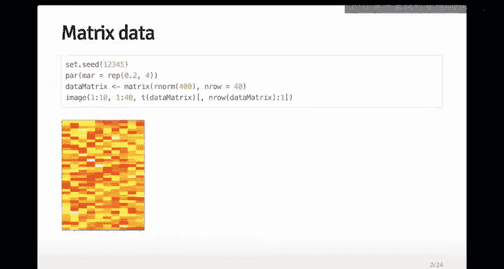

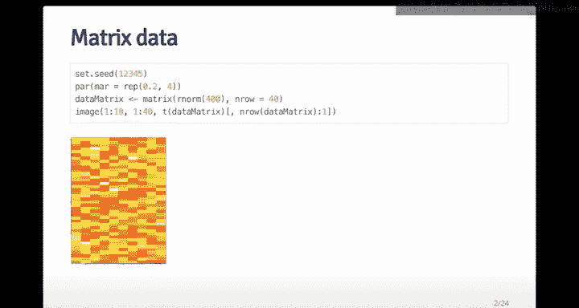

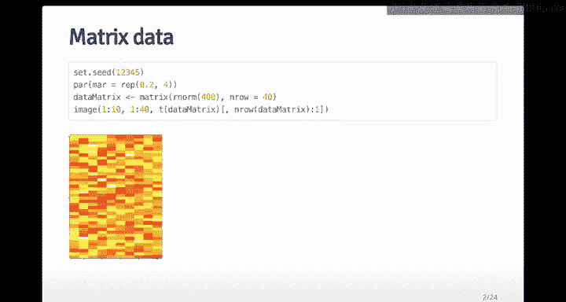

Now I could just run a hierarchicalical cluster analysis on this data set。

 I I can do a cluster analysis on the rows of the data frame or the rows of the matrix and the columns of the matrix。

 and I can do this using the heat map function very easily in R。 So when I run the heat map function。

 you can see that the cluster analysis is done， I get the dendrograms printed on both the columns in the rows。

 But again， there's no real interesting pattern that emerges。

 and that's because there's no real interesting pattern underlying in the data。

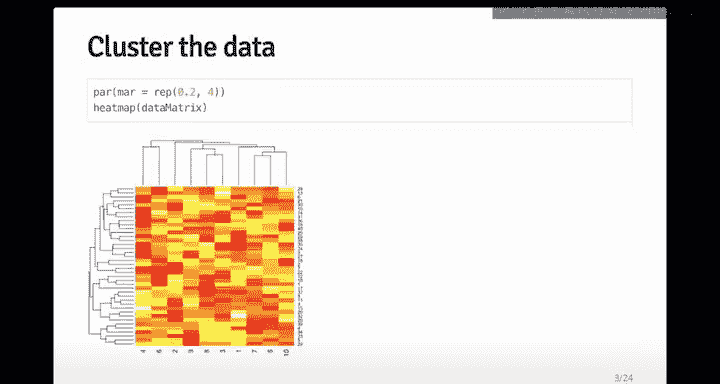

So so that's fine。 But now what if we add a pattern to the dataset set。

 So let's try to add something and I do it with this code here， this for loop here。

 So I loop through all the rows and on a random row。

 I flip a coin and if it turns out to be a one I just add a pattern I so that five of the columns have a mean of0 and the other five have a mean of three So I just kind of add a little shift here across the columns So now if I plot the data you can see that there the right on the right hand five columns are a little bit more yellow。

 which means they have a higher value then the left hand five columns which which are a little bit more red which means they have a lower value。

 that's because some of the rows。

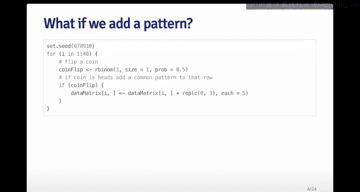

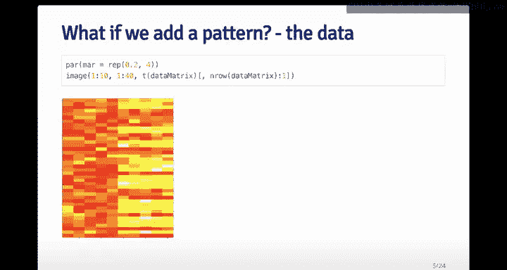

Have a mean of three on the right hand side， and some of the rows only have a mean of0 on the right hand side。

 So you can see there's an obvious kind of step pattern there。

So now if I do if I run hierarchcoical cluster analysis on the data， you can see that that the。

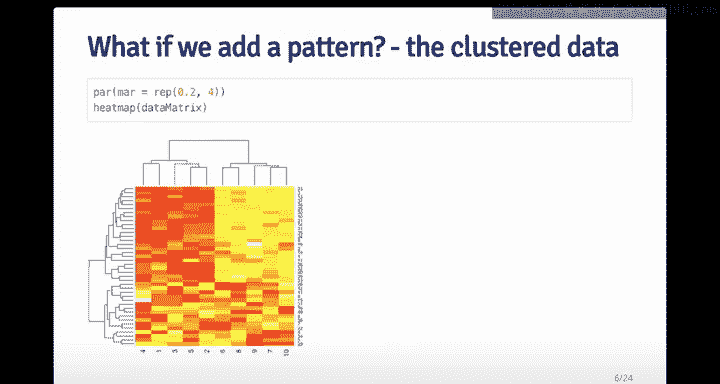

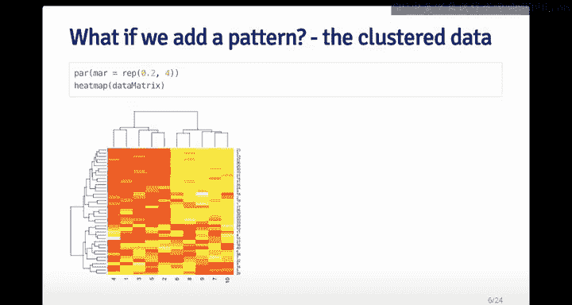

The two sets of columns are easily separated out。 So you can see the dendrogram on the top of the matrix。

 which which is run on the columns。 see clearly splits into two clusters。 There's 5 on the left。

 and there's 5 on the right on the rows is' not so obvious because there's no real pattern and that goes along the rows。

 And so that kind of gets reorganized into a random pattern。 and。

And that's the picture that emerges from the heat map。

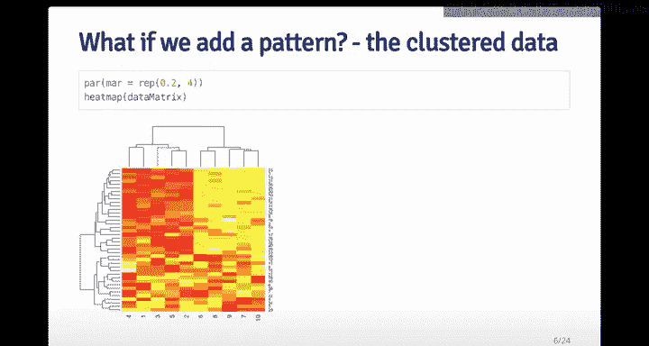

Now we could take a look at a closer look at the patterns in the rows and the columns by looking at the kind of the marginal means the of the rows and columns。

 So， for example， I can look at either the。

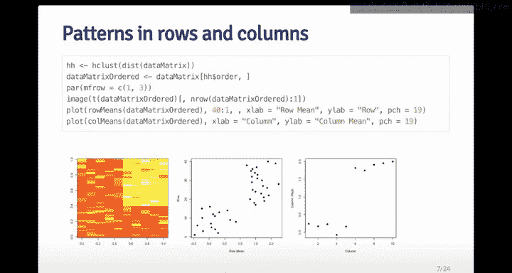

10 different column means， or I can plot the 40 different row means in this matrix。

 So here with this code， that's exactly what I've done on the left hand plot。

 I got the original matrix data。That's been kind of that's been reordered to look according to the kind of hierarchical cluster analysis the of the rows。

And and and I've plotted in the middle plot here， the mean for each of the rows。

 if you look on the y axis， I've got the row number which goes from 1 to 40。

 so that kind of is roughly parallel with the image on the left and and on the x axis I've got the mean of that row。

 So for example， you can see that for row 10， the mean is roughly know minus 0。

25 or something like that。 and that for row 30， the mean is roughly 1。

5 And so you can see that there's a clear shift。In the mean as you go across the rows， Similarlyly。

 if you go across the columns， you can see across the 10 columns。

 there's a clear shift in the mean of each column。 So the first 10 columns have roughly a mean of0 or close to it and then the next 10 columns have roughly a mean of two because there's a shift there。

 So using the plots on in the middle and the right you can see a clear pattern in the rows in the columns there。

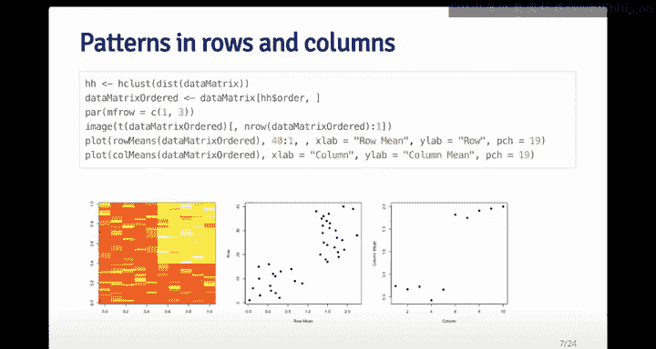

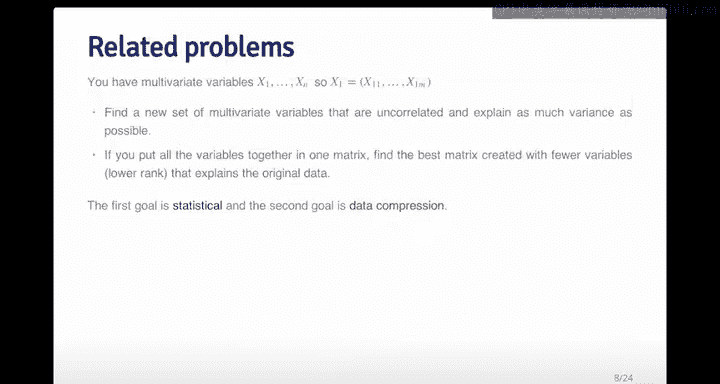

So some related problems so cluster analysis is useful for kind of identifying these types of patterns。

 but we can maybe take a little more a slightly more formal approach that kind of takes advantage of the matrix structure of the data and so the base there are two kinds kinds of problems we might want to look at so if you have a lot of variables and。

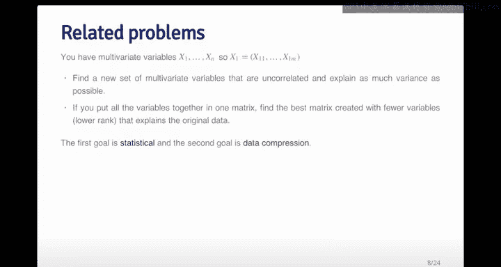

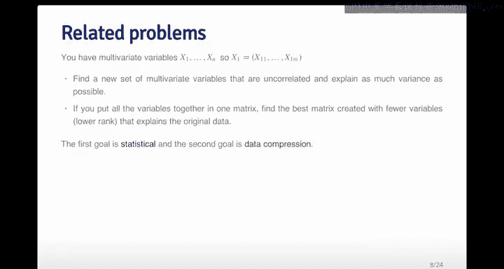

We to want to create a new set of variables that are uncorrelated and explain as much variance as possible。

 So the idea is that we have a lot of different variables。

 So suppose we have know hundreds or maybe thousands or tens of thousands of variables in our data。

 And the idea is that they're not all independent thing measurements of something right so a lot of them will be related to each other that'll be correlated with each other。

 for example， you might have two measurements that are like height and weight And so those will obviously be related to each other。

 And so they're not all independent kind of factors。

 so the idea is that we want to create a set of variables that is smaller than the original set of variables that we have and that are all uncorrelated with each other so that they kind of represent different types of variation in your dataset。

And similarly， we want this reduced set of variables to explain as much of the variability in your data set as possible。

So another related problem is that if you put all the variables together in one matrix。

 so like the matrix that we showed in the image， you want to find the best matrix that's created with fewer variables but still explains the original data So the idea is that more technical term is that you want to find the lower rank matrix that somehow explains the original data reasonably well So the first goal here is a statistical one and it's a common problem that's solved by the method of principal components analysis and the second goal here is more of a kind of data compression problem where you want to find a kind of smaller representation of the original data and one way to think about that problem is with the singular value decomposition。

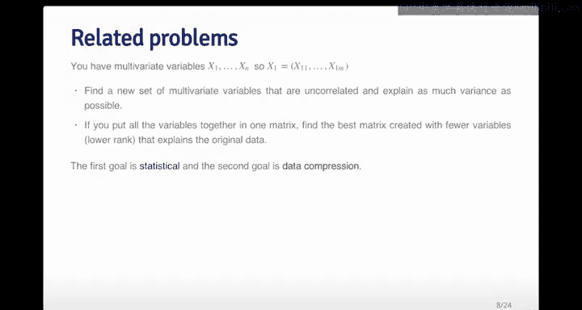

So the singular value de compositionposition can be written in mathematical terms in matrix terms as if you have a matrix X where we can think of each column in this matrix as a variable or a measurement and each row of the matrix as an observations so you might have many。

 many observations for a given matrix， so for example。

 the rows of the matrix might represent individual people and each column would represent a measurement on those people。

 so for example， the first column might be the height and the second column might be the weight。

So then the idea is that if you have a matrix X that's formatted in this way。

 then the singular value decomposition or the SVD is a matrix decomposition which decomposes the original matrix into three separate matrices。

 one is called U， one is called D and the other called V and so the columns of U are orthogonal。

 so they're independent of each other， they're called the left singular vectors and the columns of V are also orthogonal and they're called the right singular vectors and then D is a diagonal matrix which contains the singular values。

So that's the basic idea of the singular value decomposition I'll talk about these components a little bit later on Pri components analysis also usually known as PCA is it uses the singular value decomposition and is a related technique and the basic idea is that if you were to take your original data matrix and subtract the mean of each column from each so subtract the column mean from each column and divide by the column standard deviation and then run an SVD on that kind of renormalized matrix the principal components would be equal to the right singular values of the matrix so the V matrix。

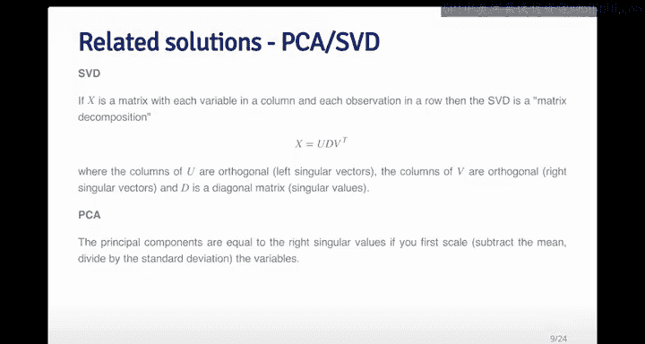